<div dir="rtl" align="right">

# راه‌حل‌های مقیاس‌پذیری و بار بالا

<p align="center">
  <a href="https://www.oreilly.com/library/view/foundations-of-scalable/9781098106058/">
    
  </a>
</p>

این مخزن مسیر آموزشی و عملی خود را بر اساس کتاب *Foundations of Scalable Systems* نوشتهٔ Ian Gorton می‌چیند. در این README خلاصهٔ مستقل هر ۱۶ فصل، لینک درس‌های کامل، و فهرست همهٔ راه‌حل‌های موجود و پیشنهادی را می‌بینید. خلاصه‌ها با بیان خودمان نوشته شده‌اند؛ این صفحه همراه مطالعه است، نه جایگزین کتاب.

**وضعیت مهم:** در حال حاضر فقط راه‌حل رویدادمحور فصل ۱۴ به‌صورت کامل و قابل‌اجرا در مخزن موجود است. بقیهٔ موارد در ادامه طرح یا مسیر پیشنهادی‌اند، نه نرم‌افزار آماده. عدد ۱۰۰٬۰۰۰ فرمان سبد در ثانیه هدف ظرفیت‌سنجی است، نه نتیجهٔ اثبات‌شدهٔ production؛ فرمان سبد با checkout تکمیل‌شده یا رزرو موجودی یکی نیست.

## فهرست

- [روش استفاده از مخزن](#روش-استفاده-از-مخزن)
- [مرور کتاب و خلاصهٔ فصل‌به‌فصل](#مرور-کتاب-و-خلاصهٔ-فصل‌به‌فصل)
- [فهرست کامل راه‌حل‌ها](#فهرست-کامل-راه‌حل‌ها)
- [راهنماهای طراحی و فناوری](#راهنماهای-طراحی-و-فناوری)
- [روش مقایسهٔ راه‌حل‌ها](#روش-مقایسهٔ-راه‌حل‌ها)
- [نقشهٔ مخزن](#نقشهٔ-مخزن)

## روش استفاده از مخزن

۱. خلاصهٔ فصل را در همین صفحه بخوانید و بعد برای آموزش، مثال، تمرین و منابع بیشتر به راهنمای همان فصل بروید.
۲. راه‌حلی را انتخاب کنید که پرسش طراحی فصل را بررسی می‌کند و قبل از اجرا وضعیتش را ببینید.
۳. قرارداد کسب‌وکار و workload را بین گزینه‌ها یکسان نگه دارید و هر بار فقط یک تصمیم معماری اصلی را تغییر دهید.
۴. محیط اجرا و نتیجهٔ خام را ثبت کنید. اسم فناوری، تعداد replica تنظیم‌شده یا نرخ هدف، مدرک ظرفیت نیست.

فهرست رسمی و معرفی ناشر در [صفحهٔ O’Reilly کتاب](https://www.oreilly.com/library/view/foundations-of-scalable/9781098106058/) است. نقشهٔ فصل‌ها و راهنماهای تفصیلی را به [نسخهٔ انگلیسی](docs/SCALABILITY-ROADMAP-EN.md) و [نقشهٔ فارسی](docs/SCALABILITY-ROADMAP-FA.md) ببینید.

## مرور کتاب و خلاصهٔ فصل‌به‌فصل

ترتیب کتاب از رشد سیستم و مبانی توزیع و هم‌روندی شروع می‌شود، سراغ طراحی سرویس و پایگاه‌داده می‌رود، سپس پیام‌رسانی و پردازش جریان را بررسی می‌کند و در پایان به خودکارسازی، مشاهده‌پذیری، بستر استقرار و دادهٔ تاریخی می‌پردازد.

### بخش اول — مبانی

#### ۱. مقدمه‌ای بر سیستم‌های مقیاس‌پذیر
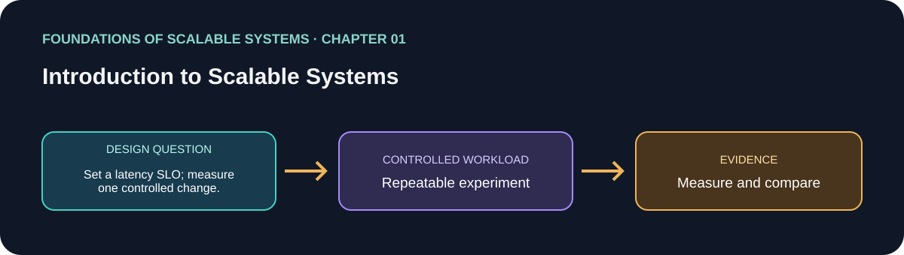


مقیاس‌پذیری یعنی سرویس با رشد یک بُعد مشخص از بار—مثل درخواست هم‌زمان، حجم داده یا پردازش—رفتار مفیدش را حفظ کند. ظرفیت کل با سرعت یک درخواست یکی نیست. فصل تکثیر و بهینه‌سازی را دو ابزار مکمل می‌داند: تکثیر ظرفیت موازی می‌افزاید اما هماهنگی می‌خواهد؛ بهینه‌سازی از منابع فعلی کار بیشتری می‌گیرد اما ممکن است گلوگاه را جابه‌جا کند. رشد هزینهٔ اقتصادی و عملیاتی دارد و باید کارایی، دسترس‌پذیری، امنیت و مدیریت‌پذیری را با هم سنجید. نقطهٔ شروع، تعریف workload و SLO و هزینه و یافتن گلوگاه با اندازه‌گیری است.

**کاربرد:** پیش از تغییر معماری، بار و هدف latency/خطا را مشخص و baseline بسازید. [راهنمای فصل](solutions/01-introduction-to-scalable-systems/README.fa.md) · [English](solutions/01-introduction-to-scalable-systems/README.md)

#### ۲. آشنایی با معماری سیستم‌های توزیع‌شده
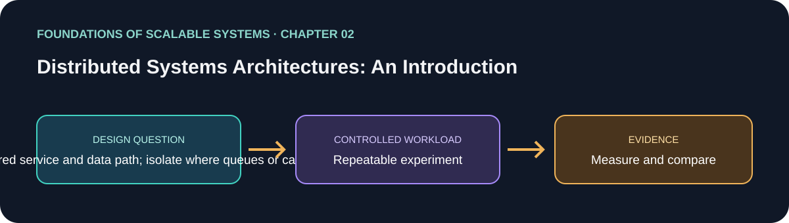


فصل از معماری سادهٔ client، برنامه و پایگاه‌داده شروع می‌کند و به scale-out می‌رسد. replicaهای سرویس پشت load balancer می‌توانند پردازش برنامه را تقسیم کنند، اما پایگاه‌دادهٔ مشترک همچنان ممکن است گلوگاه باشد. cache، توزیع داده و اضافه‌کردن لایه‌های پردازشی، مسیر درخواست را تغییر می‌دهند. انتقال کار از مسیر همگام می‌تواند پاسخ را سریع‌تر کند، ولی معنای «پذیرفته شد» را از «کار تمام شد» جدا می‌کند و queue، lag و بازیابی می‌خواهد. ظرفیت سخت‌افزار و کل سامانه بخشی از طراحی است، نه صرفاً جزئیات استقرار.

**کاربرد:** تغییر همگام سبد را با مسیر لایه‌ای یا صف‌محور زیر workload یکسان مقایسه کنید. [راهنمای فصل](solutions/02-distributed-systems-architectures/README.fa.md) · [English](solutions/02-distributed-systems-architectures/README.md)

#### ۳. مبانی سیستم‌های توزیع‌شده
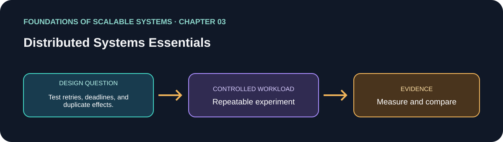


فراخوانی راه‌دور با فراخوانی تابع محلی فرق دارد: serialization، تأخیر شبکه، رفتار protocol و شکست جزئی وارد قرارداد می‌شوند. Timeout فقط می‌گوید caller دیگر منتظر نیست؛ ثابت نمی‌کند عملیات دوردست انجام نشده. پس retry به deadline، backoff و اثر idempotent نیاز دارد. فصل consensus را به‌عنوان توافق میان گره‌ها با وجود شکست توضیح می‌دهد و یادآوری می‌کند ساعت‌ها و timestampها ترتیب جهانی و قطعی نمی‌سازند. این مفاهیم علت درخواست تکراری، نتیجهٔ نامعلوم و ضرورت recovery را در برنامهٔ توزیع‌شده روشن می‌کنند.

**کاربرد:** timeout و restart را به mutation تزریق کنید و ثابت کنید retry اثر تکراری ایجاد نمی‌کند. [راهنمای فصل](solutions/03-distributed-systems-essentials/README.fa.md) · [English](solutions/03-distributed-systems-essentials/README.md)

#### ۴. مروری بر سیستم‌های هم‌روند
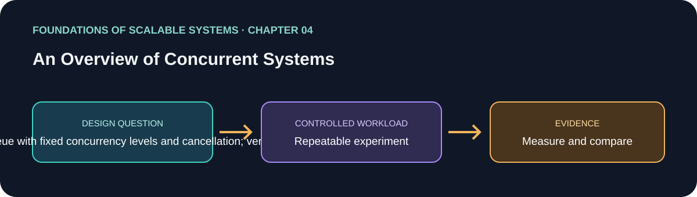


Concurrency یعنی چند کار در بازه‌ای هم‌پوشان پیش بروند؛ parallelism یعنی کارها واقعاً هم‌زمان روی چند واحد پردازشی اجرا شوند. ترتیب اجرای threadها قطعی نیست. state مشترک می‌تواند race condition بسازد و ترتیب ناهماهنگ گرفتن قفل‌ها deadlock ایجاد کند. وضعیت‌های thread، ابزارهای هماهنگی، thread pool، barrier و collectionهای هم‌روند هرکدام مسئلهٔ خاصی را حل می‌کنند و چندعملیاتی را خودکار امن نمی‌کنند. صف محدود و backpressure مانع رشد بی‌نهایت حافظه و thread در زمان overload می‌شود.

**کاربرد:** worker با concurrency محدود را با صف نامحدود مقایسه کنید و throughput، حافظه، contention و tail latency را بسنجید. [راهنمای فصل](solutions/04-overview-of-concurrent-systems/README.fa.md) · [English](solutions/04-overview-of-concurrent-systems/README.md)

### بخش دوم — سیستم‌های مقیاس‌پذیر

#### ۵. سرویس‌های برنامه
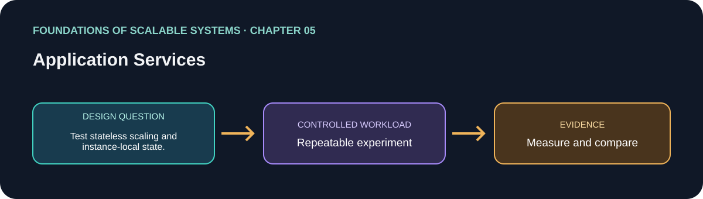


طراحی سرویس با قرارداد API، مالکیت state و رفتار زیر بار شروع می‌شود. Application server منابعی مثل worker و connection pool دارد که باید محدود و ظرفیت‌سنجی شوند. replicaهای افقی وقتی کمک می‌کنند که درخواست‌ها قابل‌تقسیم باشند و وابستگی مشترک ظرفیت داشته باشد. Load balancer با policy ترافیک را توزیع می‌کند و health و elasticity در این تصمیم دخیل‌اند. Session affinity می‌تواند session وابسته به یک replica را نگه دارد اما جابه‌جایی کار و recovery را محدود می‌کند. Readiness می‌گوید نمونه ترافیک بگیرد یا نه؛ liveness برای تشخیص گیرکردن و restart است.

**کاربرد:** API را تا جای ممکن stateless کنید، poolها را محدود کنید و مشخص کنید کدام لایه اول اشباع می‌شود. [راهنمای فصل](solutions/05-application-services/README.fa.md) · [English](solutions/05-application-services/README.md)

#### ۶. Caching توزیع‌شده
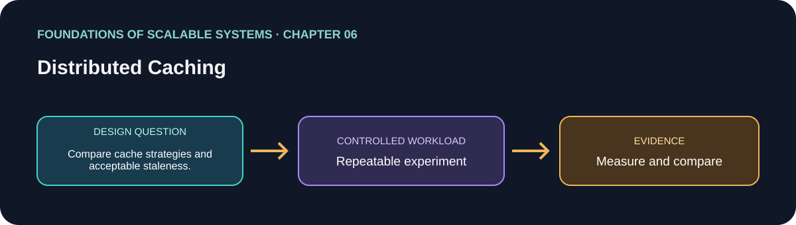


Cache برنامه محاسبه یا خواندن تکراری را کم می‌کند؛ cache وب و CDN انتقال تکراری به origin را کاهش می‌دهد. Cache زمانی مفید است که hit rate، تازگی، invalidation و رفتار خرابی با قرارداد داده جور باشد. HTTP caching با `Cache-Control` و `Expires` سیاست تازگی را می‌دهد و `Last-Modified` و `ETag` اعتبارسنجی شرطی را ممکن می‌کنند. Invalidations، دادهٔ قدیمی، هجوم هم‌زمان به کلید داغ، حریم خصوصی و بار fallback روی منبع اصلی باید طراحی و اندازه‌گیری شوند.

**کاربرد:** baseline بدون cache را با cache-aside مقایسه کنید و انقضا، invalidation و خرابی cache را آزمایش کنید. [راهنمای فصل](solutions/06-distributed-caching/README.fa.md) · [English](solutions/06-distributed-caching/README.md)

#### ۷. پیام‌رسانی ناهمگام
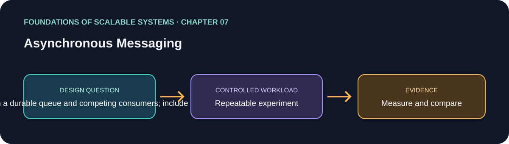


Messaging تولیدکننده را از مصرف‌کننده جدا و جهش ورودی را جذب می‌کند، اما primitiveهای آن معنای متفاوت دارند. Queue، publish/subscribe، ماندگاری و replication روی تحویل، دسترس‌پذیری و latency اثر دارند. مثال RabbitMQ تفاوت exchange، binding و queue را نشان می‌دهد؛ competing consumer کار را تقسیم می‌کند و subscriber مستقل نسخهٔ رویداد را می‌گیرد. Exactly-once باید محدود به یک broker یا اثر مشخص تعریف شود: مصرف‌کننده می‌تواند بین commit دیتابیس و تأیید پیام crash کند. Idempotency، retry محدود و مدیریت poison message برای اثر کسب‌وکار لازم‌اند.

**کاربرد:** بین ثبت اثر و acknowledgment خرابی ایجاد کنید و ایمنی replay و جداسازی poison message را بسنجید. [راهنمای فصل](solutions/07-asynchronous-messaging/README.fa.md) · [English](solutions/07-asynchronous-messaging/README.md)

#### ۸. سامانه‌های پردازش Serverless
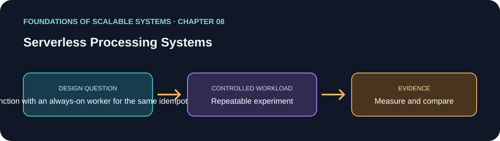


بستر serverless بخش زیادی از provisioning و واکنش به بار را مدیریت می‌کند و برای کارهای bursty یا نامنظم جذاب است. فصل Google App Engine و AWS Lambda، چرخهٔ اجرا، autoscaling و محدودیت‌های عملیاتی را بررسی می‌کند. state محلی تابع بادوام نیست و cold start، سقف concurrency، timeout و ظرفیت دیتابیس پایین‌دست روی رفتار نهایی اثر می‌گذارند. مطالعهٔ throughput و cost تأکید می‌کند چند پارامتر را با هم بسنجیم: بیشترین نرخ invocation اگر latency از SLO بگذرد یا دیتابیس را overload کند، انتخاب موفقی نیست.

**کاربرد:** function صف‌محور را با worker همیشه‌فعال زیر arrival pattern، concurrency و هزینهٔ یکسان مقایسه کنید. [راهنمای فصل](solutions/08-serverless-processing-systems/README.fa.md) · [English](solutions/08-serverless-processing-systems/README.md)

#### ۹. Microservices
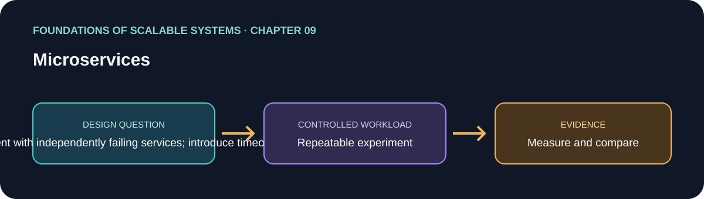


Microserviceها سیستم را به سرویس‌های مستقل در deploy تقسیم می‌کنند، اما مرز شبکه، مالکیت داده و هزینهٔ عملیات می‌سازند. فصل monolith، شکستن سیستم و اصول استقرار سرویس‌ها را بررسی می‌کند. تاب‌آوری یعنی کنترل cascading failure: وابستگی کند می‌تواند thread، connection و بودجهٔ retry را در چند سرویس مصرف کند. Bulkhead ظرفیت را ایزوله می‌کند تا یک مسیر خراب تمام منابع را نگیرد. مرزها باید بر پایهٔ قابلیت کسب‌وکار و مالکیت داده انتخاب شوند، نه فقط جداسازی کلاس‌ها.

**کاربرد:** مرزهای basket/order را ترسیم و timeout، retry، bulkhead و خرابی وابستگی را آزمایش کنید. [راهنمای فصل](solutions/09-microservices/README.fa.md) · [English](solutions/09-microservices/README.md)

### بخش سوم — پایگاه‌داده‌های توزیع‌شدهٔ مقیاس‌پذیر

#### ۱۰. مبانی پایگاه‌دادهٔ مقیاس‌پذیر
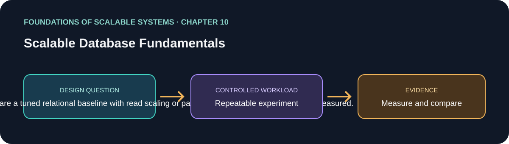


پایگاه‌دادهٔ رابطه‌ای را می‌توان با ماشین بزرگ‌تر، replica خواندنی و partition رشد داد؛ هر روش محدودیت و هزینهٔ سازگاری خود را دارد. Partitioning ممکن است افقی یا عمودی باشد و sharding بخش‌ها را بین nodeها پخش می‌کند؛ در نتیجه کلید، join و جابه‌جایی داده مهم می‌شوند. Oracle RAC نمونهٔ shared-everything است و shared-nothing داده و پردازش را طور دیگری توزیع می‌کند. NoSQL خانواده‌ای شامل key-value، document، wide-column و graph با مدل query و توزیع متفاوت است. CAP انتخاب در زمان partition شبکه است، نه قانون «همیشه دو مورد از سه مورد».

**کاربرد:** ابتدا baseline رابطه‌ای بسازید، bottleneck را اندازه بگیرید و سپس replica، partition یا مدل NoSQL مناسب الگوی دسترسی را مقایسه کنید. [راهنمای فصل](solutions/10-scalable-database-fundamentals/README.fa.md) · [English](solutions/10-scalable-database-fundamentals/README.md)

#### ۱۱. سازگاری نهایی
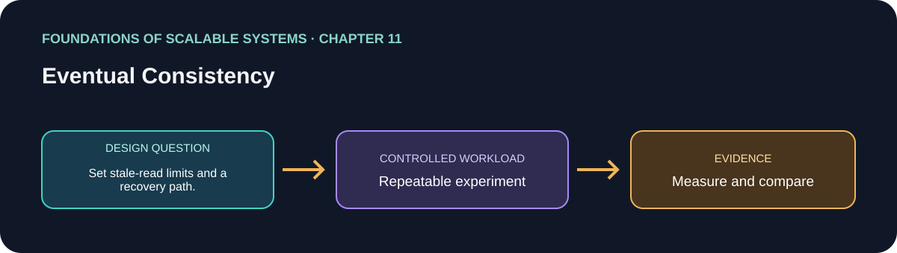


Replicaها ممکن است موقتاً مقدارهای متفاوت برگردانند؛ سازگاری نهایی یعنی اگر update متوقف شود و repair موفق شود، داده‌ها همگرا می‌شوند. پنجرهٔ ناسازگاری و read-your-own-writes رفتار قابل‌دیدن کاربر است و باید تعریف شود. Tunable consistency و quorum read/write latency و دسترس‌پذیری را با احتمال اشتراک مجموعهٔ replicaها مبادله می‌کنند. Active و passive repair راه‌های متفاوت رفع divergence هستند. تعارض هم policy می‌خواهد: last-write-wins ساده است اما ممکن است update درست را حذف کند؛ version vector هم‌زمانی را نشان می‌دهد تا merge دامنه‌ای انجام شود.

**کاربرد:** stale read مجاز را مشخص کنید، replica lag را اندازه بگیرید و update هم‌زمان سبد را آزمایش کنید. [راهنمای فصل](solutions/11-eventual-consistency/README.fa.md) · [English](solutions/11-eventual-consistency/README.md)

#### ۱۲. سازگاری قوی
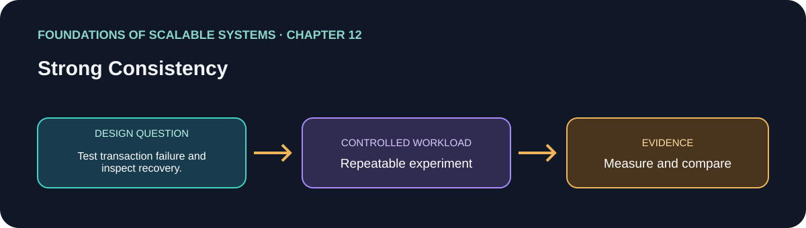


مدل‌های strong consistency تعریف می‌کنند عملیات میان replicaها چطور مرتب به نظر برسند. تراکنش توزیع‌شده participantها را هماهنگ می‌کند؛ Two-Phase Commit ممکن است participant آماده را هنگام خرابی coordinator منتظر بگذارد. Consensus مثل Raft روی log تکثیرشده توافق می‌کند و برای پیشروی به quorum و انتخاب رهبر نیاز دارد. این سازوکارها مسئلهٔ یکسانی حل نمی‌کنند. مثال‌های VoltDB و Google Cloud Spanner طراحی‌های عملی متفاوت را نشان می‌دهند، ولی تضمین قوی هزینهٔ latency، دسترس‌پذیری و عملیات دارد.

**کاربرد:** invariant لازم برای consistency قوی را بنویسید و یک تراکنش محلی را زیر خرابی با گزینهٔ توزیع‌شده مقایسه کنید. [راهنمای فصل](solutions/12-strong-consistency/README.fa.md) · [English](solutions/12-strong-consistency/README.md)

#### ۱۳. پیاده‌سازی‌های پایگاه‌دادهٔ توزیع‌شده
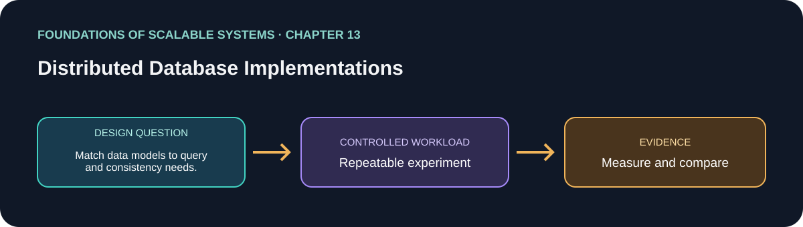


Redis، MongoDB و DynamoDB مدل و API متفاوت دارند و جایگزین‌های مستقیم هم نیستند. Redis بر ساختارهای سریع و keyمحور تکیه می‌کند؛ MongoDB سند را ذخیره و query می‌کند؛ DynamoDB دسترسی را بر اساس partition key و sort key با توزیع مدیریت‌شده طراحی می‌کند. Replication، durability، consistency و رفتار خرابی به topology، تنظیم و نوع عملیات وابسته‌اند. مقایسهٔ معتبر باید عملیات و قرارداد صحت را ثابت نگه دارد و query، latency، throughput، بازیابی و هزینهٔ عملیات را بسنجند.

**کاربرد:** یک update تکرارپذیر سبد را در هر مدل پیاده کنید و persistence، conditional write و recovery واقعی را مقایسه کنید. [راهنمای فصل](solutions/13-distributed-database-implementations/README.fa.md) · [English](solutions/13-distributed-database-implementations/README.md)

### بخش چهارم — پردازش رویداد و جریان داده

#### ۱۴. پردازش رویدادمحور مقیاس‌پذیر
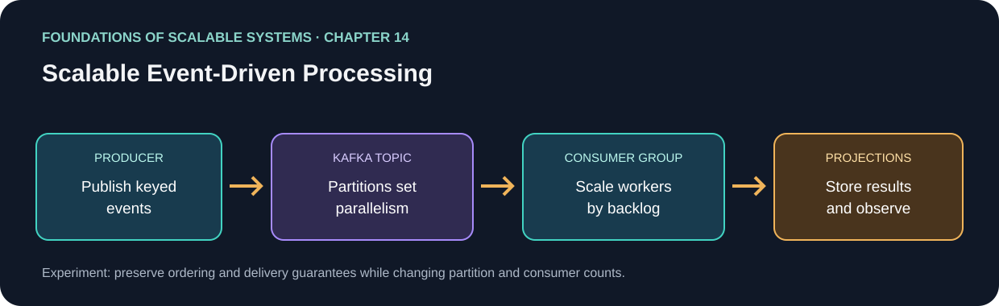


معماری رویدادمحور واقعیت‌های رخ‌داده را منتشر می‌کند تا مصرف‌کننده‌های مستقل از تولیدکننده جدا باشند. Kafka رکوردها را در logهای partitionشده نگه می‌دارد؛ producer کلید می‌فرستد، consumer offset نگه می‌دارد و consumer group کار partitionها را تقسیم می‌کند. ترتیب درون partition است، نه سراسری. Partition بیشتر می‌تواند موازی‌سازی را زیاد کند اما broker resource می‌خواهد و محل کلیدهای آینده را هم تحت‌تأثیر می‌گذارد. Replication، ISR، acknowledgment، retention و rebalance روی دوام و دسترس‌پذیری اثر دارند. Consumer معمولاً اثر at-least-once می‌دهد؛ پس side effect دیتابیس باید idempotent یا هماهنگ تراکنشی باشد. Kafka پیام را نگه می‌دارد، منطق کسب‌وکار را برنامه اجرا می‌کند.

**کاربرد:** پیاده‌سازی فعلی فرمان‌های سبد را به Kafka می‌فرستد، workerها projection و رزرو را انجام می‌دهند، Redis مدل خواندن و PostgreSQL state تراکنشی را نگه می‌دارند و Kubernetes workload را اداره می‌کند. این تنها راه‌حل اجرایی فعلی است. [درس کامل فصل](solutions/14-scalable-event-driven-processing/CHAPTER-GUIDE-FA.md) · [راهنمای اجرا](solutions/14-scalable-event-driven-processing/README.fa.md) · [English](solutions/14-scalable-event-driven-processing/README.md)

#### ۱۵. سامانه‌های پردازش Stream
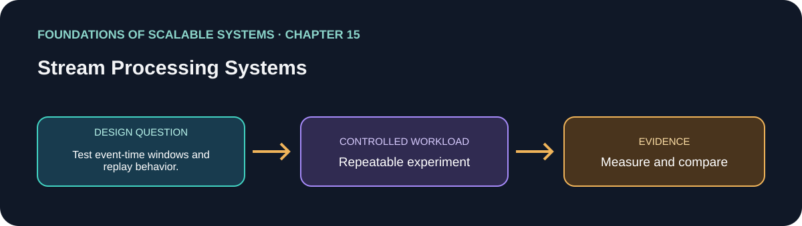


Stream processing جریان نامحدود رویداد را به‌صورت مداوم با state، window و join تبدیل می‌کند. Batch، Lambda و Kappa در تازگی نتیجه، replay و تکرار منطق متفاوت‌اند. DataStream API در Flink operator، event-time window، state و checkpoint می‌دهد. موازی‌سازی به partition منبع، توزیع key، CPU و sink وابسته است و skew یک کلید می‌تواند یک task را bottleneck کند. Checkpoint بازیابی را کمک می‌کند ولی exactly-once روی sink بیرونی به transaction یا idempotency نیاز دارد.

**کاربرد:** وقتی window زمانی، join یا aggregation stateful واقعاً لازم است یک job تحلیلی اضافه کنید؛ Flink را مرجع رزرو موجودی نکنید. [راهنمای فصل](solutions/15-stream-processing-systems/README.fa.md) · [English](solutions/15-stream-processing-systems/README.md)

#### ۱۶. توصیه‌های پایانی برای موفقیت
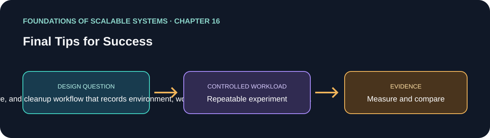


فصل پایانی مقیاس‌پذیری را به automation، observability، deployment platform و data lake وصل می‌کند. build و استقرار تکرارپذیر ریسک تغییر دستی را کم می‌کنند؛ metric، log و trace وقتی مفیدند که به هدف عملیاتی و هشدار قابل اقدام وصل شوند. VM، container، PaaS، serverless و Kubernetes هزینهٔ isolation و عملیات متفاوت دارند؛ هیچ‌کدام به‌تنهایی برنامه را scalable نمی‌کنند. Data lake دادهٔ تاریخی چندقالبی را برای تحلیل نگه می‌دارد و به catalog، lineage، دسترسی و retention نیاز دارد؛ این کار با query تراکنشی کم‌تأخیر OLTP فرق دارد. معماری را باید با تغییر بار و فناوری بازنگری کرد.

**کاربرد:** استقرار و recovery را خودکار کنید، وابستگی‌ها را instrument کنید و هر نتیجه را با سخت‌افزار و تنظیماتش نگه دارید. [راهنمای فصل](solutions/16-final-tips-for-success/README.fa.md) · [English](solutions/16-final-tips-for-success/README.md)

## فهرست کامل راه‌حل‌ها

### پیاده‌سازی قابل‌اجرا

| راه‌حل | اجزا | وضعیت |
|---|---|---|
| **Scalable Event-Driven Processing**، فصل ۱۴ | وب‌اپ React؛ API و producer با .NET؛ processor سبد و موجودی؛ Kafka؛ projection در Redis؛ state تراکنشی در PostgreSQL؛ Docker Compose؛ پروفایل‌های آموزشی و Performance روی Kind/Kubernetes؛ Prometheus و exporterها؛ workloadهای k6 | پیاده‌سازی شده. پیش‌نیاز و اجرا در [README راه‌حل](solutions/14-scalable-event-driven-processing/README.fa.md) است. |

عدد ۱۰۰٬۰۰۰ فرمان سبد در ثانیه تا پیش از اجرای پایدار و تکرارپذیر روی سخت‌افزار مشخص فقط هدف ظرفیت‌سنجی است. فرمان سبد پذیرفته‌شده را جدا از checkout تکمیل‌شده و رزرو موجودی گزارش کنید. پروفایل محلی یا سقف scale پیکربندی‌شده اثبات ظرفیت production نیست.

### طراحی‌های مستقل آمادهٔ شروع پیاده‌سازی

چهار [طرح قابل‌پیاده‌سازی](docs/IMPLEMENTABLE-SOLUTION-BLUEPRINTS-FA.md) قرارداد سبد/سفارش مشترکی دارند تا بتوان آن‌ها را منصفانه مقایسه کرد:

| طراحی | جریان اصلی | چه چیزی را می‌سنجد | وضعیت |
|---|---|---|---|
| **A. مبنای همگام رابطه‌ای** | API بدون state محلی → تراکنش PostgreSQL؛ cache اختیاری Redis | latency مسیر مستقیم، صحت transaction و اشباع pool/DB | فقط طرح |
| **B. Workerهای Kafka** | API → topicهای کلیددار Kafka → consumer group → Redis/PostgreSQL | جذب burst، ترتیب هر کلید، lag، replay و اثر ایمن در برابر duplicate | در راه‌حل فصل ۱۴ پیاده‌سازی شده |
| **C. Transactional Outbox + CDC** | تراکنش business و outbox در PostgreSQL → CDC → Kafka → consumer idempotent | انتشار مطمئن رویداد از دیتابیس بدون شکاف dual-write برنامه | فقط طرح |
| **D. Event Sourcing** | command با version شرطی → event store افزایشی → projectionها | تاریخچهٔ audit، بازسازی state، snapshot و rebuild مدل خواندن | فقط طرح |

مسیرهای مستقل دیگر:

- **مقیاس پایگاه‌داده:** بهینه‌سازی query و index در PostgreSQL، read replica و partitioning؛ گونهٔ هم‌ارز MySQL؛ مدل document در MongoDB؛ کلیدمحور در DynamoDB؛ cache و projection در Redis؛ و آزمایش Cassandra، distributed SQL، graph، search یا ذخیره‌ساز تحلیلی فقط وقتی workload توجیه کند.
- **پردازش جریانی stateful:** Kafka → Flink یا Kafka Streams → نتیجهٔ window/join. این مسیر تحلیل است، نه جایگزین تراکنش رزرو موجودی.
- **Worker serverless:** function صف‌محور را با worker دائم برای بار bursty بسنجید؛ concurrency و connectionهای پایین‌دست را محدود کنید و cold start و هزینهٔ هر عملیات موفق را ثبت کنید.
- **گونه‌های زبان/runtime:** همان قرارداد API یا worker را با C#/.NET، Go، Rust، Scala/JVM، Elixir/BEAM یا Node.js پیاده‌سازی و مقایسه کنید. این‌ها مسیر پیشنهادی‌اند و فعلاً پیاده‌سازی‌شده نیستند.

هر راه‌حل انتخاب‌شده باید پوشهٔ مستقل `solutions/<name>/` با README، کد، وابستگی، زیرساخت، workload، دستور اجرا و پاک‌سازی، محدودیت‌ها و نتیجهٔ اندازه‌گیری‌شده یا برچسب روشن «اندازه‌گیری نشده» داشته باشد.

## راهنماهای طراحی و فناوری

- [راهنمای جامع طراحی سیستم — English](docs/SYSTEM-DESIGN-MASTER-EN.md) · [فارسی](docs/SYSTEM-DESIGN-MASTER-FA.md)
- [طرح‌های قابل پیاده‌سازی سبد و سفارش — English](docs/IMPLEMENTABLE-SOLUTION-BLUEPRINTS-EN.md) · [فارسی](docs/IMPLEMENTABLE-SOLUTION-BLUEPRINTS-FA.md)
- [راهنمای خانواده‌های پایگاه‌داده و پیاده‌سازی](docs/DATABASE-FAMILIES-IMPLEMENTATION-GUIDE-FA.md)
- [راهنمای مدل‌های concurrency و زبان‌های برنامه‌نویسی](docs/CONCURRENCY-LANGUAGES-AND-APPROACHES-FA.md)
- [راهنمای رویکردهای معماری](docs/ARCHITECTURAL-APPROACHES-PLAYBOOK-FA.md)
- [نقشهٔ فصل‌ها و پیاده‌سازی — English](docs/SCALABILITY-ROADMAP-EN.md) · [فارسی](docs/SCALABILITY-ROADMAP-FA.md)

## روش مقایسهٔ راه‌حل‌ها

هر گونه باید قرارداد قابل‌مشاهدهٔ یکسانی حفظ کند: command تکرارپذیر؛ ترتیب فقط جایی که business لازم دارد؛ موجودی منفی نشود؛ رزرو چندقلمی همه‌یا‌هیچ؛ وضعیت کار ناهمگام مشخص؛ و تازگی projection تعریف‌شده باشد. در هر اجرا ثبت کنید:

- throughput و تعداد عملیات کسب‌وکار موفق در ثانیه؛
- latency در p50/p95/p99 و نرخ خطا/timeout؛
- CPU، حافظه، connection pool، lag broker و اشباع storage/network؛
- duplicate effect، ازدست‌رفتن داده، سازگاری پس از restart/failover و زمان recovery؛
- نسخهٔ runtime و dependency، سخت‌افزار، configuration، شکل workload و هزینه.

سامانه‌هایی با semantics متفاوتِ داده، retry، durability یا تکمیل کار را با هم مقایسه نکنید. نتیجهٔ خام و فرمان دقیق اجرا را کنار راه‌حل نگه دارید.

## نقشهٔ مخزن

```text
README.md                         راهنمای اصلی انگلیسی، خلاصهٔ کتاب و فهرست راه‌حل‌ها
README.fa.md                      نسخهٔ فارسی راهنمای ریشه
docs/                             طراحی سیستم و راهنماهای فناوری مشترک
solutions/01-... تا 16-...        راهنمای فصل‌ها و تصویرهای مفهومی
solutions/14-...                  برنامهٔ اجرایی فعلی Kafka/Kubernetes
```

</div>
