# Scalability and High-Load Solutions

<p align="center">
  <a href="https://www.oreilly.com/library/view/foundations-of-scalable/9781098106058/">
    
  </a>
</p>

This repository is a practical learning path based on Ian Gorton's *Foundations of Scalable Systems*. This README contains an original, chapter-by-chapter synthesis of the book's ideas, links to the detailed guides, and a catalog of runnable and proposed solutions. The summaries are written in our own words; they are a study companion, not a replacement for the book.

**Important status:** the event-driven Kafka application in Chapter 14 is the only complete runnable solution currently in the repository. Other entries below are designs or implementation tracks, not software that has already been built. The 100,000 basket commands/second figure is a planning target, not a verified production result; basket commands are not the same workload as completed checkouts or inventory reservations.

## Contents

- [How to use this repository](#how-to-use-this-repository)
- [Book overview and chapter-by-chapter guide](#book-overview-and-chapter-by-chapter-guide)
- [Complete solution catalog](#complete-solution-catalog)
- [Shared design and technology guides](#shared-design-and-technology-guides)
- [How we compare solutions](#how-we-compare-solutions)
- [Repository map](#repository-map)

## How to use this repository

1. Read the short chapter synthesis below, then open the chapter guide for the full Persian/English teaching material, examples, exercises, and references.
2. Choose a solution that tests the design question. Check its status before assuming it can be run.
3. Keep the business contract and workload the same across variants. Change one major architectural choice at a time.
4. Record the environment and raw results. A technology choice, configured replica count, or target throughput is not evidence that a capacity target has been reached.

The publisher's [official book page](https://www.oreilly.com/library/view/foundations-of-scalable/9781098106058/) contains the book description and full contents. Detailed chapter guides are available in [English](docs/SCALABILITY-ROADMAP-EN.md) and [فارسی](docs/SCALABILITY-ROADMAP-FA.md).

## Book overview and chapter-by-chapter guide

The book moves from system growth and distributed-system fundamentals, through service and database architectures, and then to event and stream processing. Its closing chapters connect architecture to automation, observability, deployment platforms, and historical-data management.

### Part I — The Basics

#### 1. Introduction to Scalable Systems
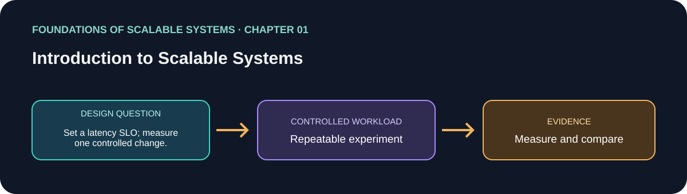


Scalability means keeping useful service behavior as a chosen workload dimension grows, such as concurrent requests, data volume, or analysis volume. The chapter distinguishes capacity from the speed of one request and presents replication and optimization as complementary tools: replication adds parallel capacity but coordination; optimization extracts more work from existing resources but may move the bottleneck. Growth planning also has economic and operational costs. Performance, availability, security, and manageability must be considered together rather than traded away invisibly. The practical starting point is to define workload, growth, service objectives, cost limits, and a measured bottleneck.

**Apply it:** define one workload and its latency/error objectives before tuning or adding infrastructure. [Chapter guide](solutions/01-introduction-to-scalable-systems/README.md) · [فارسی](solutions/01-introduction-to-scalable-systems/README.fa.md)

#### 2. Distributed Systems Architectures: An Introduction
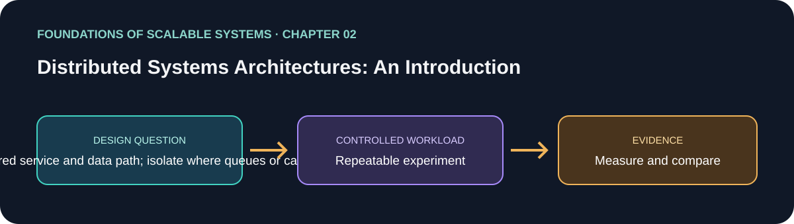


The chapter builds from a basic client, application, and database system toward scale-out architectures. It explains how replicas behind a load balancer distribute application work, why a shared database can remain the bottleneck, and how caching, data distribution, and additional processing tiers change the request path. Responsiveness can be improved by moving work off the synchronous path, but asynchronous work changes what an acceptance response means and introduces queues, lag, and recovery concerns. Hardware and system-level capacity are part of the design, not details to consider only after deployment.

**Apply it:** compare a simple synchronous basket update with a tiered or queued path using the same workload. [Chapter guide](solutions/02-distributed-systems-architectures/README.md) · [فارسی](solutions/02-distributed-systems-architectures/README.fa.md)

#### 3. Distributed Systems Essentials
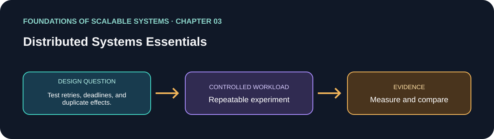


Remote communication differs from a local function call: serialization, network latency, protocol behavior, and partial failure become part of the contract. A timeout means the caller stopped waiting; it does not prove the remote operation did not happen. Retries therefore need deadlines, backoff, and idempotent effects. The chapter introduces consensus as agreement under failure and explains why clocks and timestamps cannot be treated as a universal ordering mechanism across machines. These fundamentals explain duplicate requests, unknown outcomes, and recovery behavior in every distributed application.

**Apply it:** inject timeout and restart failures into a mutation and prove that retry cannot create a duplicate effect. [Chapter guide](solutions/03-distributed-systems-essentials/README.md) · [فارسی](solutions/03-distributed-systems-essentials/README.fa.md)

#### 4. An Overview of Concurrent Systems
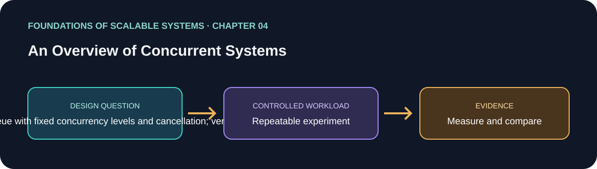


Concurrency lets multiple tasks make progress in overlapping time; parallelism means work is executing simultaneously on multiple processing units. Threads provide one implementation model, but scheduling order is nondeterministic. Shared mutable state can cause race conditions; inconsistent lock ordering can cause deadlocks. Thread states, coordination primitives, pools, barriers, and thread-safe collections each address specific problems and do not make multi-step business operations automatically safe. Bounded work queues and backpressure prevent overload from becoming unbounded memory growth or excessive thread creation.

**Apply it:** compare bounded worker concurrency with an unbounded queue while measuring throughput, memory, contention, and tail latency. [Chapter guide](solutions/04-overview-of-concurrent-systems/README.md) · [فارسی](solutions/04-overview-of-concurrent-systems/README.fa.md)

### Part II — Scalable Systems

#### 5. Application Services
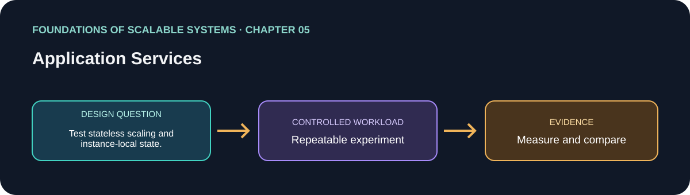


Service design starts with clear API contracts, state ownership, and predictable behavior under load. Application servers use bounded resources such as worker and connection pools; horizontal replicas help only when requests can be distributed and shared dependencies have capacity. Load balancers use policies to choose endpoints, monitor health, and support elasticity. Session affinity can preserve a session tied to one replica, but it reduces freedom to move work and complicates failure handling. Readiness and liveness answer different questions: whether an instance should receive traffic and whether it should be restarted.

**Apply it:** make API instances stateless where possible, bound pools, and measure whether the database or the service tier saturates first. [Chapter guide](solutions/05-application-services/README.md) · [فارسی](solutions/05-application-services/README.fa.md)

#### 6. Distributed Caching
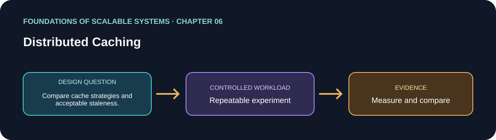


Application caches reduce repeated computation or data reads; web caches and CDNs reduce repeated transfers to origin services. A cache is useful only when its hit rate, freshness, invalidation behavior, and failure mode fit the data contract. HTTP caching provides explicit controls such as `Cache-Control` and `Expires`, while `Last-Modified` and `ETag` allow conditional validation. Cache invalidation, stale reads, hot-key stampedes, privacy boundaries, and fallback load on the source system must be designed and measured.

**Apply it:** compare a no-cache baseline with a cache-aside read path and test expiration, invalidation, and cache outage. [Chapter guide](solutions/06-distributed-caching/README.md) · [فارسی](solutions/06-distributed-caching/README.fa.md)

#### 7. Asynchronous Messaging
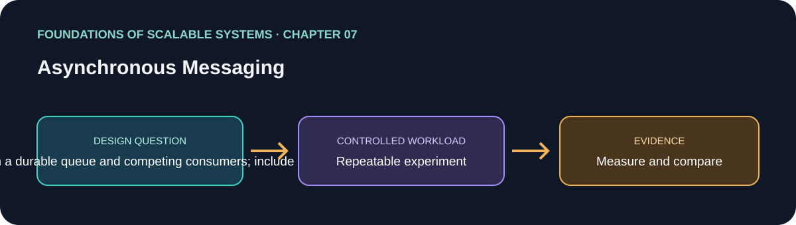


Messaging decouples producers from consumers and can absorb bursts, but message primitives have different semantics. Queues, publish/subscribe, persistence, replication, and acknowledgment affect delivery, availability, and latency. The RabbitMQ example distinguishes exchanges, bindings, and queues; competing consumers distribute work, while independent subscribers receive events separately. “Exactly once” must be scoped to a broker or a specific effect: a consumer can crash between committing a database change and acknowledging a message. Idempotency, bounded retries, and poison-message handling are needed for reliable business effects.

**Apply it:** force a crash between the durable effect and the acknowledgment, then prove replay is safe and poison messages do not block the queue. [Chapter guide](solutions/07-asynchronous-messaging/README.md) · [فارسی](solutions/07-asynchronous-messaging/README.fa.md)

#### 8. Serverless Processing Systems
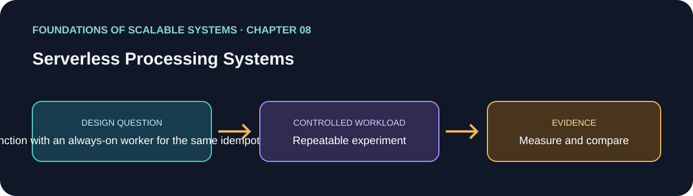


Serverless platforms manage much of the compute provisioning and scale response, which can be attractive for intermittent or bursty work. The chapter compares Google App Engine and AWS Lambda, including execution lifecycle, scaling behavior, and operational constraints. A function's local process state cannot be treated as durable, and cold starts, concurrency limits, timeouts, and downstream connection capacity affect the real system. The throughput-and-cost case study emphasizes measuring parameters together: maximizing invocation rate alone can violate latency objectives or overwhelm a database.

**Apply it:** compare a queue-triggered function with an always-on worker under the same arrival pattern, bounded concurrency, and cost accounting. [Chapter guide](solutions/08-serverless-processing-systems/README.md) · [فارسی](solutions/08-serverless-processing-systems/README.fa.md)

#### 9. Microservices
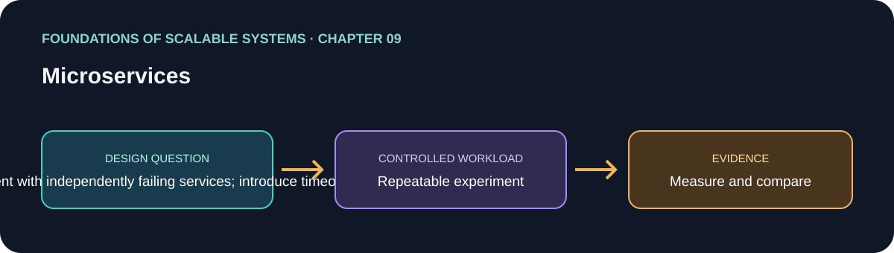


Microservices split a system into independently deployable services, but decomposition creates network calls, data ownership boundaries, and operational overhead. The chapter contrasts monoliths and service decomposition, then covers service principles and deployment. Resilience requires handling cascading failures: slow dependencies can consume threads, connections, and retry budgets across a call chain. Bulkheads isolate capacity so one failing path cannot consume every resource. Service boundaries should follow independently owned business capabilities and data, not merely code organization.

**Apply it:** map the basket/order boundaries and test timeout, retry, bulkhead, and downstream-failure behavior. [Chapter guide](solutions/09-microservices/README.md) · [فارسی](solutions/09-microservices/README.fa.md)

### Part III — Scalable Distributed Databases

#### 10. Scalable Database Fundamentals
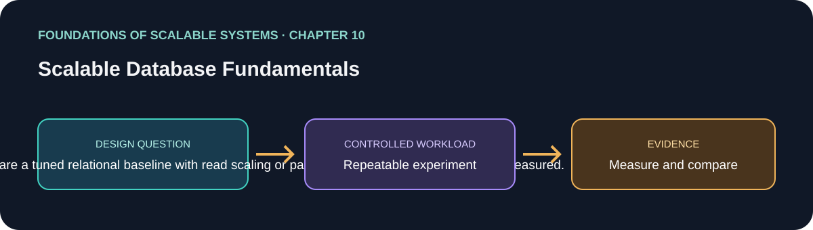


Relational systems can scale up, serve selected reads from replicas, and partition data; each approach has different limits and consistency costs. Partitioning can be horizontal or vertical, while sharding distributes partitions across nodes and makes key choice, joins, and data movement central concerns. Oracle RAC illustrates a shared-everything cluster; shared-nothing systems distribute compute and data differently. NoSQL is a family of key-value, document, wide-column, and graph models with query and distribution trade-offs. CAP is a lens on behavior during network partition, not a permanent “pick any two” rule.

**Apply it:** begin with a relational baseline, measure the bottleneck, then compare replicas, partitions, or an access-pattern-specific NoSQL model. [Chapter guide](solutions/10-scalable-database-fundamentals/README.md) · [فارسی](solutions/10-scalable-database-fundamentals/README.fa.md)

#### 11. Eventual Consistency
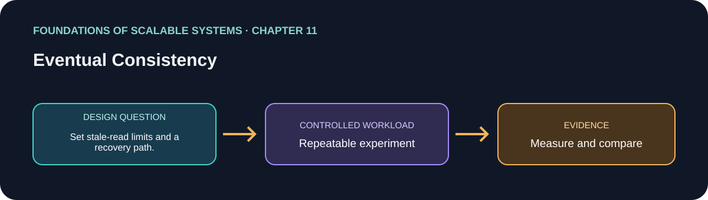


Replicas can temporarily return different values; eventual consistency means replicas converge if updates stop and repair succeeds. The inconsistency window and read-your-own-writes behavior are user-visible properties that must be specified. Tunable consistency and quorum reads/writes change latency, availability, and the chance that read and write sets overlap. Active and passive repair address divergence differently. Concurrent updates need a conflict policy: last-writer-wins is simple but may discard a valid update, while version vectors can reveal concurrency and allow a domain-specific merge.

**Apply it:** document which reads may be stale, measure replica lag, and test conflict resolution with concurrent basket updates. [Chapter guide](solutions/11-eventual-consistency/README.md) · [فارسی](solutions/11-eventual-consistency/README.fa.md)

#### 12. Strong Consistency
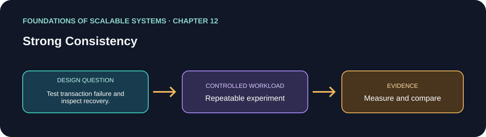


Strong consistency models define how operations appear ordered across clients and replicas. Distributed transactions coordinate participants; two-phase commit can leave prepared participants waiting if the coordinator fails. Consensus protocols such as Raft agree on a replicated log and require a quorum for progress, with leader election as part of recovery. These mechanisms solve different coordination problems. The chapter's VoltDB and Google Cloud Spanner examples show practical system designs, while reinforcing that strong guarantees have latency, availability, and operational costs.

**Apply it:** state the invariant that requires strong consistency, then compare one local transaction with a distributed transaction or quorum-based design under failure. [Chapter guide](solutions/12-strong-consistency/README.md) · [فارسی](solutions/12-strong-consistency/README.fa.md)

#### 13. Distributed Database Implementations
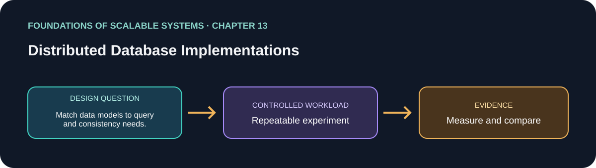


Redis, MongoDB, and DynamoDB demonstrate different data models and access APIs rather than interchangeable “NoSQL” engines. Redis centers on fast key-based structures; MongoDB stores and queries documents; DynamoDB models access around partition and sort keys with managed distribution. Their replication, durability, consistency, and failure behavior depend on topology, configuration, and operation type. A meaningful comparison keeps the business operation and correctness contract constant, then measures query behavior, latency, throughput, recovery, and operational cost.

**Apply it:** implement the same idempotent basket update in each model and compare its actual persistence, conditional-write, and recovery guarantees. [Chapter guide](solutions/13-distributed-database-implementations/README.md) · [فارسی](solutions/13-distributed-database-implementations/README.fa.md)

### Part IV — Event and Stream Processing

#### 14. Scalable Event-Driven Processing
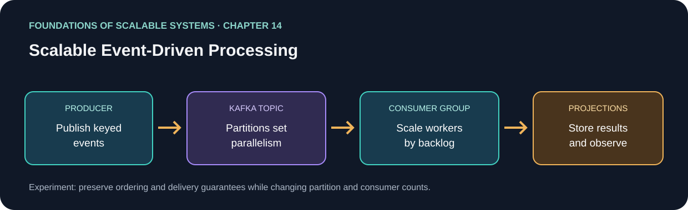


Event-driven systems publish facts for independent consumers. Kafka stores records in partitioned logs; producers select keys, consumers track offsets, and consumer groups divide partition work. Ordering is per partition, not global. More partitions increase parallelism but consume broker resources and affect future key placement. Replication, in-sync replicas, acknowledgments, retention, and rebalances determine availability and durability behavior. Consumers often provide at-least-once effects, so database side effects must be idempotent or transactionally coordinated. Kafka transports and stores events; application workers implement business rules.

**Apply it:** the current solution uses Kafka for basket commands, workers for projections/reservations, Redis for a read model, PostgreSQL for transactional inventory, and Kubernetes for workload scaling. It is the only runnable solution today. [Full chapter guide](solutions/14-scalable-event-driven-processing/CHAPTER-GUIDE-FA.md) · [Implementation README](solutions/14-scalable-event-driven-processing/README.md) · [فارسی](solutions/14-scalable-event-driven-processing/README.fa.md)

#### 15. Stream Processing Systems
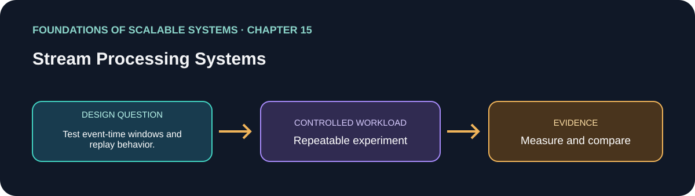


Stream processing continuously transforms unbounded event flows, often with keyed state, windows, and joins. Batch, Lambda, and Kappa approaches differ in freshness, replay strategy, and whether batch and streaming logic are duplicated. Apache Flink's DataStream API provides operators, event-time windows, state, and checkpoints. Parallelism depends on source partitions, key distribution, CPU, and sink capacity; skew can leave one task as the bottleneck. Checkpoints support recovery, but exactly-once effects at an external sink still require compatible transactions or idempotency.

**Apply it:** add a windowed analytics job only when the workload needs event-time aggregation or stateful joins; do not use it as the inventory authority. [Chapter guide](solutions/15-stream-processing-systems/README.md) · [فارسی](solutions/15-stream-processing-systems/README.fa.md)

#### 16. Final Tips for Success
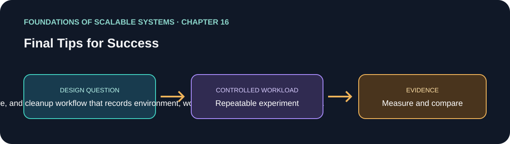


The closing chapter connects scalability with automation, observability, deployment platforms, and data lakes. Repeatable build and deployment pipelines reduce risky manual work; metrics, logs, and traces provide operational visibility when tied to actionable objectives. Virtual machines, containers, PaaS, serverless, and Kubernetes offer different isolation and operating costs, but none makes an application scalable by itself. Data lakes retain heterogeneous historical data for analysis, with catalog, lineage, access, retention, and lifecycle requirements distinct from low-latency OLTP. Architecture remains a hypothesis that should be revisited as workload and technology change.

**Apply it:** automate deployment and recovery drills, instrument dependencies, and keep measured results with hardware and configuration. [Chapter guide](solutions/16-final-tips-for-success/README.md) · [فارسی](solutions/16-final-tips-for-success/README.fa.md)

## Complete solution catalog

### Runnable implementation

| Solution | What is included | Status |
|---|---|---|
| **Scalable Event-Driven Processing** (Chapter 14) | React storefront; .NET API and Kafka producer; basket and inventory workers; Kafka; Redis projection; PostgreSQL transactional state; Docker Compose; Kind/Kubernetes Lab and Performance profiles; Prometheus/exporters; k6 workload | Implemented. Run instructions and limitations are in the [solution README](solutions/14-scalable-event-driven-processing/README.md). |

The 100,000 basket commands/second figure is a planning target until a sustained, reproducible run on named hardware proves it. Report basket commands accepted separately from checkouts completed and inventory reservations. A local profile or configured scale limit is not production-capacity evidence.

### Independent designs ready to implement

The repository's four [implementable blueprints](docs/IMPLEMENTABLE-SOLUTION-BLUEPRINTS-EN.md) use one shared basket/order contract so they can be compared fairly:

| Design | Core flow | What it tests | Status |
|---|---|---|---|
| **A. Synchronous relational baseline** | Stateless API → PostgreSQL transaction; optional Redis cache | Direct request latency, transaction correctness, pool/DB saturation | Design only |
| **B. Kafka workers** | API → keyed Kafka topics → consumer groups → Redis/PostgreSQL | Burst absorption, per-key ordering, consumer lag, replay, duplicate-safe effects | Implemented in the Chapter 14 solution |
| **C. Transactional outbox + CDC** | PostgreSQL business transaction + outbox → CDC → Kafka → idempotent consumers | Reliable database-to-event publication without an application dual-write gap | Design only |
| **D. Event Sourcing** | Version-checked command → append-only event store → projections | Audit history, state reconstruction, snapshots, projection rebuild | Design only |

Additional independent solution tracks:

- **Database scaling:** PostgreSQL query/index tuning, read replicas and partitioning; MySQL as an equivalent relational variant; MongoDB document model; DynamoDB key-first access; Redis cache/projection; selected Cassandra, distributed SQL, graph, search, and analytical-store experiments when a workload justifies them.
- **Stateful stream analytics:** Kafka → Flink or Kafka Streams → windowed/joined output. This is an analytics path, not a replacement for transactional inventory reservation.
- **Serverless worker:** compare queue-triggered functions with always-on workers for bursty workloads; bound concurrency and downstream connections, and measure cold starts and cost per successful operation.
- **Runtime/language variants:** implement the same API or worker contract in C#/.NET, Go, Rust, Scala/JVM, Elixir/BEAM, or Node.js. These are proposed comparisons, not implementations currently present. Compare equivalent semantics and workload before making performance claims.

Each selected solution must live in an independent `solutions/<name>/` folder with its own README, code, dependencies, infrastructure, workload, setup/cleanup, limitations, and measured results or an explicit “not measured” label.

## Shared design and technology guides

- [System Design master guide — English](docs/SYSTEM-DESIGN-MASTER-EN.md) · [فارسی](docs/SYSTEM-DESIGN-MASTER-FA.md)
- [Implementable basket/order blueprints — English](docs/IMPLEMENTABLE-SOLUTION-BLUEPRINTS-EN.md) · [فارسی](docs/IMPLEMENTABLE-SOLUTION-BLUEPRINTS-FA.md)
- [Database families and implementation guidance — فارسی](docs/DATABASE-FAMILIES-IMPLEMENTATION-GUIDE-FA.md)
- [Concurrency models and programming languages — فارسی](docs/CONCURRENCY-LANGUAGES-AND-APPROACHES-FA.md)
- [Architectural approaches playbook — فارسی](docs/ARCHITECTURAL-APPROACHES-PLAYBOOK-FA.md)
- [Chapter and implementation roadmap — English](docs/SCALABILITY-ROADMAP-EN.md) · [فارسی](docs/SCALABILITY-ROADMAP-FA.md)

## How we compare solutions

Every variant should preserve the same observable contract: idempotent commands; ordering where the business requires it; no negative inventory; all-or-nothing multi-item reservation; explicit status for asynchronous work; and a documented freshness limit for projections. For each run, record:

- throughput and successful business operations per second;
- p50/p95/p99 latency and error/timeout rates;
- CPU, memory, connection pools, broker lag, storage/network saturation;
- duplicate effects, data loss, consistency after restart/failover, and recovery time;
- deployment/runtime versions, hardware, configuration, workload shape, and cost.

Do not compare systems with different data, retry, durability, or completion semantics. Keep raw results and exact run commands alongside the solution.

## Repository map

```text
README.md                         This book guide and complete solution catalog
README.fa.md                      Persian version of the root guide
docs/                             Shared system-design and technology playbooks
solutions/01-... through 16-...  Chapter study guides and chapter diagrams
solutions/14-...                  The current runnable Kafka/Kubernetes application
```
