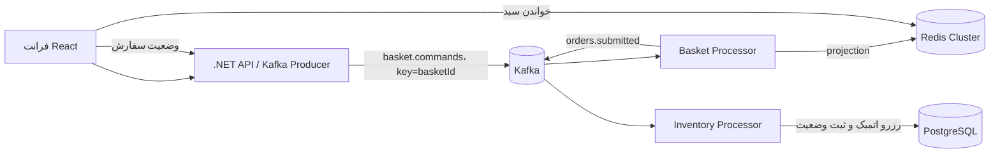

<div dir="rtl" align="right">

# پردازش‌گر پرفورمنس سبد و سفارش


<p align="center"><em>نمای تصویری معماری؛ برای جزئیات و trade-offها، راهنماهای مرتبط را دنبال کنید.</em></p>

نمونهٔ آموزشی برای جریان `سبد خرید → سفارش → رزرو موجودی` با React، .NET 10، Kafka، Redis و PostgreSQL.

**فرض قبلی معماری مخزن:** یک‌میلیون فرمان تغییر سبد در ثانیه در کل کلاستر؛ این عدد benchmark نشده است. هدف فعلی این کار، ظرفیت‌سنجی و بهبود مسیر برای ۱۰۰٬۰۰۰ فرمان سبد در ثانیه است. این عدد نیز هنوز روی محیط production اثبات نشده و با ۱۰۰٬۰۰۰ checkout/رزرو موجودی در ثانیه یکسان نیست؛ رزرو موجودی فقط پس از checkout انجام می‌شود.

## راهنمای سریع

| اگر دنبال این هستید… | به این بخش بروید |
|---|---|
| اجرای برنامه روی سیستم محلی | [اجرای سریع با Docker Compose](#اجرای-سریع-با-docker-compose) |
| اجرای محیط آموزشی Kubernetes | [استقرار Kubernetes](#اجرای-نسخهٔ-آموزشی-روی-kubernetes) |
| اجرای بار و خواندن نتایج واقعی | [پروفایل پرفورمنس](#پروفایل-پرفورمنس) |
| طراحی معماری و مقایسهٔ گزینه‌ها | [راهنمای System Design](docs/SYSTEM-DESIGN-MASTER-FA.md) |
| راهنمای کلاستر و منابع Kubernetes | [راهنمای Kubernetes](docs/KUBERNETES-GUIDE-FA.md) |
| برنامهٔ سنجش هدف ۱۰۰k فرمان سبد/s | [Runbook ظرفیت‌سنجی](docs/PERFORMANCE-100K-FA.md) |

## امکانات

- ثبت فرمان‌های سبد در Kafka و ساخت read projection در Redis.
- checkout با idempotency key و رزرو چندقلمی موجودی در تراکنش PostgreSQL.
- رابط وب فارسی RTL و APIهای REST برای سبد و وضعیت سفارش.
- استقرار lab روی Kubernetes، autoscaling نمونه و Prometheus برای metricهای API، worker، Kafka و storage.
- نمودار معماری، نمودار percentileهای latency ثبت‌شده، و راهنمایی روشن دربارهٔ محدودیت‌های benchmark محلی.

## جریان درخواست



- API فرمان `item-set` را با مقدار قطعی تعداد کالا در Kafka ثبت می‌کند. مقدار قطعی باعث می‌شود پردازش دوبارهٔ یک پیام تعداد را دو برابر نکند.
- کلید Kafka برابر شناسهٔ سبد است؛ همهٔ پیام‌های یک سبد به یک پارتیشن می‌روند و به ترتیب پردازش می‌شوند.
- Basket Processor تا ۱۲۸ رکورد را در هر poll جمع می‌کند و فرمان‌های basketهای مستقل را هم‌زمان به Redis می‌فرستد؛ پیام‌های یک basket ترتیبی می‌مانند و offset فقط پس از پردازش موفق commit می‌شود. اندازه با `Basket__MaxPollBatchSize` تنظیم می‌شود.
- API پاسخ `202 Accepted` می‌دهد. سبد در Redis یک read model است و کمی بعد از ثبت پیام به‌روز می‌شود.
- projection سبد به‌صورت پیش‌فرض بعد از ۲۴ ساعت منقضی می‌شود؛ برای دادهٔ بادوام‌تر باید TTL و storage متناسب با تعداد سبدهای فعال انتخاب شود.
- checkout یک کلید idempotency می‌گیرد. Basket Processor snapshot سبد را به `orders.submitted` می‌فرستد.
- Inventory Processor تغییر موجودی همهٔ اقلام یک سفارش را داخل تراکنش PostgreSQL انجام می‌دهد. اگر یکی از اقلام موجود نباشد، تغییرهای همان سفارش rollback و سفارش رد می‌شود.
- پیام سفارش پس از commit پایگاه داده از Kafka تأیید می‌شود. اگر consumer بین این دو مرحله قطع شود، جدول `processed_events` از رزرو دوباره جلوگیری می‌کند.

## چیدمان مخزن

- `src/Hpt.Api`: API فروشگاه و Kafka producer
- `src/Hpt.BasketProcessor`: consumer فرمان‌های سبد و ساخت رویداد سفارش
- `src/Hpt.InventoryProcessor`: consumer سفارش و رزرو اتمیک stock
- `src/Hpt.Contracts`: قرارداد رویدادهای مشترک
- `web`: رابط فارسی RTL برای انتخاب کالا، سبد و وضعیت سفارش
- `infra/postgres/init.sql`: جداول و کالاهای نمونه
- `infra/kubernetes/lab`: استقرار آموزشی
- `infra/kubernetes/performance`: نمونهٔ Kafka و HPA برای آزمون مقیاس

## اجرای سریع با Docker Compose

Docker Desktop را اجرا کنید، سپس از ریشهٔ مخزن بزنید:

```powershell
docker compose up --build
```

سپس [http://localhost:8081](http://localhost:8081) را باز کنید. API روی `localhost:5080` هم در دسترس است. Kafka محلی تک‌broker و هر topic چهار پارتیشن با replication factor یک دارد تا روی لپ‌تاپ اجرا شود. این تنظیم فقط برای یادگیری جریان است.

مشاهدهٔ لاگ‌ها:

```powershell
docker compose logs -f api basket-processor inventory-processor
```

در محیط محلی، کالاها از `infra/postgres/init.sql` seed می‌شوند. برای شروع پاک، volumeها را فقط زمانی حذف کنید که دادهٔ محلی قبلی لازم نیست:

```powershell
docker compose down -v
```

## اجرای نسخهٔ آموزشی روی Kubernetes

فایل‌های `lab` و نمونهٔ performance listener داخلی plaintext دارند؛ فایل‌های lab از credential آزمایشی هم استفاده می‌کنند. برای محیط واقعی، TLS و authentication کافکا و credentialهای واقعی Redis/PostgreSQL را تنظیم کنید.

برای استقرار کامل lab به‌صورت یک مسیر تکرارپذیر، Docker Desktop، kind، .NET 10 SDK، Node.js 24 و npm را آماده کنید و script را با context دقیق اجرا کنید؛ در kind نام cluster را هم بدهید. برنامه روی میزبان برای Linux x64 publish می‌شود و NuGet packages را restore می‌کند؛ فرانت هم با npm ساخته می‌شود و سپس imageهای runtime ساخته و به kind منتقل می‌شوند:

```powershell
.\infra\kubernetes\lab\deploy.ps1 -ExpectedContext kind-k8s-course -KindClusterName k8s-course
```

برای Docker Desktop، `-ExpectedContext docker-desktop` را بدهید و `-KindClusterName` را حذف کنید. Script قبل از هر apply مطمئن می‌شود context جاری با context مورد انتظار یکی است؛ namespace، Strimzi/Kafka، dependencyها، imageها، برنامه و Prometheus را به‌ترتیب آماده می‌کند و deploymentهای برنامه را بعد از build دوباره rollout می‌کند تا tag محلی جدید مصرف شود. برای دیدن مراحل دستی و اجزای هر فایل، ادامهٔ همین بخش را بخوانید. این مسیر مخصوص lab با credential آزمایشی است.

ابتدا namespace و manifest نصب رسمی Strimzi را نصب کنید. endpoint `latest` نسخهٔ جاری Strimzi را می‌دهد و ممکن است با گذر زمان تغییر کند؛ برای استقرار production، release سازگار را از آرشیو رسمی pin کنید.

```powershell
kubectl apply -f infra/kubernetes/namespace.yaml
kubectl create configmap hpt-postgres-init -n hpt --from-file=001-init.sql=infra/postgres/init.sql --dry-run=client -o yaml | kubectl apply -f -
kubectl apply -f "https://strimzi.io/install/latest?namespace=hpt" -n hpt
kubectl wait deployment/strimzi-cluster-operator -n hpt --for=condition=Available --timeout=5m
```

پس از آماده‌شدن operator، کلاستر چهار broker را بسازید. هر پارتیشن topic چهار replica خواهد داشت:

```powershell
kubectl apply -f infra/kubernetes/lab/kafka.yaml
kubectl wait kafka/hpt-kafka -n hpt --for=condition=Ready --timeout=15m
kubectl apply -f infra/kubernetes/lab/basket-topic-4p.yaml
kubectl apply -f infra/kubernetes/lab/dependencies.yaml
kubectl apply -f infra/kubernetes/lab/config.yaml
kubectl apply -f infra/kubernetes/lab/secret.yaml
```

ابتدا برنامه‌ها را روی میزبان publish کنید و imageهای runtime را بسازید. این مسیر نیازمند .NET 10 SDK و دسترسی restore به NuGet است:

```powershell
dotnet publish src/Hpt.Api/Hpt.Api.csproj -c Release -r linux-x64 --self-contained false -o artifacts/kubernetes/api /p:UseAppHost=false
dotnet publish src/Hpt.BasketProcessor/Hpt.BasketProcessor.csproj -c Release -r linux-x64 --self-contained false -o artifacts/kubernetes/basket-processor /p:UseAppHost=false
dotnet publish src/Hpt.InventoryProcessor/Hpt.InventoryProcessor.csproj -c Release -r linux-x64 --self-contained false -o artifacts/kubernetes/inventory-processor /p:UseAppHost=false
docker build --load -t hpt-api:dev --build-arg APP_DLL=Hpt.Api.dll -f infra/kubernetes/lab/Dockerfile.runtime artifacts/kubernetes/api
docker build --load -t hpt-basket-processor:dev --build-arg APP_DLL=Hpt.BasketProcessor.dll -f infra/kubernetes/lab/Dockerfile.runtime artifacts/kubernetes/basket-processor
docker build --load -t hpt-inventory-processor:dev --build-arg APP_DLL=Hpt.InventoryProcessor.dll -f infra/kubernetes/lab/Dockerfile.runtime artifacts/kubernetes/inventory-processor
Push-Location web
npm ci --no-audit --no-fund
npm run build
Pop-Location
docker build --load -t hpt-web:dev -f web/Dockerfile.runtime web
# فقط برای kind؛ نام cluster خود را جایگزین کنید
kind load docker-image hpt-api:dev hpt-basket-processor:dev hpt-inventory-processor:dev hpt-web:dev --name k8s-course
kubectl apply -f infra/kubernetes/lab/apps.yaml
kubectl port-forward -n hpt svc/hpt-web 8081:80
```

در پنجرهٔ مرورگر بروید به [http://localhost:8081](http://localhost:8081). کلاستر ۴ نودی Kafka و ذخیره‌سازهای PVC به منابع Kubernetes نیاز دارند؛ Docker Desktop ممکن است لازم داشته باشد CPU، حافظه و دیسک بیشتری بگیرد.

## پروفایل پرفورمنس

### آزمون بار end-to-end با k6

ابتدا کلاستر و port-forward API را آماده کنید؛ اسکریپت هر iteration یک فرمان `item-set` با basket ID یکتا می‌فرستد. `RATE` نرخ iteration یعنی فرمان در ثانیه است، نه checkout در ثانیه:

```powershell
kubectl port-forward -n hpt svc/api 15080:8080
$env:BASE_URL = "http://127.0.0.1:15080"
$env:RATE = "100"
$env:DURATION = "60s"
$env:PRE_ALLOCATED_VUS = "100"
$env:MAX_VUS = "1000"
k6 run infra/performance/k6-basket.js
```

از نرخ پایین شروع کنید، سپس با تغییر `RATE` مرحله‌ای بالا بروید. معیارهای پذیرش در اسکریپت error rate کمتر از ۱٪ و p95 زیر ۲۵۰ms / p99 زیر ۱s هستند؛ این‌ها آستانهٔ آزمایش‌اند و باید با SLO محصول جایگزین شوند. اجرای k6 روی همان لپ‌تاپ با kind فقط baseline توسعه است. برای سنجش ۱۰۰٬۰۰۰ فرمان/ثانیه، generatorهای مستقل و توزیع‌شده، محیط مشابه production، داده و کلید واقعی، نرخ پایدار، failure test و ثبت منابع/lag لازم است. تعداد درخواست ارسال‌شده را با تعداد موفق یکی نگیرید.

### ورودی batch برای کاهش سربار HTTP

برای آزمایش ingest، `POST /api/baskets/commands/batch` تا ۵۰۰ فرمان `item-set` را در یک درخواست می‌پذیرد. هر فرمان همچنان با `basketId` به Kafka کلید می‌شود تا ترتیب تغییرهای یک basket حفظ شود. هر iteration اسکریپت batch زیر یک درخواست HTTP است؛ نرخ فرمان برابر `RATE × BATCH_SIZE` است:

```powershell
$env:RATE = "30"          # batch درخواست در ثانیه
$env:DURATION = "20s"
$env:BATCH_SIZE = "50"    # در مجموع حدود 1,500 فرمان در ثانیه
k6 run infra/performance/k6-basket-batch.js
```

هر قلم می‌تواند `eventId` پایدار از سمت فراخواننده بگیرد؛ اگر حذف شود API شناسه می‌سازد. batch با callbackهای producer نتیجهٔ delivery هر record را جمع می‌کند تا برای هر پیام `Task` جدا نسازد؛ این یک بهینه‌سازی allocation است و هنوز benchmark نشده. اگر concurrency limiter پر باشد، `429` همراه `Retry-After: 1` پیش از publish برمی‌گردد و retry همان درخواست خودش پیام تکراری نمی‌سازد. پس از enqueue قطع‌شدن client درخواست را از producer پس نمی‌گیرد؛ handler نگه‌داشته می‌شود تا delivery reportها برسند و limiter واقعاً تعداد publishهای درحال‌انجام را محدود کند. با این حال client ممکن است پاسخ را نبیند و نتیجه برایش نامعلوم بماند. در خطای Kafka ممکن است تعدادی از publishهای batch تأیید شده و بقیه ناموفق باشند. پاسخ 503 مقدارهای `acknowledgedByKafka` و `failedDeliveries` را می‌دهد اما پیام‌های تأییدشده ممکن است از قبل ثبت شده باشند. `eventId` ثابت لازم است ولی consumer فعلی آن را deduplicate نمی‌کند؛ retry هنوز می‌تواند اثر تکراری/دیررس داشته باشد. این endpoint تراکنش اتمیک چندپیامی Kafka ایجاد نمی‌کند.

#### baseline محلی ثبت‌شده


این تصویر از percentileهای runهای ثبت‌شده ساخته شده است؛ شکل histogram آموزشی و روش به‌دست‌آوردن bucketهای واقعی در [runbook پرفورمنس](docs/PERFORMANCE-100K-FA.md) آمده است.

در `2026-11-12` روی `kind-k8s-course` یک اجرای کوتاه ۱۰ ثانیه‌ای با نرخ هدف ۱۰۰ فرمان/ثانیه انجام شد: ۱٬۰۰۱ درخواست موفق، ۰٪ خطا، p95 برابر ۱۴٫۴۷ms و p99 برابر ۲۳٫۷۶ms. در run طولانی‌تر ۳۰ ثانیه‌ای نیز k6 حدود ۱۰۰ iteration/s گزارش کرد. HPA در نمونه‌برداری حین بار حدود ۲۸٪ CPU برای API و ۶٪ برای basket worker نشان داد. این فقط baseline یک کلاستر تک‌نودی محلی، بدون checkout بارگذاری‌شده و بدون آزمون خرابی است؛ نتیجه دربارهٔ ظرفیت production یا ۱۰۰٬۰۰۰ TPS چیزی ثابت نمی‌کند.

آزمون مرحلهٔ بعد با نرخ هدف ۱٬۰۰۰ فرمان/ثانیه به مدت ۱۰ ثانیه نیز روی همان kind اجرا شد: ۱۰٬۰۰۱ درخواست موفق، ۰٪ خطا، p95 برابر ۲۳٫۹۸ms و p99 برابر ۶۱٫۴۶ms؛ هشدار cardinality k6 پس از گروه‌بندی route پویا برطرف شد. HPA هنگام فشار تعداد API را موقتاً از ۲ به ۶ و basket processor را از ۲ به ۳ افزایش داد؛ همهٔ targetهای Prometheus `up` ماندند. این آزمون کوتاه و تک‌نودی است و ظرفیت پایدار یا production را ثابت نمی‌کند.

در آزمون ۲٬۰۰۰ فرمان/ثانیه به مدت ۱۰ ثانیه، ۱۹٬۹۹۳ درخواست موفق و صفر خطای HTTP ثبت شد؛ p95 برابر ۶۹٫۴۹ms و p99 برابر ۱۴۷٫۱۷ms بود، اما k6 تعداد ۷ iteration را به‌دلیل نرسیدن به نرخ هدف drop کرد. پس آستانه‌های latency و خطا پاس شدند، ولی نرخ کامل در این run محقق نشد. HPA روی ۶ API و ۳ basket worker ماند و Podها آماده بودند. این نشان می‌دهد این اجرای محلی در همین تنظیم نتوانست نرخ برنامه‌ریزی‌شده را کامل تولید کند؛ برای پیدا کردن محدودیت دقیق باید generator و node را جداگانه پایش کرد.

در تلاش ۲٬۵۰۰ فرمان/ثانیه به مدت ۱۰ ثانیه، ۲۴٬۴۱۰ درخواست موفق (حدود ۲٬۴۲۷/s) و صفر خطای HTTP ثبت شد؛ p95 برابر ۱۱۰٫۳ms و p99 برابر ۴۰۷٫۸۴ms شد، ولی ۵۹۲ iteration drop شد. API و workerها آماده ماندند و شش target مانیتورینگ `up` بودند. نتیجه نشان می‌دهد این run روی محیط تک‌نودی به نرخ درخواستی نرسید و tail latency به‌سرعت رشد کرد؛ برای نسبت‌دادن گلوگاه به generator یا سرویس، آزمون با load generator جدا و پایش node ضروری است.

در `2026-11-12` مسیر batch با ۵۰ فرمان در هر درخواست و هدف ۳۰ درخواست/ثانیه به مدت ۲۰ ثانیه روی همان kind سنجیده شد: endpoint یک batch سه‌فرمانی را هم جداگانه با پاسخ accepted=3 تأیید کرد؛ k6 حدود ۶۰۱ درخواست HTTP (۳۰/s) و ۳۰٬۰۵۰ فرمان پذیرفته‌شده، یعنی حدود ۱٬۵۰۱ فرمان/s، با صفر خطای HTTP ثبت کرد. p95 درخواست batch برابر ۱۷٫۲۲ms و p99 در خروجی این اجرا گزارش نشده بود. این نتیجه نشان می‌دهد batch تعداد round-tripهای HTTP را کم می‌کند؛ ظرفیت end-to-end پایدار، throughput مصرف‌کننده یا هدف ۱۰۰٬۰۰۰ TPS را ثابت نمی‌کند.

یک اجرای batch دیگر با ۱۰ فرمان در هر درخواست و هدف ۱۰۰ درخواست/s برای ۲۰ ثانیه، ۲٬۰۰۱ درخواست HTTP و ۲۰٬۰۱۰ فرمان را با صفر خطای HTTP پذیرفت (حدود ۱٬۰۰۰ فرمان/s)؛ p95 درخواست ۱۷٫۲۵ms بود. این نشان می‌دهد با این workload، تعداد فرمان را می‌توان با کم‌کردن نرخ درخواست‌ها حفظ کرد؛ مقایسهٔ ظرفیت نهایی نیازمند تکرار پایدار، اندازه‌گیری lag مصرف‌کننده و تست‌های کنترل‌شدهٔ یک‌متغیره است.

در rollout اولیهٔ batch، metric پذیرش API جمعاً `50,063` فرمان batch را ثبت کرد و شش scrape target `up=1` بودند. Kafka Exporter lag مجموع ۱۱۵ (پارتیشن‌ها: ۵۸، ۵۵، ۲ و ۰) نشان می‌داد و این مقدار در بررسی ۱۰ ثانیه بعد تغییر نکرد؛ بررسی بعدی علت را در commit هنگام idle یافت و در بخش اصلاح‌شده توضیح می‌دهد.

بررسی مستقیم `kafka-consumer-groups.sh` نشان داد lag واقعاً مربوط به offsetهای commit‌شده بود. علت کدی این بود که commit زمان‌دار فقط بعد از پردازش پیام بررسی می‌شد؛ وقتی پیام تازه‌ای نمی‌رسید، worker در `Consume` می‌ماند و آخرین offsetهای کمتر از آستانه commit نمی‌شدند. Basket و inventory worker به poll با timeout صد میلی‌ثانیه و commit هنگام idle مجهز شدند و شمارندهٔ committed نیز اضافه شد. Prometheus هم از scrape کردن یک Service به Kubernetes endpoint discovery با label مجزای pod تغییر کرد تا همهٔ replicaها جداگانه دیده شوند.

پس از این اصلاح، یک batch کوچک ۲۰ فرمانی پس از idle به lag صفر رسید. اجرای مجدد بار ۵۰ فرمان/request و هدف ۳۰ batch/s به ۳۰٬۰۵۰ فرمان پذیرفته‌شده (حدود ۱٬۵۰۱/s)، صفر خطای HTTP و p95 برابر ۱۹٫۵۱ms رسید. سه ثانیه پس از بار، `kafka-consumer-groups.sh` نشان داد lag هر چهار پارتیشن صفر است. Prometheus برای هر دو basket worker processed و committed counters جداگانه ثبت کرد؛ مجموع هرکدام `30,070` بود و با ۲۰ فرمان آزمایش کوچک به‌علاوهٔ ۳۰٬۰۵۰ فرمان k6 تطابق داشت. این اصلاح و آزمایش tail offset و پردازش بار محلی را تأیید می‌کند؛ هنوز اثبات‌کنندهٔ ۱۰۰٬۰۰۰ TPS نیست.

آزمون بعدی، ۵۰۰ فرمان در هر batch و هدف ۱۰ درخواست/s برای ۱۵ ثانیه بود: ۱۵۱ درخواست، ۷۵٬۵۰۰ فرمان پذیرفته‌شده (حدود ۵٬۰۱۵/s)، صفر خطای HTTP و p95 برابر ۳۷٫۲۱ms. پس از بار، هر چهار partition lag صفر داشتند و HPA تعداد basket processorها را از ۲ تا سقف lab یعنی ۴ افزایش داد. Prometheus اکنون ۱۱ endpoint شامل تمام ۴ basket pod را جدا scrape می‌کرد و هر ۱۱ target سالم بودند. این run ظرفیت پذیرش/مصرف کوتاه‌مدت محیط توسعه را بالا برد، اما نرخ پایدار، checkout و ۱۰۰٬۰۰۰ تراکنش/s را اثبات نمی‌کند.

مرحلهٔ ۱۰٬۰۰۰ فرمان/s با batch=500 و هدف ۲۰ درخواست/s برای ۱۰ ثانیه نیز ۲۰۱ batch و ۱۰۰٬۵۰۰ فرمان را با صفر خطای HTTP پذیرفت؛ p95 برابر ۶۹٫۲۳ms بود. پس از بار، `kafka-consumer-groups.sh` lag صفر برای هر چهار پارتیشن نشان داد؛ چهار worker آماده بودند و HPA در سقف lab یعنی ۴ replica بود. این نرخ ۱۰ ثانیه‌ای است و SLO پایدار یا ظرفیت ۱۰۰k را اثبات نمی‌کند.

در مرحلهٔ ۲۵٬۰۰۰ فرمان/s با batch=500 و هدف ۵۰ درخواست/s برای ۱۰ ثانیه، k6 حدود ۲۴٬۹۶۶ فرمان/s را با صفر خطای HTTP و p95 برابر ۲۰۵٫۷۲ms پذیرفت. بلافاصله پس از پایان، consumer group حدود ۹۱٬۰۰۰ فرمان lag داشت؛ پس از ۱۰ ثانیه lag هر چهار partition صفر شد. چهار worker به سقف HPA lab رسیدند، CPU بین ۴۸۹m و ۹۰۰m بود و utilization گزارش‌شده ۱۳۰٪ از target بود. این اندازه‌گیری نشان می‌دهد در این کلاستر چهارپارتیشنی گلوگاه worker CPU و drain time است، با وجود پاسخ موفق API؛ مرحلهٔ بعد برای هدف بالاتر باید روی profile چندگرهی با partition و replica بیشتر انجام شود.

Prometheus در lab، پس از scale موقت basket به چهار pod، ۱۱ target را scrape می‌کند: دو replica API، چهار basket worker، دو inventory worker، Kafka Exporter، postgres_exporter و redis_exporter. در بررسی جاری هر ۱۱ target `up` بودند؛ `pg_up`, `redis_up`, `kafka_brokers`, `kafka_topic_partitions` و `kafka_consumergroup_lag` هم داده دارند. Prometheus تک replica با storage موقت است؛ برای production، storage پایدار/HA و secretهای امن لازم‌اند.

برای یادگیری عمیق گزینه‌های طراحی، مقایسهٔ معماری‌ها، failure modeها، Kubernetes، observability و روش benchmark، [راهنمای جامع System Design](docs/SYSTEM-DESIGN-MASTER-FA.md) را بخوانید.

برای راهنمای جامع فارسی Kubernetes، مفاهیم، مراحل نصب/حذف، معماری، observability، تمرین‌های دست‌به‌کار و مسیر مطالعه تا درک HPA/Service/StatefulSet/PVC، [راهنمای Kubernetes](docs/KUBERNETES-GUIDE-FA.md) را ببینید.

فایل‌های `infra/kubernetes/performance` نقطهٔ شروع آزمون روی کلاستر جداگانه‌اند:

- ۳ controller مجزا و ۱۲ broker Kafka
- topic سبد با ۵۱۲ پارتیشن، replication factor چهار و retention یک‌ساعتهٔ نمونه
- topicهای سفارش و نتیجه با ۱۲۸ پارتیشن و replication factor چهار
- `min.insync.replicas=3` همراه با producer دارای `acks=all`
- HPA برای API و KEDA برای scale کردن consumerها بر اساس lag در Kafka
- سقف basket consumer برابر تعداد پارتیشن‌هاست؛ consumerهای بیشتر موازی‌سازی واقعی اضافه نمی‌کنند

برای سبد با یک‌میلیون فرمان در ثانیه، ۵۱۲ پارتیشن یعنی میانگین حدود ۱٬۹۵۳ فرمان در ثانیه برای هر پارتیشن، پیش از درنظرگرفتن skew کلیدها و هزینهٔ چهار replica. این فقط یک نقطهٔ شروع برای اندازه‌گیری است. Kafka ترتیب را درون هر پارتیشن نگه می‌دارد؛ تعداد پارتیشن topic سبد را بعد از شروع دادهٔ واقعی بی‌برنامه تغییر ندهید، چون hash keyها می‌توانند به پارتیشن دیگری بروند. برای تغییر بزرگ، topic نسخه‌دار و مهاجرت کنترل‌شده بسازید.

کلاستر پرفورمنس نمونه به ۱۲ broker با request هرکدام ۲ CPU، ۴Gi RAM و PVC پانصد گیگابایتی نیاز دارد؛ به‌علاوهٔ controllerها، Redis شاردشده و پایگاه دادهٔ مناسب. برای نمونه، یک میلیون پیام با اندازهٔ میانگین ۲۰۰ بایت حدود ۲۰۰ مگابایت بر ثانیه دادهٔ منطقی می‌سازد؛ چهار replica تقریباً چهار برابر حجم نوشتن در brokerها ایجاد می‌کند، پیش از overhead پروتکل و فایل‌سیستم. retention و دیسک باید از اندازهٔ واقعی event و زمان بازیابی موردنیاز محاسبه شوند. این تنظیمات وعدهٔ throughput نیستند. نرخ پایدار، latency، اندازهٔ پیام، ترکیب خواندن/نوشتن، skew سبدهای پرترافیک، تعداد replicaها و نرخ checkout باید روی سخت‌افزار هدف سنجیده شوند.

برای Redis پرفورمنس از endpoint یک Redis Cluster/سرویس مدیریت‌شده استفاده کنید و `Redis__ConnectionString` را با چند seed node آن تنظیم کنید. KEDA 2.21 را روی کلاستر نصب کنید تا `infra/kubernetes/performance/keda-scalers.yaml` فعال شود. Kubernetes lab عمداً Redis و PostgreSQL تک‌نمونه دارد و برای ظرفیت بالا نیست. PostgreSQL در این نسخه فقط مسیر checkout و رزرو موجودی را می‌گیرد؛ هدف ۱۰۰٬۰۰۰ فرمان basket به معنی ۱۰۰٬۰۰۰ checkout یا رزرو موفق در ثانیه نیست.

برای هدف ۱۰۰٬۰۰۰ **فرمان سبد** در ثانیه، batch حداکثر ۵۰۰تایی از نظر API حدود ۲۰۰ درخواست/s لازم دارد. در مرحلهٔ محلی ۲۵k/s، offset commitشده طی ۱۰ ثانیهٔ بار حدود ۱۵۹k جلو رفت؛ حدود ۴k فرمان/s برای هرکدام از ۴ worker همان run. تقسیم خطی اولیه برای ۱۰۰k حدود ۲۶ worker می‌شود؛ این تخمین بسیار خام روی kind تک‌نودی و بدون headroom است، نه replica count production. جزئیات rollout، منابع و روش ظرفیت‌سنجی در [runbook پرفورمنس ۱۰۰k](docs/PERFORMANCE-100K-FA.md) است. ۵۱۲ پارتیشن موازی‌سازی تا این تعداد consumer را ممکن می‌کند؛ نرخ واقعی به کلیدهای داغ، Redis Cluster، CPU/شبکه، replication و نرخ checkout وابسته است.

نصب KEDA روی کلاستر پرفورمنس و فعال‌کردن scale بر اساس Kafka lag:

```powershell
kubectl apply --server-side -f https://github.com/kedacore/keda/releases/download/v2.21.0/keda-2.21.0.yaml
kubectl get pods -n keda
kubectl delete hpa hpt-basket-processor -n hpt --ignore-not-found
kubectl apply -f infra/kubernetes/performance/apps-hpa.yaml
kubectl apply -f infra/kubernetes/performance/keda-scalers.yaml
```

قبل از استفاده از KEDA، endpoint Kafka در manifest باید از namespace مصرف‌کننده قابل‌دسترسی باشد. فایل HPA سبد lab را حذف کنید تا فقط یک کنترل‌کننده تعداد replicaهای consumer را تغییر دهد.

## API

- `GET /api/products`
- `POST /api/baskets` → ساخت شناسهٔ سبد
- `GET /api/baskets/{basketId}` → خواندن projection سبد از Redis
- `PUT /api/baskets/{basketId}/items/{productId}` با `{ "quantity": 3 }` → ثبت فرمان در Kafka
- `POST /api/baskets/commands/batch` با `{ "items": [{ "basketId": "...", "productId": "...", "quantity": 3, "eventId": "..." }] }` → پذیرش حداکثر ۵۰۰ فرمان در یک درخواست؛ `eventId` اختیاری است اما برای retry پایدار بفرستید.
- `POST /api/baskets/{basketId}/checkout` با `{ "idempotencyKey": "<uuid>" }` → ثبت checkout
- `GET /api/orders/{orderId}` → وضعیت سفارش و اقلام

`quantity: 0` کالا را از سبد حذف می‌کند. سبد پس از checkout قفل می‌شود. موجودی در مرحلهٔ افزودن کالا تضمین نمی‌شود؛ رزرو نهایی هنگام checkout انجام می‌شود.

## تنظیمات مهم

از environment variableهای .NET استفاده کنید؛ نمونه:

```text
Kafka__BootstrapServers=broker-1:9092,broker-2:9092
Redis__ConnectionString=redis-1:6379,redis-2:6379,redis-3:6379
ConnectionStrings__Inventory=Host=postgres;Database=hpt;Username=...;Password=...
```

برای دیدن schema و مقادیر آزمایشی به `infra/postgres/init.sql` مراجعه کنید. این schema آموزشی است؛ تغییرات بعدی باید با migration کنترل‌شده اعمال شوند.

</div>
