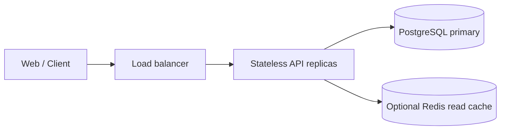
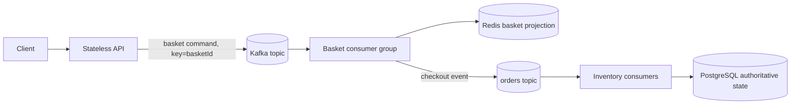
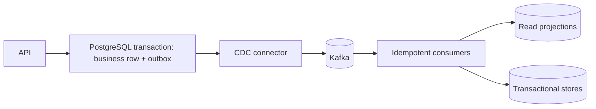
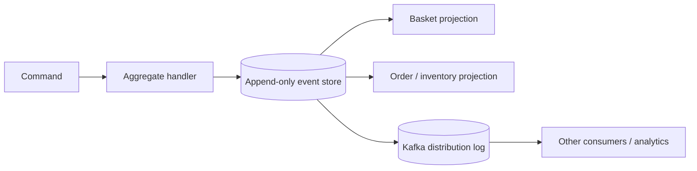

# Implementable Blueprints for a High-Load Basket and Order System

This document defines four independent designs for the same problem: accept a high rate of basket commands, preserve per-basket ordering, make checkout repeatable, reserve inventory correctly, and serve status reads quickly. *Foundations of Scalable Systems* provides the decision framework; these are original repository designs, not a universal recipe or a capacity guarantee.

**Book reference:** Ian Gorton, *Foundations of Scalable Systems*, [official publisher page](https://www.oreilly.com/library/view/foundations-of-scalable/9781098106058/).

## Shared contract for comparison

Every option must implement the same observable behavior:

- Operations: change basket, read basket, submit checkout, reserve inventory, and read order status.
- Every write carries a `RequestId` or `Idempotency-Key`; repeating it must not create a new effect.
- Ordering is required within one basket. Independent baskets may be processed concurrently.
- Inventory for an SKU must never become negative. A multi-item checkout reserves every item or none.
- “Command accepted” is different from “order completed.” An asynchronous `202` confirms only durable command acceptance.
- Reads from projections or caches must disclose their allowed freshness delay.

Track basket commands accepted per second separately from checkouts completed per second. For each, report throughput, errors, p50/p95/p99, CPU, memory, lag, recovery time, and cost. The 100,000 commands/s figure is a capacity-planning target until a sustained test on specified hardware proves it.

## Option A — Synchronous API with PostgreSQL

### Flow and data

1. The API validates a request and writes its idempotency record and basket or checkout update in one database transaction.
2. Inventory reservation uses conditional updates. A multi-item order updates all SKUs in one transaction; an unavailable item rolls the whole reservation back.
3. Order status is read from PostgreSQL. Redis is a rebuildable cache, never the inventory authority.

### Implementation components

- Stateless ASP.NET Core API with validation and a maximum batch size.
- `Baskets`, `BasketItems`, `Orders`, `OrderItems`, `Inventory`, and `IdempotencyRecords` tables.
- Unique constraint on `(ClientId, IdempotencyKey)` and request/event identity; indexes follow measured read patterns.
- Short transactions, bounded connection pool, explicit timeouts, readiness and liveness endpoints.
- For hot reads, add a cache with an explicit TTL, version, or invalidation policy; do not keep authoritative inventory only in cache.

### When to choose it and limits

This is the best correctness baseline with the fewest moving parts. API replicas scale the web tier, but concurrent writes and hot SKUs remain limited by PostgreSQL. First measure query plans, lock waits, WAL, IOPS, and pool saturation. A read replica can offload reads that tolerate staleness; it does not scale inventory writes.

## Option B — Kafka with independent workers

### Flow and contract

1. The API publishes a deterministic, versioned command using `basketId` as the key and acknowledges only after the required broker acknowledgement.
2. Kafka ordering is per partition. Producers need a stable key; a consumer group cannot usefully run more simultaneous consumers than it has assigned partitions.
3. Basket workers apply commands idempotently to a Redis projection. Checkout emits an order event containing a specific basket snapshot/version.
4. Inventory workers record a deduplication identity and reserve every item in one PostgreSQL transaction; they commit the Kafka offset after the database commit.

### Implementation components

- Separate topics for basket commands, submitted orders, and reservation results; versioned schemas and compatibility rules.
- A basket key for ordering; retention for replay; replication and `acks` chosen from RPO and latency needs.
- Consumers with bounded batches, parallelism only across independent keys, commit after successful effects, and shutdown that stops polling and safely completes or cancels in-flight work.
- `ProcessedEvents` with a unique constraint to prevent repeat reservations. Permanent failures go to a visible quarantine/dead-letter path; retries are bounded.
- Consumer scaling based on lag and oldest-message age, capped by partitions and downstream capacity.

### When to choose it and limits

This design absorbs bursts and decouples API traffic from database speed. It introduces temporary projection staleness, broker operations, replay, schema evolution, partition skew, and poison-message handling. A PostgreSQL commit and the publication of a later event are not one atomic transaction; use Option C or an outbox in the worker if that publication must not be lost.

## Option C — PostgreSQL Outbox and CDC with Kafka

### Flow and contract

1. The API commits the business change and an outbox row in the same database transaction; it does not publish directly before commit.
2. CDC reads committed outbox changes from the WAL and publishes them to Kafka. The event key follows the aggregate whose ordering must be preserved.
3. Consumers record local effects and message identity idempotently. Projections are separate from the source tables and can be rebuilt when needed.

### Implementation components

- Domain tables, `Outbox(Id, AggregateId, AggregateVersion, Type, Payload, CreatedAt)`, and uniqueness constraints.
- CDC connector, schema evolution policy, outbox cleanup, WAL/replication-slot management, and CDC-lag monitoring.
- Consumer inbox/deduplication, bounded retry, dead-letter handling, and a replay tool based on offset or outbox history.
- If write volume warrants it, partition outbox/database by domain key and design migrations from the start.

### When to choose it and limits

This removes the dual-write gap between a database change and publication of its corresponding event, making it useful when PostgreSQL is the business source of truth. CDC does not eliminate failure, duplicates, or lag; consumers still need idempotency. It also does not replace transactional inventory reservation and adds connector and WAL operations.

## Option D — Event Sourcing for Basket and Order

### Flow and contract

1. A command handler validates an event against `AggregateId` and `ExpectedVersion`.
2. Events are appended to an immutable history; concurrent append succeeds only if the aggregate version is still the expected version.
3. Basket, order-status, and reporting projections are derived from events. Snapshots shorten replay but are not the source of truth.
4. Inventory requires a carefully chosen contention boundary. One aggregate per SKU can enforce no-oversell with a version or transaction, but hot SKUs may need a dedicated queue/partition and domain changes.

### Implementation components

- Versioned event schemas with event type, aggregate ID, sequence/version, correlation ID, and semantic timestamp.
- A transactional event store (for example PostgreSQL with a unique `(AggregateId, Version)` constraint), an outbox/publisher to Kafka, and projection consumers.
- Schema evolution/upcasting, snapshots, replay drills, compensating events for corrections, and PII retention rules.
- Never treat unordered concurrent projection writes as truth; expose projection state and lag to API clients.

### When to choose it and limits

Event sourcing is useful when audit history, state reconstruction, and changing read models are valuable. It adds unnecessary cost for ordinary CRUD or simple inventory reservation: event design, versioning, replay, snapshots, and correction are complex. Kafka alone does not replace a transactional event store or aggregate rules.

## Analytical extension — Flink on Kafka

Use Flink for work such as windowed acceptance rates, anomaly detection, or joins between order and reservation streams, not as a replacement for the inventory transaction. Specify event time, watermarks, state backend, checkpointing, sink semantics, partition parallelism, and late-event behavior. Send analytics to a derived topic or store; the authoritative financial/inventory path keeps its own transactional invariants.

## Serverless extension

For short, irregular bursts, compare a queue-triggered function with Option B. Bound concurrency and database connections, make the function idempotent, and measure cold starts and cost per successful operation. For steady heavy load, compare it with always-on workers; serverless does not increase broker or database capacity by itself.

## Database and language choices

| Need | Starting point | Comparison variant |
|---|---|---|
| Transactions and inventory constraints | PostgreSQL | MySQL with the same constraints/transactions; distributed SQL only for a demonstrated scale/region need |
| Cache/read projection | Redis with rebuild and TTL policy | MongoDB for document/aggregate access; DynamoDB for key-first conditional access |
| Event distribution and replay | Kafka | Separate event store for Event Sourcing; do not use Kafka as a database without explicit guarantees |
| API/worker language | Current C#/.NET reference | Go or Rust for a profiled hot path; Scala/Flink for streams; Elixir for I/O concurrency with equivalent benchmarks |

Do not build a variant by swapping a technology name. Keep schema, semantics, partition key, retry behavior, data volume, and workload constant; include resource use and cost in results.

## Recommended implementation order

1. Freeze the shared contract and workload, then establish the Option A baseline.
2. Harden and measure current Option B under duplicates, lag, restart, and poison-message scenarios.
3. Build Option C to guarantee DB-to-Kafka publication; include CDC lag and WAL in its cost.
4. Build Option D for one bounded context only if domain history and reconstruction justify it.
5. Add Flink and serverless only for concrete workloads that need them.
6. After profiling, compare one hot path in Go/Rust or one stream job in Scala/Flink without changing semantics.
