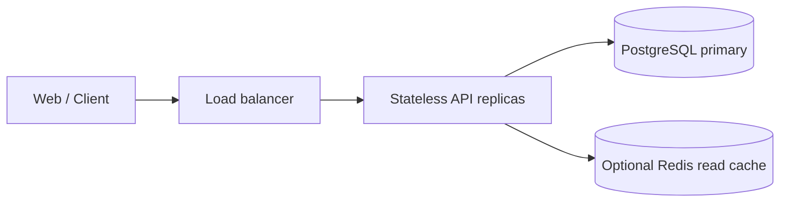
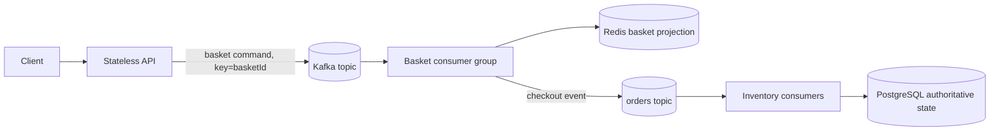
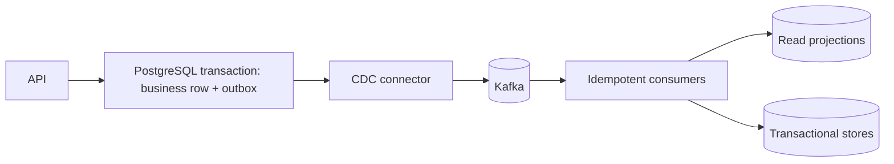
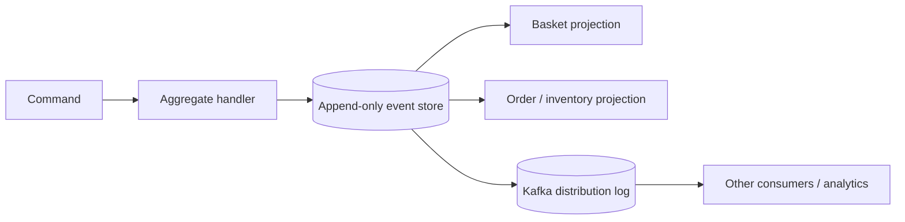

# طرح‌های قابل پیاده‌سازی برای سامانهٔ پرترافیک سبد و سفارش

این سند چهار راه‌حل مستقل و قابل ساخت برای یک مسئلهٔ یکسان تعریف می‌کند: پذیرش فرمان‌های زیاد برای سبد خرید، حفظ ترتیب تغییرهای هر سبد، checkout تکرارپذیر، رزرو درست موجودی و خواندن سریع وضعیت. کتاب *Foundations of Scalable Systems* چارچوب تصمیم‌گیری این گزینه‌هاست؛ این طرح‌ها خلاصهٔ آموزشی و تصمیم‌های پیشنهادی خود مخزن‌اند، نه نسخهٔ یگانه یا تضمین ظرفیت.

**مرجع کتاب:** Ian Gorton، *Foundations of Scalable Systems*، [صفحهٔ رسمی ناشر](https://www.oreilly.com/library/view/foundations-of-scalable/9781098106058/).

## قرارداد مشترک برای مقایسه

همهٔ گزینه‌ها باید یک workload و رفتار قابل مشاهده داشته باشند:

- عملیات‌ها: ثبت تغییر سبد، خواندن سبد، ثبت checkout، رزرو موجودی، مشاهدهٔ وضعیت سفارش.
- هر درخواست تغییردهنده `RequestId` یا `Idempotency-Key` دارد؛ تکرار همان شناسه اثر تازه نمی‌سازد.
- ترتیب فقط برای یک سبد لازم است؛ برای سبدهای مستقل موازی‌سازی آزاد است.
- موجودی برای هر SKU هرگز منفی نمی‌شود. checkout یا همهٔ اقلام را رزرو می‌کند یا هیچ‌کدام را.
- «فرمان پذیرفته شد» از «سفارش تکمیل شد» جداست. پاسخ ناهمگام `202` فقط پذیرش پایدار فرمان را معنی می‌دهد.
- هر نتیجه‌ای که از projection یا cache خوانده می‌شود باید میزان تأخیر و تازگی قابل‌قبولش را اعلام کند.

معیارها را برای هر دو نرخ جدا ثبت کنید: فرمان سبد پذیرفته‌شده بر ثانیه و checkout تکمیل‌شده بر ثانیه. برای هرکدام throughput، خطا، p50/p95/p99، CPU، حافظه، lag، زمان بازیابی و هزینه را اندازه بگیرید. هدف ۱۰۰ هزار فرمان بر ثانیه، هدف ظرفیت‌سنجی است تا زمانی که آزمون پایدار روی سخت‌افزار مشخص آن را ثابت کند.

## گزینهٔ A — API همگام با PostgreSQL

### جریان و داده

1. API درخواست را اعتبارسنجی می‌کند و در یک transaction، ردیف idempotency و تغییر basket یا checkout را می‌نویسد.
2. رزرو موجودی با update شرطی انجام می‌شود؛ برای سفارش چندقلمی همهٔ SKUها در یک transaction قفل/به‌روزرسانی می‌شوند و کمبود یک قلم باعث rollback کامل می‌شود.
3. وضعیت سفارش مستقیماً از PostgreSQL خوانده می‌شود. Redis فقط cache قابل‌بازسازی است، نه مرجع موجودی.

### اجزای لازم برای پیاده‌سازی

- ASP.NET Core API stateless با validation و محدودیت اندازهٔ batch.
- جدول‌های `Baskets`, `BasketItems`, `Orders`, `OrderItems`, `Inventory`, `IdempotencyRecords`.
- قید یکتا برای `(ClientId, IdempotencyKey)` و شناسهٔ درخواست رویداد؛ index روی کلیدهای خواندن واقعی.
- transaction کوتاه، connection pool محدود، timeout مشخص، endpointهای readiness و liveness.
- برای پاسخ‌های پرتکرار، cache با TTL، نسخه‌گذاری یا invalidation روشن؛ هرگز موجودی authoritative را فقط در cache نگه ندارید.

### انتخاب و محدودیت

این بهترین baseline برای صحت تراکنشی و کمترین تعداد قطعه است. با افزودن API replica، بخش وب scale می‌شود، اما نوشتن‌های هم‌زمان و SKU داغ همچنان ظرفیت PostgreSQL را محدود می‌کنند. ابتدا query plan، lock wait، WAL، IOPS و pool را اندازه بگیرید. read replica فقط خواندن‌های قابل‌تحمل با دادهٔ کهنه را سبک می‌کند؛ نوشتن موجودی را scale نمی‌کند.

## گزینهٔ B — Kafka و workerهای مستقل

### جریان و قرارداد

1. API یک فرمان قطعی و versioned را با کلید `basketId` به topic ثبت می‌کند و فقط پس از acknowledgement لازم پاسخ پذیرش می‌دهد.
2. Kafka ترتیب را فقط داخل partition تضمین می‌کند. producerها باید کلید پایدار داشته باشند؛ تعداد consumerهای هم‌زمان هر گروه از تعداد partitionهای قابل‌مصرف فراتر نمی‌رود.
3. Basket worker فرمان را idempotent به projection Redis اعمال می‌کند. checkout یک snapshot/version مشخص از سبد را به رویداد سفارش تبدیل می‌کند.
4. Inventory worker در transaction PostgreSQL یک رکورد deduplication و رزرو همهٔ اقلام را ثبت می‌کند؛ بعد از commit دیتابیس offset را commit می‌کند.

### اجزای لازم برای پیاده‌سازی

- topic جدا برای فرمان سبد، سفارش ثبت‌شده و نتیجهٔ رزرو؛ schema version و سازگاری producer/consumer.
- key سبد برای ترتیب، retention متناسب با نیاز replay، replication و `acks` بر اساس RPO/latency.
- consumer با batch محدود، پردازش موازی فقط بین کلیدهای مستقل، commit پس از side effect موفق، و shutdown با توقف poll، تکمیل/لغو کار امن و commit نتیجهٔ انجام‌شده.
- جدول `ProcessedEvents` با قید یکتا برای جلوگیری از رزرو تکراری. خطای دائمی به dead-letter/quarantine می‌رود؛ retry محدود و قابل مشاهده است.
- مقیاس consumer بر مبنای lag و سن قدیمی‌ترین پیام، با سقف بر اساس partition و ظرفیت downstream.

### انتخاب و محدودیت

این گزینه burst را جذب می‌کند و API را از سرعت DB جدا می‌سازد. در عوض وضعیت basket و order ممکن است موقتاً کهنه باشد و عملیات broker، replay، schema، partition skew و poison message اضافه می‌شود. نوشتن PostgreSQL و انتشار رویداد بعدی یک تراکنش مشترک نیست؛ اگر انتشار نتیجه نباید گم شود، گزینهٔ C یا outbox محلی در worker را اضافه کنید.

## گزینهٔ C — PostgreSQL Outbox و CDC با Kafka

### جریان و قرارداد

1. API تغییر business و یک ردیف outbox را در همان transaction پایگاه‌داده ثبت می‌کند؛ هیچ publish مستقیم پیش از commit انجام نمی‌شود.
2. CDC از WAL تغییرهای outbox را می‌خواند و به Kafka می‌فرستد. کلید رویداد بر اساس aggregate تعیین می‌شود تا ترتیب لازم حفظ شود.
3. هر consumer اثر محلی و شناسهٔ پیام را به‌صورت idempotent ثبت می‌کند. projectionها جدا از جدول مرجع ساخته و در صورت نیاز replay می‌شوند.

### اجزای لازم برای پیاده‌سازی

- جداول دامنه، `Outbox(Id, AggregateId, AggregateVersion, Type, Payload, CreatedAt)` و قیود یکتا.
- connector CDC، سیاست schema evolution، retention و پاک‌سازی outbox، پایش WAL/replication-slot و CDC lag.
- consumer inbox/deduplication، retry محدود، dead-letter، و ابزار replay از offset یا outbox.
- در صورت بالا بودن نوشتن، partitioning تدریجی outbox و پایگاه‌داده بر اساس کلید دامنه؛ عملیات migration را از ابتدا طراحی کنید.

### انتخاب و محدودیت

این طراحی مسئلهٔ dual-write در «تغییر DB و انتشار همان رویداد» را حل می‌کند و وقتی PostgreSQL مرجع business است مناسب است. خودِ CDC خطا، duplicate یا lag را حذف نمی‌کند؛ consumer باید idempotent باشد. همچنین CDC جای پردازش تراکنشی موجودی را نمی‌گیرد و هزینهٔ عملیاتی connector و WAL را اضافه می‌کند.

## گزینهٔ D — Event Sourcing برای Basket و Order

### جریان و قرارداد

1. command handler با `AggregateId` و `ExpectedVersion` رویدادهای مجاز را اعتبارسنجی می‌کند.
2. رویدادها append-only ذخیره می‌شوند؛ ثبت هم‌زمان فقط وقتی موفق است که نسخهٔ aggregate هنوز همان مقدار مورد انتظار باشد.
3. projectionهای basket، وضعیت سفارش و گزارش از رویدادها ساخته می‌شوند. snapshot برای کوتاه‌کردن replay است، نه منبع حقیقت.
4. برای موجودی، aggregate باید مرز رقابت را درست انتخاب کند؛ یک aggregate برای هر SKU می‌تواند oversell را با version/transaction کنترل کند، اما SKU داغ به صف یا partition اختصاصی و طراحی دامنه نیاز دارد.

### اجزای لازم برای پیاده‌سازی

- event schema versioned با نام رویداد، aggregate ID، sequence/version، correlation ID و timestamp معنایی.
- event store تراکنشی (مثلاً PostgreSQL با قید یکتای `(AggregateId, Version)`)، publisher/outbox برای انتقال به Kafka، و consumerهای projection.
- سیاست evolution/upcasting، snapshot، replay آزمایشی، اصلاح رویداد اشتباه با رویداد جبرانی، و نگه‌داری PII.
- projection هرگز از نوشتن هم‌زمان مستقل و بدون ترتیب به‌عنوان حقیقت خوانده نشود؛ وضعیت و میزان lag را به API نشان دهید.

### انتخاب و محدودیت

برای audit، تاریخچه، بازسازی مدل خواندن و تحلیل تغییرات ارزش دارد. برای CRUD یا رزرو سادهٔ موجودی هزینهٔ غیرضروری ایجاد می‌کند: طراحی event، versioning، replay، snapshot و جبران داده پیچیده‌اند. Kafka به‌تنهایی جای event store تراکنشی و قواعد aggregate را نمی‌گیرد.

## افزونهٔ تحلیلی — Flink روی Kafka

Flink را برای کارهایی مثل پنجرهٔ نرخ پذیرش، کشف anomaly یا join جریان سفارش و نتیجه اضافه کنید، نه برای جایگزینی transaction رزرو موجودی. event-time، watermark، state backend، checkpoint، sink semantics، partition parallelism و رفتار دادهٔ دیررس را مشخص کنید. خروجی تحلیلی به topic یا store مشتق‌شده برود؛ مسیر تصمیم مالی/موجودی همچنان invariant تراکنشی مستقل داشته باشد.

## افزونهٔ serverless

برای بار کوتاه‌مدت و ناپیوسته می‌توان consumer queue-triggered یا function را با variant B مقایسه کرد. تابع باید idempotent باشد، محدودیت concurrency و connection DB داشته باشد و cold-start و هزینهٔ هر عملیات موفق اندازه‌گیری شود. برای بار پایدار و سنگین، مقایسهٔ هزینه و latency با worker همیشه‌روشن لازم است؛ serverless به‌تنهایی ظرفیت broker یا database را زیاد نمی‌کند.

## انتخاب پایگاه‌داده و زبان

| نیاز | نقطهٔ شروع | variant قابل مقایسه |
|---|---|---|
| تراکنش و قید موجودی | PostgreSQL | MySQL با همان قید و transaction؛ distributed SQL فقط با نیاز روشن به scale/region |
| cache/read projection | Redis با سیاست rebuild و TTL | MongoDB برای سند/aggregate؛ DynamoDB برای دسترسی key-first و شرطی |
| event log و replay | Kafka به‌عنوان توزیع رویداد | event store جدا برای Event Sourcing؛ Kafka را بی‌قید جای دیتابیس نگذار |
| زبان API/worker | C#/.NET مرجع فعلی | Go یا Rust برای hot path پس از profiling؛ Scala/Flink برای stream؛ Elixir برای concurrency I/Oمحور با benchmark هم‌معنا |

هیچ variantی را با تعویض صرف فناوری نسازید. schema، semantics، کلید partition، رفتار retry، تعداد داده و workload باید ثابت و نتیجه‌ها شامل منابع و هزینه باشند.

## ترتیب پیاده‌سازی پیشنهادی

1. قرارداد و workload مشترک و baseline گزینهٔ A را تثبیت کنید.
2. مسیر Kafka فعلی گزینهٔ B را با duplicate، lag، restart و poison message سخت‌گیرانه اندازه بگیرید.
3. گزینهٔ C را برای قابل‌اعتمادکردن انتشار DB-to-Kafka بسازید و CDC lag/WAL را هم در هزینه حساب کنید.
4. فقط اگر تاریخچه و بازسازی ارزش دامنه دارد، گزینهٔ D را برای یک bounded context محدود بسازید.
5. Flink و serverless را به workloadهای مشخص و جدا اضافه کنید.
6. پس از profile، یک hot path را با Go/Rust یا stream job را با Scala/Flink مقایسه کنید؛ semantics و workload تغییر نکند.

