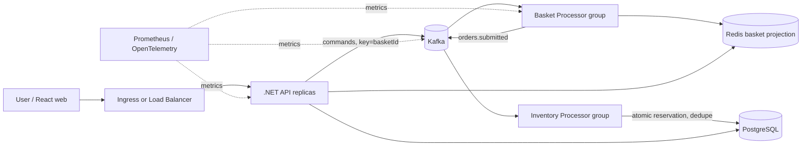
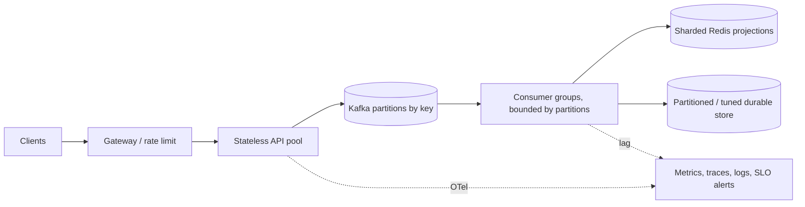

<div dir="ltr" align="left">

<p align="center"><a href="KUBERNETES-GUIDE-EN.md"><strong>English</strong></a> | <a href="KUBERNETES-GUIDE-FA.md">فارسی</a></p>

# Kubernetes Guide for HPT


This guide explains the project manifests and provides a hands-on Kubernetes lab. `lab` is for laptops and learning. `performance` is a capacity-planning starting point; it does not prove 100,000 transactions per second. A real deployment requires immutable images, TLS, managed secrets, tested backup/restore, and load testing.

## Architecture and data path



The API publishes basket commands to Kafka using the basket ID as key, then returns `202`. The basket projection is eventually consistent. On the order path, `processed_events` prevents a reservation from running again after the PostgreSQL transaction commits. Checkout accepts an idempotency key. The basket batch consumer does not yet persistently deduplicate by `eventId`, so a late retry can move projection state backward. Kafka ordering is guaranteed only within a partition. Redis is the lab read model; PostgreSQL reserves inventory transactionally.

## Kubernetes vocabulary

| Concept | Use in this project |
|---|---|
| Cluster / Node | Control plane and machines that run Pods; kind is for local tests. |
| Namespace | Name/access boundary; project resources live in `hpt`. |
| Pod | Container execution unit; a Deployment recreates deleted Pods. |
| Deployment | Version and replica management for API, workers, and web. |
| StatefulSet and PVC | Identity and durable storage for PostgreSQL/Kafka; namespace deletion can remove data. |
| Service | Stable in-cluster address for changing Pods. |
| ConfigMap / Secret | Configuration and sensitive values; lab secrets are examples only. |
| Probe | Liveness restarts a process; readiness removes an unready Pod from traffic. |
| requests / limits | CPU/RAM reservation and ceilings; used for scheduling and CPU HPA. |
| HPA / KEDA | HPA uses CPU; KEDA can scale workers by Kafka lag. |
| CRD / Operator | Strimzi turns Kafka custom resources into brokers and topics. |

## Prerequisites and lab deployment with PowerShell

You need Docker Desktop with Kubernetes or kind, `kubectl`, Docker, .NET 10 SDK, Node.js 24, and npm. Package restore requires NuGet/npm access. Check the cluster context first so commands do not target the wrong cluster:

```powershell
kubectl config get-contexts
kubectl config current-context
kubectl cluster-info
```

The repeatable deployment script runs the lab setup and rollouts. For kind, provide the cluster name:

```powershell
.\infra\kubernetes\lab\deploy.ps1 -ExpectedContext kind-k8s-course -KindClusterName k8s-course
```

For Docker Desktop, use `-ExpectedContext docker-desktop` and omit `-KindClusterName`. The script checks the current context and stops if it differs from the expected context. It then rebuilds images and restarts application Deployments so they use the new local image. Never use lab manifests or sample credentials in production.

### Manual lab setup

From the repository root:

```powershell
kubectl apply -f infra/kubernetes/namespace.yaml
kubectl create configmap hpt-postgres-init -n hpt --from-file=001-init.sql=infra/postgres/init.sql --dry-run=client -o yaml | kubectl apply -f -
kubectl apply -f "https://strimzi.io/install/latest?namespace=hpt" -n hpt
kubectl wait deployment/strimzi-cluster-operator -n hpt --for=condition=Available --timeout=5m
kubectl apply -f infra/kubernetes/lab/kafka.yaml
kubectl wait kafka/hpt-kafka -n hpt --for=condition=Ready --timeout=15m
kubectl apply -f infra/kubernetes/lab/basket-topic-4p.yaml
kubectl apply -f infra/kubernetes/lab/dependencies.yaml
kubectl apply -f infra/kubernetes/lab/config.yaml
kubectl apply -f infra/kubernetes/lab/secret.yaml
dotnet publish src/Hpt.Api/Hpt.Api.csproj -c Release -r linux-x64 --self-contained false -o artifacts/kubernetes/api /p:UseAppHost=false
dotnet publish src/Hpt.BasketProcessor/Hpt.BasketProcessor.csproj -c Release -r linux-x64 --self-contained false -o artifacts/kubernetes/basket-processor /p:UseAppHost=false
dotnet publish src/Hpt.InventoryProcessor/Hpt.InventoryProcessor.csproj -c Release -r linux-x64 --self-contained false -o artifacts/kubernetes/inventory-processor /p:UseAppHost=false
Push-Location web
npm ci --no-audit --no-fund
npm run build
Pop-Location
docker build --load -t hpt-web:dev -f web/Dockerfile.runtime web
docker build --load -t hpt-api:dev --build-arg APP_DLL=Hpt.Api.dll -f infra/kubernetes/lab/Dockerfile.runtime artifacts/kubernetes/api
docker build --load -t hpt-basket-processor:dev --build-arg APP_DLL=Hpt.BasketProcessor.dll -f infra/kubernetes/lab/Dockerfile.runtime artifacts/kubernetes/basket-processor
docker build --load -t hpt-inventory-processor:dev --build-arg APP_DLL=Hpt.InventoryProcessor.dll -f infra/kubernetes/lab/Dockerfile.runtime artifacts/kubernetes/inventory-processor
# For kind only; replace the value with your cluster name
$KindClusterName = "k8s-course"
kind load docker-image hpt-api:dev hpt-basket-processor:dev hpt-inventory-processor:dev hpt-web:dev --name $KindClusterName
kubectl apply -f infra/kubernetes/lab/apps.yaml
kubectl get pods,svc,hpa -n hpt -w
kubectl port-forward -n hpt svc/hpt-web 8081:80
```

Open `http://localhost:8081`. In a second terminal, forward the API with `kubectl port-forward -n hpt svc/api 5080:8080`. If an image is missing from kind, repeat `kind load docker-image <image>:<tag> --name <cluster>` for each image.

## Routine troubleshooting

```powershell
kubectl get all -n hpt
kubectl describe pod <pod> -n hpt
kubectl logs deploy/hpt-api -n hpt --all-pods=true --tail=100
kubectl get events -n hpt --sort-by=.lastTimestamp
kubectl top pods -n hpt
kubectl get hpa -n hpt
kubectl get pvc -n hpt
```

- `ImagePullBackOff`: check image, tag, and registry access.
- `Pending`: inspect node capacity, taints, PVCs, and StorageClass.
- Failed readiness: inspect dependencies and health endpoints. Worker `/health/ready` returns 503 until it owns at least one Kafka partition and checks Redis; Inventory Processor also checks PostgreSQL. A newly-created Pod is not ready before joining the consumer group.
- `/health/live` checks only the process so temporary broker errors do not cause needless restarts.
- HPA shows `<unknown>`: check metrics-server or the Metrics API.
- Scaling workers beyond available topic partitions does not add throughput.

`kubectl top` and HPA use the Metrics API, usually supplied by metrics-server. This is not the same as historical Prometheus scraping. Project lab Prometheus collects application and dependency exporter metrics, but does not install/scrape kubelet/cAdvisor, `kube-state-metrics`, or `node-exporter`. For historical CPU, memory, restart, PVC, and scheduling graphs/alerts, install a cluster-appropriate monitoring stack or configure secure scraping with suitable TLS and RBAC. Do not assume those series exist in the current lab Prometheus.

Basket Processor polls bounded micro-batches and sends independent baskets to Redis concurrently, preserving per-basket order. It commits a partition offset only after processing succeeds. `Basket__MaxPollBatchSize=128` sets the default batch size; adjust gradually and watch `hpt_basket_poll_batch_size`. This reduces serial Redis round trips but does not prove capacity without a target-environment benchmark.

If kind cannot pull the official metrics-server image from `registry.k8s.io`, fix registry/network access first. For this lab environment, `bitnamilegacy/metrics-server:0.8.0-debian-12-r4` from Docker Hub was used as a compatible image; its legacy status makes it unsuitable as a permanent production solution. After the APIService is ready, inspect `kubectl top nodes`, `kubectl top pods -n hpt`, and `kubectl get hpa -n hpt`. In real environments, mirror an official image to a trusted registry and pin its digest. `--kubelet-insecure-tls` is a local kind workaround, not a production setting.

## Cleanup

This removes all workloads and PVCs in namespace `hpt`. With a StorageClass reclaim policy of `Delete`, volume data may also be deleted. Recheck the current context first:

```powershell
kubectl config current-context
kubectl delete namespace hpt --wait=true
kubectl get namespace hpt
kubectl get pv
```

To delete the entire kind cluster and all its state, run `kind delete cluster --name <cluster>`. That is different from deleting the `hpt` namespace.

## Scaling design and the 100,000 TPS target

Define TPS first: HTTP requests, accepted basket commands, or completed checkouts are different workloads. The target is not a benchmark result. Capacity planning should:

1. Record payload size, read/write/checkout mix, target latency, durability, and error rate for each message type.
2. Test API → Kafka → Redis, then test checkout/PostgreSQL separately.
3. Ramp the rate and capture sustainable throughput, p50/p95/p99, errors, consumer lag, CPU, memory, network, and disk.
4. Include headroom and failure of one broker/node; repeat the run and recovery test.

Initial estimate: `partition count >= target events/sec / measured sustainable events/sec per partition`. Then test key skew, replication, batch size, retention, and recovery. Partition count caps useful consumer parallelism in a group. A hot basket must remain ordered on one partition; splitting a hot key can break semantics. For 100k basket commands, evaluate key sharding, measured partitioning, producer batching, asynchronous ingestion, backpressure, and Redis Cluster. PostgreSQL inventory reservation is a separate constraint; hot SKU rows can bottleneck on lock contention. The [System Design guide](SYSTEM-DESIGN-MASTER-EN.md) covers checkout/inventory scaling options. Only a benchmark can verify real capacity.



## Metrics and observability

| Layer | Metrics |
|---|---|
| API | Request count/rate by route/status, latency histogram, active requests, dependency failures, publish latency |
| Kafka | Bytes in/out, request latency, under-replicated partitions, ISR changes, disk/network, consumer lag and message age |
| Workers | Processed/failed/retried, batch size, processing duration, rebalance, lag, commit time |
| Redis | Operations/s, p99 latency, hit ratio, memory/evictions, replication/cluster health |
| PostgreSQL | Transaction latency, lock waits, connections, WAL, deadlocks, pool saturation, replication lag |
| Kubernetes | Desired/ready replicas, restarts, CPU/memory throttling, PVC usage, scheduling failures, HPA desired/current |
| Business | Accepted basket commands, accepted/completed/rejected checkout, reservation outcomes, duplicate events |

The API exposes OpenTelemetry metrics at `/metrics`. Manual metrics include `hpt.basket.commands`, `hpt.checkout.commands`, `hpt.kafka.publish.failures`, `hpt.basket.batch.rejections`, and a Kafka publish-duration histogram. Publish failures count batch record-delivery failures; batch histograms carry the fixed tag `mode=batch`. Each Pod limits concurrent batch requests through `Ingestion__MaxConcurrentBatchesPerPod`; overloaded requests receive 429 before enqueue, and after enqueue the permit stays held until delivery callbacks finish—even if the client disconnects. ASP.NET Core instrumentation also records request metrics. Workers record processed/failed events, processing duration, and `*.offsets.committed`. Do not use basket/order IDs as metric labels; cardinality would grow without bound. Lab Prometheus uses namespace-limited RBAC and endpoint discovery to scrape each Pod. Align production permissions with your organization's policies.

The batch endpoint `POST /api/baskets/commands/batch` accepts at most 500 `item-set` commands per request. Each message uses `basketId` as its partition key, preserving publish order within a basket. A batch is not an atomic Kafka transaction. If only some messages publish, retry with stable `eventId`, but the current consumer does not deduplicate that ID; this does not guarantee exactly-once effects or correct projection order. Alternatives include Kafka transactions for atomic visibility, a durable inbox for dedupe, or a per-basket sequence to reject old commands. See the [System Design guide](SYSTEM-DESIGN-MASTER-EN.md) for trade-offs. A local run at `RATE=30`, `BATCH_SIZE=50` accepted about 1,501 commands/s; this was a short single-node kind experiment, not proof of sustained capacity.

Consumers use `EnableAutoCommit=false`. Periodic commits must run even when a topic becomes temporarily idle; otherwise the last processed offsets may remain only in memory and reported Kafka lag may not reach zero. These workers poll with a maximum 100ms timeout and commit during idle periods. After changing a consumer, inspect lag with `kafka-consumer-groups.sh` or Kafka Exporter and review each worker replica in Prometheus.

Install the ServiceMonitor and forward the API:

```powershell
kubectl apply -f infra/kubernetes/lab/api-servicemonitor.yaml
kubectl port-forward -n hpt svc/api 5080:8080
```

Open `http://localhost:5080/metrics`. A ServiceMonitor is discovered only when Prometheus Operator is installed and its release label matches the Operator selector; change `release: prometheus` if needed. To scrape all lab components, apply the exporter manifests:

```powershell
kubectl apply -f infra/kubernetes/lab/observability-exporters.yaml
kubectl apply -f infra/kubernetes/lab/kafka.yaml
kubectl apply -f infra/kubernetes/lab/prometheus.yaml
kubectl rollout restart deployment/hpt-prometheus -n hpt
```

Strimzi Kafka Exporter exposes topic and consumer-group lag; PostgreSQL and Redis exporters expose database/cache metrics. In the current cluster `up` is 1 for API, both workers, and all three exporters. Queries `pg_up`, `redis_up`, `kafka_brokers`, and `kafka_consumergroup_lag` return data. Example SLIs are publish success/latency, checkout completion time, and lag percentiles. Set SLO thresholds from product requirements.

For a standalone lab without Operator, `infra/kubernetes/lab/prometheus.yaml` creates one Prometheus replica with 24-hour retention and scrapes the API:

```powershell
kubectl apply -f infra/kubernetes/lab/prometheus.yaml
kubectl port-forward -n hpt svc/hpt-prometheus 19090:9090
```

Open Prometheus at `http://localhost:19090`; query `up{job="hpt-api"}` should return `1`. This is lab-only: storage is ephemeral and there is no HA or long-term retention. Worker jobs scrape port 9464; their primary metrics are successful/failed event counts and processing-duration histograms.

The same manifest includes recording rules for API rate, p95, total lag, accepted command rate, and basket processing rate. Alerts cover target-down, high lag, sustained ingest exceeding processing with backlog, batch delivery failures, sustained admission-limit pressure, and p95 above 500ms. Review **Alerts** and **Rules** in Prometheus. The rules evaluate alerts; notifications require separately configured Alertmanager and a receiver such as email or a messaging service. Restart Prometheus after changing its ConfigMap.

## Hands-on Kubernetes practice

Run these exercises only in the lab. Exercises 4 and 5 deliberately disrupt a service or Pod; never run them in production or a shared cluster. Restore app replica counts from `infra/kubernetes/lab/apps.yaml` at the end; the Redis exercise scales Redis back to one.

### Exercise 1: Map the resources

```powershell
kubectl get namespaces
kubectl get deploy,statefulset,pod,svc,hpa,pvc -n hpt -o wide
kubectl get endpoints -n hpt
```

Identify Deployments `hpt-api`, `hpt-basket-processor`, `hpt-inventory-processor`, and `hpt-web` versus dependency StatefulSets. A Service has a stable address and uses selectors to find Pods; endpoints list the IPs of ready Pods. Pod IPs can change after replacement while clients keep using the Service.

### Exercise 2: Distinguish readiness from liveness

```powershell
kubectl get pods -n hpt -w
kubectl describe pod <api-pod> -n hpt
kubectl get endpoints api -n hpt -o yaml
kubectl get endpoints hpt-basket-processor -n hpt -o yaml
```

API becomes ready when Redis and PostgreSQL respond. Basket worker becomes ready after it owns a Kafka partition and Redis responds; Inventory Processor also checks PostgreSQL. Failed readiness leaves the Pod alive but removes it from Service endpoints. Liveness checks the process and restarts the container on failure. Readiness models dependency availability; liveness models a stuck process.

### Exercise 3: Deployment, replicas, and Service

Temporarily change `hpt-web` replicas in the lab:

```powershell
kubectl scale deployment/hpt-web -n hpt --replicas=3
kubectl rollout status deployment/hpt-web -n hpt --timeout=2m
kubectl get pods -n hpt -l app=hpt-web -o wide
kubectl get endpoints hpt-web -n hpt
kubectl scale deployment/hpt-web -n hpt --replicas=2
```

Deployment records the desired replica count; ReplicaSet reconciles the difference; Service routes to ready Pods. Web is stateless, so every replica can serve requests. API has an HPA; manual scaling can be overwritten by the HPA. Scale workers only up to the topic's partition count; extra consumers without partitions are idle.

### Exercise 4: Dependency failure and recovery

**Single-user lab only:** stop Redis temporarily, inspect readiness, and restore it immediately:

```powershell
kubectl scale deployment/hpt-redis -n hpt --replicas=0
kubectl get pods,endpoints -n hpt -w
kubectl scale deployment/hpt-redis -n hpt --replicas=1
kubectl rollout status deployment/hpt-redis -n hpt --timeout=2m
kubectl get pods -n hpt -w
```

Expected: API/worker processes remain alive while Redis-dependent readiness fails; readiness should recover when Redis returns. This does not guarantee Redis data deletion, but in-flight requests may be interrupted. Test PostgreSQL or Kafka separately, changing only one dependency at a time.

### Exercise 5: StatefulSet and PVC

PostgreSQL in this lab uses a StatefulSet/PVC. Delete only its Pod to see the controller recreate the same identity; do not delete the PVC:

```powershell
kubectl get statefulset,pvc -n hpt
kubectl delete pod hpt-postgres-0 -n hpt
kubectl get pods,pvc -n hpt -w
```

The StatefulSet recreates the disposable Pod; the PVC has a separate data lifecycle. Deleting a PVC or namespace can permanently delete data depending on the reclaim policy and storage provider.

### Exercise 6: Check your understanding

1. Why can more API replicas help while workers beyond partition count do not increase throughput?
2. If worker `/health/ready` returns 503 while `/health/live` returns 200, what do kubelet and Service do?
3. Why does API `202` not mean checkout is complete?
4. Why is deleting a PostgreSQL Pod different from deleting its PVC?
5. If lag grows while the API still returns success, which stage is falling behind and which metrics should be compared?

**Short answers:** API is stateless and replicas serve independent requests; a consumer group is limited by assignable partitions. Failed readiness removes a Pod from Service endpoints, while healthy liveness avoids a restart. `202` means command accepted, not projection or reservation completed. StatefulSet recreates a Pod; PVC keeps data. Growing lag means consumers fall behind input; compare accepted rate, processed rate, lag, CPU throttling, and Redis latency.

## Architecture choices for learning

| Option | Best for | Cost / limitation |
|---|---|---|
| Monolith + PostgreSQL | Simple start and low load | Simple, but limited load isolation and replay |
| Stateless API + Kafka + workers (current) | Bursts, asynchronous processing, replay | Eventual consistency and Kafka operations |
| Kafka + DB outbox/CDC | Aligning event publication with DB commit | CDC and schema-evolution complexity |
| Partitioned relational DB | Relational transactions and queries | Shard key, migration, and cross-shard complexity |
| Stream processor (Kafka Streams/Flink) | Large-scale aggregation/stateful streams | Specialized state/recovery operations |
| Managed Kafka/Redis/DB | Less infrastructure toil | Cost, provider dependency, and service-limit testing |

Compare ordering, idempotency, consistency, replay, backpressure, failure recovery, cost, and daily operations for every option. The current architecture is useful for learning async processing but does not claim 100k TPS.

## Production readiness checklist

- Immutable image tags in a trusted registry; non-root containers, image scanning, resource requests/limits.
- Kafka TLS and SASL/ACL; real secrets outside plaintext YAML; RBAC and NetworkPolicy.
- Replicas on separate nodes, PodDisruptionBudget, topology spread, and lag-aware autoscaling.
- Kafka/database storage, replication, backup, restore, and disaster-recovery tests.
- Schema migrations, event compatibility, idempotency, DLQ/retry policy, rate limiting, and backpressure.
- Dashboards, alerts, SLOs, tracing, structured logs, and incident runbooks.
- End-to-end load testing on target hardware; publish capacity only with repeatable results.

For the staged multi-node capacity test, see the [English performance runbook](PERFORMANCE-100K-EN.md) or [فارسی](PERFORMANCE-100K-FA.md). The broader design catalog is available in [English](SYSTEM-DESIGN-MASTER-EN.md) and [فارسی](SYSTEM-DESIGN-MASTER-FA.md).

</div>
