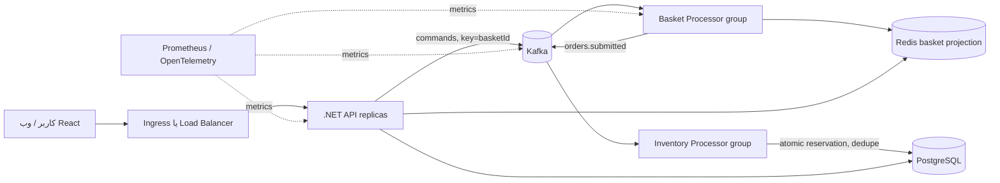
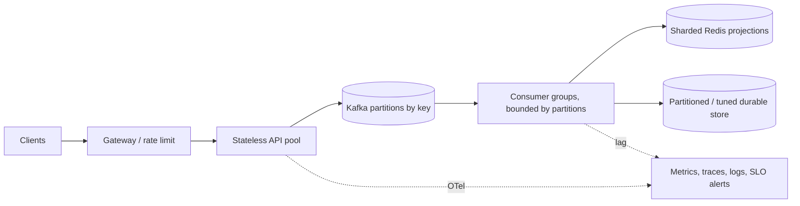

<div dir="rtl" align="right">

<p dir="ltr" align="center"><a href="KUBERNETES-GUIDE-EN.md">English</a> | <strong>فارسی</strong></p>

# راهنمای کامل Kubernetes برای HPT


<p align="center"><em>مسیر ورودی درخواست، صف پایدار، workerهای موازی و ذخیره‌سازی و پایش.</em></p>

این راهنما برای یادگیری و اجرای دستی پروژه است. مسیر `lab` برای لپ‌تاپ و یادگیری است؛ پوشهٔ `performance` فقط طرح اولیهٔ ظرفیت‌سنجی است و ظرفیت ۱۰۰٬۰۰۰ تراکنش در ثانیه را ثابت نمی‌کند. قبل از محیط واقعی، imageهای immutable، TLS، secret manager، backup/restore و آزمون بار لازم‌اند.

## معماری و مسیر داده



API فرمان‌ها را با کلید سبد به Kafka می‌فرستد و `202` می‌دهد؛ projection سبد eventual-consistent است. جدول `processed_events` در مسیر سفارش از اجرای دوبارهٔ reservation پس از commit DB جلوگیری می‌کند. checkout کلید idempotency می‌گیرد؛ اما batch سبد در consumer هنوز dedupe پایدار بر اساس `eventId` ندارد و retry دیررس می‌تواند ترتیب state را عقب ببرد. ترتیب Kafka فقط درون یک partition تضمین می‌شود. Redis در lab مدل خواندن است؛ PostgreSQL رزرو موجودی را در تراکنش انجام می‌دهد.

## واژگان Kubernetes

| مفهوم | کاربرد در این پروژه |
|---|---|
| Cluster / Node | صفحهٔ کنترل و ماشین‌های اجرای Pod؛ kind برای آزمایش محلی است. |
| Namespace | جداسازی نام‌ها و دسترسی‌ها؛ `hpt` محل اجزای پروژه است. |
| Pod | واحد اجرای container؛ با حذف Pod، Deployment آن را دوباره می‌سازد. |
| Deployment | مدیریت نسخه و تعداد replica برای API، worker و web. |
| StatefulSet و PVC | هویت و دیسک بادوام برای PostgreSQL/Kafka؛ حذف namespace می‌تواند داده را حذف کند. |
| Service | آدرس پایدار داخل کلاستر برای Podهای متغیر. |
| ConfigMap / Secret | تنظیمات و دادهٔ حساس؛ secretهای lab فقط نمونه‌اند. |
| Probe | liveness برای restart و readiness برای خارج‌کردن Pod ناآماده از ترافیک. |
| requests / limits | رزرو و سقف CPU/RAM؛ مبنای scheduling و HPA CPU. |
| HPA / KEDA | HPA با CPU؛ KEDA می‌تواند worker را با Kafka lag مقیاس دهد. |
| CRD / Operator | Strimzi منابع Kafka را به broker و topic واقعی تبدیل می‌کند. |

## پیش‌نیاز و اجرای lab در PowerShell

Docker Desktop با Kubernetes یا kind، `kubectl`، Docker، .NET 10 SDK، Node.js 24 و npm لازم است. برای restore پکیج‌ها دسترسی NuGet/npm هم نیاز است. ابتدا context را بررسی کنید تا فرمان روی کلاستر اشتباه اجرا نشود:

```powershell
kubectl config get-contexts
kubectl config current-context
kubectl cluster-info
```

برای استقرار تکرارپذیر lab، script ریشهٔ repo همهٔ مراحل و rolloutها را انجام می‌دهد. در kind نام cluster را هم وارد کنید:

```powershell
.\infra\kubernetes\lab\deploy.ps1 -ExpectedContext kind-k8s-course -KindClusterName k8s-course
```

برای Docker Desktop از `-ExpectedContext docker-desktop` استفاده و `-KindClusterName` را حذف کنید. script context جاری را بررسی می‌کند و اگر نامش مطابق انتظار نباشد متوقف می‌شود؛ بعد از ساخت imageها deploymentهای برنامه را restart می‌کند تا image محلی تازه را بگیرند. برای محیط واقعی از manifestهای lab و credential نمونه استفاده نکنید.

از ریشهٔ repo:

```powershell
kubectl apply -f infra/kubernetes/namespace.yaml
kubectl create configmap hpt-postgres-init -n hpt --from-file=001-init.sql=infra/postgres/init.sql --dry-run=client -o yaml | kubectl apply -f -
kubectl apply -f "https://strimzi.io/install/latest?namespace=hpt" -n hpt
kubectl wait deployment/strimzi-cluster-operator -n hpt --for=condition=Available --timeout=5m
kubectl apply -f infra/kubernetes/lab/kafka.yaml
kubectl wait kafka/hpt-kafka -n hpt --for=condition=Ready --timeout=15m
kubectl apply -f infra/kubernetes/lab/basket-topic-4p.yaml
kubectl apply -f infra/kubernetes/lab/dependencies.yaml
kubectl apply -f infra/kubernetes/lab/config.yaml
kubectl apply -f infra/kubernetes/lab/secret.yaml
dotnet publish src/Hpt.Api/Hpt.Api.csproj -c Release -r linux-x64 --self-contained false -o artifacts/kubernetes/api /p:UseAppHost=false
dotnet publish src/Hpt.BasketProcessor/Hpt.BasketProcessor.csproj -c Release -r linux-x64 --self-contained false -o artifacts/kubernetes/basket-processor /p:UseAppHost=false
dotnet publish src/Hpt.InventoryProcessor/Hpt.InventoryProcessor.csproj -c Release -r linux-x64 --self-contained false -o artifacts/kubernetes/inventory-processor /p:UseAppHost=false
Push-Location web
npm ci --no-audit --no-fund
npm run build
Pop-Location
docker build --load -t hpt-web:dev -f web/Dockerfile.runtime web
docker build --load -t hpt-api:dev --build-arg APP_DLL=Hpt.Api.dll -f infra/kubernetes/lab/Dockerfile.runtime artifacts/kubernetes/api
docker build --load -t hpt-basket-processor:dev --build-arg APP_DLL=Hpt.BasketProcessor.dll -f infra/kubernetes/lab/Dockerfile.runtime artifacts/kubernetes/basket-processor
docker build --load -t hpt-inventory-processor:dev --build-arg APP_DLL=Hpt.InventoryProcessor.dll -f infra/kubernetes/lab/Dockerfile.runtime artifacts/kubernetes/inventory-processor
# فقط برای kind؛ مقدار را با نام cluster خود عوض کنید
$KindClusterName = "k8s-course"
kind load docker-image hpt-api:dev hpt-basket-processor:dev hpt-inventory-processor:dev hpt-web:dev --name $KindClusterName
kubectl apply -f infra/kubernetes/lab/apps.yaml
kubectl get pods,svc,hpa -n hpt -w
kubectl port-forward -n hpt svc/hpt-web 8081:80
```

سپس `http://localhost:8081` را باز کنید. در پنجرهٔ دیگر `kubectl port-forward -n hpt svc/api 5080:8080` برای API. اگر image در kind دیده نشد، آن را با `kind load docker-image hpt-api:dev --name <cluster>` و برای هر image تکرار کنید.

## عیب‌یابی روزمره

```powershell
kubectl get all -n hpt
kubectl describe pod <pod> -n hpt
kubectl logs deploy/hpt-api -n hpt --all-pods=true --tail=100
kubectl get events -n hpt --sort-by=.lastTimestamp
kubectl top pods -n hpt
kubectl get hpa -n hpt
kubectl get pvc -n hpt
```

`ImagePullBackOff`: image/tag/registry را بررسی کنید. `Pending`: node capacity, taint, PVC/storage class را بررسی کنید. readiness ناموفق: وابستگی و health endpoint را ببینید. در workerهای این پروژه، `/health/ready` تا گرفتن حداقل یک Kafka partition پاسخ 503 می‌دهد و سلامت Redis را می‌سنجد؛ inventory worker علاوه بر آن PostgreSQL را هم بررسی می‌کند. این رفتار باعث می‌شود Pod تازه‌ساخته‌شده پیش از عضویت واقعی در consumer group آماده شمرده نشود. `/health/live` فقط process را می‌سنجد تا خطای موقت broker بی‌دلیل restart ایجاد نکند. HPA با `<unknown>`: metrics-server یا metrics API موجود نیست. افزایش replica worker از تعداد partitionهای مصرفی بیشتر، throughput اضافه نمی‌کند.

`kubectl top` و HPA از Metrics API (معمولاً metrics-server) استفاده می‌کنند. این API معادل scrape تاریخی Prometheus نیست: Prometheus lab این پروژه metricهای برنامه و exporterهای dependency را می‌گیرد، اما kubelet/cAdvisor، `kube-state-metrics` و `node-exporter` را نصب یا scrape نمی‌کند. برای نمودار/alert تاریخی CPU، memory، restart، PVC و وضعیت scheduling، در کلاستر واقعی باید monitoring stack مناسب نصب شود یا این منابع با TLS و RBAC متناسب با کلاستر پیکربندی شوند؛ metricهای مذکور را در داشبورد Prometheus lab حاضر فرض نکنید. دستورات روزمرهٔ بالا منبع مستقیم وضعیت لحظه‌ای Kubernetes هستند.

Basket Processor فرمان‌ها را در micro-batchهای محدود poll می‌کند و رویدادهای basketهای متفاوت را هم‌زمان به Redis می‌فرستد؛ ترتیب پیام‌های یک basket حفظ می‌شود و offset همان partition فقط بعد از موفقیت پردازش commit می‌شود. اندازهٔ پیش‌فرض با `Basket__MaxPollBatchSize=128` کنترل می‌شود؛ برای حافظه و latency آن را مرحله‌ای تغییر بده و metric `hpt_basket_poll_batch_size` را پایش کن. این بهینه‌سازی از RTT سریالی Redis می‌کاهد، اما ظرفیت عددی را بدون benchmark محیط مقصد ثابت نمی‌کند.

در کلاستر kind اگر image رسمی metrics-server از `registry.k8s.io` قابل pull نبود، ابتدا علت شبکه/registry را برطرف کنید. برای همین lab در این محیط، image سازگار `bitnamilegacy/metrics-server:0.8.0-debian-12-r4` از Docker Hub استفاده شد؛ legacy بودن آن یعنی راه‌حل دائمی/production نیست. پس از آماده‌شدن APIService، `kubectl top nodes`, `kubectl top pods -n hpt` و `kubectl get hpa -n hpt` را بررسی کنید. در محیط واقعی image رسمی را در registry مورداعتماد mirror و digest آن را pin کنید. گزینهٔ `--kubelet-insecure-tls` فقط workaround محلی kind است و برای production مناسب نیست.

## پاک‌سازی

این فرمان تمام workloadها و PVCهای namespace `hpt` را حذف می‌کند. برای StorageClass با reclaim policy برابر `Delete` دادهٔ volume هم پاک می‌شود. context را دوباره بررسی کنید:

```powershell
kubectl config current-context
kubectl delete namespace hpt --wait=true
kubectl get namespace hpt
kubectl get pv
```

برای حذف خود kind cluster (تمام state آن): `kind delete cluster --name <cluster>`. این کار با `kubectl delete namespace` فرق دارد و کل کلاستر را از بین می‌برد.

## طراحی مقیاس‌پذیری و هدف ۱۰۰٬۰۰۰ TPS

TPS باید تعریف شود: درخواست HTTP، فرمان سبد پذیرفته‌شده، یا checkout موفق؟ این‌ها بارهای متفاوت‌اند. هدف یک عدد benchmarkشده نیست. روش ظرفیت‌سنجی:

برای مراحل استقرار پروفایل چندگرهی، image registry، topicهای بزرگ، KEDA و بار مرحله‌ای، [runbook پرفورمنس ۱۰۰k](PERFORMANCE-100K-FA.md) را دنبال کنید. آن runbook به‌صراحت فرمان سبد را از checkout تکمیل‌شده جدا می‌سنجد.

1. بار هر نوع پیام، اندازهٔ payload، نسبت read/write/checkout، latency هدف، دوام و نرخ خطا را ثبت کنید.
2. آزمون را از API تا Kafka و Redis اجرا کنید؛ سپس مسیر checkout/PostgreSQL را جداگانه بسنجید.
3. در نرخ افزایشی، throughput پایدار، p50/p95/p99، error rate، consumer lag، CPU، حافظه، شبکه و دیسک را ثبت کنید.
4. ظرفیت را با headroom و تحمل خرابی یک broker/node محاسبه کنید؛ تکرار آزمون و restore را هم بسنجید.

تقریب اولیه: `partition count >= target events/sec / measured sustainable events/sec per partition`؛ سپس با skew کلید، replication، batch size، retention و recovery آزمون کنید. تعداد partition مساوی تعداد consumer موازی مؤثر در یک group است. hot basket ذاتاً روی یک partition مرتب می‌شود و یک کلید داغ را تقسیم‌کردن می‌تواند ترتیب/سازگاری را بشکند. برای ۱۰۰k فرمان basket باید چند shard کلید، partitioning سنجیده، producer batching، async ingestion، backpressure و Redis Cluster بررسی شوند. PostgreSQL رزرو موجودی محدودیت جداگانه است؛ برای کالاهای داغ رقابت روی ردیف/قفل می‌تواند bottleneck باشد. گزینه‌های scale کردن checkout و رزرو موجودی در [راهنمای System Design](SYSTEM-DESIGN-MASTER-FA.md) آمده‌اند. فقط benchmark می‌تواند ظرفیت واقعی را تأیید کند.



## معیارها و مشاهده‌پذیری پیشنهادی

| لایه | معیارها |
|---|---|
| API | request count و rate بر اساس route/status، latency histogram، active requests، dependency failures، queue publish latency |
| Kafka | bytes in/out، request latency، under-replicated partitions، ISR changes، disk/network، consumer lag و زمان ماند پیام |
| Workers | processed/failed/retried، batch size، processing duration، rebalance، lag و زمان commit |
| Redis | ops/sec، p99 latency، hit ratio، memory/evictions، replication/cluster health |
| PostgreSQL | transaction latency، lock waits، connections، WAL, deadlocks، pool saturation، replication lag |
| Kubernetes | desired/ready replicas، restarts، CPU/memory throttling، PVC usage، scheduling failures، HPA desired/current |
| کسب‌وکار | basket commands پذیرفته‌شده، checkout accepted/completed/rejected، reservation outcomes، duplicate events |

API اکنون OpenTelemetry Metrics دارد و exporter مسیر `/metrics` را ارائه می‌کند. metricهای دستی `hpt.basket.commands`، `hpt.checkout.commands`، `hpt.kafka.publish.failures` و `hpt.basket.batch.rejections` و histogram انتشار Kafka را ثبت می‌کنند؛ counter خطای publish برای delivery failureهای batch است و histogram batch هم tag ثابت `mode=batch` دارد. هم‌زمانی batch در هر Pod با `Ingestion__MaxConcurrentBatchesPerPod` محدود می‌شود؛ اضافه‌بار پیش از enqueue با HTTP 429 رد می‌شود و پس از enqueue permit تا دریافت delivery callbackها نگه داشته می‌شود، حتی اگر client قطع شود. ASP.NET Core instrumentation نیز متریک‌های درخواست را اضافه می‌کند. workerها processed، failed، processing-duration و `*.offsets.committed` را ثبت می‌کنند. شناسهٔ basket/order را به label تبدیل نکنید چون cardinality را بی‌حد می‌کند. Prometheus lab با RBAC محدود به namespace و Kubernetes endpoint discovery، هر pod را جدا scrape می‌کند؛ در محیط production مجوزها را با policy سازمان هماهنگ کنید. این manifest را نصب کنید:

برای کاهش overhead درخواست در ingest حجیم، API مسیر batch `POST /api/baskets/commands/batch` دارد: حداکثر ۵۰۰ فرمان `item-set` در هر درخواست. هر پیام هنوز با `basketId` partition-key می‌شود؛ پس ترتیب publishشده per-basket باقی می‌ماند. batch چند پیام را به شکل atomic در Kafka commit نمی‌کند. اگر در یک batch publish بخشی از پیام‌ها موفق شود، caller باید retry را با `eventId` ثابت انجام دهد؛ consumer فعلی این event ID را deduplicate نمی‌کند، پس چنین retryای هنوز تضمین exactly-once یا ترتیب درست projection ندارد. گزینه‌های حل، Kafka transaction برای atomic visibility، inbox پایدار برای dedupe، یا sequence افزایشی per-basket برای ردکردن فرمان قدیمی است؛ trade-offها در [راهنمای System Design](SYSTEM-DESIGN-MASTER-FA.md) آمده‌اند. در benchmark محلی `RATE=30` و `BATCH_SIZE=50` به تقریباً ۱٬۵۰۱ فرمان پذیرفته‌شده در ثانیه رسید؛ این یک آزمایش کوتاه روی kind تک‌نودی است، نه اثبات ظرفیت پایدار.

Consumerها offset را با `EnableAutoCommit=false` کنترل می‌کنند. commit دوره‌ای باید حتی وقتی topic موقتاً خالی می‌شود اجرا شود؛ در غیر این صورت آخرین offsetهای پردازش‌شده ممکن است فقط در حافظه بمانند و lag دیده‌شده در Kafka صفر نشود. workerهای این پروژه با poll حداکثر ۱۰۰ms و commit هنگام idle این tail را تخلیه می‌کنند. بعد از تغییر consumer، lag را از خود `kafka-consumer-groups.sh` یا Kafka Exporter بخوانید و همهٔ replicaهای worker را جداگانه از Prometheus بررسی کنید.

```powershell
kubectl apply -f infra/kubernetes/lab/api-servicemonitor.yaml
kubectl port-forward -n hpt svc/api 5080:8080
```

درخواست `http://localhost:5080/metrics` را بررسی کنید. ServiceMonitor فقط وقتی کشف می‌شود که Prometheus Operator نصب باشد و label مربوط به release با selector نصب شما هماهنگ باشد؛ در صورت تفاوت، `release: prometheus` را تغییر دهید. برای جمع‌آوری از همهٔ اجزای lab، manifest exporterها را هم اعمال کنید:

```powershell
kubectl apply -f infra/kubernetes/lab/observability-exporters.yaml
kubectl apply -f infra/kubernetes/lab/kafka.yaml
kubectl apply -f infra/kubernetes/lab/prometheus.yaml
kubectl rollout restart deployment/hpt-prometheus -n hpt
```

Strimzi Kafka Exporter lag گروه‌های مصرف‌کننده و topicها را می‌دهد؛ exporterهای رسمی Postgres و Redis معیارهای دیتابیس و cache را می‌خوانند. در این کلاستر، `up` برای API، هر دو worker، Kafka exporter، PostgreSQL exporter و Redis exporter برابر ۱ است؛ queryهای `pg_up`، `redis_up`، `kafka_brokers` و `kafka_consumergroup_lag` نیز داده برمی‌گردانند. SLI نمونه: نرخ موفقیت publish و latency آن، زمان تکمیل checkout، و lag صدکی. آستانهٔ SLO را بر اساس نیاز محصول تعیین کنید.

برای lab مستقل بدون Operator، `infra/kubernetes/lab/prometheus.yaml` یک Prometheus تک replica با retention بیست‌وچهارساعته می‌سازد و API را scrape می‌کند:

```powershell
kubectl apply -f infra/kubernetes/lab/prometheus.yaml
kubectl port-forward -n hpt svc/hpt-prometheus 19090:9090
```

Prometheus UI در `http://localhost:19090` است؛ query `up{job="hpt-api"}` باید `1` برگرداند. این پیکربندی فقط برای lab است: storage آن ephemeral است و HA/retention بلندمدت ندارد. jobهای workerها از پورت 9464 scrape می‌شوند؛ metricهای اصلی آن‌ها تعداد event موفق/ناموفق و histogram مدت پردازش‌اند.

همین manifest شامل recording ruleهای نرخ API، p95، مجموع lag، نرخ فرمان پذیرفته‌شده و نرخ پردازش basket است. alertها target-down، lag بالا، جلو افتادن پایدار نرخ ingest از processing همراه با backlog، خطای delivery در batch، فشار پایدار روی admission limit و p95 بالای ۵۰۰ms را پوشش می‌دهند. در Prometheus UI از بخش **Alerts** و **Rules** آن‌ها را ببینید. این ruleها فقط alert را evaluate می‌کنند؛ برای ارسال اعلان باید Alertmanager و receiver (مثلاً ایمیل یا پیام‌رسان) جدا تنظیم شود. پس از تغییر ConfigMap، Deployment پرومتئوس را restart کنید تا config لود شود.

## مسیر تمرین برای تسلط بر Kubernetes

این تمرین‌ها را فقط در cluster lab انجام دهید. مراحل ۴ و ۵ عمداً سرویس یا Pod را مختل می‌کنند؛ آن‌ها را روی production یا cluster مشترک اجرا نکنید. برای برگرداندن تعداد replica برنامه‌ها به manifest، در پایان `kubectl apply -f infra/kubernetes/lab/apps.yaml` را دوباره اجرا کنید؛ replica Redis را دستور خودش به یک برمی‌گرداند.

### تمرین ۱: نقشهٔ منابع را بخوان

```powershell
kubectl get namespaces
kubectl get deploy,statefulset,pod,svc,hpa,pvc -n hpt -o wide
kubectl get endpoints -n hpt
```

Deploymentهای `hpt-api`, `hpt-basket-processor`, `hpt-inventory-processor` و `hpt-web` را از StatefulSetهای dependency تشخیص بده. Service آدرس ثابت است و selector آن Podها را پیدا می‌کند؛ endpointها IPهای فعلی Podهای آماده را نشان می‌دهند. اگر Pod جایگزین شود، IP ممکن است عوض شود ولی client همچنان از Service استفاده می‌کند.

### تمرین ۲: readiness و liveness را از هم جدا کن

```powershell
kubectl get pods -n hpt -w
kubectl describe pod <api-pod> -n hpt
kubectl get endpoints api -n hpt -o yaml
kubectl get endpoints hpt-basket-processor -n hpt -o yaml
```

API وقتی Redis و PostgreSQL پاسخ می‌دهند ready می‌شود. worker سبد وقتی Kafka partition گرفته و Redis پاسخ می‌دهد ready می‌شود؛ worker inventory هم PostgreSQL را بررسی می‌کند. اگر readiness ناموفق باشد Pod زنده می‌ماند اما از endpointهای سرویس خارج می‌شود. liveness فقط process را می‌سنجد و در صورت شکست Kubernetes container را restart می‌کند. به‌همین دلیل readiness dependency failure و liveness process failure را مدل می‌کند.

### تمرین ۳: Deployment، replica و Service

در lab، تعداد `hpt-web` را موقتاً تغییر بده:

```powershell
kubectl scale deployment/hpt-web -n hpt --replicas=3
kubectl rollout status deployment/hpt-web -n hpt --timeout=2m
kubectl get pods -n hpt -l app=hpt-web -o wide
kubectl get endpoints hpt-web -n hpt
kubectl scale deployment/hpt-web -n hpt --replicas=2
```

Deployment تعداد replica مطلوب را ثبت می‌کند، ReplicaSet اختلاف را reconcile می‌کند و Service به Podهای ready مسیر می‌دهد. Web stateless است، پس هر replica می‌تواند درخواست‌ها را پاسخ دهد. API HPA دارد؛ تغییر دستی آن ممکن است HPA را دوباره به تعداد محاسبه‌شده برگرداند. worker را نیز فقط تا سقف partitionهای topic افزایش بده؛ consumerهای اضافه بدون partition بیکار می‌مانند.

### تمرین ۴: رفتار dependency failure و بازیابی

**فقط در lab تک‌کاربره:** Redis را موقتاً متوقف کن و readiness را ببین، سپس فوراً آن را برگردان:

```powershell
kubectl scale deployment/hpt-redis -n hpt --replicas=0
kubectl get pods,endpoints -n hpt -w
kubectl scale deployment/hpt-redis -n hpt --replicas=1
kubectl rollout status deployment/hpt-redis -n hpt --timeout=2m
kubectl get pods -n hpt -w
```

انتظار: Podهای API و worker process زنده دارند، اما readiness وابسته به Redis شکست می‌خورد؛ با بازگشت Redis، readiness باید دوباره برقرار شود. این تمرین حذف دادهٔ Redis را تضمین نمی‌کند، ولی ممکن است درخواست‌های جاری را مختل کند. قطع PostgreSQL یا Kafka را در تمرین جداگانه انجام بده و هر بار فقط یک dependency را تغییر بده.

### تمرین ۵: StatefulSet و PVC

PostgreSQL در این lab با StatefulSet/PVC اجرا می‌شود. Pod را حذف کن تا controller همان identity را دوباره بسازد؛ خود PVC را حذف نکن:

```powershell
kubectl get statefulset,pvc -n hpt
kubectl delete pod hpt-postgres-0 -n hpt
kubectl get pods,pvc -n hpt -w
```

Pod یک‌بارمصرف است و StatefulSet آن را بازمی‌سازد؛ PVC چرخهٔ عمر داده را جدا نگه می‌دارد. حذف PVC یا namespace می‌تواند داده را برای همیشه پاک کند، بسته به reclaim policy و storage provider.

### تمرین ۶: سؤالات سنجش فهم

1. چرا افزایش تعداد API replica می‌تواند مفید باشد ولی افزایش worker بیشتر از partitionها throughput را بالا نمی‌برد؟
2. اگر `/health/ready` برای worker 503 بدهد ولی `/health/live` 200 باشد، kubelet چه می‌کند و Service چه می‌کند؟
3. چرا پاسخ `202` API به معنی نهایی‌شدن checkout نیست؟
4. چرا حذف Pod PostgreSQL با حذف PVC یکی نیست؟
5. اگر lag رشد کند اما API پاسخ موفق بدهد، کدام بخش ظرفیت عقب مانده و کدام metricها را کنار هم می‌خوانی؟

**پاسخ کوتاه:** API stateless است و replicaها درخواست‌های مستقل می‌گیرند؛ consumer group به partitionهای قابل‌تخصیص محدود است. readiness ناموفق Pod را از endpoint سرویس بیرون می‌برد، اما liveness سالم مانع restart است. `202` یعنی فرمان پذیرفته شده، نه اینکه projection یا reservation نهایی شده باشد. StatefulSet Pod را برمی‌گرداند و PVC داده را نگه می‌دارد. lag رو‌به‌رشد یعنی مصرف‌کننده از ورودی عقب است؛ accepted rate، processed rate، lag، CPU throttling و Redis latency را هم‌زمان بررسی کن.

## گزینه‌های معماری برای یادگیری

| گزینه | مناسب برای | هزینه و محدودیت |
|---|---|---|
| Monolith + PostgreSQL | شروع ساده و بار کم | ساده، اما جداسازی بار و replay محدود |
| Stateless API + Kafka + workers (فعلی) | جذب جهش بار، پردازش async، replay | eventual consistency و عملیات Kafka |
| Kafka + DB outbox/CDC | اطمینان از انتشار رویداد هم‌راستا با commit | پیچیدگی CDC و schema evolution |
| Partitioned relational DB | تراکنش و query رابطه‌ای | shard key، migration و cross-shard دشوار |
| Stream processor (Kafka Streams/Flink) | aggregation/stateful stream در مقیاس | state/recovery و عملیات تخصصی |
| Managed Kafka/Redis/DB | کاهش عملیات زیرساخت | هزینه، وابستگی ارائه‌دهنده و نیاز به آزمون محدودیت‌ها |

برای هر گزینه، ordering، idempotency، consistency، replay، backpressure، failure recovery، هزینه و عملیات روزانه را روی نمودار جریان داده مقایسه کنید. معماری فعلی برای آموزش async مناسب است، اما ادعای ۱۰۰k TPS ندارد.

## چک‌لیست پیش از production

- imageها با tag تغییرناپذیر و registry امن؛ non-root، scan و resource requests/limits.
- TLS و SASL/ACL برای Kafka؛ Secret واقعی خارج از فایل plain YAML؛ RBAC و NetworkPolicy.
- چند replica روی nodeهای مستقل، PodDisruptionBudget، topology spread و autoscaling با lag.
- Kafka و پایگاه داده با storage، replication، backup، restore و disaster recovery آزموده‌شده.
- migration schema، سازگاری event، idempotency، DLQ/retry policy، rate limit و backpressure.
- dashboards، alertها، SLOها، tracing، logهای ساختاریافته و runbook رخداد.
- بارسنجی end-to-end روی سخت‌افزار هدف و اعلام ظرفیت فقط با نتایج قابل تکرار.

</div>
