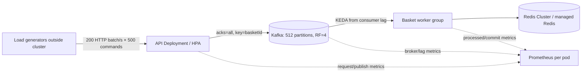
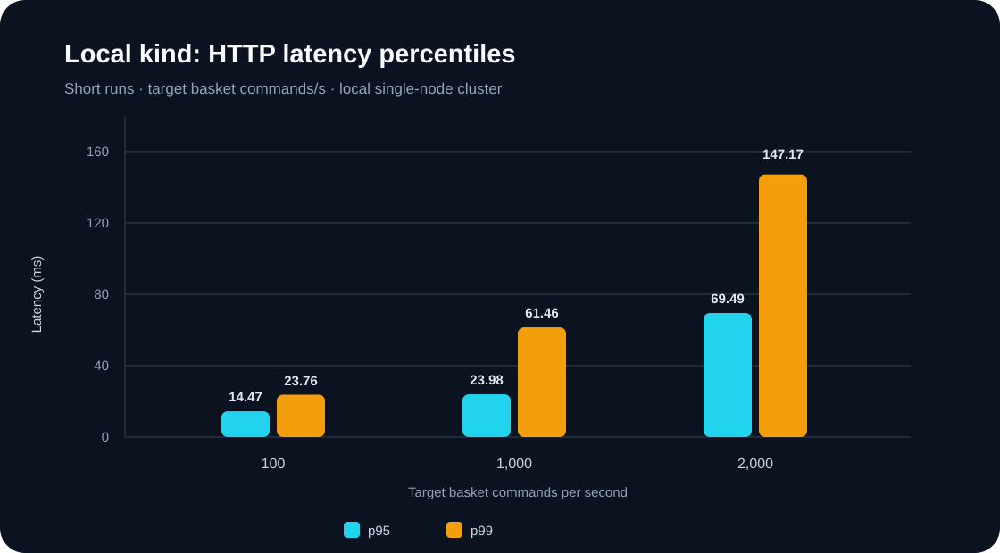
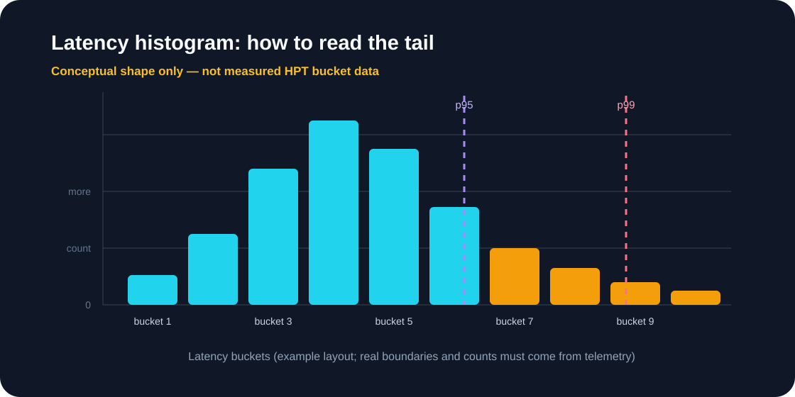

<div dir="ltr" align="left">

<p align="center"><a href="PERFORMANCE-100K-EN.md"><strong>English</strong></a> | <a href="PERFORMANCE-100K-FA.md">فارسی</a></p>

# Capacity Test Runbook: 100,000 Basket Commands per Second


This runbook describes how to deploy the separate performance profile and measure it in controlled stages. In this document, `100,000` means **accepted basket `item-set` commands per second**. It does not mean 100,000 paid orders or successful inventory reservations per second. The multi-node profile has not been run on this project's production hardware. Manifests alone do not prove capacity.

> **Safety boundary:** apply `infra/kubernetes/performance` only to a dedicated cluster. Its Kafka resource is named `hpt-kafka`, the same as the lab resource. Do not apply its Kafka or NodePool manifests to the existing lab cluster.

## 1. Architecture and measurement boundaries



Track four distinct outcomes: successful HTTP requests, commands acknowledged by the broker, commands applied to the Redis projection, and completed checkout. Existing basket benchmarks measured Kafka acceptance and basket-consumer drain. Checkout and PostgreSQL need a separate workload.

If the target is 100,000 **completed orders with inventory reservation** per second, define and test that target directly. The current `orders.submitted` → Inventory Processor → PostgreSQL path has its own row-lock, database-write-capacity, and consistency limits. Do not infer checkout throughput from basket-command throughput. PostgreSQL designs, SKU ownership shards, escrow/bucket inventory, and reservation sagas are discussed in the [System Design guide](SYSTEM-DESIGN-MASTER-EN.md).

## 2. Capacity envelope and environment isolation

Run `infra/kubernetes/performance` on a **separate cluster**. The manifest requests below are raw minimums; review them against the target StorageClass and real cluster capacity. The worker estimate is a linear extrapolation from a short 25k/s run on kind.

| Component | Example setting | Approximate requested total before headroom |
|---|---:|---:|
| Kafka controllers | 3 × 0.5 CPU and 1Gi | 1.5 CPU, 3Gi |
| Kafka brokers | 12 × 2 CPU and 4Gi; 500Gi PVC each | 24 CPU, 48Gi, about 5.9TiB PVC |
| Basket workers | about 26 at 0.5 CPU and 512Mi each | about 13 CPU and 13Gi before headroom |
| API | 12 initial replicas × 0.25 CPU and 256Mi | 3 CPU and 3Gi |

This excludes Redis, PostgreSQL, Prometheus, OS, page cache, rolling-update surge, failover, and spare capacity. Do not start on a cluster that cannot actually reserve the requested resources. The 26-worker value is only `100,000 / 4,000`, extrapolating one short run. It is not production sizing.

The performance profile reuses the application resource requests from `infra/kubernetes/lab/apps.yaml`, while HPA/KEDA set the replica ceilings:

| Group | Maximum replicas | Request per Pod | Total at maximum |
|---|---:|---:|---:|
| API | 256 | 0.25 CPU / 256Mi | 64 CPU / 64Gi |
| Basket worker | 512 | 0.5 CPU / 512Mi | 256 CPU / 256Gi |
| Inventory worker, if checkout lag grows | 128 | 0.5 CPU / 512Mi | 64 CPU / 64Gi |

Kafka controllers/brokers plus API and basket at their maximums request about **345.5 CPU and 371Gi RAM**. If Inventory also reaches its maximum, this rises to about **409.5 CPU and 435Gi**. This still excludes exporters, Redis/PostgreSQL, Prometheus, DaemonSets, system reserve, page cache, rollout surge, and failover capacity. The raw profile PVC requests are 12×500Gi for brokers and 3×20Gi for controllers, about 5.9TiB before storage overhead and recovery space.

These maxima do not mean you need to buy that many nodes on day one. But if HPA/KEDA can scale to these values while a backlog grows, the scheduler may leave hundreds of Pods `Pending`. Set `maxReplicaCount` to actual cluster quota/capacity, or provide matching node autoscaling and scale-out budget. The estimate of 26 basket workers is a point estimate from a short run; the 512 maximum is only a controller upper bound.

### Prerequisites

- A multi-node Kubernetes cluster, durable StorageClass, and enough broker PVC capacity. Calculate final storage from bytes/message, retention, and replication.
- Kubernetes-compatible versions. The lab installer uses `latest`, which changes over time. At the time this guide was written, the installed Strimzi image was 1.3.1 with Kafka 4.3.2. Check the [Strimzi downloads and compatibility](https://strimzi.io/downloads/) and pin a release for production. KEDA 2.21 was tested with Kubernetes 1.34–1.36; see the [KEDA installation guide](https://keda.sh/docs/2.21/deploy/).
- Immutable images in a registry reachable by every node. Local Docker Desktop tags such as `hpt-api:dev` are not present on remote nodes.
- A capacity- and failover-tested Redis Cluster or managed Redis service. The single lab Redis instance is not suitable for this profile.
- Managed/HA PostgreSQL for checkout. Define and benchmark the order rate separately.
- TLS, Kafka authentication, a secret manager, NetworkPolicy, backup/restore, quotas, monitoring, and load generators outside the service nodes.

Kafka in this profile uses an internal plaintext listener for isolated testing. Before connecting real workloads, coordinate TLS/authentication across Kafka, application producer/consumer settings, Kafka exporter, and KEDA `TriggerAuthentication`. Enabling TLS only on Kafka does not automatically configure the application or autoscaler.

## 3. Prepare the registry and cluster

Build and push immutable image tags from CI or a build machine. Replace the registry address with your own:

```powershell
$Registry = "registry.example.com/pouya/hpt"
$Version = "<git-sha>"

docker build -t "$Registry/api:$Version" -f src/Hpt.Api/Dockerfile .
docker build -t "$Registry/basket-processor:$Version" -f src/Hpt.BasketProcessor/Dockerfile .
docker build -t "$Registry/inventory-processor:$Version" -f src/Hpt.InventoryProcessor/Dockerfile .
docker build -t "$Registry/web:$Version" -f web/Dockerfile --build-arg VITE_API_BASE_URL=/ .
docker push "$Registry/api:$Version"
docker push "$Registry/basket-processor:$Version"
docker push "$Registry/inventory-processor:$Version"
docker push "$Registry/web:$Version"
```

Install the namespace and Strimzi operator in the performance cluster. Pin an operator release compatible with your Kubernetes and Kafka versions; this URL illustrates the lab's current installer only:

```powershell
kubectl apply -f infra/kubernetes/namespace.yaml
kubectl apply -f "https://strimzi.io/install/latest?namespace=hpt" -n hpt
kubectl wait deployment/strimzi-cluster-operator -n hpt --for=condition=Available --timeout=10m
```

After the operator is ready, create the Kafka node pools and brokers:

```powershell
kubectl apply -f infra/kubernetes/performance/kafka.yaml
kubectl wait kafka/hpt-kafka -n hpt --for=condition=Ready --timeout=30m
kubectl get kafkanodepool -n hpt
kubectl get pods,pvc -n hpt -o wide
```

Expect three controllers, twelve brokers, and their PVCs. If Kafka is not ready, check scheduling, StorageClass, PVCs, quotas, and operator events. Do not create topics before the brokers are ready.

Create the performance topics:

```powershell
kubectl apply -f infra/kubernetes/performance/topics.yaml
kubectl get kafkatopics -n hpt
```

`basket.commands` has 512 partitions and replication factor 4. Partitions cap active consumers in a group. The `basketId` key preserves order for each basket; a hot basket is still limited to one partition/consumer.

## 4. Configure dependencies, secrets, and application

`infra/kubernetes/lab/dependencies.yaml` contains simple lab Redis/PostgreSQL instances. Do not use them for a 100k performance run. Put Redis Cluster and real/test PostgreSQL endpoints into namespace secrets through your secret manager. Never commit credential values or put them into shell history.

The application ConfigMap needs at least these settings. Change `Redis__ConnectionString` to Redis Cluster seed endpoints before applying; the lab value points to a single Redis instance:

```text
Kafka__BootstrapServers=hpt-kafka-kafka-bootstrap:9092
Kafka__BasketTopic=basket.commands
Kafka__OrdersTopic=orders.submitted
Kafka__InventoryResultsTopic=orders.inventory-results
Kafka__BasketConsumerGroup=basket-projector-v1
Kafka__InventoryConsumerGroup=inventory-reservation-v1
Redis__ConnectionString=<Redis Cluster seed endpoints>
ConnectionStrings__Inventory=<PostgreSQL endpoint from Secret>
Ingestion__MaxConcurrentBatchesPerPod=8
Basket__MaxPollBatchSize=128
```

Each API Pod accepts at most 8 concurrent batch requests and rejects excess requests before publish with `429 Retry-After: 1`; retry is safe because that handler did not run the batch. Each API Pod's Kafka producer queue is capped at 5,000 messages or 64MiB, whichever comes first. Basket Processor polls up to 128 records and concurrently sends independent baskets to Redis, preserves order within a basket, and commits a partition offset only after processing succeeds. These are starting guardrails, not fixed capacity values. Tune them against message size, broker latency, memory limits, replica count, and SLO. The limiter is per replica, so total concurrency changes with API replica count. The current API HPA scales on CPU and does not directly consume the rejection metric; observe sustained 429s and tune the limit/replicas against resource headroom. Enforce customer-wide quotas at a shared gateway if required.

Create the schema through your approved migration process before checkout. `infra/postgres/init.sql` creates the sample tables and seeds four test products; do not move this sample seed data into production.

In `infra/kubernetes/lab/apps.yaml`, replace the images for all four Deployments with the tags built above:

| Container | Image |
|---|---|
| API | `registry.example.com/pouya/hpt/api:<version>` |
| Basket processor | `registry.example.com/pouya/hpt/basket-processor:<version>` |
| Inventory processor | `registry.example.com/pouya/hpt/inventory-processor:<version>` |
| Web | `registry.example.com/pouya/hpt/web:<version>` |

Set worker/API resources and starting replicas for your environment. The broker topic and `Kafka__BasketTopic` must both be `basket.commands`.

```powershell
kubectl apply -f infra/kubernetes/lab/config.yaml
# Create secrets through your secret manager; do not copy the lab secret.yaml.
kubectl apply -f infra/kubernetes/lab/apps.yaml
kubectl rollout status deployment/hpt-api -n hpt --timeout=10m
kubectl rollout status deployment/hpt-basket-processor -n hpt --timeout=10m
kubectl rollout status deployment/hpt-inventory-processor -n hpt --timeout=10m
kubectl get pods -n hpt -o wide
```

For a private registry, add `imagePullSecrets` to the Pod templates. API readiness checks Redis and PostgreSQL. Worker readiness stays 503 until a Kafka consumer has an assigned partition; the basket worker also checks Redis, and the inventory worker checks Redis and PostgreSQL. Kafka consume errors temporarily remove a worker from ready service. Liveness checks only the web-metrics process so a temporary broker outage does not trigger a restart loop. After rollout, inspect consumer groups, lag, and dependency health in dashboards and `kubectl describe pod`.

## 5. Autoscaling and monitoring

Install KEDA. This manifest installs KEDA 2.21.0; match the destination Kubernetes version to that release's compatibility matrix:

```powershell
kubectl apply --server-side -f https://github.com/kedacore/keda/releases/download/v2.21.0/keda-2.21.0.yaml
kubectl get pods -n keda -w
kubectl get crd scaledobjects.keda.sh
```

After the operator and CRDs are ready, remove the lab CPU HPA for basket workers so two controllers do not compete for replica count. Then enable the API HPA and performance-profile KEDA ScaledObjects:

```powershell
kubectl delete hpa hpt-basket-processor -n hpt --ignore-not-found
kubectl apply -f infra/kubernetes/performance/apps-hpa.yaml
kubectl apply -f infra/kubernetes/performance/keda-scalers.yaml
kubectl get hpa,scaledobject -n hpt -w
```

KEDA scales basket workers from 16 to at most 512 based on lag; constrain the result by quota, node resources, and partitions. The [KEDA Apache Kafka scaler](https://keda.sh/docs/2.21/scalers/apache-kafka/) defines `lagThreshold` as the target lag used in scaling decisions. The current `4000` is roughly one second of backlog per worker at the observed kind rate. Calculate the threshold from sustainable worker throughput and allowed drain time. More than 512 consumers in this group cannot add parallelism. The API HPA requests 12–256 replicas and must fit the resource budget and load balancer.

Lab Prometheus uses endpoint discovery and namespace-scoped RBAC to scrape every Pod. For a remote profile, configure image, persistent storage, retention, alert routing, and production RBAC first. Track these metrics per Pod and in aggregate:

- `hpt_basket_commands_total`: commands accepted by the API.
- `hpt_basket_events_processed_total`: commands applied to the basket projection.
- `hpt_basket_offsets_committed_total`: committed offsets.
- `hpt_basket_poll_batch_size`: micro-batch size per Basket Processor poll; compare p50/p95 with processing duration.
- `hpt_kafka_publish_failures_total`: failed record deliveries in the batch API path.
- `hpt_basket_batch_rejections_total`: batch requests rejected with 429 by a Pod's pre-publish limiter.
- `kafka_consumergroup_lag`: queued work per partition.
- `http_server_request_duration_seconds`: API request rate/latency; use low-cardinality route/status labels.
- Kafka disk/network and Redis operations/latency from exporters.

### Kubernetes metric collection boundary in the lab

Current Prometheus scrapes application and Kafka/PostgreSQL/Redis exporter metrics. It does **not** install/scrape kubelet/cAdvisor, `kube-state-metrics`, or `node-exporter`. Do not assume metrics such as `container_cpu_usage_seconds_total`, throttling, working set, PVC state, restarts, or scheduling are present in this Prometheus. Use the Metrics API for current resource values:

```powershell
kubectl top nodes
kubectl top pods -n hpt
kubectl get hpa -n hpt
kubectl describe pod <pod> -n hpt
kubectl get events -n hpt --sort-by=.lastTimestamp
kubectl get pvc -n hpt
```

`metrics-server` powers the Metrics API for `kubectl top` and HPA; it does not export these series to Prometheus. For historical Kubernetes graphs and alerts, install a monitoring stack compatible with the target cluster or configure secure kubelet/cAdvisor, `kube-state-metrics`, and `node-exporter` scraping. Access, TLS, RBAC, retention, and alert routing depend on the cluster. PromQL below applies only to series that exist in the target Prometheus.

Do not confuse API acceptance with processing throughput. After each run, inspect the consumer group and confirm lag returned to zero or the defined SLO. Use `rate()` when aggregating counters across Pod restarts.

Example PromQL:

```promql
# Broker-acknowledged basket commands per second
sum(rate(hpt_basket_commands_total[5m]))

# Commands applied to basket projections per second
sum(rate(hpt_basket_events_processed_total[5m]))

# Current consumer lag
hpt:kafka_consumer_lag:sum

# p95 records per Basket Processor poll
histogram_quantile(0.95,
  sum by (le) (rate(hpt_basket_poll_batch_size_bucket[5m])))

# p95 wait from batch publish to Kafka delivery report
histogram_quantile(0.95,
  sum by (le) (rate(hpt_kafka_publish_duration_milliseconds_bucket{mode="batch"}[5m])))

# Batch requests rejected with 429 per second (after deploying the limiter build)
sum(rate(hpt_basket_batch_rejections_total[5m]))
```

The publish-duration histogram is total batch duration, not per-message latency. New publish-failure and rejection series appear only after the updated image is built and deployed.

## 6. Staged load plan

Run load generators outside the cluster. In the batch script, `RATE` is HTTP batches/second; `command rate = RATE × BATCH_SIZE`. With batches of 500, 100k commands/s is about 200 HTTP requests/s.

Run stages one at a time. Wait for lag to drain before moving on:

| Stage | `BATCH_SIZE` | Total batch rate | Target command rate | Initial duration |
|---|---:|---:|---:|---:|
| Warm-up | 50 | 20/s | 1k/s | 2 minutes |
| Baseline profile | 500 | 10/s | 5k/s | 5 minutes |
| Intermediate | 500 | 50/s | 25k/s | 5 minutes |
| Target ramp | 500 | 100/s | 50k/s | 5 minutes |
| Target | 500 | 200/s | 100k/s | 30 minutes, then soak |

Example run:

```powershell
$env:BASE_URL = "https://hpt.example.com"
$env:RATE = "50"
$env:DURATION = "5m"
$env:BATCH_SIZE = "500"
$env:PRE_ALLOCATED_VUS = "100"
$env:MAX_VUS = "1000"
k6 run infra/performance/k6-basket-batch.js
```

For the 100k target, run four independent generators at 50 batches/s each, or more generators with an even rate split. Sum `basket_commands_submitted` across generators. Monitor generator CPU/network so it does not become the bottleneck.

For every stage record: commit SHA, image digest, generator count, workload/payload/key skew, successful batch and command rate, p50/p95/p99, HTTP/produce errors, consumer-group lag before/during/after, HPA replicas, CPU throttling, Redis operations/latency, broker disk/network, and drain time. Pass only when sustained rate, latency/error SLO, acceptable lag, and headroom hold together. Then remove one node and one broker separately and verify recovery.

## 7. Current measurements and interpretation

The `kind-k8s-course` runs used one node, four Kafka partitions, and at most four basket workers:

| Requested rate | Accepted rate | HTTP p95 | Consumer result |
|---:|---:|---:|---|
| 5k commands/s, batch=500 | about 5,015/s | 37ms | lag returned to zero |
| 10k commands/s, batch=500 | about 9,998/s | 69ms | lag returned to zero |
| 25k commands/s, batch=500 | about 24,966/s | 206ms | about 91k lag immediately; zero within 10s; worker CPU up to 900m |

At 25k/s, committed offsets advanced about 159k during 10 seconds, near 4k messages/s for each of the four workers in that run. This short run is the temporary basis for a 4000 threshold. Runs lasted 10–15 seconds on one node. The 100k target remains **unproven** until a multi-node ramp and soak with SLOs and failure tests are completed.

### Recorded latency chart and histogram shape

The chart shows three short single-request runs from this project's records. These are target rates on a single-node kind cluster and do not represent production capacity. Batch scenarios are separate; do not directly compare batch-request latency to single-request latency.



The measured notes retain selected percentiles, not raw latency samples or bucket frequencies. Therefore the following histogram is conceptual; its bar counts are **not measured data**.



For an actual histogram, store the run's latency buckets/samples and build from Prometheus `*_bucket` series. Choose bucket boundaries precise enough for the SLOs (for example around 100ms, 250ms, 500ms, and 1s). `histogram_quantile()` estimates percentiles from buckets. Avoid high-cardinality labels such as customer or order IDs.

## 8. Clean up the dedicated performance profile

For a dedicated test environment, stop workloads and remove ScaledObjects first. Kafka PVCs in these manifests use `deleteClaim: false`; decide whether to retain topic data before removing the namespace. Never delete a shared namespace.

```powershell
kubectl delete -f infra/kubernetes/performance/keda-scalers.yaml
kubectl delete -f infra/kubernetes/performance/topics.yaml
kubectl delete -f infra/kubernetes/performance/kafka.yaml
```

Deleting the custom resources does not necessarily delete retained PVCs. Delete a PVC only after confirming its name, namespace, and data-retention requirement.

</div>
