<div dir="ltr" align="left">

<p align="center"><a href="SYSTEM-DESIGN-MASTER-EN.md"><strong>English</strong></a> | <a href="SYSTEM-DESIGN-MASTER-FA.md">فارسی</a></p>

# System Design Master Guide for a High-Throughput Transaction System


This is a learning and decision guide, not a recipe that guarantees 100,000 TPS. Capacity is meaningful only when workload, hardware, SLOs, and measured results are known. The current kind cluster is for learning and smoke tests; it does not represent production.

## 1. Define the problem before choosing technology

| Question | Example definition |
|---|---|
| What does TPS count? | Incoming HTTP requests, accepted messages, or completed checkout? |
| What is the workload mix? | 90% basket updates, 9% reads, 1% checkout (example only). |
| What is the latency goal? | p95/p99 for command acceptance and checkout completion separately. |
| What durability is required? | Is success returned only after a durable Kafka acknowledgement? |
| What must be ordered? | Must updates to one basket remain ordered? |
| What are retry semantics? | What happens when the same request uses the same idempotency key? |
| Which failures must be tolerated? | Pod, node, broker, zone, or region? |
| What are data size and growth? | Message size × rate × retention × replication. |

Separate “command accepted” from “order completed.” The current API returns `202` after publishing to Kafka; it does not mean inventory has been reserved.

## 2. Current architecture and consistency boundaries

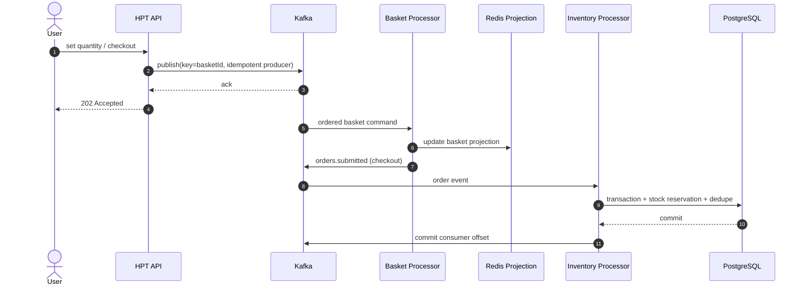

Kafka preserves order within a partition; basket keys place updates for one basket together. Redis is a rebuildable projection with a 24-hour TTL. On the inventory path, the database commits before the consumer offset; `processed_events` prevents a repeated reservation. Publishing the result to Kafka and committing PostgreSQL are not one distributed transaction, so every step needs safe retry behavior and observability.

## 3. Architecture options and trade-offs

### A. Monolith and PostgreSQL

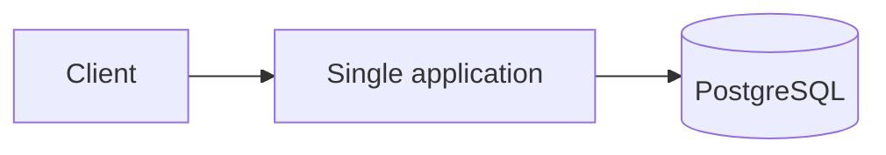

Best first step when load is manageable and transactional logic matters. It has the fewest components and simplest debugging. At higher load, connection pools, row locks, and database write capacity may become bottlenecks. Start with indexes, query tuning, cache, and read replicas; do not shard before evidence requires it.

### B. Stateless API, queue, and workers (current model)

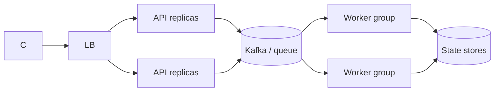

Useful for bursts and asynchronous work. A queue absorbs spikes; workers scale independently; replay is possible. Costs include eventual consistency, lag management, retries, poison messages, schema evolution, and broker operations. Apply backpressure using queue/lag ceilings and rate limits; an unbounded queue only postpones failure.

### C. Transactional Outbox and CDC

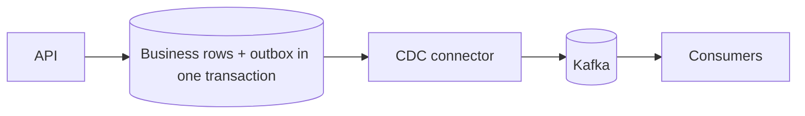

When a database change and event publication must not diverge, write the outbox row in the same business transaction and publish it through CDC. This avoids direct dual writes (database first, then Kafka, or vice versa). Consumers still need idempotency; monitor outbox retention, ordering, CDC lag, and schema compatibility.

### D. Event sourcing

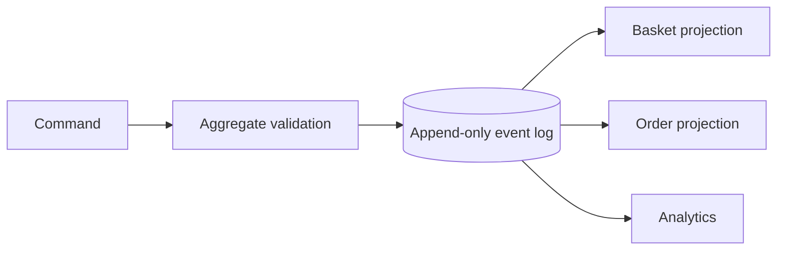

Choose it when history, audit, state reconstruction, and changing read models are valuable. Events become the source of truth and projections are derived. Costs include event versioning, long replay, data correction, snapshots, and eventual consistency. Avoid it for simple CRUD without a domain need.

### E. Stream processing

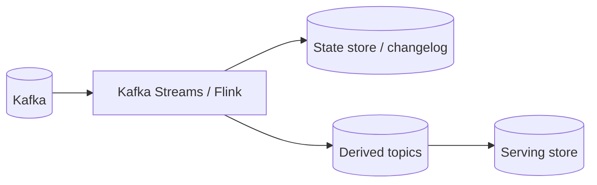

Useful for windowed aggregation, stream joins, and stateful computation. Kafka Streams and Flink manage state and recovery but require operational expertise and partition design. Relational transactions may still be needed for inventory reservation.

### F. Data sharding

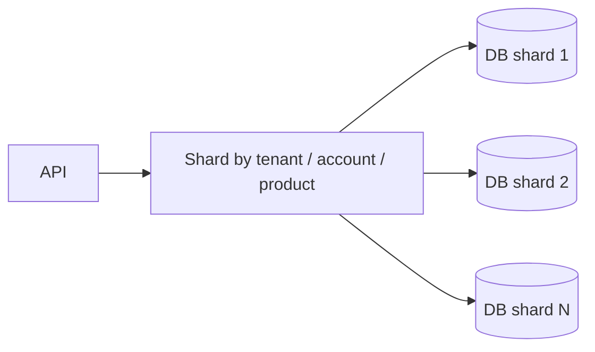

Consider sharding when one tuned database is not enough. Select a shard key from access patterns; measure hot keys and skew; design migration and resharding from the start. Cross-shard transactions, global uniqueness, and reporting become harder. Sharding inventory by product can concentrate contention on one hot SKU; splitting inventory into reservable buckets is an alternative with consistency costs.

### G. Cache and CQRS

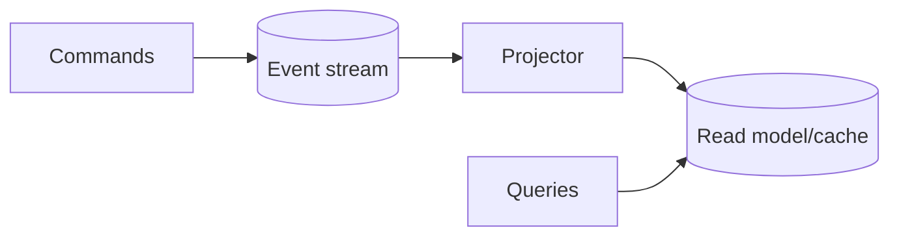

Use when read/write volume or response models differ. A read model is optimized for queries; a cache is not the source of truth unless durability and recovery are explicitly designed. Invalidation, stale reads, cache stampedes, and slow rebuilds are failure modes.

### H. If the goal is 100,000 checkouts or inventory reservations per second

This differs from 100,000 basket commands/s. The current implementation opens one PostgreSQL transaction per order, conditionally decrements stock (`available >= quantity`), writes the order/items, and records `processed_events`. This prevents selling more than available stock in the current database, but simultaneous orders for a hot SKU serialize on the same row. More worker Pods do not remove that shared lock.

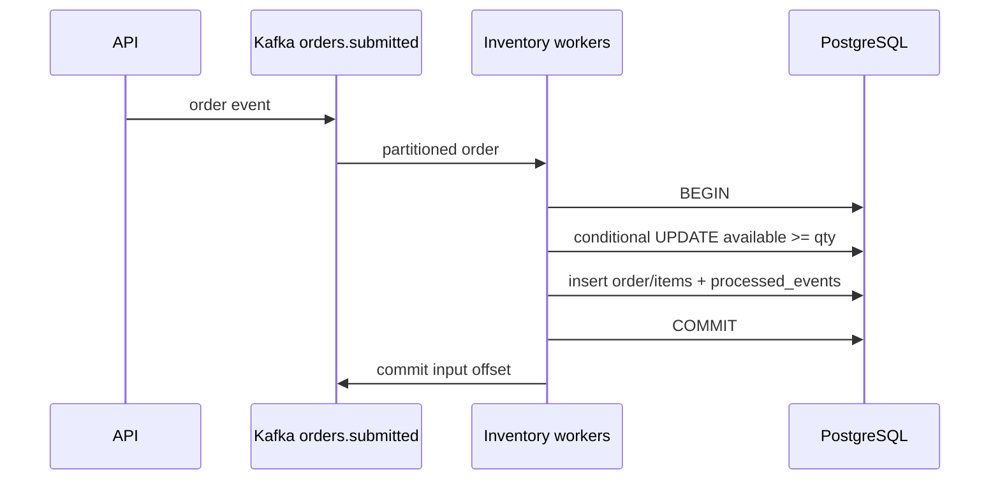

Choose based on oversell tolerance and whether multiple SKUs must be atomic:

| Approach | Oversell control / atomicity | Bottleneck / cost | Appropriate when |
|---|---|---|---|
| Strong PostgreSQL + query/index/pool tuning | ACID for the complete order; reservation and order can share a transaction. | Hot-row contention, WAL, connection/I/O, and one primary writer remain. | Start here until tests prove the DB is the bottleneck. |
| PostgreSQL partitioning/sharding by product or tenant | Simple transactions within one shard and clear ownership. | Multi-shard orders lose one ACID transaction; routing and resharding are harder. | Data/access patterns can be separated. |
| Single owner per SKU/shard via Kafka | Clear ordering per inventory item; replay and dedupe are possible. | Multi-SKU events span owners; order response requires saga/coordination and timeouts. | Inventory order matters and async results are acceptable. |
| Escrow/inventory buckets | Pre-allocate total stock among independent buckets; local decrements run in parallel without exceeding total allocation. | A bucket may run out while another has stock; rebalancing and hold release are complex. | Hot SKUs and high reservation rate justify inventory fragmentation. |
| Oversell/backorder with compensation | Faster acceptance without strict reservation at ingress. | Payment/order may later be rejected or compensated; customer/financial commitments change. | Business rules allow backorder or substitution. |

Single-owner or bucket designs often turn a multi-item order into a reservation saga:

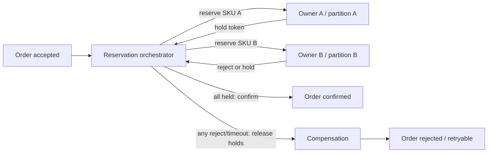

Saga design needs expiring holds, unique `reservationId` values, idempotent confirm/release, recoverable timeouts, and API-visible intermediate state. Kafka transactions make Kafka publishes atomic; they are not distributed transactions across Kafka and PostgreSQL. Outbox/CDC coordinates event publication with database commit but does not increase row-lock or database write capacity by itself.

For checkout sizing, measure final success separately from request and event ingress. End-to-end capacity is the minimum of order publishing, reservation owners/partitions, durable ledger, database commit, and result delivery. Record hot SKU count, lines/order, rejection rate, lock wait, WAL/s, connection concurrency, and hold duration. Until oversell semantics, multi-item atomicity, and timeout behavior are defined, “100k checkout/s” is incomplete.

## 4. Partition, key, and ordering choices

Start with a measured estimate:

```text
partitions_needed >= target_events_per_second / measured_safe_events_per_second_per_partition
```

Then include headroom, replication factor, record size, acknowledgements, compression, consumer processing time, and broker disk/network. This is an initial estimate only. A basket key preserves order for each basket but cannot parallelize one hot basket. Do not promise global ordering unless required; global order limits throughput.

### Where should batching happen?

| Layer | Reduces | Trade-off |
|---|---|---|
| Client/API batch | HTTP/TLS/auth round trips | Larger payloads, partial failure, fairness, and per-item results must be handled. |
| Kafka producer batch | Broker requests and syscalls | `linger` can increase latency and buffers use memory. |
| Consumer micro-batch | Per-record processing overhead | Larger batches use memory and can increase tail latency. |
| Database batch | SQL round trips and commit overhead | Lock duration, rollback cost, and atomicity scope increase. |

Batch at the layer with measured overhead. Do not treat the HPT batch API's limit of 500 as an optimal Kafka or database batch size.

### Retry boundaries in the current implementation

The batch API's `eventId` is optional; when absent, the API creates a new UUID for each attempt. A client must reuse the same ID for retries. The current basket consumer does not retain `eventId` as a dedupe key. Its Redis guard recognizes a replay of the same Kafka partition/offset, not two separate publishes with the same `eventId`. Because `item-set` writes absolute quantity, an immediate duplicate often produces the same value; a late retry after a newer command may overwrite newer state. Treat this API as **at-least-once with usually idempotent effect, but without request-level retry dedupe/order guarantees**.

| Method | Guarantee and cost | Choose when |
|---|---|---|
| Kafka transaction for a batch | All publishes commit or abort; retrying with the same business ID can still duplicate the logical event. Adds transaction latency and producer-ID handling. | Batch must be atomically visible in Kafka. |
| Inbox with unique `eventId` | Durable consumer storage deduplicates retries; adds writes, indexes, and retention. | Each business command must have one effect and storage cost is acceptable. |
| Monotonic basket version | Projection accepts only a version newer than its current one; old retries cannot move state backward. Version generation must itself be atomic/retry-stable. | Final state matters more than retaining every change and stable sequencing is available. |
| Event log plus rebuildable projection | Inputs remain append-only; projections rebuild from version/checkpoint. Better audit/replay with more storage and operations. | Product needs history, audit, or projection correction. |

At 100k/s, retaining a UUID for every event can use substantial memory/disk. Size retention from the retry window and business rules; do not store every ID forever without a financial/legal need. A short-lived dedupe store needs a calculated TTL/capacity and documented eviction behavior. Basket versions must define concurrent writers and sequence reset/migration.

### Choose a strategy from the problem

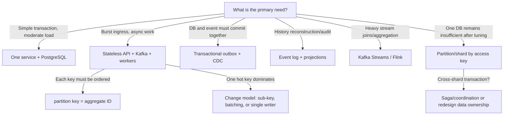

This is a conversation starter, not an automatic answer. If one operation must atomically update several inventory rows, one order-level database transaction is simpler. If that DB becomes the bottleneck, splitting it may require a reservation saga and compensation. Define consistency and failure behavior before measuring throughput.

## 5. Semantics, failures, and recovery

- **At-most-once:** messages can be lost; use only when loss is acceptable.
- **At-least-once:** retries can duplicate work; require idempotency/deduplication.
- **Effectively-once:** commonly built from idempotent producers, unique keys, local transactions, and dedupe; it is not a magical end-to-end guarantee.
- **Retry:** exponential backoff with jitter and a finite attempt budget; put permanent failures into a DLQ and build a safe replay tool.
- **Poison event:** do not block a partition forever; quarantine, alert, and provide a correction path.
- **Ordering:** preserve only the required scope; global order limits throughput.
- **Timeout:** a timeout makes the outcome unknown; check the idempotency key before repeating.
- **Graceful shutdown:** stop polling, finish/cancel in-flight work safely, and commit only after the effect is recorded.
- **Commit while idle:** do not check a time-based commit only after consuming a message. Use a bounded poll or independent timer to commit trailing offsets. Compare committed counters, group offsets, and lag.

## 6. Kubernetes and scaling

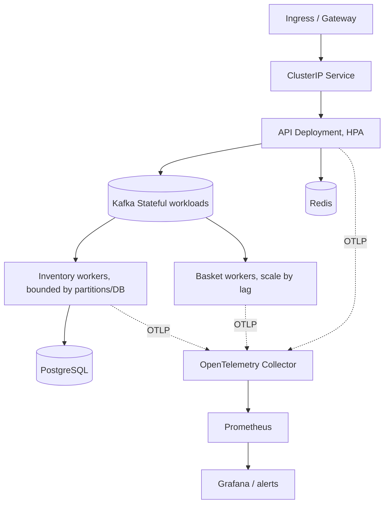

Use Deployments for stateless APIs/workers and StatefulSets/PVCs or managed services for stateful dependencies. CPU HPA works for stateless API; consumer scaling is better based on Kafka lag and drain time. More workers than partitions do not increase group parallelism. Autoscaling faster than Kafka/database startup can cause oscillation; configure min/max, cooldown, and quota. Production also needs PodDisruptionBudget, topology spread, requests/limits, readiness/startup probes, NetworkPolicy, RBAC, and secret management.

### Logical path toward 100,000 TPS

1. Define TPS and success semantics: API acceptance or final result?
2. Build realistic workload: read/write mix, payload, hot keys, checkout ratio, and bursts.
3. Record baseline: p50/p95/p99, errors, resource usage, and cost.
4. Profile allocations, JSON, connection pools, Kafka batching, Redis round trips, and DB locks/I/O.
5. Scale only the measured bottleneck; API, partitions/consumers, cache, DB, and network are separate.
6. Measure sustained capacity with headroom and one node/broker failure; test repeated runs and restore.
7. Run soak, burst, failover, recovery, and replay tests before publishing a capacity claim.

Approximate input volume: `bytes/sec = TPS × average serialized bytes`; replicated disk is approximately `bytes/sec × retention_seconds × replication_factor`, plus indexes, segments, and recovery space. At 100k/s, 1KB messages mean about 100MB/s logical data before replication. Four Kafka replicas multiply broker writes/network. This is a load calculation, not proof of capacity.

### Local latency illustration

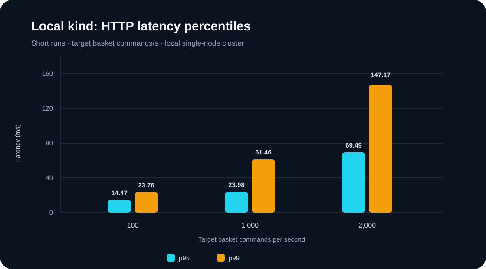

The chart contains selected percentiles from short single-node kind runs. It is a local observation, not a production SLO or capacity guarantee. The histogram below illustrates a latency distribution and its tail only; its bar frequencies are not measured data.

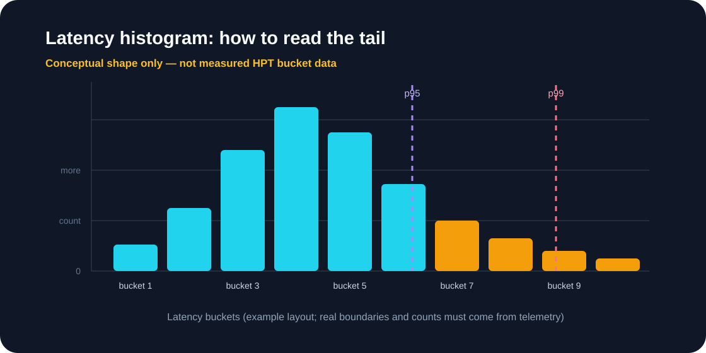

Build a measured histogram from raw samples or Prometheus buckets for each repeatable run. See the [performance runbook](PERFORMANCE-100K-EN.md) for measured scenarios and bucket guidance.

### Initial estimate from this project's local measurements

On single-node kind, a low-load run with two basket workers was about 750 commands/s per worker. At 25k/s, committed offsets advanced about 159k over 10 seconds, near 4k commands/s per each of the four workers in that run. This more-than-five-fold difference shows how utilization and workload affect extrapolation. `100,000 / 4,000 ≈ 26` workers is a rough high-load estimate, about 13 vCPU and 13Gi at current worker requests before headroom and other services. It is not final sizing. Current manifest maxima are 512 basket workers and 256 API replicas; controllers/brokers/API/basket at those ceilings request about 345.5 vCPU and 371Gi. Inventory workers raise that envelope. Limit controller ceilings to node capacity/quota. The assumptions are detailed in the [performance runbook](PERFORMANCE-100K-EN.md). The performance topic has 512 partitions, so 26 consumers fit below the parallelism cap; skew, CPU throttling, and Redis can change actual throughput.

Maximum API batch size is 500, so 100k commands/s could arrive in about 200 HTTP requests/s. On kind, batch=500 at 10 requests/s reached about 5,015 commands/s for 15 seconds and lag returned to zero. At 25k commands/s, the API had no errors but accumulated about 91k lag; four workers reached CPU above the HPA target, and the queue drained within 10 seconds. This demonstrates the four-worker ceiling in that kind setup, not production capacity. API acceptance, Kafka durability, Redis projection, and checkout completion are separate outcomes and need separate SLOs.

## 7. Observability and SLOs

Four golden signals are latency, traffic, errors, and saturation. For HPT:

| Layer | Example metrics |
|---|---|
| API | Requests/s, latency histogram, status class, in-flight requests, Kafka publish latency |
| Kafka | Bytes in/out, ISR and under-replicated partitions, request latency, disk, consumer lag/age |
| Consumer | Processed/s, errors/retries, batch size, processing duration, commits/rebalances |
| Redis | Command latency, memory, evictions, hit ratio, replication health |
| PostgreSQL | Transaction latency, lock waits, pool saturation, deadlocks, WAL/replication lag |
| Kubernetes | Ready replicas, restarts, throttling, memory, PVC fill, pending Pods, HPA desired/current |
| Business | Accepted vs completed checkout, rejection, oversell, reservation expiry, duplicate effects, order age |

Use low-cardinality labels such as route template, status class, topic, and consumer group. Never label metrics with `userId`, `orderId`, `basketId`, or `idempotencyKey`. Put correlation IDs in logs/traces, not metric labels. Alert on symptoms/SLO burn: latency/error increase, sustained lag/age, missing headroom, or backlog that does not drain. A single dashboard should show API acceptance, final throughput, backlog, and dependency health together.

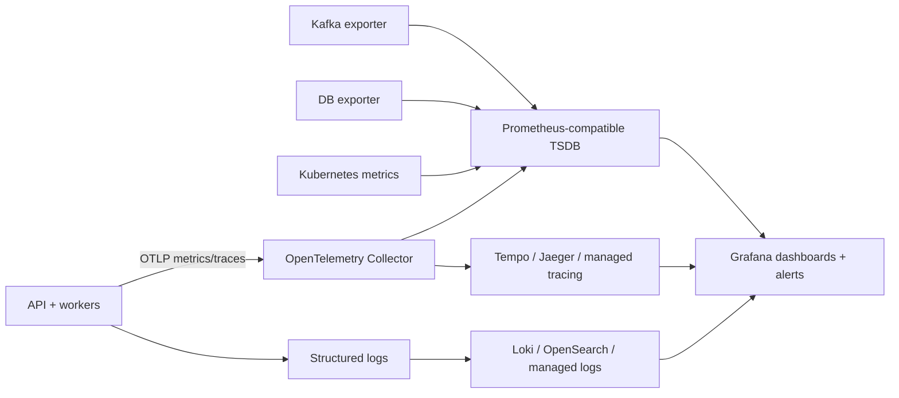

These products are examples. Prometheus/Grafana are common; OpenTelemetry instruments/exports; Tempo/Jaeger store traces; Loki/OpenSearch/cloud services store logs; Mimir/Thanos/VictoriaMetrics extend retention/scale. Choose by retention, cardinality, query concurrency, HA, cost, and team experience.

## 8. Database families and choices

No single database fits every access pattern. Do not confuse the authoritative transaction store with cache, search, or analytics. Each additional store adds backup, security, schema, monitoring, on-call, and consistency work. Begin with workload and data model: [Azure data-store models](https://learn.microsoft.com/azure/architecture/data-guide/technology-choices/understand-data-store-models) and [AWS database decision guide](https://docs.aws.amazon.com/decision-guides/latest/decision-guides/databases-on-aws-how-to-choose.html).

| Family and examples | Likely HPT use | Strengths | Trade-offs / limits |
|---|---|---|---|
| Relational: PostgreSQL, MySQL/MariaDB, SQL Server, Oracle | Orders, payment, inventory, and multi-row invariants | SQL, constraints, transactions, mature tools/reporting | Write scale needs vertical capacity, replicas, or sharding; connections, locks, and poor queries bottleneck. |
| Distributed SQL/NewSQL: CockroachDB, YugabyteDB, TiDB, Google Spanner, Azure SQL Hyperscale | SQL transactions across nodes/zones/regions | Scale-out and HA with relational APIs | Replication/consensus adds latency; schema/placement/operations differ by product. |
| Key-value: Redis/Valkey, DynamoDB, Aerospike, FoundationDB (access-pattern dependent) | Basket state, idempotency, key lookup, designed counters | Fast lookup and horizontal key-based scale | Limited joins/free queries; hot keys/partitions; durability and transaction semantics vary. Do not assume a cache is authoritative. |
| In-memory/cache: Redis, Valkey, Memcached, Hazelcast, Aerospike | Cache, session, rate limits, temporary projections | Low latency, less OLTP load | Expensive capacity, eviction, persistence/failover, invalidation. Cache rebuildable data. |
| Wide-column: Cassandra, ScyllaDB, HBase, Bigtable, DynamoDB wide-row model | High-volume writes with queries known by partition key | Horizontal distributed throughput for the right access pattern | Query-first denormalization, repair/compaction; not relational transactions or arbitrary query. |
| Document: MongoDB, Couchbase, DocumentDB and similar | Variable-shape aggregates, catalog/profile, possibly basket document | JSON-like model and whole-aggregate reads | Large-document update contention; indexes/transactions need design; multi-document invariants are harder. |
| Search/index: Elasticsearch, OpenSearch, Solr | Text search, filtering, ranking | Full-text and index-based query | Not OLTP source of truth; usually asynchronous/eventual consistency; shard/reindex/memory cost. |
| OLAP/real-time analytics: ClickHouse, Druid, Pinot, BigQuery, Snowflake, Redshift | Event rates, funnels, operational analytics | Large scans/aggregations separate from OLTP | Does not replace order writes; ingest lag, columnar modeling, cost/query isolation. |
| Time series: Prometheus/Thanos/Mimir, VictoriaMetrics, InfluxDB, TimescaleDB, Timestream | Metrics, telemetry, time-based data | Retention/downsampling/time query | Not an order ledger; control cardinality and retention. |
| Graph: Neo4j, Neptune, JanusGraph | Deep relationships such as fraud networks | Traversals and graph algorithms | Usually unjustified for basic transactional CRUD; product-specific transaction/scale/cost. |
| Object store/table formats: S3/GCS/Azure Blob/ADLS + Iceberg/Delta/Hudi | Event archives, backup, lake, replay/batch analytics | Durable, low-cost bulk storage outside OLTP | Not database latency or fine-grained transactions; catalog, compaction, and governance needed. |
| Ledger/immutable log: event store or SQL/broker journal | Audit, immutable changes, reconstruction | History and auditability | Design retention, privacy, corrections, and replay; append-only does not guarantee correctness. |

### Initial store choice by HPT concern

| Data/operation | Starting choice | Alternative to evaluate | Safety rule |
|---|---|---|---|
| Authoritative order/payment/inventory | PostgreSQL or existing relational DB | Distributed SQL if multi-node/region writes are truly needed | Keep authoritative constraints/transactions and define durable success. |
| Basket state | Redis projection/cache or PostgreSQL for simplicity | DynamoDB, Cassandra, MongoDB by access pattern | Define lifetime, version, and recovery; cache loss must not erase a completed order. |
| Event transport | Kafka/managed equivalent | Pulsar, Redpanda, cloud event/queue | A broker is generally not a domain transactional ledger. |
| Search | OpenSearch/Elasticsearch or native SQL search | Solr or cloud search | Rebuild the index from durable source. |
| Metrics | Prometheus-compatible TSDB | Mimir/Thanos/VictoriaMetrics/managed service | Keep label cardinality low and retention explicit. |
| Analytics/history | ClickHouse/warehouse/object lake | Druid, Pinot, BigQuery/Snowflake/Redshift/lakehouse | Isolate analytics workloads from transactions. |

Relational table partitioning is not the same as distributed sharding. Partitioning helps retention, pruning, and maintenance, but by itself does not spread writes across machines. PostgreSQL also has uniqueness/primary-key constraints on partitioned tables; too many partitions can increase planning/memory costs. Choose key/count to fit queries and constraints. See [PostgreSQL table partitioning](https://www.postgresql.org/docs/current/ddl-partitioning.html). In key-based databases, distribute keys to avoid hot partitions; see [DynamoDB partition-key design](https://docs.aws.amazon.com/amazondynamodb/latest/developerguide/bp-partition-key-design.html).

## 9. Broker, queue, and stream options

| Technology/family | Relative best fit | Benefit | Cost / limitation |
|---|---|---|---|
| Apache Kafka | Replayable log, multiple consumer groups, high throughput | Partitioned append log, CDC/stream ecosystem | Broker/storage operations and partition design; ordering only within a partition. |
| Redpanda | Kafka API with a different operations/runtime model | Kafka ecosystem compatibility | Benchmark behavior/performance/cost against the exact workload and version. |
| Apache Pulsar | Multi-tenant messaging and queue/stream patterns | Broker/storage separation and subscription choices | More components and different operational model. |
| RabbitMQ | Task queues, routing, acknowledgements | Flexible routing and classic queues | Long replay logs/high throughput are not its central design goal; plan backlog/durability. |
| NATS JetStream | Low-latency messaging with simpler pub/sub | NATS API and streaming features | Evaluate retention, delivery, scale, replay, and ordering needs. |
| Redis Streams | Simple stream when Redis is already present | Consumer groups close to Redis operations | Test memory cost and failover for large/long event logs. |
| Cloud queues/buses: SQS/SNS, EventBridge, Pub/Sub, Event Hubs, Service Bus | Reduce broker operations in a chosen cloud | Managed HA and native integrations | Lock-in, request/throughput cost, service limits, ordering/replay vary by service/tier. |
| DB queue/outbox | Low volume or starting with transactional DB writes | Simple atomicity with domain data | Polling/cleanup can load the DB; reassess at high throughput. |

Kafka orders events within a partition, so the key defines the ordering scope. Batching/compression may improve efficiency while changing latency and CPU. Kafka idempotent producers and Kafka transactions do not magically extend exactly-once guarantees to an external database; external consumers normally need idempotency/dedupe, an outbox, or coordinated transactions. See [Kafka delivery semantics](https://kafka.apache.org/44/design/design/) and [producer configuration](https://kafka.apache.org/36/configuration/producer-configs/).

### Delivery and ordering choices

- **At-most-once:** messages may be lost; use only for ignorable data.
- **At-least-once:** messages are retried but may duplicate; common in practice with idempotent handlers.
- **Exactly-once effect:** apply one business effect per command, usually through an idempotency key and destination constraint/transaction—not a transport claim alone.
- **Global ordering:** often limits throughput; per-aggregate ordering (`basketId`, `skuId`) is usually sufficient.
- **Poison message:** unlimited retries can stop a partition; use finite retries, backoff, quarantine/DLQ, replay tooling, and cause detection.

## 10. Languages and runtimes

Language alone does not guarantee TPS. Allocation, serialization, I/O, connection pools, algorithms, database/broker, payload, CPU limits, and team experience usually matter more. Prefer a mature language with supported clients and good observability over synthetic benchmark rankings.

| Language/runtime | Strengths | Trade-offs | Likely fit |
|---|---|---|---|
| C# / .NET (ASP.NET Core) | Strong async I/O, runtime/tooling, matches current implementation | Monitor GC/allocations; runtime version and tuning matter | Natural choice to maintain HPT API/workers. |
| Java / Kotlin (JVM) | Rich ecosystem, mature Kafka/DB clients, large talent pool | GC/heap tuning, startup/footprint, framework complexity | Transactional and streaming services. |
| Go | Simple deployment, lightweight concurrency, clear startup/usage | GC remains; fewer abstractions; manage goroutines/backpressure | Network APIs and workers. |
| Rust | Memory control, performance, strong safety | Development/learning and hiring costs | Hot path or low-latency service with an experienced team. |
| C/C++ | Fine control and potentially high performance | Memory safety, complexity, expensive development/maintenance | Small specialized components, not default business stack. |
| Scala | Kafka Streams/Spark and distributed-data ecosystem | Language/runtime complexity and maintenance/hiring | Existing stream/data platforms. |
| Python | Fast development, data/ML ecosystem, orchestration | CPython GIL for CPU parallelism; CPU/latency need measurement; async is not automatically fast | Control plane, analytics/ML, measured I/O worker. |
| JavaScript/TypeScript / Node.js | Full-stack teams, async I/O, web ecosystem | CPU-bound work blocks event loop; runtime types need validation | Gateway/BFF and I/O-heavy services. |
| Elixir/Erlang (BEAM) | Fault isolation, actor/concurrency, messaging | Specialized ecosystem and hiring/support model | Many concurrent connections and resilient messaging systems. |
| PHP/Ruby | Product development and established web ecosystems | High throughput depends on process/runtime/architecture | Valid when team/product already exists; benchmark real workload. |
| Clojure/F#/OCaml/others | Functional models and strong niche tooling | Talent pool/integration may be smaller | Sound choice when organizational expertise exists. |

### Language selection rules

1. Keep the current language unless profiling proves runtime CPU is the dominant bottleneck.
2. For CPU-bound code, measure algorithms, allocations, and batching; for I/O-bound code, measure async and connection management.
3. Compare team/on-call cost, broker/DB clients, tracing, security patches, and delivery speed along with benchmarks.
4. Limit polyglot growth: every new language adds build, deployment, telemetry, vulnerability-scanning, and on-call skill.
5. If one hot path is the bottleneck, isolate and measure that component before rewriting the whole product.

## 11. Data correctness, idempotency, and backpressure

### Idempotency and transaction model

For every command with financial/inventory effects, use a stable client `idempotencyKey`. Persist it with a suitable scope (tenant/account/operation) and input hash. Same key/same input returns the same result; same key/different payload returns conflict. A unique constraint and transaction in the authoritative database are the final defense. Key TTL must cover the longest retry/replay window.

### Hot keys and hot SKUs

Normal partitioning does not solve traffic focused on one `skuId` or basket:

- Serialize a hot key in one queue: simple ordering, but one stream sets the ceiling.
- Use escrow/quota counters: more parallel, with reconciliation and possible early rejection.
- Reserve instead of decrementing synchronously: requires reserve/confirm/expire states and cleanup jobs.
- Batch/aggregate in workers: fewer DB calls but higher final latency.
- Rate-limit or queue requests: controlled behavior but poorer burst user experience.
- Isolate a hot tenant/key on its own shard: better isolation, more operations and skew complexity.

### Backpressure and ingress capacity

Bound body/batch size, quotas, timeouts, and request rates. Treat broker lag, oldest-message age, worker saturation, and DB pool saturation as control signals. Overload choices include fast 429/503 with `Retry-After`, a bounded wait queue, disabling nonessential features, or accepting only when durable capacity is available. Client retries need exponential backoff with jitter and a maximum budget; synchronized retries can intensify an outage.

### Multi-region patterns

| Pattern | Benefit | Cost |
|---|---|---|
| One writer region + geographic read replicas | Simpler and clearer consistency | Remote write latency and complex region failover. |
| Active-passive | Simple normal path and disaster recovery | Must test RTO/RPO, fencing, and failover. |
| Active-active with key/region ownership | Local latency and availability | Conflict resolution, duplicates, routing complexity; global transactions are expensive. |
| Multi-region distributed SQL | More managed transactional replication abstraction | Consensus latency and cost; schema/placement is critical. |

For order/inventory, letting every region write independently without ownership/conflict rules can oversell or double-charge. Start by evaluating a single writer per aggregate/region.

## 12. Deployment and infrastructure

| Runtime model | Benefit | Trade-off |
|---|---|---|
| Single process/VM | Simplest, low cost to start | Coarse deployment/scale, manual HA. |
| VM/autoscaling group | OS/network control and familiar operations | Team owns patching, capacity, orchestration. |
| Kubernetes | Rollouts, discovery, autoscaling, workload standardization | Control plane, storage/network, and on-call expertise; it does not autoscale managed dependencies. |
| Managed Kubernetes + managed DB/broker | Less control-plane/stateful toil | Cost, provider limits, egress/lock-in. |
| Serverless/container functions | Less server operation and burst scaling | Cold starts, execution/concurrency limits, retries, burst cost, debugging. |
| Bare metal | Control and attractive economics for some steady high scales | Provisioning, failure domains, replacement, and operations are harder. |

HPT stateless API/workers suit containers/Kubernetes. Self-host Kafka/database only if the team can operate storage, upgrades, backup/restore, node replacement, and incidents. Managed services cost more directly but buy some operations. Pod replicas do not replace shard, broker, or DB write capacity. Scale workers from both lag/oldest-message age and downstream limits; CPU alone may react too early or late.

### Supporting components

| Concern | Options | Selection note |
|---|---|---|
| Gateway/Ingress | NGINX, Envoy, HAProxy, cloud LB/API Gateway, Traefik | TLS, rate/body limits, retries, and each hop's cost. |
| Service-to-service | HTTP/REST, gRPC, messaging | HTTP is simple/debuggable; gRPC adds contracts/compact payload; messaging decouples async work. |
| API style | REST, GraphQL, gRPC, WebSocket | GraphQL is not inherently ideal for bulk ingestion; a bounded batch endpoint may fit better. |
| Schema | JSON Schema, Protobuf, Avro, gRPC contracts | Backward/forward compatibility and schema validation/registry. |
| Secrets/config | Kubernetes Secrets + KMS, Vault, cloud secret manager | Never store secrets in Git/image; design rotation and least privilege. |
| IaC/GitOps | Terraform/OpenTofu, Pulumi, Bicep/CloudFormation, Helm, Argo CD/Flux | Plan for drift, review, rollback, and secret state. |
| CI/CD | GitHub Actions, GitLab CI, Azure DevOps, Jenkins | Immutable images, scan, provenance, rollout, rollback. |
| Network/security | NetworkPolicy, service mesh, mTLS, WAF, IAM/RBAC | Mesh adds latency/complexity; not required for every service. |

## 13. Metrics, tracing, and dashboards

### Golden signals and business metrics

| Layer | Baseline metrics |
|---|---|
| HTTP API | Rate, errors, p50/p95/p99, in-flight requests, body bytes, batch size, publish latency |
| Broker | Bytes in/out, produce/fetch latency, under-replicated partitions, ISR shrink, disk, oldest lag age, consumer lag |
| Worker | Commands/s, processing latency, batch size, retries, duplicates, poison events, commit latency, rebalances |
| OLTP DB | Transaction latency, rows/s, lock waits, deadlocks, pool wait, active/idle connections, WAL/replication lag, growth |
| Cache | Command latency, hit/miss, evictions, memory fragmentation, replication/cluster health |
| Kubernetes | Ready/desired replicas, restarts, OOM, CPU throttling, Pending Pods, node allocatable, PVC usage, HPA desired/current |
| Business | Accepted vs completed, checkout rejection, oversell, reservation expiry, duplicate effect, order age, reconciliation mismatch |

Use units and clear metric types: histogram for latency, counter for cumulative events, gauge for current values. Avoid high-cardinality labels (`userId`, `orderId`, `basketId`, `idempotencyKey`); use correlation IDs in traces/logs. Alert on SLO symptoms/burn: latency/errors, sustained lag/age, low headroom, backlog not draining. Show API acceptance, final throughput, backlog, and dependency health together.

### Telemetry pipeline


Products above are examples: Prometheus/Grafana, OpenTelemetry, Tempo/Jaeger, Loki/OpenSearch, and Mimir/Thanos/VictoriaMetrics. Select backends by retention, cardinality, query concurrency, HA, cost, and team skills.

## 14. HPT decision matrix

| Primary need | Evaluate first | Measure explicitly |
|---|---|---|
| Order/payment correctness | Relational transaction, unique idempotency, outbox | Contention, commit latency, pool, recovery. |
| Command bursts and consumer decoupling | Kafka/Pulsar/managed stream + bounded workers | Durable produce, lag age, replay, consumer throughput. |
| Fast basket lookup | Cache/key-value with an appropriate durable source | Hot keys, misses, loss/rebuild, required consistency. |
| Product/order text search | Search index | Index lag, reindex, stale results, shard cost. |
| High-volume event analytics | OLAP/stream analytics/lake | Ingest lag, query SLA, storage/retention/cost. |
| Horizontal writes across zones | Distributed SQL or logical sharding | RTT/consensus, hot shard, failover, transaction scope. |
| 100k HTTP/s with batches | Batch API, load shedding, worker pipeline | Real command/s, payload, p99, DB/broker ceiling. |
| 100k business transactions/s | Define invariants/load model; custom capacity design | End-to-end completion, hot keys, dependencies, fault modes. |

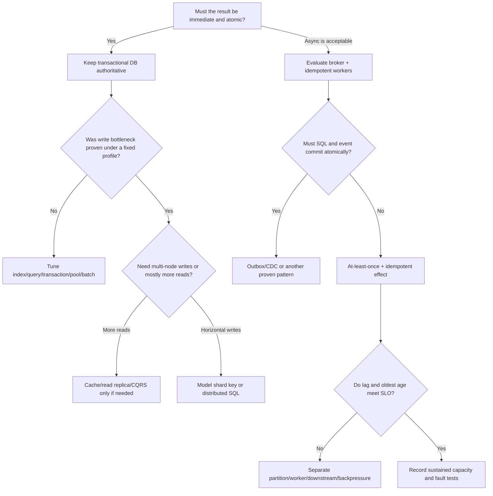

## 15. Common “100k” design mistakes

- Treating HTTP RPS, command/s, event/s, and business completion/s as one metric.
- Counting produced messages as durable messages or successful checkouts.
- Treating “exactly once” as a substitute for idempotency in the destination database.
- Adding partitions/replicas without measuring broker, disk, network, and downstream capacity.
- Sharding too early, then discovering cross-shard queries and transactions.
- Making Redis or search authoritative without persistence/recovery design.
- Scaling consumers beyond available partitions or database capacity.
- Increasing retries without backoff, a retry budget, and outage controls.
- Requiring global event order when per-entity order is enough.
- Adding microservices or many languages/databases before domain/team need is clear.
- Putting unique IDs into metric labels and destroying metrics usability.
- Using an internet benchmark or kind run as a production capacity claim.
- Ignoring failover cost; capacity must meet SLO during node/broker loss.
- Ignoring skew; averages can hide a hot tenant/SKU.
- Targeting 100% utilization instead of reserving headroom for bursts/rebalance/failure.

## 16. Exercises

1. Draw the four rates—API request, command, event, order completion—and define a metric for each.
2. Choose an event key among `basketId`, `customerId`, `skuId`, and `orderId`; compare ordering, hot keys, and shard locality.
3. Design oversell controls using conditional SQL update and reservation/escrow; list each failure mode.
4. Define final behavior for broker outage, slow DB, Redis outage, and consumer crash after write but before commit.
5. Model the workload in relational, distributed SQL, and key-value stores; list required queries and invariants each makes easier/harder.
6. Compare costs of maintaining two databases, a broker, and telemetry with compute/storage cost.
7. Define separate SLOs for command acceptance and checkout completion using product requirements.
8. Record benchmark evidence so another team can repeat it with the same image, config, payload, hardware, and failures.

### Official references

- [Azure Architecture Center: data-store models](https://learn.microsoft.com/azure/architecture/data-guide/technology-choices/understand-data-store-models)
- [AWS Decision Guide: choosing a database](https://docs.aws.amazon.com/decision-guides/latest/decision-guides/databases-on-aws-how-to-choose.html)
- [PostgreSQL 18: partitioning](https://www.postgresql.org/docs/current/ddl-partitioning.html)
- [Amazon DynamoDB: partition-key design](https://docs.aws.amazon.com/amazondynamodb/latest/developerguide/bp-partition-key-design.html)
- [Apache Kafka 4.4: design and delivery semantics](https://kafka.apache.org/44/design/design/)
- [Apache Kafka 3.6: producer configuration](https://kafka.apache.org/36/configuration/producer-configs/)
- [Kubernetes concepts](https://kubernetes.io/docs/concepts/)
- [Kubernetes HPA](https://kubernetes.io/docs/tasks/run-application/horizontal-pod-autoscale/)
- [OpenTelemetry for .NET](https://opentelemetry.io/docs/languages/dotnet/)
- [Prometheus concepts](https://prometheus.io/docs/introduction/overview/)

## 17. Capacity optimization toolbox

Optimize the measured bottleneck first. Improving one stage may move the bottleneck downstream; API batching may fill the broker faster and increase worker backlog.

### API and ingress options

| Option | What it improves | Trade-off / condition |
|---|---|---|
| Batch API | HTTP/TLS/auth/syscall cost per command | Larger payloads, partial failure, timeout/fairness; bound batch size and return per-item results. |
| Client-side batching | Round trips; coalesces rapid updates | Wait time to fill batch; retries must avoid duplicates. |
| Async `202` acceptance | Separates API latency from final processing | Results arrive later; need durable acknowledgement and status endpoint. |
| gRPC/Protobuf | Smaller payload, typed contract, HTTP/2 multiplexing | Browser/proxy/version management; does not raise backend capacity alone. |
| HTTP/2 or HTTP/3 | Fewer connections/multiplexing in some network conditions | Depends on LB, client, TLS, and network; test end-to-end. |
| Compression | Fewer network/storage bytes | More CPU/latency; little gain for small/already-compressed payloads. |
| Body limits/cheap validation | Protects memory and parsing cost | Reject invalid input early; align limits with allowed batch size. |
| Keep-alive/connection reuse | Less handshake/socket churn | Coordinate connection limits and LB idle timeout. |
| Nonblocking async I/O | Many waiting connections without one thread each | CPU-bound work still blocks event loop/thread pool; async across call chain. |
| Rate limit/quota | Protects bursts and isolates tenants | Rejects some overload; define token-bucket/sliding-window policy. |
| Admission control/load shedding | Prevents unbounded queue and latency | Rejects/degrades at peak; define priorities and retryable responses. |
| Stateless API replicas | Easy horizontal scaling | Remove/control session/local cache/sticky routing; shared dependencies remain limits. |
| CDN/edge cache | Reduces static/cacheable GET traffic | Does not help writes or private uncacheable data. |
| BFF/API Gateway | Aggregates APIs/auth/quota/routing | Adds hop/control plane; do not turn gateway into primary queue/DB. |

**For HPT:** batch API accepts up to 500 commands and can reduce request cost. 500 is an API contract, not the optimal Kafka batch or number of DB transactions. Measure payload, p99, and API memory; define per-item success/rejection and dedupe IDs.

### Broker and stream options

| Option | Potential gain | Trade-off / caution |
|---|---|---|
| More partitions | More consumer parallelism and log shards | More metadata/files/rebalances; ordering/key distribution changes. |
| Balanced partition key | Better distribution | Wrong key breaks domain ordering; hashing does not fix one hot entity. |
| Producer batching | Fewer requests/syscalls | Wait for a batch; more buffer memory and possible latency. |
| Batch compression | Less network/disk | CPU for producer/broker/consumer and decompression delay. |
| Idempotent producer | Avoids producer-retry duplicates within broker semantics | Does not prevent duplicate business effect end-to-end; benchmark version/config. |
| `acks=all`, replication, `min.insync.replicas` | Better durability during broker failure | Higher latency/lower effective write capacity; writes stop if too few replicas are in sync. |
| Retention tuning | Controls disk and replay window | Short retention limits recovery; long retention costs disk/replay time. |
| Multiple consumer groups | Independent fan-out for projections/analytics | Every group rereads the stream, increasing I/O and lag. |
| Cooperative/sticky assignor | Reduces some rebalance pauses | More interactions; scale churn/session timeout still matter. |
| Batched offset commit | Lower commit overhead | Crash after side effect/before commit replays; destination must be idempotent. |
| Poll/worker micro-batches | Amortized overhead and parallel independent keys | Large batch increases memory/tail latency; preserve same-key order. |
| Concurrency within partition | Parallelism within a partition | Can break order without reorder buffer/key serialization. |
| Priority queues | Protects important work from starvation | Adds routing/capacity reservation; lower priority can starve. |
| Broker-to-API backpressure | Controls backlog/tail latency | Reduces acceptance; coordinate client retry behavior. |
| Log tiering/object storage | Cheaper long retention | Cold replay is slower; define hot/cold SLOs. |
| Stream state/checkpoint | Separates stateful aggregation from application logic | Understand checkpoints, changelogs, exactly-once scope, and reprocessing. |

Tune `linger`, `batch.size`, compression, producer memory, and `acks` together; no one setting is universally fastest. Record broker acknowledgements, consumer processing, and business completion separately.

### Database options, from simple to large scale

| Step | Option | Use when | Cost / warning |
|---:|---|---|---|
| 1 | Correct query plan, indexes, schema | Baseline is slow due to scans/locks | Extra indexes increase writes/storage. |
| 2 | Short transactions/reduced contention | Lock wait/deadlock dominates | Do not move invariants outside transactions without safe compensation. |
| 3 | Batch insert/update/prepared statements | Round-trip/parse overhead is high | Large batches increase locks/rollback/latency. |
| 4 | Connection pool/pooler | Connection churn/count is high | Oversized pools move queues into DB; total pool = replicas × pool size. |
| 5 | Read replica/cache | Read pressure dominates | Replication lag/stale reads; does not increase primary writes. |
| 6 | Table/index partition maintenance | Large time-based data or cleanup | Query must prune partitions; repartition/uniqueness have limits. |
| 7 | Vertical scale/faster storage | One node still has headroom | Nonlinear cost and hardware/failover ceiling. |
| 8 | Application sharding | Independent keys need write scale | Routing, rebalance, cross-shard work, migration. |
| 9 | Distributed SQL | SQL transactions plus multi-node scale/HA are needed | Replication latency/conflicts/retries and placement complexity. |
| 10 | Split by data domain | Bounded contexts need separate lifecycle/scale | Saga/distributed transactions and more on-call services. |

Database patterns include:

- **Append-only ledger:** record changes as events and fold state. Better audit, harder correction/replay/current-state query.
- **Write-behind cache:** cache first, DB async. Lower latency but crash/cache loss can lose acknowledged data unless there is a durable journal.
- **Write-through cache:** DB commit then cache update. Simpler consistency but more latency/failure coordination.
- **Read-through cache:** fill cache on miss; still address stampedes and stale invalidation.
- **Materialized view/projection:** separate query model from write model; handle projection delay and rebuild.
- **CQRS:** separate read/write data shapes when read pattern is truly different/expensive.
- **Database per service:** independent data ownership; cross-service joins/transactions become messaging/eventual consistency.
- **Bulk import/COPY:** efficient files/large batch ingest, not interactive per-command transactions.
- **Optimistic version column:** detect conflicts with compare-and-swap; conflicts cost retries.
- **Pessimistic row lock:** explicit inventory correctness; hot row becomes serialized queue.
- **Conditional update:** `UPDATE ... WHERE available >= requested` and check row count; atomic/simple, but hot SKU remains a bottleneck.

For inventory and checkout:

| Method | Model | Benefit/guarantee | Cost |
|---|---|---|---|
| Synchronous SQL transaction | Order + inventory in one short transaction | Clear atomic result in one DB | Inventory-row contention and transaction latency. |
| TTL reservation | Short reserve → payment → confirm/expire | Handles multi-step checkout | State machine, expiry worker, reconciliation. |
| Saga/compensation | Services commit stages and compensate on failure | No global transaction/long lock | Compensation is not always true rollback; intermediate state is user-visible. |
| Escrow/quota buckets | Split inventory into independent buckets | Parallel local operations on hot key | Imbalanced quotas, bucket transfer, reconciliation. |
| Queue per SKU | Serialize commands for one SKU | Simple ordering/oversell protection | Per-SKU throughput limited to one writer. |
| CRDT/counter merge | Merge increments/decrements across replicas | High availability for additive counters | Inventory with `>=0` invariant is not a simple CRDT; needs escrow/quota to avoid oversell. |

For basket, absolute `item-set` is more idempotent than `increment quantity`. For checkout, protect `processed_events` and idempotency with durable constraints. If checkout rate is far below basket updates, scaling PostgreSQL for every basket command may be wasted effort; measure paths separately.

### Compute, concurrency, and code optimization

| Option | Useful for | Trade-off |
|---|---|---|
| CPU/memory/allocation profiling | Find JSON, GC, hashing, serialization cost | Use production-like load and correct symbols. |
| Reduce allocations/object churn | High GC pressure | May harm readability/complexity; profile first. |
| Batch serialization/reuse buffers | High payload throughput | Buffer lifetime/thread-safety become harder. |
| SIMD/vectorization | CPU-heavy numeric/text transforms | Usually low impact or wrong for I/O-bound services; portability/complexity. |
| Bounded worker pool | Control CPU/downstream concurrency | Internal queue must stay bounded; measure saturation. |
| Parallel partition processing | Concurrent independent keys | Preserve per-key order and commit frontier. |
| Actor/mailbox per key | Serialize each aggregate state | Actor count, mailbox growth, hot actors. |
| Work stealing | Uneven CPU workloads | Ordering/fairness must be handled explicitly. |
| Native/Rust rewrite | Reduce overhead in a CPU-bound hot component | Rewrite, interop, security, and dual-stack costs; require evidence. |
| GPU | Heavy parallel batch computation | Transfer latency, batching, complexity; usually poor for CRUD/transactions. |

**Rule:** if a service mostly waits on Kafka/DB/network, rewriting C# to Rust/C++ may move the bottleneck instead of removing it. Start with `dotnet-trace`/metrics/flame graphs; inspect algorithms and queries before language choice.

### Kubernetes scaling strategies

| Mechanism | Typical signal | Good for | Limitation |
|---|---|---|---|
| HPA CPU/memory | Utilization/average value | Stateless API and CPU-bound worker | May miss queue lag; wrong CPU requests mislead target. |
| HPA custom/external metric | RPS, queue depth, latency, custom metric | Workload-based scaling | Needs reliable adapter/query, semantics, and scale delay. |
| KEDA | Kafka lag, queue length, event source | Event-driven workers/scale-to-zero | Cold start, lag target, partition cap; not every workload should scale to zero. |
| Cluster autoscaler/node pool | Pending Pods/requests | Add node capacity | Provisioning delay/cloud quota; Pod autoscaling without nodes does not help. |
| VPA | CPU/memory profile | Misconfigured requests/variable load | May restart/change resources and interact with CPU HPA. |
| Scheduled scaling | Predictable patterns | Warm capacity before known peak | Does not cover unexpected peaks. |
| Manual reservation | Stable/critical capacity | Predictable cost/low latency | Idle capacity and manual work. |

Reliability and placement practices:

- **Anti-affinity/topology spread:** distribute replicas across nodes/zones; requires resources and valid topology labels.
- **PodDisruptionBudget:** limits voluntary simultaneous eviction; cannot stop actual node failure.
- **Startup/readiness/liveness probes:** startup for slow boot, readiness for traffic/message consumption, liveness for a stuck process. DB-dependent liveness can cause restart storms.
- **Graceful shutdown:** stop admission, finish batch, safely commit offset, and allow sufficient termination grace.
- **Requests/limits:** scheduler uses requests; CPU limits throttle, memory limits cause OOM kills. Measure headroom/quota.
- **Separate node pools:** isolate API, broker, DB, batch/noisy neighbors and storage; bin packing/cost may worsen.
- **Priority class/quota:** protect critical services under pressure; lower-priority Pods may remain pending.
- **NetworkPolicy/RBAC/secret encryption:** reduce blast radius; bad policies can block DNS/scraping/broker traffic.
- **Rolling update:** set surge/unavailable/readiness to preserve capacity and Kafka partition ownership.
- **Managed stateful services:** separate database/broker lifecycle from app cluster; increases cost/network/provider lock-in.
- **Multi-cluster/cell architecture:** limit blast radius and scale independently; adds routing/fleet/cross-cell data complexity.

### Cell/shard architecture

Instead of one massive shared cluster, build independent cells with API, workers, and a slice of data. Route by tenant/account. Benefits: limited blast radius, independent scale/deploy, less noisy-neighbor impact. Costs: tenant placement/rebalancing/moves, global reports, uneven capacity, and multi-cell version management. Cell design is considered after multi-cluster scaling is proven necessary; 100k alone does not require multiple clusters.

## 16. Cost and economics

The best capacity is not merely the highest TPS; cost per successful operation and latency must match SLOs.

| Cost area | Main drivers |
|---|---|
| CPU | Serialization, TLS, compression, validation, GC, queries, stream processing |
| RAM | Heap/cache, broker page cache, batch buffers, DB working set |
| Network | Payload × rate × replication × cross-zone traffic; inter-region egress |
| Disk | Message × rate × retention × replication + index/WAL/compaction/headroom |
| API gateway | Request count, connections, WAF rules, data processing |
| Database | Instance, IOPS, storage, backup, replicas, HA, connection pools |
| Operations | On-call, upgrades, restore drills, incidents, team skills |
| Telemetry | Metric cardinality, trace sampling, log ingestion/retention |

Compare `cost per million durable commands`, `cost per million completed checkouts`, and failure headroom cost. Scale-out can increase replicas/network cost without resolving the actual bottleneck.

## 17. Example architectures from simple to very large

### Option A — Simple and maintainable

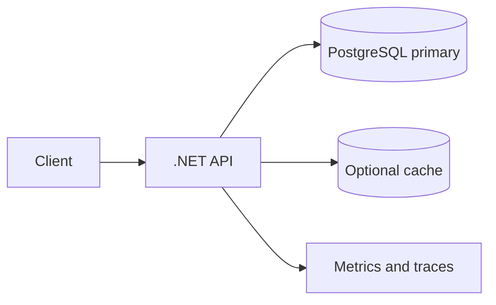

One API Deployment and managed/HA PostgreSQL. Basket commands remain in the database or use an outbox. Fits moderate load and immediate correctness; DB write capacity is the ceiling and burst buffering is limited.

### Option B — Queue-based burst handling and basket ingest

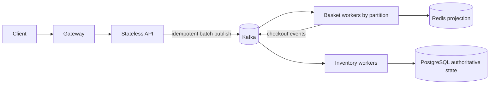

Close to current HPT: broker absorbs input waves; workers scale by partitions; Redis is the read model and PostgreSQL owns order/inventory state. Trade-offs are projection delay, duplicate/replay handling, and Kafka operations.

### Option C — Coordinate SQL and broker publication

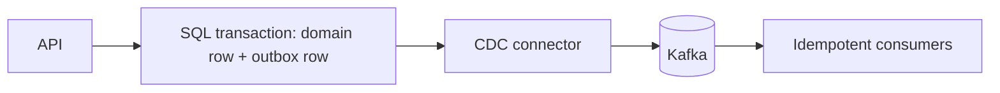

Outbox/CDC removes separate sources of truth for one write. It requires connector/schema evolution, outbox retention, replication-slot/WAL management, and lag monitoring.

### Option D — Multiple regions/cells

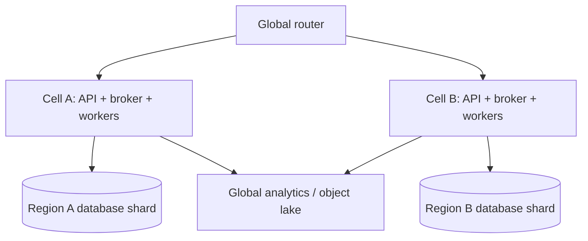

Useful for organizational scale and blast-radius isolation. Data ownership, routing, and cross-cell queries add cost. Do not start here unless region/tenant isolation has been proven necessary.

## 18. Recommended staged design for this repository

1. **Fix the metric:** target 100k basket commands/s separately; define checkout completion/s, p99, durability, and fault tolerance independently.
2. **Keep the current design:** .NET stateless API + durable Kafka command log + basket worker + Redis projection + checkout worker + transactional PostgreSQL inventory.
3. **Define API acceptance:** return `202` only after durable publish; bound batch size, return per-item outcome, use event IDs/idempotency, limit request size.
4. **Preserve per-basket order:** partition key is basket ID; monitor hot baskets and split only after changing semantics.
5. **Parallelize consumers deliberately:** enough partitions, bounded batches, concurrency only across independent baskets; commit after idempotent side effect.
6. **Separate checkout rate from basket rate:** DB idempotency, short transaction, unique constraints, conditional inventory update, queryable order result.
7. **Isolate read/write workloads:** Redis as rebuildable projection, PostgreSQL as authoritative state; add search/OLAP only for real queries.
8. **Keep Kubernetes simple:** API HPA by CPU/RPS, workers by lag/oldest age (KEDA/external metrics); managed broker/database or dedicated nodes/storage. Single-node kind is educational only.
9. **Calculate resource limits:** 100k command/s × average bytes, replication, retention, headroom; consumer targets from measured per-Pod throughput, not kind rates.
10. **Keep business metrics:** accepted/s, processed/s, durable offset age, checkout completion/rejection, duplicate effects, reservation expiry—alongside latency/saturation.
11. **Plan staged capacity tests:** baseline, ramp, soak, burst, key skew, worker kill, broker/node failure, recovery/replay. Publish capacity only after sustained and failure runs.
12. **Make language/database rewrites conditional:** only after profiling proves a component ceiling and local optimization is insufficient.

### Quick choice by bottleneck

| Measured bottleneck | Check first | Then consider, after proof |
|---|---|---|
| API CPU/latency | Batch limits, JSON allocations, connection reuse, async chain | gRPC/binary protocol or a separate hot path. |
| Kafka producer | Batch/compression, key skew, broker network/disk, acks/replication | Partition/node scale, log tiering, managed Kafka. |
| Consumer lag | Per-record overhead, batch, partitions, worker CPU, downstream latency | Consumer parallelism/KEDA, stream processor, partition/topic migration. |
| Redis projection | Command pipelining, key layout, hot key, memory/eviction | Redis Cluster/Valkey/Aerospike/DynamoDB for a defined access pattern. |
| PostgreSQL | SQL plan, locks, pool, WAL/disk, indexes, transaction time | Read replicas, partitioning, vertical scale, distributed SQL, sharding. |
| One hot inventory SKU | Conditional update and per-key queue | Escrow/quota buckets or domain-level inventory partitioning. |
| Heavy change/reporting | Isolate reads from OLTP, CDC | ClickHouse/Pinot/Druid/warehouse/lake. |
| Cross-region latency | Placement and write ownership | Regional cells, one writer region, multi-region distributed SQL. |
| High cost | Cost per successful outcome, overprovisioning, payload/retention | Autoscale, compression, tiered storage, managed-service comparison. |

The guide is complete when the team can explain for every decision: the actual need, alternatives, trade-offs/failure modes, and measurements that would accept or reject the choice. Tools are means; semantics, partition keys, and downstream capacity determine whether the design works.

</div>
