<div dir="rtl" align="right">

# راهنمای جامع طراحی سیستم تراکنش پرترافیک


<p align="center"><em>تصویر جلد راهنما؛ نمودارهای دقیق جریان و تصمیم‌گیری در ادامهٔ سند آمده‌اند.</em></p>

این سند یک مسیر یادگیری و تصمیم‌گیری است؛ برای رسیدن به «۱۰۰٬۰۰۰ TPS» نسخهٔ جادویی وجود ندارد. ظرفیت فقط وقتی واقعی است که workload، سخت‌افزار، SLO و نتایج آزمون روشن باشند. کلاستر فعلی kind برای یادگیری و smoke test است و نمایندهٔ محیط production نیست.

## ۱. مسئله را دقیق تعریف کن

قبل از انتخاب Kafka یا Kubernetes، این پرسش‌ها را جواب بده:

| پرسش | نمونهٔ تعریف |
|---|---|
| TPS یعنی چه؟ | درخواست HTTP ورودی، پیام پذیرفته‌شده، یا checkout نهایی؟ |
| ترکیب بار چیست؟ | ۹۰٪ تغییر سبد، ۹٪ خواندن، ۱٪ checkout؛ این فقط نمونه است. |
| latency هدف؟ | p95/p99 برای پذیرش فرمان و زمان تکمیل checkout جداگانه. |
| دوام؟ | آیا پاسخ موفق فقط بعد از ثبت پایدار روی Kafka مجاز است؟ |
| ordering؟ | ترتیب تغییرهای یک basket باید حفظ شود یا نه؟ |
| semantics تکرار؟ | درخواست تکراری با idempotency key چه نتیجه‌ای می‌دهد؟ |
| خرابی قابل تحمل؟ | یک Pod، node، broker، zone یا کل region؟ |
| داده و رشد؟ | اندازهٔ پیام × نرخ × retention × replication. |

تفکیک «فرمان پذیرفته شد» از «سفارش انجام شد» حیاتی است. API فعلی بعد از publish به Kafka پاسخ `202` می‌دهد؛ این پاسخ به معنی رزرو موجودی نیست.

## ۲. معماری فعلی و مرزهای سازگاری

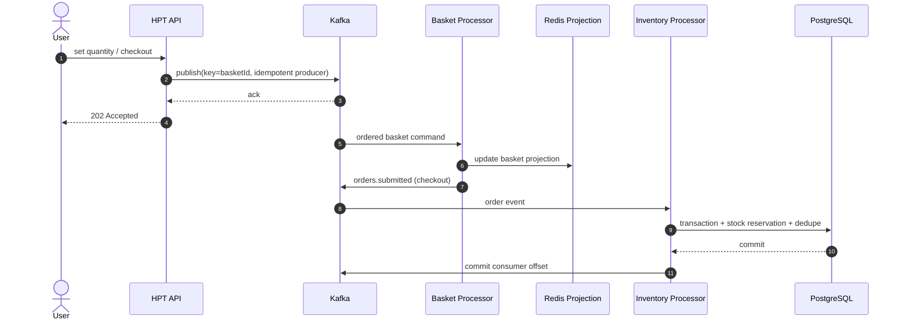

مرز تضمین: Kafka ترتیب را درون partition می‌دهد؛ کلید basket تغییرهای همان سبد را کنار هم می‌گذارد. Redis projection قابل بازسازی از event است، اما TTL آن ۲۴ ساعت است. در مسیر موجودی، commit دیتابیس پیش از commit offset انجام می‌شود؛ جدول `processed_events` جلوی اجرای دوبارهٔ رزرو را می‌گیرد. انتشار نتیجه به Kafka و commit دیتابیس یک تراکنش توزیع‌شده نیست؛ هر مرحله باید retry-safe و قابل مشاهده باشد.

## ۳. گزینه‌های طراحی

### A. Monolith و PostgreSQL

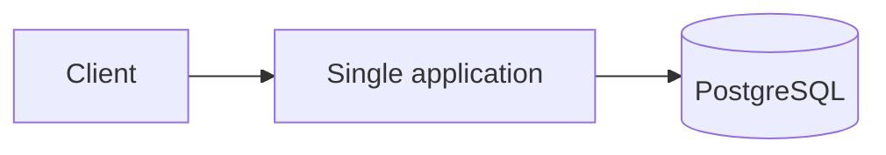

بهترین شروع وقتی بار قابل مدیریت و منطق تراکنشی مهم است. کمترین تعداد قطعه و ساده‌ترین debugging. با افزایش بار، connection pool، قفل ردیف و scale نوشتن DB گلوگاه می‌شوند. با index، query tuning، cache و read replicas شروع کن؛ زودتر از نیاز shard نکن.

### B. Stateless API + صف + worker (مدل فعلی)

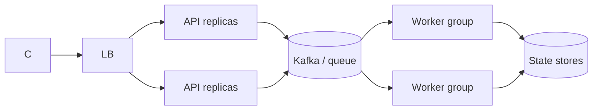

برای جهش بار و پردازش async مناسب است. Queue درخواست‌ها را جذب می‌کند، workerها مستقل scale می‌شوند و replay ممکن است. هزینه: eventual consistency، مدیریت lag، retry, poison message, schema evolution و عملیات broker. Backpressure را با سقف queue/lag و rate limit اعمال کن؛ صف نامحدود خرابی را فقط به آینده منتقل می‌کند.

### C. Transactional Outbox و CDC

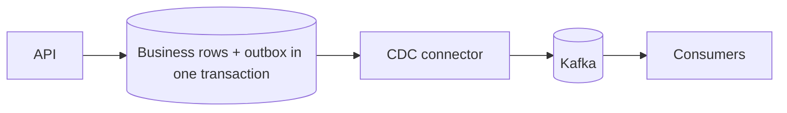

وقتی تغییر DB و انتشار رویداد باید از دست نرود، outbox را در همان تراکنش business بنویس و CDC آن را منتشر کند. از dual-write مستقیم (اول DB، بعد Kafka یا برعکس) اجتناب می‌کند. مصرف‌کننده هنوز باید idempotent باشد؛ outbox retention، ordering، CDC lag و schema compatibility باید پایش شوند.

### D. Event sourcing

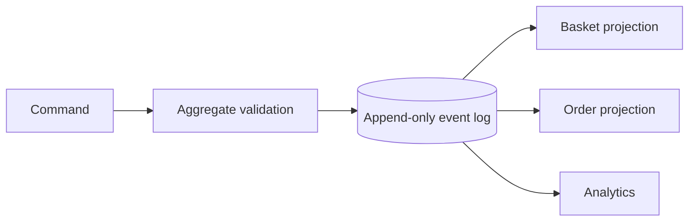

وقتی تاریخچه، audit، بازسازی state و تغییر read model ارزشمند است. رویداد منبع حقیقت می‌شود؛ projectionها مشتق‌اند. پیچیدگی بالا: versioning رویداد، replay طولانی، اصلاح داده، snapshot و سازگاری eventual. برای CRUD ساده بی‌دلیل انتخابش نکن.

### E. Stream processing

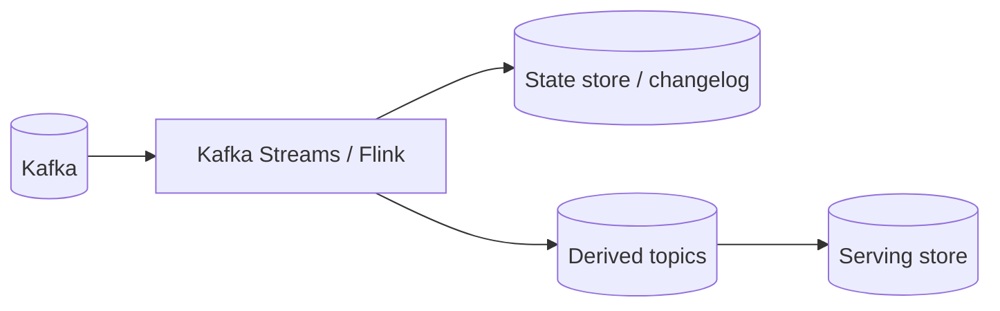

برای aggregation پنجره‌ای، join جریان‌ها و stateful computation. ابزارهایی مثل Kafka Streams/Flink state و recovery را مدیریت می‌کنند اما operational skill و مدل partitioning لازم دارند. پردازش سفارش با قفل موجودی relational ممکن است همچنان به DB transactional نیاز داشته باشد.

### F. Sharding داده

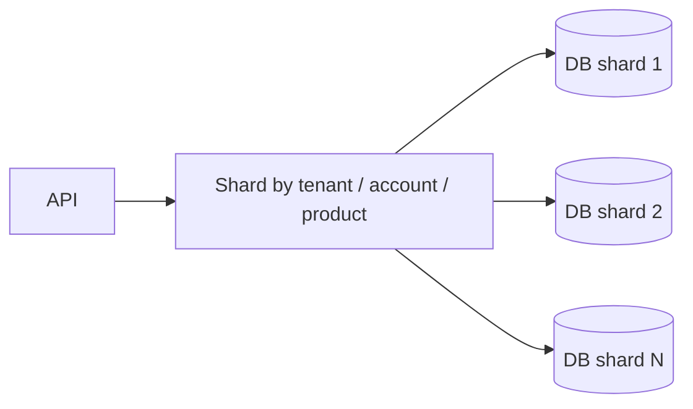

وقتی یک دیتابیس عمودی/تنظیم‌شده کافی نیست. کلید shard را با الگوی دسترسی انتخاب کن، hot key و توزیع نامتعادل را اندازه بگیر، migration و reshard را از روز اول طراحی کن. تراکنش cross-shard، unique constraint سراسری و گزارش‌گیری سخت‌تر می‌شوند. در موجودی، shard بر اساس product ممکن است رقابت هر کالای داغ را متمرکز کند؛ موجودی را به bucketهای قابل رزرو تقسیم کردن یک انتخاب با پیچیدگی consistency است.

### G. Cache / CQRS

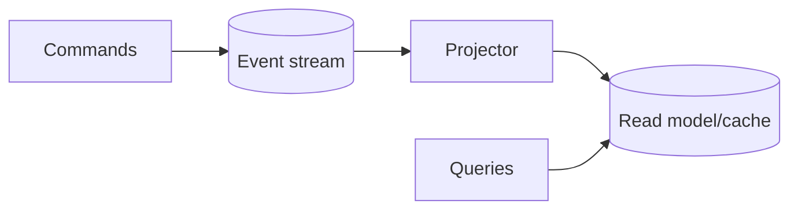

وقتی حجم خواندن و نوشتن یا مدل پاسخ متفاوت است. read model سریع و مخصوص query است؛ cache منبع حقیقت نیست مگر پروتکل دوام و بازیابی صریح داشته باشد. invalidation، stale read، cache stampede و rebuild زمان‌بر از failure modeها هستند.

### H. اگر هدف ۱۰۰٬۰۰۰ checkout یا رزرو موجودی در ثانیه باشد

این هدف با ۱۰۰٬۰۰۰ فرمان سبد در ثانیه فرق دارد. implementation فعلی برای هر سفارش یک transaction PostgreSQL باز می‌کند، ردیف‌های موجودی را با شرط `available >= quantity` کم می‌کند، order و itemها را می‌نویسد و `processed_events` را ثبت می‌کند. این الگو جلوی فروش بیش از موجودی را در دیتابیس فعلی می‌گیرد؛ اما سفارش‌های هم‌زمان برای یک کالای داغ روی همان row serialize می‌شوند. بالا بردن تعداد Podهای worker این قفل مشترک را حذف نمی‌کند.

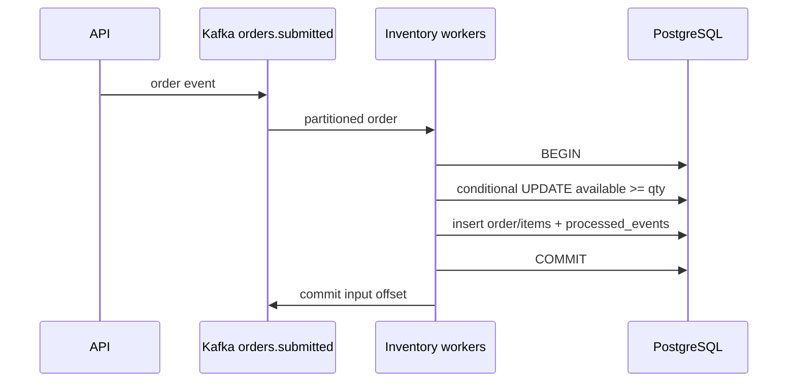

گزینه‌ها را بر اساس اجازهٔ oversell و atomicity بین چند SKU انتخاب کن:

| طرح | کنترل oversell و atomicity | bottleneck/هزینه | مناسب وقتی |
|---|---|---|---|
| یک PostgreSQL قوی + query/index/pool tuning | ACID برای کل سفارش؛ reservation و ثبت order می‌توانند یک transaction باشند. | رقابت rowهای کالای داغ، WAL، connection/IO و سقف یک writer هنوز باقی می‌ماند. | ابتدا؛ تا وقتی آزمون نشان دهد DB گلوگاه واقعی است. |
| PostgreSQL partitioning/sharding بر اساس product یا tenant | تراکنش در یک shard ساده؛ کلید مالکیت مشخص است. | سفارش با SKUهای چند shard دیگر یک ACID transaction ندارد؛ routing و reshard دشوار می‌شوند. | داده و الگوی دسترسی قابل جداسازی باشد. |
| مالک تک‌نویسنده برای هر SKU/shard روی Kafka | ترتیب رزرو هر موجودی روشن؛ replay و dedupe رویداد ممکن است. | event چند-SKU به چند مالک می‌رود؛ پاسخ order باید saga/coordination و timeout داشته باشد. | ordering موجودی مهم است و async بودن پاسخ پذیرفته شده است. |
| escrow/bucket موجودی | موجودی کل بین bucketهای مستقل پیش‌تخصیص می‌شود؛ هر bucket می‌تواند موازی کم شود و مجموع allocation از موجودی واقعی بیشتر نیست. | bucket داغ ممکن است تمام شود درحالی‌که bucket دیگر موجودی دارد؛ rebalance و بازگرداندن hold پیچیده است. | چند کالای داغ، نرخ بالای رزرو و پذیرش inventory fragmentation وجود دارد. |
| oversell/backorder با جبران | پذیرش سریع‌تر است؛ رزرو در لحظهٔ ورودی سخت‌گیر نیست. | ممکن است پرداخت/سفارش بعداً رد یا جبران شود؛ تجربهٔ مشتری و تعهد مالی تغییر می‌کند. | کسب‌وکار backorder یا جایگزینی را مجاز می‌داند. |

طرح single-writer یا bucket را برای سفارش چندقلمی معمولاً به reservation saga تبدیل می‌کند:

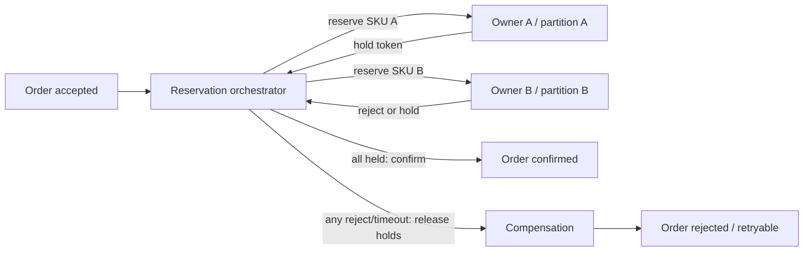

برای saga باید holdها expiration داشته باشند، هر فرمان `reservationId` یکتا داشته باشد، confirm/release idempotent باشد، timeout قابل‌بازیابی باشد و وضعیت میانی در API نمایش داده شود. Kafka transaction فقط publishهای Kafka را اتمیک می‌کند؛ آن را با transaction توزیع‌شدهٔ Kafka + PostgreSQL اشتباه نگیر. Outbox/CDC انتشار event را با commit دیتابیس هماهنگ می‌کند، اما قفل row یا ظرفیت نوشتن DB را خودبه‌خود زیاد نمی‌کند.

برای sizing checkout، نرخ موفقیت نهایی را جدا از request و event ingress بسنج. throughput واقعی برابر کمترین ظرفیت مسیرهای ضروری است: order publish، reservation owner/partition، durable ledger، database commit و result delivery. تعداد محصول‌های داغ، تعداد lineهای هر سفارش، نرخ rejection، lock wait، WAL/s، connection concurrency و مدت نگه‌داری hold را ثبت کن. تا وقتی semantics فروش بیش از موجودی، چندکالایی بودن سفارش و رفتار timeout روشن نشده، عدد ۱۰۰k checkout/s یک هدف ناقص است و نباید از benchmark basket command نتیجه‌گیری شود.

## ۴. انتخاب partition، کلید و ترتیب

ظرفیت را با اندازه‌گیری به‌دست بیاور:

```text
partitions_needed >= target_events_per_second / measured_safe_events_per_second_per_partition
```

بعد headroom، replication factor، اندازهٔ رکورد، acks، compression، consumer processing time و broker disk/network را اضافه کن. این فرمول فقط تخمین اولیه است. کلید basket ترتیب هر سبد را حفظ می‌کند اما یک basket پرترافیک را نمی‌توان همزمان روی چند partition پردازش کرد. افزایش partition بعد از تولید داده می‌تواند mapping کلیدها را عوض کند؛ مهاجرت topic نسخه‌دار و cutover کنترل‌شده طراحی کن.

### Batch در کدام لایه؟

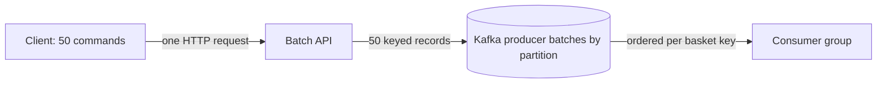

سه مفهوم را جدا نگه دار: **HTTP batching** تعداد round-tripهای شبکه و هزینهٔ parse/auth را برای client کم می‌کند؛ **producer batching** رکوردهای چند درخواست را در حافظه جمع می‌کند و تعداد requestهای broker را پایین می‌آورد؛ **consumer batching** چند رکورد را با یک مرحلهٔ پردازش/commit جلو می‌برد، اما فقط وقتی اثرها و offsetها اتمیک یا idempotent باشند. batch بزرگ‌تر معمولاً throughput را بهتر می‌کند و در عوض انتظار/حافظه، tail latency، اندازهٔ retry و تعداد پیام‌های تکراری احتمالی را بالا می‌برد.

در این نمونه مسیر `POST /api/baskets/commands/batch` حداکثر ۵۰۰ فرمان را می‌گیرد و هر پیام را با `basketId` کلید می‌کند؛ این کار batch را atomic نمی‌کند. API برای جمع‌آوری نتیجهٔ delivery از callback استفاده می‌کند تا به‌ازای هر پیام Task جدا نسازد؛ این کاهش allocation یک فرض بهینه‌سازی است و تا benchmark مقایسه‌ای، دستاورد throughput محسوب نمی‌شود. پس از enqueue حتی با قطع client، handler تا completion callbackها می‌ماند تا limiter تعداد publishهای واقعاً درحال‌انجام را کنترل کند؛ client ممکن است acknowledgment HTTP را نبیند و نتیجه برایش نامعلوم بماند. `429` همراه `Retry-After` پیش از اجرای handler صادر می‌شود و batch را منتشر نکرده، پس retry آن درخواست بی‌ابهام است. اما اگر چند publish موفق و یکی ناموفق شود، پاسخ 503 است و بخشی از فرمان‌ها ممکن است در Kafka باشند؛ این پاسخ ambiguous است و retry کور کل batch امن نیست. retry امن به `eventId` ثابت و deduplication پایدار در consumer نیاز دارد. اجرای محلی ۵۰ فرمان/request با هدف ۳۰ request/s، حدود ۱٬۵۰۱ فرمان/s پذیرفته‌شده نشان داد؛ این فقط endpoint و Kafka پذیرش را در kind کوتاه‌مدت مشاهده کرد و throughput مصرف کامل یا ۱۰۰٬۰۰۰ فرمان/s را اثبات نکرد.

### مرز واقعی retry در پیاده‌سازی فعلی

`eventId` در batch اختیاری است و اگر خالی باشد API برای هر تلاش UUID تازه می‌سازد؛ بنابراین client باید برای retry همان شناسهٔ قبلی را دوباره بفرستد. با این حال consumer سبد، `eventId` را به‌عنوان کلید dedupe نگه نمی‌دارد. محافظ فعلی Redis بر اساس partition/offset تکرار همان offset Kafka را می‌شناسد، نه دو publish جداگانه با یک `eventId`. از آن‌جا که `item-set` مقدار مطلق quantity را می‌نویسد، تکرار پشت سر هم معمولاً همان مقدار را می‌سازد؛ اما retry دیررس پس از فرمان جدیدتر می‌تواند مقدار قدیمی را دوباره بنویسد. پس این API را فعلاً «at-least-once با اثر معمولاً idempotent، ولی بدون تضمین dedupe/ترتیب retry در سطح درخواست» در نظر بگیر.

برای رفع این محدودیت، راه‌حل را با semantics انتخاب کن:

| روش | تضمین و هزینه | زمان انتخاب |
|---|---|---|
| Kafka transaction برای کل batch | همهٔ publishها commit یا abort می‌شوند؛ retry کل transaction با `eventId` قدیمی هنوز ممکن است رویداد منطقی را دوباره ثبت کند. Transaction latency و مدیریت producer ID اضافه می‌شود. | وقتی batch باید در Kafka all-or-nothing دیده شود. |
| Inbox با unique `eventId` | consumer در storage بادوام شناسه را یکتا ثبت می‌کند؛ retry dedupe می‌شود، اما write و index و retention storage افزایش می‌یابد. | وقتی هر فرمان کسب‌وکاری دقیقاً یک بار اثر کند و هزینهٔ storage پذیرفتنی باشد. |
| version افزایشی به‌ازای basket | projection فقط نسخه‌ای بزرگ‌تر از نسخهٔ موجود را می‌پذیرد؛ retry قدیمی نمی‌تواند state جدید را عقب ببرد. تولید نسخه باید اتمیک و قابل‌استفادهٔ مجدد در retry باشد. | وقتی state نهایی مهم‌تر از نگه‌داشتن هر تغییر است و client/server می‌تواند sequence پایدار بسازد. |
| event log + projection قابل‌بازسازی | ورودی‌ها append-only می‌مانند و projection با version/checkpoint بازسازی می‌شود؛ audit/replay بهتر، اما storage و عملیات بیشتر. | وقتی تاریخچه، audit و اصلاح projection ارزش محصولی دارد. |

در هدف ۱۰۰k/s، inbox با نگه‌داشتن UUID هر event می‌تواند حافظه/دیسک بسیار زیادی مصرف کند. retention را از پنجرهٔ retry و قانون کسب‌وکار بسنج؛ برای هر event یک رکورد دائمی نساز مگر آن‌که الزام مالی/حقوقی داشته باشی. اگر dedupe کوتاه‌مدت کافی است، TTL و سقف حجم آن باید محاسبه و eviction/از‌دست‌رفتن کلیدها به‌عنوان رفتار طراحی‌شده مستند شود. راه‌حل نسخهٔ basket نیز باید رفتار دو نویسندهٔ هم‌زمان و reset/migration sequence را روشن کند.

### انتخاب راهبرد بر اساس مسئله

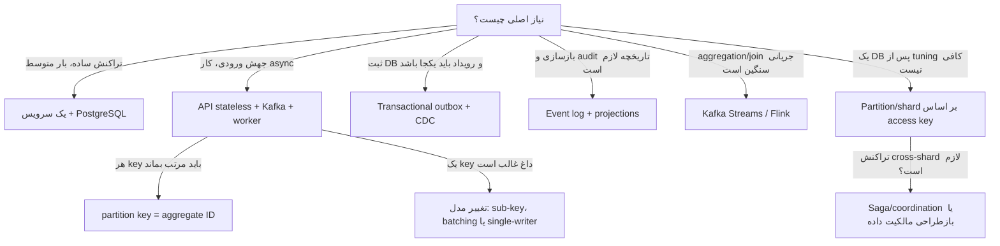

این درخت شروع گفتگو است، نه انتخاب خودکار. اگر عملیات باید هم‌زمان روی چند موجودی انجام شود، یک order-level ACID transaction در دیتابیس ساده‌تر است؛ اگر آن DB bottleneck شد، شکستن آن به چند shard می‌تواند نیازمند reservation saga و جبران باشد. ابتدا consistency و failure behavior را بنویس، سپس throughput موردنیاز را روی همان semantics اندازه بگیر.

## ۵. semantics، خطا و recovery

- **At-most-once:** ممکن است پیام گم شود؛ فقط وقتی از دست‌رفتن پذیرفتنی است.
- **At-least-once:** retry پیام تکراری می‌سازد؛ idempotency و dedup لازم است.
- **Effectively-once:** معمولاً با idempotent producer، کلید یکتا، transaction محلی و dedupe به دست می‌آید؛ قول جادویی end-to-end نیست.
- **Retry:** exponential backoff + jitter و حداکثر تلاش؛ خطای دائمی را در DLQ بگذار و ابزار replay امن بساز.
- **Poison event:** offset را بی‌نهایت روی همان پیام نگه ندار؛ قرنطینه، alert و مسیر اصلاح لازم است.
- **Ordering:** فقط دامنهٔ لازم را مرتب کن؛ ترتیب سراسری throughput را محدود می‌کند.
- **Timeout:** timeout نتیجه را نامعلوم می‌کند؛ قبل از تکرار، idempotency key را بررسی کن.
- **Graceful shutdown:** worker باید poll را متوقف کند، پردازش جاری را تمام/لغو کنترل‌شده کند و offset را فقط پس از commit اثر ثبت کند.
- **Commit هنگام idle:** commit مبتنی بر زمان را فقط پس از دریافت پیام بررسی نکن؛ با poll محدود زمانی یا timer مستقل، offsetهای انتهایی را هم commit کن. برای سنجش، committed counter، Kafka group offset و lag را کنار هم ببین.

## ۶. Kubernetes و مقیاس

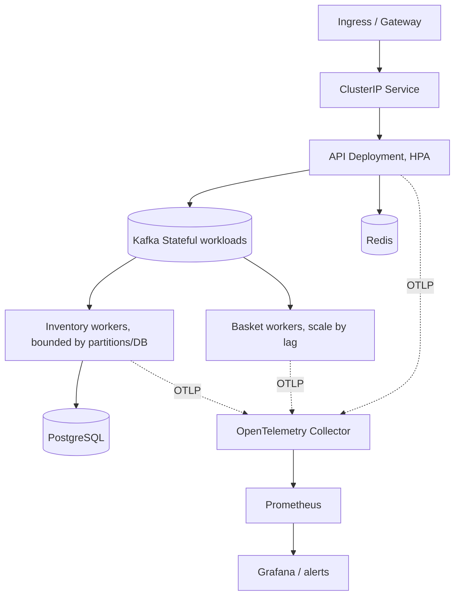

Deployment برای API و worker بدون state محلی؛ StatefulSet/PVC یا سرویس مدیریت‌شده برای stateful dependencies. HPA CPU برای API stateless خوب است؛ consumer بر اساس Kafka lag و زمان drain بهتر scale می‌شود. worker بیشتر از partitionها parallelism همان group را زیاد نمی‌کند. autoscaling سریع‌تر از زمان startup Kafka/DB می‌تواند نوسان ایجاد کند؛ min/max، cooldown و quota بگذار. PodDisruptionBudget، topology spread، requests/limits، readiness، startup probe، NetworkPolicy، RBAC و secret management را برای محیط واقعی اضافه کن.

## ۷. مسیر منطقی به ۱۰۰٬۰۰۰ TPS

1. تعریف TPS و قرارداد موفقیت: API پذیرش یا نتیجهٔ نهایی؟
2. workload واقعی بساز: read/write mix، payload، کلیدهای داغ، checkout ratio و burst.
3. baseline تک‌نسخه ثبت کن؛ latency p50/p95/p99، خطا، مصرف منابع و هزینه را نگه دار.
4. profiling: تخصیص حافظه، JSON، connection pools، Kafka producer batching، Redis round trip، DB lock/IO.
5. گلوگاه را جدا scale کن؛ API stateless، partition/consumer، cache، DB و شبکه مستقل‌اند.
6. ظرفیت پایدار را با headroom و خرابی یک node/broker بسنج؛ فقط throughput لحظه‌ای کافی نیست.
7. soak، burst، failover، recovery و replay را اجرا کن؛ سپس ادعای ظرفیت منتشر کن.

تقریب حجم ورودی: `bytes/sec = TPS × average serialized bytes`; حجم دیسک تقریبی با replication: `bytes/sec × retention_seconds × replication_factor` به‌علاوهٔ index، segment و فضای recovery. اندازهٔ متوسط و صدکی پیام را از ترافیک واقعی بگیر. در نرخ ۱۰۰k، هر ۱KB پیام حدود ۱۰۰MB/s دادهٔ منطقی پیش از replication می‌شود. Kafka چهار replica یعنی هزینهٔ نوشتن/شبکه چندبرابر است. این عدد محاسبهٔ بار است، نه اثبات ظرفیت.

### تخمین اولیه از اندازه‌گیری محلی این پروژه

در kind تک‌نودی، یک اجرای کم‌بار با دو basket worker حدود ۷۵۰ فرمان/s برای هر worker داشت؛ اما در مرحلهٔ ۲۵k/s، offset commitشده طی ۱۰ ثانیه حدود ۱۵۹k جلو رفت، یعنی نزدیک ۴k فرمان/s برای هر یک از چهار worker همان run. این اختلاف بیش از پنج‌برابری نشان می‌دهد extrapolation به utilization و workload وابسته است. `100,000 / 4,000 ≈ 26` worker فقط برون‌یابی سادهٔ پرفشار است؛ بر اساس requests فعلی، حدود ۱۳ vCPU و ۱۳Gi برای workerها می‌خواهد، پیش از headroom و سایر سرویس‌ها. این sizing نهایی نیست. سقف manifestهای فعلی ۵۱۲ basket worker و ۲۵۶ API است و در سقف، فقط controller/broker/API/basket حدود ۳۴۵٫۵ vCPU و ۳۷۱Gi request می‌خواهند؛ سقف Inventory با workerهای checkout این envelope را بزرگ‌تر می‌کند. این سقف کنترل‌کننده را با ظرفیت nodeها/quota محدود کن؛ محاسبه و فرض‌ها در [runbook پرفورمنس ۱۰۰k](PERFORMANCE-100K-FA.md) آمده است. topic پرفورمنس ۵۱۲ partition دارد، پس ۲۶ consumer از سقف موازی‌سازی آن کمتر است؛ اما skew، CPU throttling و Redis ممکن است نرخ را تغییر دهند.

حداکثر batch size برابر ۵۰۰ است؛ بنابراین ۱۰۰k command/s می‌تواند از حدود ۲۰۰ HTTP request/s برسد. در kind، batch=500 و 10 request/s به حدود 5,015 command/s برای ۱۵ ثانیه رسید و consumer lag بعد از load به صفر برگشت؛ در 25k command/s، API صفر خطا داشت اما پس از run حدود 91k lag جمع شد و چهار worker به CPU بالاتر از HPA target رسیدند؛ حداکثر ۱۰ ثانیه بعد صف تخلیه شده بود. این مشاهده گلوگاه سقف چهار worker در همان kind را نشان می‌دهد، نه ظرفیت production. API acceptance، Kafka durability، Redis projection و checkout completion چهار نتیجهٔ جدا هستند و باید هرکدام با SLO خود benchmark شوند.

## ۸. Observability و SLO

چهار سیگنال: latency، traffic، errors و saturation. برای این سیستم:

| سیگنال | مثال |
|---|---|
| API | requests/sec، latency histogram، status class، active requests، Kafka publish latency |
| Kafka | bytes in/out، ISR و under-replicated، request latency، disk، consumer lag/age |
| Consumer | processed/sec، error/retry، batch size، processing duration، commit/rebalance |
| Redis | command latency، memory، evictions، hit ratio، replication health |
| PostgreSQL | transaction latency، lock wait، pool saturation، deadlock، WAL/replication lag |
| Kubernetes | ready replicas، restart، throttling، memory، PVC fill، pending pods، HPA desired/current |
| Business | command accepted، checkout completed/rejected، reservation result، duplicate event |

labelها باید کم‌کاردینالیتی باشند: route template، status code class، topic، consumer group. هرگز user/basket/order ID را label نکن. SLOها را محصول تعیین می‌کند؛ مثال: درصدی از publishها زیر latency مشخص و checkoutها در زمان مشخص نهایی شوند. برای paging، burn rate و symptom را alert کن نه هر نوسان CPU. لاگ ساختاریافته و trace با correlation ID کمک می‌کند؛ ID در trace/log خوب است، در metric label بد است.

## ۹. روش benchmark و پذیرش

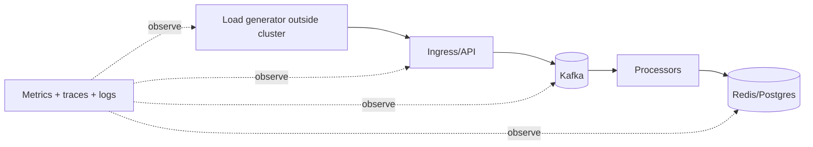

بارساز را روی همان node سرویس قرار نده تا منبع CPU را با برنامه شریک نشود. نرخ ثابت و ramp جدا، payload واقعی، warm-up، run چند دقیقه‌ای و soak چندساعته اجرا کن. هر سناریو را با و بدون خرابی broker/worker تکرار کن. خروجی هر run باید شامل commit SHA، image digest، config، سخت‌افزار، workload، throughput موفق، p50/p95/p99، error، lag، resource و هزینه باشد. قبولی یعنی target پایدار با SLO و headroom، نه صرفاً تعداد درخواست ارسال‌شده.

## ۱۰. واژه‌نامهٔ کوتاه

| واژه | معنی |
|---|---|
| Throughput | کار موفق در واحد زمان؛ با TPS ارسالی یکی نیست. |
| Latency | مدت عملیات؛ percentile دنبالهٔ توزیع را نشان می‌دهد. |
| Backpressure | کندکردن ورودی وقتی مصرف‌کننده ظرفیت ندارد. |
| Consumer lag | فاصلهٔ offset مصرف‌شده تا انتهای partition. |
| Idempotency | تکرار همان درخواست اثر اضافی نسازد. |
| Partition key | تعیین می‌کند رویداد کجا ذخیره و چه ترتیبی حفظ شود. |
| SLI/SLO/SLA | اندازه‌گیری، هدف داخلی و تعهد قراردادی. |
| RPO/RTO | حداکثر دادهٔ قابل‌از‌دست‌رفتن و زمان بازیابی هدف. |
| CQRS | جداسازی مدل command از read/query. |
| DLQ | مسیر قرنطینهٔ رویدادهای غیرقابل‌پردازش خودکار. |

## ترتیب پیشنهادی مطالعه و تمرین

1. اجرای Compose و ترسیم request flow.
2. حذف یک consumer و مشاهدهٔ lag؛ سپس scale تا سقف partition.
3. قطع Redis و بررسی readiness و رفتار retry.
4. ارسال checkout تکراری با idempotency key یکسان و بررسی dedupe.
5. تغییر partition key در یک محیط آزمایشی و مشاهدهٔ اثر ordering.
6. افزودن outbox در branch آموزشی و مقایسه با dual-write.
7. طراحی benchmark و SLO قبل از افزایش replica.

### منابع رسمی

- [Kubernetes Concepts](https://kubernetes.io/docs/concepts/)
- [Kubernetes HPA](https://kubernetes.io/docs/tasks/run-application/horizontal-pod-autoscale/)
- [Apache Kafka Documentation](https://kafka.apache.org/documentation/)
- [OpenTelemetry .NET](https://opentelemetry.io/docs/languages/dotnet/)
- [Prometheus Docs](https://prometheus.io/docs/introduction/overview/)

---

# بخش دوم: کاتالوگ جامع گزینه‌های طراحی و انتخاب فناوری

> این بخش برای مقایسهٔ گزینه‌هاست، نه این‌که همهٔ آن‌ها را هم‌زمان در سیستم نصب کنیم. محصولات و نسخه‌ها دائماً تغییر می‌کنند؛ بنابراین «همهٔ گزینه‌های ممکن» فهرستی بسته و همیشگی نیست. این کاتالوگ خانواده‌های اصلی و نمونه‌های شناخته‌شده را پوشش می‌دهد و انتخاب نهایی باید با workload، SLO، تیم، هزینه و محدودیت عملیاتی سنجیده شود.

## ۱۱. اول دقیق کنیم «۱۰۰٬۰۰۰ تراکنش در ثانیه» یعنی چه

عدد TPS بدون تعریف واحد کار قابل استفاده نیست. در سیستم این پروژه دست‌کم این نرخ‌ها جدا هستند:

| نرخ | تعریف | معنی موفقیت |
|---|---|---|
| HTTP RPS | درخواست‌های ورودی به API در ثانیه | پاسخ HTTP در زمان SLO |
| Command/s | فرمان‌های basket یا checkout پذیرفته‌شده در ثانیه | اعتبارسنجی و ثبت پایدار فرمان |
| Event/s | رویدادهای durable نوشته‌شده در log | رویداد با ضمانت durability مورد توافق ثبت شده |
| Projection update/s | تغییرات اعمال‌شده در Redis/نمای خواندن | نسخهٔ projection به offset/sequence مورد انتظار رسیده |
| Business transaction/s | خریدی که نتیجهٔ کسب‌وکاری نهایی دارد | رزرو، پرداخت/لغو، موجودی و سفارش با وضعیت سازگار نهایی شده‌اند |

اگر یک HTTP request شامل ۵۰۰ فرمان باشد، ۲۰۰ درخواست/s ممکن است ۱۰۰٬۰۰۰ command/s بسازد؛ اما به این معنا نیست که ۱۰۰٬۰۰۰ خرید/s تکمیل شده‌اند. در برآورد، نسبت batch، میانگین و صدک payload، درصد checkout، تعداد رویدادهای ناشی از هر فرمان، مدت نگهداری، کلیدهای داغ، درصد retry، read/write mix، سطح durability، منطقه‌ها، و latency صدکی را ثبت کن.

### تعریف پذیرش قابل سنجش

یک ادعای ظرفیت باید این جمله را کامل کند: «با workload مشخص، سخت‌افزار و تنظیمات ثبت‌شده، سامانه به مدت معین حداقل X عملیات durable/نهایی در ثانیه را با p99 ≤ Y، خطای ≤ Z، lag ≤ L، و پس از خرابی N node قابل بازیابی انجام می‌دهد.» اگر durability، percentile، طول run و خرابی‌ها ذکر نشده‌اند، این ظرفیت هنوز قابل مقایسه نیست.

## ۱۲. الگوهای معماری ممکن و trade-offها

| الگو | جریان ساده | مزیت اصلی | هزینه/ریسک | مناسب برای |
|---|---|---|---|---|
| برنامهٔ یکپارچه + یک DB رابطه‌ای | API → transaction در SQL | ساده‌ترین دیباگ و تراکنش چندرکوردی | scale نوشتن و lock/connection محدود به DB؛ صف‌پذیری کمتر | شروع، بار متوسط، invariantهای قوی |
| Stateless API + broker + worker | API → log → مصرف‌کننده → store | جذب burst، جداسازی پذیرش از پردازش، replay | eventual consistency، نیاز به idempotency و پایش lag | بار ناهموار و کارهای async |
| Outbox + CDC | SQL transaction → outbox → CDC → broker | جلوگیری از dual-write ناسازگار | CDC و schema evolution پیچیده‌تر؛ outbox باید پاک‌سازی شود | وقتی commit دامنه‌ای و publish باید هماهنگ باشند |
| Event sourcing | فرمان → event log مرجع → projections | تاریخچهٔ کامل، بازسازی state، audit | تغییر مدل و replay دشوار؛ حذف/اصلاح داده پیچیده | دامنهٔ event-centric با نیاز audit/replay واقعی |
| CQRS | مدل نوشتن جدا از مدل خواندن | read scale مستقل و query متناسب با مصرف‌کننده | چند projection، تأخیر همگرایی، دو مدل برای نگهداری | read/write الگوهای بسیار متفاوت |
| Stream processing | broker → stateful stream operator → خروجی‌ها | پنجره/تجمیع و محاسبهٔ پیوسته | state/checkpoint/repartition و semantics سخت‌تر | fraud، aggregation و پردازش زمان‌محور |
| شاردینگ دامنه‌ای | key → shard مستقل | گسترش write capacity و isolation | query بین‌شاردی، جابه‌جایی کلید، عملیات چندشاردی | پس از اثبات bottleneck یک DB و داشتن shard key طبیعی |
| Saga / workflow | مراحل مستقل + پیام جبرانی | تراکنش طولانی بدون lock سراسری | وضعیت‌های میانی و compensation باید طراحی شوند | checkout چندسرویسه، پرداخت و رزرو |
| Escrow / سهمیه‌بندی موجودی | پیش‌تخصیص سهمیه به shardها | عملیات محلی سریع و کاهش رقابت روی شمارندهٔ داغ | ظرفیت ممکن است در shard دیگر بلااستفاده بماند؛ reconcile لازم | موجودی/اعتبار با invariant قابل تقسیم |

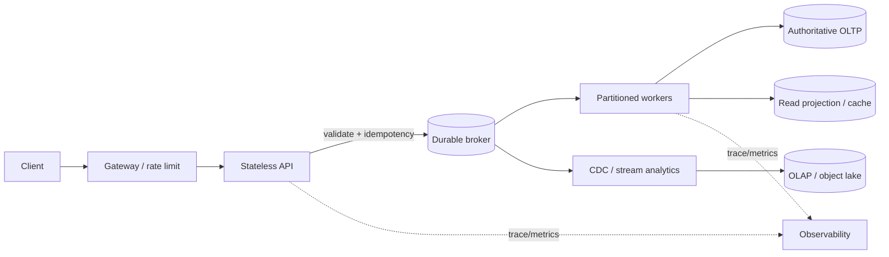

### ترتیب تحول پیشنهادی برای همین پروژه

1. ابتدا semantics را مشخص کن: آیا قبول‌شدن فرمان باید بلافاصله نتیجهٔ checkout بدهد یا فقط ثبت durable را تأیید می‌کند؟
2. مسیر سادهٔ API + PostgreSQL را به عنوان baseline نگه‌دار؛ query plan، index، batching، connection pool و transaction scope را اندازه بگیر.
3. اگر ورودی burst دارد یا کار می‌تواند asynchronous باشد، broker و worker را اضافه کن؛ هر پیام idempotency key و نسخهٔ schema داشته باشد.
4. اگر SQL write و publish هم‌زمان باید اتمیک باشند، outbox/CDC را بررسی کن.
5. read projection را جدا کن فقط اگر read workload یا isolation واقعاً نیازمند آن است.
6. partition/shard را وقتی اضافه کن که یک اندازه‌گیری تکرارپذیر bottleneck را نشان دهد؛ shard key باید با ordering و queryها سازگار باشد.
7. سراغ distributed SQL، event sourcing یا چند نوع database برو اگر نیاز دامنه و SLO آن هزینهٔ اضافی را توجیه کند.

## ۱۳. خانواده‌های پایگاه داده و انتخاب برای این سیستم

هیچ database واحدی برای همهٔ دسترسی‌ها بهترین نیست. database مرجع تراکنش را با cache، search و analytics اشتباه نگیر. استفاده از چند مدل فقط وقتی ارزش دارد که نیازهای access pattern، retention یا latency واقعاً متفاوت باشند؛ هر مدل جدید هزینهٔ backup، امنیت، schema، مانیتورینگ، on-call و consistency اضافه می‌کند. راهنمای مدل‌های دادهٔ Azure و راهنمای databaseهای AWS نیز انتخاب را از workload و مدل داده شروع می‌کنند و امکان ترکیب purpose-built storeها را مطرح می‌کنند. [Azure: مدل‌های ذخیره‌سازی](https://learn.microsoft.com/azure/architecture/data-guide/technology-choices/understand-data-store-models)، [AWS: انتخاب database](https://docs.aws.amazon.com/decision-guides/latest/decision-guides/databases-on-aws-how-to-choose.html)

| خانواده و نمونه‌ها | کاربرد محتمل در HPT | نقاط قوت | trade-off / محدودیت مهم |
|---|---|---|---|
| رابطه‌ای: PostgreSQL، MySQL/MariaDB، SQL Server، Oracle | سفارش، پرداخت، موجودی و دادهٔ مرجع با invariantهای چندرکوردی | SQL، constraint، transaction، ابزار بالغ و گزارش‌گیری | write scaling عمودی یا معماری replica/shard می‌خواهد؛ connection/lock contention و query نامناسب می‌تواند گلوگاه شود |
| Distributed SQL / NewSQL: CockroachDB، YugabyteDB، TiDB، Google Spanner، Azure SQL Hyperscale و گزینه‌های مشابه | SQL و تراکنش در چند node/zone/region | scale-out و HA همراه با API رابطه‌ای | replication و consensus هزینهٔ latency/شبکه دارند؛ طراحی schema/region و عملیات متفاوت است؛ سازگاری SQL و قابلیت‌ها محصول‌محور است |
| Key-value: Redis/Valkey، DynamoDB، Aerospike، FoundationDB (بسته به مدل دسترسی) | basket state، idempotency، lookup بر اساس کلید، counterهای طراحی‌شده | lookup سریع و scale افقی برای دسترسی key-based | query آزاد و join محدود؛ hot key/partition؛ durability و transaction semantics بین محصول‌ها متفاوت است؛ cache را مرجع داده فرض نکن |
| In-memory / cache: Redis، Valkey، Memcached، Hazelcast، Aerospike | cache، session، نرخ محدودسازی، projection موقت | latency پایین و بار کم‌تر روی OLTP | ظرفیت گران‌تر، eviction، persistence/failover و invalidation؛ دادهٔ قابل‌بازسازی را cache نگه‌دار |
| Wide-column / column-family: Cassandra، ScyllaDB، HBase، Bigtable، DynamoDB در مدل wide-row | نوشتن حجیم و دسترسی‌هایی که query از قبل بر اساس partition key تعریف شده | scale افقی و throughput بالای توزیع‌شده برای access pattern مناسب | مدل‌سازی query-first، denormalization و repair/compaction؛ تراکنش و query دلخواه رابطه‌ای نیست |
| Document: MongoDB، Couchbase، DocumentDB و document APIهای دیگر | aggregateهایی با ساختار متغیر، کاتالوگ/پروفایل یا basket document در صورت نیاز | مدل نزدیک به JSON و خواندن aggregate یک‌جا | update contention سند بزرگ، index و transaction محدود به طراحی؛ ارتباطات و invariant چندسندی ممکن است پیچیده شود |
| Search/index: Elasticsearch، OpenSearch، Solr | جست‌وجوی متن، فیلتر و رتبه‌بندی | full-text و query تحلیلی بر index | منبع حقیقت OLTP نیست؛ index معمولاً async و eventually consistent است؛ shard/reindex و حافظه گران |
| OLAP / real-time analytics: ClickHouse، Apache Druid، Pinot، BigQuery، Snowflake، Redshift | نرخ رویداد، funnel، گزارش عملیاتی تحلیلی | scan و aggregation پرحجم جدا از OLTP | write transaction سفارش را جایگزین نمی‌کند؛ ingest lag و مدل ستونی؛ هزینه و query isolation |
| Time-series: Prometheus/Thanos/Mimir، VictoriaMetrics، InfluxDB، TimescaleDB، Timestream | metric، telemetry و دادهٔ زمانی | retention/downsampling و query زمانی | مناسب order ledger نیست؛ cardinality و retention کنترل شود |
| Graph: Neo4j، Neptune، JanusGraph | روابط عمیق مثل fraud network یا مسیر وابستگی | traversal رابطه‌ای و الگوریتم گراف | اضافه‌کردن آن صرفاً برای CRUD تراکنش توجیه ندارد؛ transaction/scale/هزینه محصول‌محور |
| Object store + table format: S3، GCS، Azure Blob/ADLS + Iceberg/Delta/Hudi | آرشیو event، backup، data lake و replay/تحلیل batch | ارزان و بادوام برای دادهٔ حجیم، جدا از OLTP | latency و تراکنش ریزدانهٔ بانک اطلاعاتی نیست؛ catalog، compaction و governance لازم |
| Ledger / immutable log: event store تخصصی یا journal در SQL/broker | audit، ثبت تغییرناپذیر یا بازسازی | تاریخچه و قابلیت audit | retention، حریم خصوصی، اصلاح داده و replay باید از ابتدا طراحی شود؛ «append-only» خودبه‌خود correctness نمی‌دهد |

### گزینهٔ پایگاه داده برای هر بخش HPT

| داده/عملیات | انتخاب آغازین | جایگزین قابل ارزیابی | قاعدهٔ ایمنی |
|---|---|---|---|
| Order/payment/inventory authoritative state | PostgreSQL یا DB رابطه‌ای موجود | Distributed SQL اگر multi-node/region write و عملیات واقعاً لازم شد | constraint و transaction مرجع را حذف نکن؛ نتیجهٔ durable را تعریف کن |
| Basket state | Redis برای projection/cache یا PostgreSQL برای سادگی | DynamoDB، Cassandra، MongoDB بر اساس access pattern | عمر، version و recovery basket را تعریف کن؛ cache loss نباید سفارش نهایی را پاک کند |
| Event transport | Kafka/سرویس managed معادل | Pulsar، Redpanda، cloud event/queue | broker معمولاً جایگزین ledger تراکنشی دامنه نیست |
| Search | OpenSearch/Elasticsearch یا جست‌وجوی native SQL | Solr، سرویس cloud | دوباره‌سازی index از منبع durable ممکن باشد |
| Metrics | Prometheus-compatible TSDB | Mimir/Thanos/VictoriaMetrics/سرویس managed | label cardinality کم و retention مشخص |
| Analytics/history | ClickHouse/warehouse/object lake | Druid، Pinot، BigQuery/Snowflake/Redshift، lakehouse | workload تحلیلی را از transaction path جدا کن |

Partitioning داخل یک relational DB با sharding توزیع‌شده یکی نیست. Partitioning نگهداری/حذف بازه‌ای و pruning را آسان می‌کند، اما به تنهایی write ظرفیت را بین ماشین‌ها پخش نمی‌کند. حتی PostgreSQL محدودیت‌هایی برای unique/primary key روی partitioned table دارد و partition زیاد می‌تواند planning و حافظه را سنگین کند؛ کلید و تعداد partition باید با query و constraint سازگار باشد. [PostgreSQL: Table Partitioning](https://www.postgresql.org/docs/current/ddl-partitioning.html)

برای databaseهای key-based، توزیع کلید مهم است: کلیدی که همهٔ ترافیک را به یک partition ببرد، hot partition می‌سازد. DynamoDB توصیه می‌کند activity بین partition keyها یکنواخت پخش شود؛ این اصل در hash partitioning سیستم‌های دیگر هم مهم است. [DynamoDB: انتخاب partition key](https://docs.aws.amazon.com/amazondynamodb/latest/developerguide/bp-partition-key-design.html)

## ۱۴. Broker، queue و stream: گزینه‌ها و trade-off

| فناوری/خانواده | بهترین کاربرد نسبی | مزیت | هزینه/محدودیت |
|---|---|---|---|
| Apache Kafka | log قابل replay، چند consumer group و throughput بالا | partitioned append log، اکوسیستم CDC/streaming | عملیات broker/storage و طراحی partition؛ ordering فقط در محدودهٔ partition |
| Redpanda | Kafka API و مدل عملیاتی متفاوت | سازگاری اکوسیستم Kafka و انتخاب runtime/عملیات | رفتار، performance و هزینه باید با نسخه و workload خود benchmark شود |
| Apache Pulsar | multi-tenant messaging و الگوهای queue/stream | جداسازی لایه‌های broker/storage و subscriptionهای متعدد | اجزای بیشتر و مدل عملیاتی متفاوت |
| RabbitMQ | صف task، routing و تأیید پیام | routing انعطاف‌پذیر و الگوی queue کلاسیک | replay log بلندمدت/throughput مدل Kafka هدف اصلی آن نیست؛ backlog و durability طراحی لازم دارد |
| NATS JetStream | messaging کم‌تاخیر و ساده‌تر | APIهای pub/sub و stream در اکوسیستم NATS | retention، delivery و scale را با نیازهای replay/ordering بررسی کن |
| Redis Streams | ساده‌سازی وقتی Redis از قبل بخشی از سیستم است | consumer group و ابزار نزدیک به Redis | workload event log بزرگ/مدت‌دار را با هزینهٔ حافظه و failover بسنج |
| Cloud queue/bus: SQS/SNS, EventBridge, Pub/Sub, Event Hubs, Service Bus | کاهش عملیات broker در cloud خاص | managed HA و integration بومی | lock-in، هزینهٔ درخواست/throughput، limits، ordering و replay تابع سرویس/پلن |
| DB queue/outbox | حجم کم یا شروع با transaction DB | atomicity با دادهٔ دامنه ساده‌تر | polling/cleanup می‌تواند DB را تحت فشار بگذارد؛ معمولاً وقتی throughput بالا شد باید سنجیده شود |

Kafka در هر partition ترتیب را حفظ می‌کند؛ کلید تعیین‌کنندهٔ partition نیز بنابراین تعیین‌کنندهٔ دامنهٔ ordering است. batching و compression می‌توانند کارایی را بهتر کنند ولی latency و CPU را تغییر می‌دهند. Kafka idempotent producer و transactionهای Kafka را ارائه می‌دهد، اما guarantee «exactly once» را نباید به‌صورت جادویی تا database خارجی تعمیم داد؛ consumer خارجی عموماً به idempotency/deduplication، outbox یا transaction هماهنگ نیاز دارد. [Kafka Design: Delivery Semantics](https://kafka.apache.org/44/design/design/)، [Kafka Producer Config](https://kafka.apache.org/36/configuration/producer-configs/)

### انتخاب delivery و ordering

- **At-most-once:** پیام گم‌شدنی است ولی duplicate کمتر؛ برای دادهٔ قابل‌چشم‌پوشی.
- **At-least-once:** پیام از دست نرود، ولی duplicate ممکن است؛ انتخاب عملی رایج به شرط handler idempotent.
- **Exactly-once effect:** نتیجهٔ دامنه برای همان command بیش از یک بار اعمال نشود؛ معمولاً با idempotency key + unique constraint/transaction در مقصد ساخته می‌شود، نه با ادعای transport به‌تنهایی.
- **ترتیب سراسری:** اغلب throughput را محدود می‌کند؛ معمولاً ordering per aggregate (مثلاً `basketId` یا `skuId`) کافی است.
- **Poison message:** retry نامحدود می‌تواند partition را متوقف کند؛ retry محدود، backoff، quarantine/DLQ، ابزار replay و تشخیص علت لازم است.

## ۱۵. زبان‌ها و runtimeها: همهٔ گزینه‌های اصلی

زبان به تنهایی TPS را تضمین نمی‌کند. طراحی allocation، serialization، I/O، connection pool، الگوریتم، DB/broker، payload، محدودیت CPU و تجربهٔ تیم معمولاً اثر بیشتری دارند. برای API/worker این پروژه، یک زبان بالغ با client رسمی و observability خوب از انتخاب زبان صرفاً به خاطر benchmark مصنوعی بهتر است.

| زبان/runtime | نقاط قوت | trade-off | جایگاه محتمل |
|---|---|---|---|
| C# / .NET (ASP.NET Core) | async I/O، runtime و tooling قوی، هم‌خوانی با پیاده‌سازی فعلی | GC و allocation باید پایش شوند؛ tuning و نسخهٔ runtime مهم است | انتخاب طبیعی برای نگه‌داری HPT فعلی و API/worker |
| Java / Kotlin (JVM) | اکوسیستم بسیار غنی، Kafka و DB clients بالغ، تیم‌های بزرگ | GC/heap tuning، startup/footprint و framework complexity | سرویس‌های transactional و streaming |
| Go | deployment ساده، concurrency سبک، startup و مصرف معمولاً قابل‌فهم | GC همچنان هست؛ abstractionهای کمتر؛ مراقبت از goroutine و backpressure | API و workerهای شبکه‌ای |
| Rust | کنترل حافظه، performance و safety قوی | زمان توسعه، learning curve و ecosystem/team hiring هزینه دارد | hot path یا سرویس کم‌تأخیر با تیم آماده |
| C/C++ | کنترل دقیق و performance بالقوه بالا | memory safety، پیچیدگی و سرعت توسعه/نگهداری پرهزینه | اجزای محدود و تخصصی؛ معمولاً انتخاب پیش‌فرض کسب‌وکار نیست |
| Scala | Kafka Streams/Spark و پردازش توزیع‌شدهٔ غنی | پیچیدگی زبان/runtime و استخدام/نگهداری | stream/data platform موجود در سازمان |
| Python | توسعه سریع، ecosystem داده/ML و orchestration | GIL در CPython برای CPU parallel، بهره‌وری CPU و latency باید سنجیده شود؛ async همه‌چیز را سریع نمی‌کند | control plane، analytics/ML، یا I/O workerهای اندازه‌گیری‌شده |
| JavaScript/TypeScript / Node.js | تیم full-stack، I/O async و اکوسیستم وب | event loop برای CPU-bound نباید مسدود شود؛ type safety زمان اجرا نیازمند validation است | gateway/BFF و سرویس I/O محور |
| Elixir / Erlang (BEAM) | fault isolation، actor/concurrency و سیستم‌های messaging | اکوسیستم تخصصی‌تر و مدل استخدام/پشتیبانی خاص | اتصال‌های هم‌زمان زیاد و سامانه‌های مقاوم به failure |
| PHP / Ruby | توسعه محصول و اکوسیستم وب مناسب | برای throughput بالا به process model، runtime و معماری درست نیاز دارند | قابل استفاده اگر تیم/محصول موجود باشد؛ benchmark با workload واقعی |
| Clojure / F# / OCaml و زبان‌های دیگر | مدل‌های functional و ابزارهای مناسب تیم‌های خاص | بازار نیرو و integration ممکن است محدودتر باشد | انتخاب مهندسی معتبر با مهارت و پشتیبانی سازمانی |

### قواعد انتخاب زبان

1. زبان/stack موجود را حفظ کن مگر profiling نشان دهد CPU runtime گلوگاه غالب است.
2. برای CPU-bound، الگوریتم، allocation و batching را اندازه بگیر؛ برای I/O-bound، async و connection management را.
3. هزینهٔ تیم، on-call، کتابخانهٔ broker/DB، tracing، security patch و سرعت تحویل را کنار benchmark بگذار.
4. polyglot را محدود کن: هر زبان جدید یعنی build, deployment, telemetry, vulnerability scanning و مهارت on-call جدید.
5. اگر فقط یک hot path واقعاً گلوگاه است، ابتدا آن قسمت را جدا و اندازه‌گیری کن؛ بازنویسی کل محصول معمولاً ریسک زیادی دارد.

## ۱۶. الگوهای داده، صحت و کنترل فشار

### Idempotency و مدل تراکنش

برای هر command دارای اثر مالی یا موجودی، client یک `idempotencyKey` پایدار بفرستد. سرور کلید را با scope مناسب (tenant/account/operation) و hash ورودی در storage durable ثبت کند. تکرار همان کلید و همان ورودی، همان نتیجه را بازگرداند؛ همان کلید با payload متفاوت خطای conflict بدهد. در database مرجع، unique constraint و transaction راه دفاع نهایی است. TTL کلید باید حداقل از بزرگ‌ترین بازهٔ retry/replay پشتیبانی کند.

### Hot key / hot SKU

اگر تمام خریدها روی یک `skuId` یا یک basket متمرکز شوند، partitioning معمولی مشکل را حل نمی‌کند. گزینه‌ها:

- صف سریالی برای کلید داغ: ساده و ترتیب‌پذیر، اما سقف آن یک جریان است.
- چند سهمیه/escrow counter: موازی و سریع‌تر، با reconcile و احتمال رد زودهنگام.
- reservation به‌جای decrement هم‌زمان: وضعیت‌های رزرو/تأیید/انقضا و job پاک‌سازی لازم.
- batch/aggregation در worker: callهای DB کمتر، latency نهایی بیشتر.
- محدودسازی/صف انتظار: رفتار قابل‌کنترل، اما تجربهٔ کاربر ضعیف‌تر در burst.
- جداسازی hot tenant/key به shard اختصاصی: ایزولیشن بهتر، عملیات و skew پیچیده‌تر.

### Backpressure و ظرفیت ورودی

API باید سقف body/batch، quota، timeout و نرخ مجاز داشته باشد. broker lag، oldest message age، worker saturation و DB pool saturation را به سیگنال کنترل تبدیل کن. انتخاب‌های overload عبارت‌اند از رد سریع با 429/503 و `Retry-After`، صف انتظار، کاهش featureهای غیرضروری، یا پذیرش فقط اگر durable capacity موجود است. retry کلاینت‌ها باید exponential backoff + jitter و سقف تلاش داشته باشد؛ retry هم‌زمان همهٔ کلاینت‌ها می‌تواند outage را تشدید کند.

### Multi-region

| الگو | مزیت | هزینه |
|---|---|---|
| یک region نویسنده + read replicas جغرافیایی | ساده‌تر و consistency روشن | latency دوردست برای write، region failover پیچیده |
| active-passive | مسیر عادی ساده، disaster recovery | RTO/RPO و failover/fencing باید آزمایش شود |
| active-active با مالکیت کلید/region | latency محلی و availability | conflict resolution، duplicate و routing پیچیده؛ تراکنش global پرهزینه |
| multi-region distributed SQL | abstraction تراکنشی و replication مدیریت‌شده‌تر | latency consensus و هزینه؛ schema/placement حیاتی |

برای order/inventory، «هر region همه‌چیز را مستقل بنویسد» بدون مالکیت و conflict plan می‌تواند oversell یا double charge بسازد. ابتدا single-writer per aggregate/region را بررسی کن.

## ۱۷. استقرار و زیرساخت: چه چیزی را کجا اجرا کنیم

| مدل اجرا | مزیت | trade-off |
|---|---|---|
| یک process/VM | ساده و کم‌هزینه برای شروع | deployment و scale درشت‌دانه، HA دستی |
| VM/Autoscaling group | کنترل OS و شبکه، عملیات شناخته‌شده | patching، capacity و orchestration بر عهدهٔ تیم |
| Kubernetes | rollout، service discovery، autoscaling و استانداردسازی workload | خود control plane و storage/networking نیاز به مهارت و ظرفیت on-call دارد؛ scale سرویس managed dependency را خودکار نمی‌کند |
| Managed Kubernetes + managed DB/broker | کاهش toil روی control plane/stateful layer | هزینه، محدودیت provider و egress/lock-in |
| Serverless/container functions | scale و عملیات سرور کمتر برای burst/event handler | cold start، سقف اجرا/concurrency، retry semantics، هزینهٔ burst و debugging |
| Bare metal | کنترل و قیمت مناسب در scale پایدار خاص | provisioning، failure domain، جایگزینی و عملیات پیچیده‌تر |

در HPT، API و workerهای بدون state محلی کاندید Kubernetes/containers مناسبی‌اند. Kafka و database را در Kubernetes فقط وقتی self-host کن که تیم قابلیت storage، upgrade، backup/restore، node replacement و incident آن را دارد؛ سرویس مدیریت‌شده هزینهٔ مستقیم دارد اما بخشی از عملیات را می‌خرد. Pod replica جای shard، broker capacity یا DB write capacity نیست. autoscaling worker باید lag و عمر قدیمی‌ترین پیام را با محدودیت downstream ترکیب کند؛ فقط CPU ممکن است دیر یا زودتر از نیاز واکنش دهد.

### اجزای پیرامونی

| مسئله | گزینه‌ها | نکتهٔ انتخاب |
|---|---|---|
| Gateway/Ingress | NGINX، Envoy، HAProxy، cloud LB/API Gateway، Traefik | TLS، rate limits، body limits، retry policy و هزینهٔ هر hop |
| Service-to-service | HTTP/REST، gRPC، messaging | HTTP ساده و debugپذیر؛ gRPC قرارداد و payload فشرده؛ پیام برای decoupling و async |
| API style | REST، GraphQL، gRPC، WebSocket | GraphQL لزوماً برای ingest حجیم بهترین نیست؛ batch endpoint کنترل‌شده غالباً بهتر است |
| Schema | JSON Schema، Protobuf، Avro، Protobuf/gRPC contracts | backward/forward compatibility و schema registry/validation |
| Secret/config | Kubernetes Secrets با KMS، Vault، cloud secret manager | secret در Git و image نباشد؛ rotation و دسترسی least privilege |
| IaC/GitOps | Terraform/OpenTofu، Pulumi، Bicep/CloudFormation، Helm، Argo CD/Flux | drift، review، rollback و secret state را طراحی کن |
| CI/CD | GitHub Actions، GitLab CI، Azure DevOps، Jenkins و مشابه | image immutable، scan، provenance، rollout و rollback |
| Network/security | NetworkPolicy، service mesh، mTLS، WAF، IAM/RBAC | mesh هزینهٔ latency و پیچیدگی دارد؛ برای همهٔ سرویس‌ها ضرورت ندارد |

## ۱۸. Metrics، tracing و داشبورد پیشنهادی

### Golden signals و metricهای محصول

| لایه | metricهای پایه |
|---|---|
| HTTP API | request rate، error rate، p50/p95/p99، in-flight، body bytes، batch size، publish latency |
| Broker | bytes in/out، produce/fetch latency، under-replicated partitions، ISR shrink، disk utilization، oldest lag age، consumer lag |
| Worker | commands/s، processing latency، batch size، retries، duplicate count، poison count، commit latency، rebalance count |
| OLTP DB | transaction latency، rows/s، lock wait، deadlock، pool wait، active/idle connections، WAL/replication lag، storage growth |
| Cache | command latency، hit/miss، evictions، memory fragmentation، replication/cluster health |
| Kubernetes | ready/desired replicas، restart، OOM، CPU throttling، pending pods، node allocatable، PVC usage، HPA desired/current |
| Business | accepted vs completed، checkout rejection، oversell، reservation expiry، duplicate effect، order age، reconciliation mismatch |

Metric nameها با واحد و نوع روشن باشند؛ histogram برای latency، counter برای رخداد تجمعی، gauge برای مقدار جاری. labelهای پرکاردینالیتی مثل `userId`, `orderId`, `basketId`, `idempotencyKey` را وارد metric نکن. برای trace/log correlation ID به کار ببر. alert روی علائم و SLO burn rate باشد: افزایش latency/error، رشد ماندگار lag/age، کمبود headroom و تخلیه‌نشدن backlog. یک داشبورد باید پذیرش API، throughput نهایی، backlog و سلامت dependency را در یک قاب نشان دهد.

### معماری telemetry

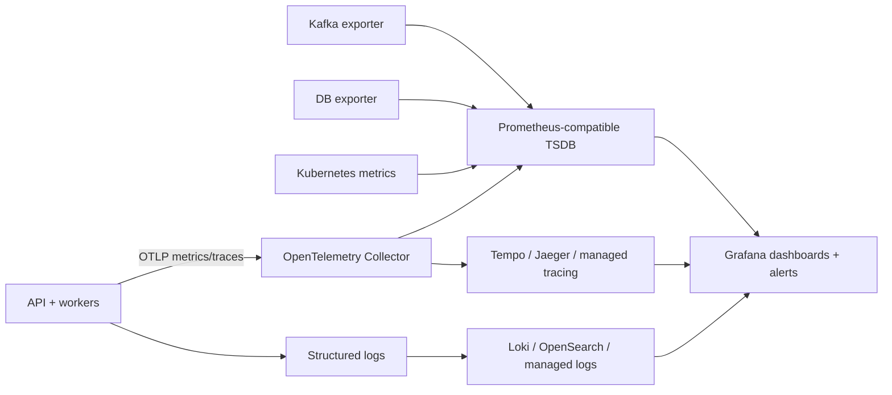

ابزارها فقط نمونه‌اند: Prometheus و Grafana رایج‌اند؛ OpenTelemetry برای instrumentation/export؛ Tempo/Jaeger برای trace؛ Loki/OpenSearch یا سرویس cloud برای log؛ Mimir/Thanos/VictoriaMetrics برای retention/scale بزرگ‌تر. انتخاب backend را با retention، cardinality، query concurrency، HA، هزینه و مهارت تیم بسنج.

## ۱۹. ماتریس تصمیم برای HPT

| اگر نیاز اصلی این است… | ابتدا بررسی کن | چه چیزی را صریحاً اندازه بگیر |
|---|---|---|
| correctness سفارش/پرداخت | relational transaction، unique idempotency، outbox | contention، commit latency، pool، recovery |
| burst command و decouple مصرف | Kafka/Pulsar/managed stream + bounded worker | produce durability، lag age، replay، consumer throughput |
| basket lookup سریع | cache/key-value با منبع durable مناسب | hot key، miss، loss/rebuild، consistency لازم |
| جست‌وجوی متنی محصول/سفارش | search index | index lag، reindex، stale result، هزینهٔ shard |
| تحلیلی روی رویداد زیاد | OLAP/stream analytics/lake | ingest lag، query SLA، storage/retention و هزینه |
| write افقی در چند zone | distributed SQL یا sharding منطقی | RTT/consensus، hot shard، failover و transaction scope |
| ۱۰۰k HTTP/s با batch | batch API + load shedding و worker pipeline | command/s واقعی، payload، p99، DB/broker ceiling |
| ۱۰۰k business transaction/s | ابتدا تعریف invariant و load model؛ سپس capacity design اختصاصی | پایان end-to-end، کلید داغ، dependency و fault-mode |

### درخت تصمیم کوتاه

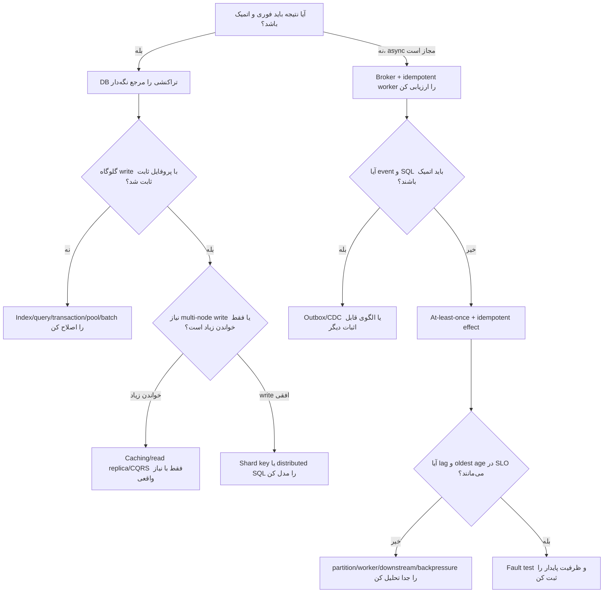

## ۲۰. خطاهای رایج در طراحی «۱۰۰k»

- یکی‌گرفتن HTTP RPS، command/s، event/s و business completion/s.
- شمارش پیام تولیدشده به‌عنوان پیام durable یا checkout موفق.
- استفاده از exactly-once به‌عنوان جایگزین idempotency در database مقصد.
- افزایش partition یا replica بدون اندازه‌گیری broker، disk، network و downstream.
- shard کردن زودهنگام و سپس مواجهه با queryهای cross-shard و تراکنش چندشاردی.
- تبدیل Redis یا search index به مرجع داده بدون طراحی persistence و recovery.
- scale کردن consumer بیش از partitionهای قابل مصرف یا بیش از ظرفیت DB.
- افزایش retry بدون backoff، سقف و budget؛ retry storm.
- تضمین ترتیب global برای تمام رخدادها وقتی ترتیب per entity کافی است.
- ساخت microservice یا polyglot متعدد پیش از نیاز سازمانی و مرز دامنهٔ واقعی.
- نگهداری IDهای منحصربه‌فرد در metric label و از بین بردن قابلیت query metrics.
- استناد به benchmark اینترنتی یا اجرای kind برای ادعای ظرفیت production.
- ندیدن هزینهٔ failover: ظرفیت باید با خرابی node/broker هم SLO را نگه دارد.
- نادیده‌گرفتن skew: میانگین یکنواخت، hot tenant/SKU را پنهان می‌کند.
- هدف‌گرفتن ۱۰۰٪ utilization؛ headroom برای burst، rebalance و خرابی لازم است.

## ۲۱. تمرین برای مسلط‌شدن

1. یک جریان را با چهار نرخ API request، command، event و order completion دوباره رسم کن و برای هرکدام metric بنویس.
2. برای هر event key بین `basketId`, `customerId`, `skuId` و `orderId` انتخاب کن؛ ordering، hot key و shard locality را مقایسه کن.
3. دو طرح برای oversell بنویس: conditional update در SQL و reservation/escrow؛ failureهای هرکدام را فهرست کن.
4. برای broker قطع‌شده، DB کند، Redis از دسترس خارج، consumer crash بعد از write و قبل از commit، پاسخ/وضعیت نهایی را مشخص کن.
5. همین workload را در relational DB، distributed SQL و key-value مدل کن؛ queryهای موردنیاز و invariantهایی را که هر طرح ساده/سخت می‌کند بنویس.
6. هزینهٔ نگهداری دو DB، broker و telemetry را کنار هزینهٔ خود compute و storage حساب کن.
7. یک SLO برای command acceptance و یک SLO جدا برای checkout completion بنویس؛ هدف‌ها را از محصول/کسب‌وکار بگیر.
8. شواهد benchmark را طوری ثبت کن که تیم دیگری بتواند با همان image، config، payload، hardware و faultها تکرارش کند.

## منابع رسمی تکمیلی

- [Azure Architecture Center: فهم مدل‌های data store](https://learn.microsoft.com/azure/architecture/data-guide/technology-choices/understand-data-store-models)
- [AWS Decision Guide: انتخاب database](https://docs.aws.amazon.com/decision-guides/latest/decision-guides/databases-on-aws-how-to-choose.html)
- [PostgreSQL 18: Partitioning](https://www.postgresql.org/docs/current/ddl-partitioning.html)
- [Amazon DynamoDB: طراحی partition key](https://docs.aws.amazon.com/amazondynamodb/latest/developerguide/bp-partition-key-design.html)
- [Apache Kafka 4.4: طراحی و delivery semantics](https://kafka.apache.org/44/design/design/)
- [Apache Kafka 3.6: Producer configurations](https://kafka.apache.org/36/configuration/producer-configs/)
- [Kubernetes: مفاهیم معماری](https://kubernetes.io/docs/concepts/)
- [Kubernetes: Horizontal Pod Autoscaling](https://kubernetes.io/docs/tasks/run-application/horizontal-pod-autoscale/)
- [OpenTelemetry: .NET](https://opentelemetry.io/docs/languages/dotnet/)
- [Prometheus: مفاهیم](https://prometheus.io/docs/introduction/overview/)

---

# بخش سوم: جعبه‌ابزار کامل بهینه‌سازی ظرفیت

این بخش راه‌حل‌ها را بر اساس محل گلوگاه گروه‌بندی می‌کند. اصل کار این است: ابتدا ظرفیت و latency هر مرحله را جدا اندازه بگیر؛ سپس کوچک‌ترین تغییری را انتخاب کن که همان گلوگاه را برطرف می‌کند. بهینه‌سازی یک مرحله ممکن است گلوگاه را به مرحلهٔ بعد منتقل کند؛ مثلاً batch کردن API می‌تواند broker را سریع‌تر پر کند و backlog worker را بیشتر کند.

## ۲۲. راه‌حل‌های سمت API و ورود بار

| راه‌حل | چه چیزی را بهتر می‌کند | trade-off و شرط استفاده |
|---|---|---|
| batch API | کاهش هزینهٔ HTTP/TLS/auth و syscall برای هر فرمان | payload بزرگ، partial failure، timeout و fair scheduling پیچیده‌تر؛ سقف batch و پاسخ per-item لازم است |
| client-side batching | کاهش تعداد رفت‌وبرگشت و ادغام تغییرات پشت سر هم | latency انتظار برای پرشدن batch؛ retry باید eventها را تکراری نکند |
| async acceptance (`202`) | API را از زمان پردازش نهایی مستقل می‌کند | نتیجه دیرتر آماده می‌شود؛ durable acknowledgment و status endpoint لازم است |
| gRPC/Protobuf | payload کوچک‌تر، قرارداد type شده، HTTP/2 multiplexing | دشوارتر برای مرورگر/proxy و نیازمند مدیریت version/compatibility؛ خود gRPC ظرفیت backend را زیاد نمی‌کند |
| HTTP/2 یا HTTP/3 | اتصال‌های کمتر/چندجریانی و بهبود رفتار شبکه در شرایط خاص | اثر تابع LB، کلاینت، TLS و latency شبکه است؛ benchmark end-to-end لازم |
| فشرده‌سازی | کاهش bytes و هزینهٔ شبکه/storage | CPU و latency بیشتر؛ payload کوچک یا قبلاً فشرده سود کمی دارد |
| محدودکردن body و اعتبارسنجی ارزان | حفاظت از حافظه و هزینهٔ parse | درخواست نامعتبر باید زود رد شود؛ حدها باید با batch مجاز هم‌خوان باشند |
| connection reuse و keep-alive | کم‌کردن handshake و socket churn | connection limits و load balancer idle timeout باید هماهنگ باشند |
| async non-blocking I/O | اتصال‌های زیاد بدون thread به ازای هر درخواست | CPU-bound code همچنان event loop/thread pool را اشغال می‌کند؛ async سراسر call chain باید رعایت شود |
| محدودسازی نرخ / quota | حفظ سرویس در burst، tenant isolation | در overload بخشی از درخواست‌ها رد می‌شوند؛ token bucket/sliding window و quotaها نیازمند policy روشن‌اند |
| admission control و load shedding | جلوگیری از رشد بی‌حد queue و latency | در اوج بار پاسخ رد/کاهش قابلیت می‌دهد؛ منطق اولویت و پاسخ retryable طراحی شود |
| stateless API replica | گسترش افقی آسان | session، cache محلی و sticky routing را حذف/کنترل کن؛ shared dependencies همچنان محدودکننده‌اند |
| edge caching / CDN | کاهش بار محتوای ثابت و GETهای cacheable | هیچ کمکی به commandهای نوشتنی و دادهٔ شخصی غیرقابل‌cache نمی‌کند |
| BFF یا API Gateway | تجمیع API، auth، quota، routing | یک hop و control plane بیشتر؛ gateway را به صف/DB اصلی تبدیل نکن |

**برای HPT:** batch endpoint موجود تا ۵۰۰ فرمان می‌تواند هزینهٔ درخواست را کم کند. عدد ۵۰۰ قرارداد API است، نه اندازهٔ بهینهٔ Kafka batch یا تعداد transactionهای DB. آن را با payload، p99 و حافظهٔ API بسنج؛ برای batch باید موفقیت/رد هر آیتم و شناسهٔ dedupe روشن باشد.

## ۲۳. راه‌حل‌های broker و stream

| راه‌حل | سود بالقوه | trade-off / مراقبت |
|---|---|---|
| افزایش partition | مصرف‌کنندهٔ موازی بیشتر و shard log بیشتر | تعداد زیاد metadata و فایل، rebalancing و مدیریت؛ ordering/key distribution تغییر می‌کند |
| کلید partition متوازن | توزیع بهتر throughput | کلید اشتباه ordering دامنه‌ای را می‌شکند؛ hot entity را با hash ساده حل نمی‌کنی |
| batching producer | درخواست و syscall کمتر | انتظار تا batch، حافظهٔ buffer و احتمال latency بالاتر |
| compression batch | network و disk کمتر | CPU producer/broker/consumer و تأخیر decompress |
| idempotent producer | جلوگیری از duplicate ناشی از retry producer در حدود semantics broker | end-to-end duplicate business effect را حل نمی‌کند؛ throughput و config باید با نسخه سنجیده شود |
| `acks=all`, replication و `min.insync.replicas` | دوام بهتر در برابر خرابی broker | latency و ظرفیت مؤثر write کمتر؛ اگر replicaهای کافی نباشند write متوقف می‌شود |
| تنظیم retention | کنترل disk و replay window | کوتاهی retention recovery را محدود؛ طولانی‌بودن آن هزینهٔ disk و زمان replay را زیاد می‌کند |
| چند consumer group | fan-out مستقل برای projection/analytics | هر group کل stream را دوباره می‌خواند؛ مجموع read I/O و lag افزایش می‌یابد |
| cooperative/sticky assignor | کاهش توقف/rebalance برخی سناریوها | تعاملات پیچیده؛ scale churn و session timeout هنوز باید تنظیم شود |
| commit گروهی offset | کاهش overhead commit | crash پس از side-effect و پیش از commit باعث replay می‌شود؛ مقصد idempotent باشد |
| poll/worker batch | amortize کردن overhead و پردازش موازی keyهای مستقل | batch بزرگ latency و مصرف حافظه بالا؛ ترتیب همان key حفظ شود |
| consumer concurrency per partition | parallelism داخل یک partition | بدون reorder buffer ممکن است ترتیب خراب شود؛ stateful consumer باید key-wise serialize کند |
| queue separation by priority | جلوگیری از گرسنگی taskهای مهم | routing و capacity reservation اضافه؛ priority starvation ممکن است رخ دهد |
| backpressure از broker به API | محدودکردن backlog و tail latency | نرخ پذیرش کاهش می‌یابد؛ rate response/client retries را هماهنگ کن |
| log tiering / object storage | نگهداری ارزان‌تر و stream طولانی‌تر | replay از tier سرد کندتر است؛ hot/cold SLA متفاوت |
| stream processing state store/checkpoint | aggregation و stateful compute را از app logic جدا می‌کند | checkpoint, changelog, exactly-once scope و reprocessing باید درک شود |

پارامترهای `linger`, `batch.size`, compression، producer memory و `acks` را با هم تنظیم کن؛ هرکدام به تنهایی نسخهٔ «سریع‌ترین» ندارند. نرخ publish را از broker acknowledgment، consumer processing و business completion جدا ثبت کن.

## ۲۴. راه‌حل‌های پایگاه‌داده و مدل‌سازی

### از ساده به مقیاس بزرگ

| مرحله | راه‌حل | مناسب وقتی | هزینه / هشدار |
|---|---|---|---|
| ۱ | query plan، index و schema درست | baseline کند یا scan/lock بی‌دلیل است | index اضافی write و storage را گران می‌کند |
| ۲ | transaction کوتاه و محدودکردن contention | lock wait و deadlock غالب‌اند | invariantها را از transaction بیرون نبَر مگر جبران سازگار طراحی شده باشد |
| ۳ | batch insert/update و prepared statements | round trip/parse overhead زیاد است | batch بزرگ lock/rollback و latency را بالا می‌برد |
| ۴ | connection pool و pooler | connection churn یا تعداد connection زیاد است | pool بیش‌ازحد صف را به DB منتقل می‌کند؛ pool total = replicas × pool size |
| ۵ | read replica و cache | read فشار اصلی است | replication lag و stale read؛ write capacity primary را زیاد نمی‌کند |
| ۶ | partition table/index maintenance | دادهٔ حجیم زمان‌محور یا پاک‌سازی دوره‌ای است | query باید partition pruning کند؛ repartition و uniqueness محدودیت دارد |
| ۷ | vertical scale و storage سریع‌تر | یک node هنوز ظرفیت کافی دارد | هزینهٔ غیرخطی و سقف سخت‌افزار/failover |
| ۸ | sharding application-side | write scaling بین keyهای مستقل لازم است | routing, rebalancing, cross-shard queries/transactions و migration |
| ۹ | distributed SQL | نیاز به SQL/transaction همراه با scale/HA چند node است | latency replication, conflict/retry و placement schema را پیچیده می‌کند |
| ۱۰ | data-domain split | bounded contextها lifecycle/scale مستقل دارند | distributed transaction/Saga و on-call service count بالا می‌رود |

### طرح‌های خاص دیتابیس

- **Append-only ledger:** تغییر موجودی/سفارش را رویداد ثبت کن و وضعیت را fold کن. audit بهتر، اما اصلاح و replay و query current state سخت‌تر.
- **Write-behind cache:** ابتدا cache سپس DB async؛ latency پایین، اما crash یا cache loss می‌تواند دادهٔ تأییدشده را از بین ببرد، مگر journal durable باشد.
- **Write-through cache:** DB commit سپس cache update؛ consistency ساده‌تر، ولی latency و failure coordination بیشتر.
- **Read-through cache:** cache miss را از DB پر می‌کند؛ ساده برای read, اما stampede و stale invalidation را حل کن.
- **Materialized view/projection:** query read را از مدل نوشتن جدا می‌کند؛ projection delay و rebuild لازم.
- **CQRS:** نوشتن و خواندن شکل دادهٔ جدا دارند؛ زمانی مفید است که الگوی read واقعاً متفاوت و پرهزینه است.
- **Database-per-service:** مالکیت داده مستقل؛ در مقابل join/trx بین سرویس‌ها به پیام و eventual consistency تبدیل می‌شود.
- **Bulk import/COPY:** برای ingest فایل یا batch بزرگ کارآمد؛ برای تراکنش تعاملی با هر command مناسب نیست.
- **Optimistic concurrency/version column:** رقابت را با compare-and-swap تشخیص می‌دهد؛ retry conflict هزینه دارد.
- **Pessimistic row lock:** correctness صریح برای موجودی؛ hot row throughput را به صفی سریالی تبدیل می‌کند.
- **Conditional update:** `UPDATE ... WHERE available >= requested` و بررسی row count؛ ساده و اتمیک، ولی hot SKU هنوز bottleneck است.

### موجودی و checkout

| روش | مدل | تضمین/مزیت | هزینه |
|---|---|---|---|
| sync SQL transaction | order + inventory در یک transaction کوتاه | نتیجهٔ روشن و atomic در یک DB | concurrency روی ردیف موجودی و transaction latency |
| reservation با TTL | رزرو کوتاه‌مدت → پرداخت → confirm/expire | checkoutهای چندمرحله‌ای را مدیریت می‌کند | state machine، expiry worker و reconcile |
| saga و compensation | سرویس‌ها مرحله‌ای commit می‌کنند و در شکست جبران | تراکنش سراسری/قفل طولانی لازم نیست | compensation همیشه rollback واقعی نیست؛ وضعیت‌های میانی کاربرمحور می‌شوند |
| escrow/quota buckets | موجودی به bucketهای مستقل تقسیم می‌شود | عملیات محلی موازی روی کلید پرترافیک | سهمیهٔ نامتوازن، انتقال bucket و reconcile |
| queue per SKU | دستور یک SKU سریالی اجرا می‌شود | ترتیب و عدم oversell ساده‌تر | سقف throughput آن SKU تک‌نویسنده‌ای است |
| CRDT/counter merge | افزایش/کاهش بین replicaها merge می‌شود | availability بالا برای شمارش‌های قابل‌جمع | موجودی با شرط `>=0` ساده CRDT نیست؛ oversell ممکن است مگر escrow/quota |

برای خود مسئلهٔ سبد، رویداد `item-set` با مقدار مطلق idempotentتر از `increment quantity` است. برای checkout، `processed_events` و idempotency باید با constraint durable محافظت شوند. اگر نرخ checkout بسیار کم‌تر از basket update است، scale کردن PostgreSQL برای تمام commandهای سبد شاید بی‌فایده باشد؛ مسیرها را جدا اندازه بگیر.

## ۲۵. محاسبات، concurrency و بهینه‌سازی کد

| راه‌حل | کجا مفید است | trade-off |
|---|---|---|
| profiling CPU/memory/allocations | یافتن هزینهٔ JSON، GC، hashing، serialization | اندازه‌گیری باید با production-like load و symbol درست باشد |
| کاهش allocation و object churn | GC pressure بالا | ممکن است خوانایی/پیچیدگی کد بدتر شود؛ ابتدا allocation profile |
| batch serialization / reuse buffers | payload throughput بالا | buffer lifetime و thread-safety سخت‌تر |
| SIMD/vectorization | transform عددی/متنی CPU-heavy | برای I/O-bound business service نادرست یا کم‌اثر؛ portability و complexity |
| worker pool bounded | کنترل concurrency CPU و downstream | queue داخلی نباید نامحدود باشد؛ اندازه‌گیری saturation |
| parallel partition processing | چند key مستقل هم‌زمان | preserve ordering per key و commit frontier پیچیده است |
| actor/mailbox per key | serialize کردن state هر aggregate | actor count، mailbox growth و hot actor |
| work stealing | توزیع کار ناهمگون CPU | ordering per key و fairness را خودت تضمین کن |
| native/Rust rewrite | کاهش overhead در hot CPU-bound component | هزینهٔ rewrite، interop، امنیت و دو stack؛ فقط با شواهد |
| GPU | batch محاسباتی موازی سنگین | latency انتقال، batching و پیچیدگی؛ برای CRUD/transaction معمولاً انتخاب بد |

**قاعده:** اگر یک سرویس عمدتاً منتظر Kafka/DB/شبکه است، بازنویسی C# به Rust یا C++ احتمالاً گلوگاه را جابه‌جا می‌کند نه حذف. اول pprof/dotnet trace/metrics و flame graph بگیر؛ الگوریتم و query را قبل از زبان بررسی کن.

## ۲۶. راهبردهای Kubernetes و ظرفیت زیرساخت

### راه‌های scale

| مکانیزم | سیگنال معمول | خوب برای | محدودیت |
|---|---|---|---|
| HPA بر CPU/memory | utilization یا average value | API stateless و CPU-bound worker | برای صف ممکن است lag را نبیند؛ CPU request غلط target را گمراه می‌کند |
| HPA با custom/external metric | RPS، queue depth، latency و metric سفارشی | scale بر اساس علامت واقعی workload | adapter، query reliability، scale delay و metric semantics لازم |
| KEDA | Kafka lag، queue length و event source | workerهای event-driven و scale-to-zero/lag | cold start، lag target و consumer partition cap؛ همهٔ workloadها نیاز به scale-to-zero ندارند |
| cluster autoscaler/node pool | pending pods/requests | افزودن ظرفیت node | زمان provision و cloud quota؛ pod autoscale تنها بدون node capacity فایده ندارد |
| vertical pod autoscaler | memory/CPU profile | request تنظیم‌نشده/بار نوسانی | restart یا تغییر resource و تعامل با HPA CPU |
| scheduled scaling | الگوی قابل‌پیش‌بینی | warm capacity پیش از پیک | پیک غیرمنتظره را پوشش نمی‌دهد |
| manual capacity reservation | ثابت و بحرانی | هزینهٔ قابل‌پیش‌بینی/low-latency | ظرفیت idle و عملیات دستی |

### چیدمان و قابلیت اطمینان

- **Pod anti-affinity / topology spread:** replicaها را روی node/zone پخش کن؛ به resource کافی و topology label معتبر نیاز است.
- **PodDisruptionBudget:** محدودکردن voluntary eviction هم‌زمان؛ خرابی واقعی node را متوقف نمی‌کند.
- **startup/readiness/liveness probe:** startup برای boot کند، readiness برای ترافیک/مصرف پیام، liveness فقط برای process گیرکرده؛ liveness وابسته به DB می‌تواند restart storm بسازد.
- **graceful shutdown:** توقف پذیرش، پایان پردازش batch، commit offset امن و `terminationGracePeriodSeconds` کافی.
- **requests/limits:** scheduler بر اساس request تصمیم می‌گیرد؛ CPU limit throttling می‌آورد، memory limit OOM kill؛ headroom و quota را اندازه بگیر.
- **separate node pools:** API، broker، DB و batch workload را برای noisy-neighbor و storage جدا کن؛ هزینه و bin-packing کمتر بهینه می‌شود.
- **priority class/quota:** حفظ سرویس حیاتی در cluster pressure؛ پایین‌اولویت‌ها ممکن است pending شوند.
- **NetworkPolicy / RBAC / secret encryption:** کاهش blast radius؛ policy غلط می‌تواند DNS، scrape یا broker traffic را قطع کند.
- **rolling update:** surge/unavailable و readiness را طوری تنظیم کن که capacity و Kafka partition ownership حفظ شود.
- **managed stateful services:** database/broker را از cluster اپلیکیشن جدا کن تا scale/recovery چرخهٔ عمر همدیگر را مختل نکنند؛ هزینه/شبکه/lock-in بیشتر.
- **multi-cluster/cell architecture:** blast radius و scale را محدود می‌کند؛ routing، fleet management و cross-cell data complexity اضافه می‌شود.

### Cell/shard architecture

به‌جای یک cluster عظیم و همه‌چیز مشترک، چند cell مستقل شامل API، worker و partitionی از داده‌ها می‌ساز. یک router بر اساس tenant/account به cell می‌فرستد. مزیت: failure blast radius محدود، scale و deploy هر cell مستقل، noisy neighbor محدودتر. trade-off: تخصیص tenant، rebalancing، tenant جابه‌جایی، گزارش global، ظرفیت نامتوازن و کنترل نسخهٔ چند cell. برای ۱۰۰k، cell-based معمولاً بعد از اثبات نیاز به scale چند-کلاستری مطرح می‌شود؛ ۱۰۰k به خودی خود الزام چند cluster نیست.

## ۲۷. هزینه و اندازه‌گیری اقتصادی

ظرفیت بهینه تنها بیشترین TPS نیست؛ هزینه به ازای کار موفق و latency باید با SLO هماهنگ باشد.

| هزینه | عامل اصلی |
|---|---|
| CPU | serialization، TLS، compression، validation، GC، query و stream processing |
| RAM | heap/cache، broker page cache، batch buffers، DB working set |
| Network | payload × نرخ × replication × cross-zone traffic؛ egress بین regionها |
| Disk | پیام × نرخ × retention × replication + index/WAL/compaction/headroom |
| API gateway | request count، connection، WAF rule، data processing |
| Database | instance/IOPS/storage/backup/replica/HA و connection pool |
| Operations | on-call، upgrade، backup restore drill، incident و مهارت تیم |
| telemetry | metrics cardinality، trace sampling، log ingestion/retention |

معیار قابل مقایسه: `cost per million durable commands`، `cost per million completed checkouts` و هزینهٔ headroom برای failure. scale-out گاهی هزینهٔ replica/network را بیشتر می‌کند بدون این‌که bottleneck اصلی را حل کند.

## ۲۸. معماری‌های نمونه از کم‌هزینه تا مقیاس بسیار بالا

### گزینهٔ A — ساده و قابل‌نگهداری

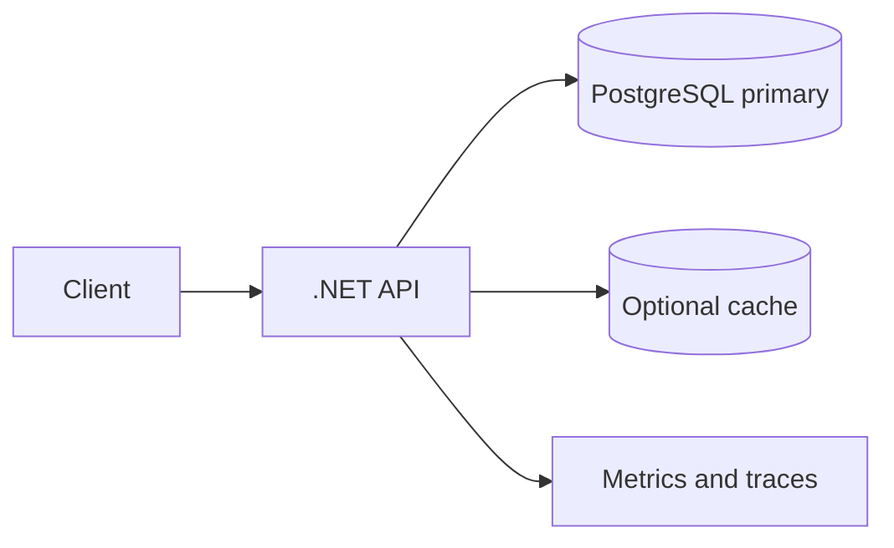

یک API deployment و PostgreSQL managed/HA. commandهای basket در DB می‌مانند یا به outbox نوشته می‌شوند. انتخاب برای حجم متوسط و correctness فوری. trade-off: DB write capacity سقف اصلی و burst buffer محدود.

### گزینهٔ B — صف‌محور برای burst و basket ingest

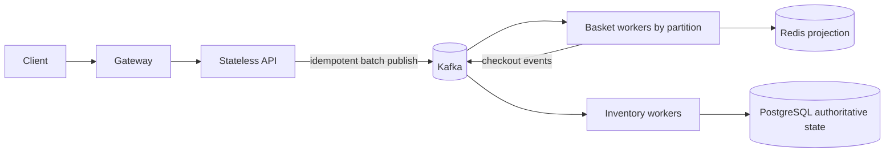

مدل نزدیک به HPT فعلی: broker موج ورودی را جذب می‌کند؛ workerها بر اساس partition scale می‌شوند. read model در Redis است و PostgreSQL فقط مسیر سفارش/موجودی را حفظ می‌کند. trade-off: تاخیر projection، duplicate/replay و عملیات Kafka.

### گزینهٔ C — تضمین انتشار بین SQL و broker

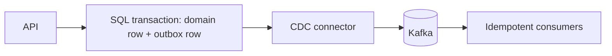

Outbox/CDC دو منبع حقیقت جدا برای یک write را حذف می‌کند. trade-off: connector، schema evolution، outbox retention، replication slot/WAL و lag پایش لازم.

### گزینهٔ D — چند منطقه / چند cell

```mermaid
flowchart TB
  G[Global router] --> C1[Cell A: API + broker + workers]
  G --> C2[Cell B: API + broker + workers]
  C1 --> D1[(Region A database shard)]
  C2 --> D2[(Region B database shard)]
  C1 --> O[Global analytics / object lake]
  C2 --> O
```

این مدل برای blast radius و scale افقی سازمانی است؛ هزینهٔ data ownership، routing و cross-cell query دارد. شروع از آن توصیه نمی‌شود مگر نیاز region/tenant isolation اثبات شده باشد.

## ۲۹. پیشنهاد نهایی مرحله‌ای برای همین کدبیس

1. **معیار را تثبیت کن:** ۱۰۰k فرمان basket/s را هدف مجزا بگیر؛ checkout completion/s، p99، durability و fault tolerance را جدا تعیین کن.
2. **معماری فعلی را حفظ کن:** .NET stateless API + Kafka durable command log + basket worker + Redis projection + checkout worker + PostgreSQL transactional inventory.
3. **API acceptance را دقیق کن:** `202` فقط بعد از publish durable؛ batch دارای سقف، per-item outcome، event ID/idempotency و request size limit.
4. **ترتیب را per basket نگه‌دار:** partition key = basket ID؛ hot basket را monitor کن و فقط با مدل semantics جدید تقسیمش کن.
5. **consumer را کنترل‌شده موازی کن:** partition کافی، batch محدود، parallelism فقط بین basketهای مستقل؛ commit بعد از side effect idempotent.
6. **checkout را از basket rate جدا نگه‌دار:** idempotency در DB، transaction کوتاه، unique constraint، conditional inventory update و نتیجهٔ سفارش قابل query.
7. **DB read/write را isolate کن:** Redis به‌عنوان projection قابل‌بازسازی، PostgreSQL مرجع دامنه؛ Search/OLAP را فقط با query واقعی اضافه کن.
8. **Kubernetes ساده بماند:** API با HPA مبتنی بر CPU/RPS، worker با lag و oldest age (KEDA یا external metric)، broker/DB روی سرویس managed یا node/storage اختصاصی. kind تک‌نودی فقط آموزشی است.
9. **حدود منابع را از ظرفیت حساب کن:** 100k command/s × میانگین bytes، replication factor، retention و headroom؛ consumer target بر اساس اندازه‌گیری هر pod، نه نرخ kind.
10. **متریک کسب‌وکاری را اضافه/حفظ کن:** accepted/s، processed/s، durable offset age، completed/rejected checkout، duplicate effect، reservation expiry؛ کنار latency و saturation.
11. **آزمون‌های ظرفیت را مرحله‌ای برنامه‌ریزی کن:** baseline، ramp، soak، burst، skew، worker kill، broker/node failure، recovery/replay. ظرفیت واقعی را فقط پس از run پایدار و failure run اعلام کن.
12. **بازنویسی زبان/DB را شرطی کن:** فقط اگر profiling نشان داد همان component سقف است و optimization موضعی کافی نیست.

### انتخاب سریع بر اساس مسئله

| اگر گلوگاه واقعی این است… | اول این‌ها را بررسی کن | بعد از اثبات، سراغ این برو |
|---|---|---|
| API CPU/latency | batch limits، JSON allocations، connection reuse، async chain | gRPC/binary protocol یا جداکردن hot path |
| Kafka producer | batch/compression، key skew، broker network/disk، acks/replication | partition/node scale، broker tiering یا managed Kafka |
| Consumer lag | per-record overhead، batch، partition count، worker CPU، downstream latency | consumer parallelism/KEDA، stream processor، partition/topic migration |
| Redis projection | command pipelining، key layout، hot key، memory/eviction | Redis Cluster/Valkey/Aerospike/DynamoDB با access pattern مشخص |
| PostgreSQL | SQL plan، lock، pool، WAL/disk، index، transaction duration | read replica، partition، vertical scale، distributed SQL یا sharding |
| موجودی یک SKU داغ | conditional update و صف per key | escrow/quota buckets یا domain-level inventory partitioning |
| تغییرات/گزارش سنگین | جداکردن query از OLTP، CDC | ClickHouse/Pinot/Druid/warehouse/lake |
| تأخیر بین مناطق | placement و مالکیت write | regional cells، single-writer region یا distributed SQL multi-region |
| هزینه بالا | cost per successful outcome، overprovision، payload/retention | autoscale، compression، tiered storage، managed-service comparison |

پایان سند وقتی است که تیم بتواند برای هر تصمیم این چهار مورد را توضیح دهد: نیاز واقعی چیست، گزینه‌های جایگزین چه هستند، trade-off و failure mode چیست، و کدام اندازه‌گیری تصمیم را تأیید یا رد می‌کند. ابزارها وسیله‌اند؛ semantics، partition key و ظرفیت downstream تعیین می‌کنند طرح واقعاً کار کند.

</div>
