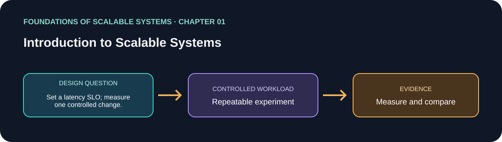

# فصل 01: مقدمه‌ای بر سیستم‌های مقیاس‌پذیر

> راهنمای این فصل در مسیر یادگیری بر پایهٔ *Foundations of Scalable Systems*. موضوع‌ها به بیان خودمان خلاصه شده‌اند و تمرین پیشنهادی مستقل است؛ متن کتاب بازنشر نشده است.

## هدف

پرسش طراحی فصل را به آزمایشی کوچک و تکرارپذیر تبدیل کنیم. خروجی، مقایسه با فرض‌های روشن است؛ نه رتبه‌بندی همیشگی فناوری‌ها.

## محور فصل

ابعاد مقیاس‌پذیری؛ workload و گلوگاه؛ هزینه و مصالحهٔ معماری؛ کارایی، دسترس‌پذیری، امنیت و مدیریت‌پذیری.

## خلاصهٔ جامع فصل

**بخش متناظر در نسخهٔ PDF: صفحه‌های چاپی 3–16.** جمع‌بندی آموزشی با بیان تازه از ایده‌های فصل؛ برای شرح کامل به کتاب مراجعه کن.

مقیاس‌پذیری یعنی پاسخ‌دادن به رشد کار و داده، در حالی که ویژگی‌های مورد نیاز کاربران حفظ شود. این ویژگی طراحی است، نه مترادف افزودن سرور: تکثیر و بهینه‌سازی از سازوکارهای اصلی‌اند، اما هزینه و محدودیت دارند. معماری باید کارایی، دسترس‌پذیری، امنیت، مدیریت‌پذیری و هزینه را با هم بسنجد. ابتدا workload، رشد مورد انتظار و هدف سرویس را تعریف کن؛ بعد منبع محدودکننده را پیدا کن و اثر تغییر پیشنهادی بر کل سیستم را بسنج. benchmark بدون زمینهٔ workload و عملیات، مقیاس‌پذیری را اثبات نمی‌کند.

### نکته‌های کلیدی

- پیش از انتخاب فناوری، workload و هدف سرویس را تعریف کن.
- تکثیر و بهینه‌سازی ابزارند و هزینه و اثر خرابی دارند.
- کارایی، دسترس‌پذیری، امنیت، مدیریت‌پذیری و هزینه را با هم بسنج.

### پوشش موضوع‌های اصلی فصل

- معنای مقیاس و عامل‌های رشد؛ تکثیر و بهینه‌سازی به‌عنوان راه افزایش ظرفیت.
- هزینه و مصالحه میان کارایی، دسترس‌پذیری، امنیت و مدیریت‌پذیری.
- تغییر گلوگاه با رشد workload و نیاز به اعتبارسنجی با شواهد.

## برنامهٔ application پیشنهادی

- **نام application / راه‌حل:** `ScalabilityWorkloadLab`.
- **الگوی namespace کد:** FoundationsOfScalableSystems.Chapter01
- **پوشهٔ مستقل راه‌حل:** solutions/01-introduction-to-scalable-systems/
- **وضعیت فعلی:** راهنمای یادگیری و طرح آزمایش؛ پیاده‌سازی کد هنوز اضافه نشده است.

## تمرین عملی

Measure a small HTTP workload before and after a single controlled change. Define read/write mix and latency SLO first.

۱. عملیات، شکل بار، اندازهٔ داده و invariant صحت را بنویسیم.
۲. قبل از افزودن تکنیک مقیاس‌دهی، baseline ساده بسازیم.
۳. هر بار فقط یک انتخاب اصلی را تغییر دهیم و همان workload را تکرار کنیم.
۴. نتیجهٔ خام، مشخصات محیط، نسخه‌ها و فرمان دقیق اجرا را نگه داریم.

## چه چیزهایی را اندازه بگیریم

Throughput, p50/p95/p99 latency, error rate, CPU, memory, and cost per successful operation.

حداقل p50/p95/p99 latency، throughput، خطا، CPU، حافظه و رفتار هنگام یک شکست مرتبط را گزارش کنیم. ادعای اندازه‌گیری‌نشده را با وضعیت **اندازه‌گیری نشده** مشخص کنیم.

## پرسش‌های بازبینی طراحی

- این طراحی کدام گلوگاه یا ویژگی کیفی را هدف می‌گیرد؟
- هنگام retry، restart یا شکست جزئی کدام معناها باید حفظ شوند؟
- چه گلوگاه یا هزینهٔ عملیاتی تازه‌ای ایجاد می‌شود؟
- چه نتیجه‌ای باعث رد کردن این طراحی می‌شود؟

## رفرنس‌ها

- Ian Gorton، *Foundations of Scalable Systems*، فصل 01: “Introduction to Scalable Systems” — [صفحهٔ فصل در O’Reilly](https://www.oreilly.com/library/view/foundations-of-scalable/9781098106058/ch01.html).
- مستندات فنی اولیه: [مرجع رسمی](https://sre.google/sre-book/monitoring-distributed-systems/).
- نقشهٔ فصل‌ها و ترتیب پیاده‌سازی مخزن: [نقشهٔ راه فارسی](../../docs/SCALABILITY-ROADMAP-FA.md).

## نام‌گذاری و استقلال

هنگام شروع پیاده‌سازی، کد، زیرساخت، workload و راهنمای اجرا را داخل همین پوشه نگه داریم. namespace بالا پیشنهاد برای namespace کد است، نه Kubernetes؛ namespace کوبرنتیز را از همان slug فصل انتخاب می‌کنیم وقتی manifestهای این راه‌حل اضافه شدند. کد application را با راه‌حل دیگر مشترک نکنیم.

