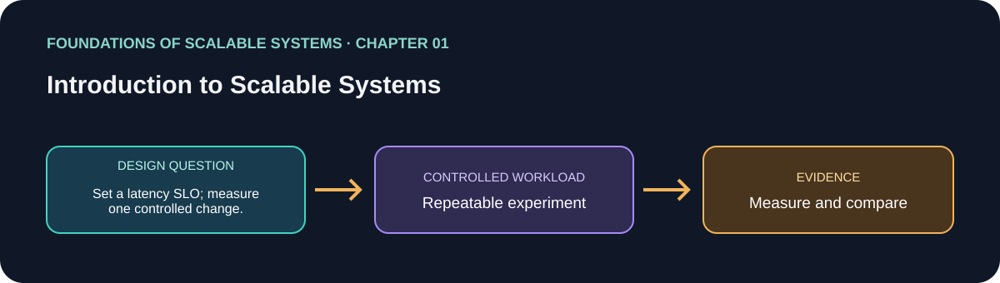

# 01. Introduction to Scalable Systems

> Chapter guide in the *Foundations of Scalable Systems* learning track. This repository guide paraphrases topics and proposes an independent practical exercise; it does not reproduce the book.

## Goal

Turn this chapter's design question into a small, repeatable experiment. The result is a comparison with stated assumptions, not a universal technology ranking.

## Chapter focus

Scalability dimensions; workload and bottlenecks; cost and architecture trade-offs; performance, availability, security, and manageability.

## Chapter synthesis

**Source reading: printed pages 3–16.** Original learning summary of the chapter's listed ideas; consult the book for full treatment.

Scalability is the ability to accommodate growth in a chosen operational dimension—such as concurrent requests, data volume, or analysis—while keeping useful service behavior. Growth can be gradual or sudden, and capacity may need to shrink as demand falls; cloud elasticity makes this practical, but only if the application and its components can adapt. Internet-facing systems changed the problem from bounded, predictable internal populations to large and uncertain user populations. The chapter uses historical examples to show why scale became an architectural concern, while cautioning that technology and usage figures quickly age.

Two recurring capacity strategies are replication and optimization. Replication adds instances or resources so work can be served in parallel; optimization gets more work from existing resources through better algorithms, indexes, or implementation. Neither is free: replication adds coordination and consistency problems, while optimization can shift a bottleneck or consume extra memory. Scalability is also distinct from single-request performance. Improving latency can increase capacity, but keeping more state in memory may make each request faster while reducing the total number the system can support.

The chapter frames scale as an economic and architectural choice: the same target capacity may require a simple resize, code or schema changes, or an expensive redesign, depending on foundations laid earlier. It also connects scalability to availability, security, and manageability. Replicas can preserve service after a failure, but replicated mutable state must be reconciled. TLS, encryption, and attack resistance have measurable costs that must be budgeted rather than omitted. More components require observability and operational automation; otherwise the system becomes harder and more expensive to run. Define workload dimensions, growth, service objectives, cost limits, and the current bottleneck before choosing a scaling mechanism, then measure the result under representative conditions.

### Key takeaways

- Define workload and service objectives before choosing technology.
- Treat replication and optimization as tools with costs and failure implications.
- Review performance, availability, security, manageability, and cost together.

### Coverage of chapter topics

- Meaning and historical drivers of scale; replication and optimization as capacity tactics.
- Cost models and architecture trade-offs across performance, availability, security, and manageability.
- How workload growth changes bottlenecks and why scale must be validated with evidence.

## Proposed application

- **Application / solution name:** `ScalabilityWorkloadLab`.
- **Namespace convention:** FoundationsOfScalableSystems.Chapter01
- **Independent solution folder:** solutions/01-introduction-to-scalable-systems/
- **Current state:** learning guide and experiment design; implementation is not yet present.

## Practical exercise

Measure a small HTTP workload before and after a single controlled change. Define read/write mix and latency SLO first.

1. Write down the operation, workload shape, data size, and correctness invariant.
2. Establish a simple baseline before adding the chapter's scaling technique.
3. Change one major design choice at a time and repeat the same workload.
4. Save raw results, environment details, versions, and the exact run command.

## What to measure

Throughput, p50/p95/p99 latency, error rate, CPU, memory, and cost per successful operation.

Report at least p50/p95/p99 latency, throughput, errors, CPU, memory, and behavior during one relevant failure. Mark any unmeasured claim as **Not measured**.

## Design review questions

- What is the bottleneck or quality attribute this design addresses?
- Which semantics must remain true under retry, restart, or partial failure?
- What new bottleneck or operational cost does the approach introduce?
- What result would make us reject this design?

## References

- Ian Gorton, *Foundations of Scalable Systems*, Chapter 01: “Introduction to Scalable Systems” — [O’Reilly chapter page](https://www.oreilly.com/library/view/foundations-of-scalable/9781098106058/ch01.html).
- Supporting primary documentation: [official reference](https://sre.google/sre-book/monitoring-distributed-systems/).
- Repository-wide chapter map and implementation order: [Scalability roadmap](../../docs/SCALABILITY-ROADMAP-EN.md).

## Naming and independence

When implementation begins, keep this application's source, infrastructure, workload, and run instructions inside this folder. The namespace above is a proposed code namespace, not a Kubernetes namespace; choose a Kubernetes namespace from the same chapter slug only when this solution gets manifests. Do not share application code with another solution.
