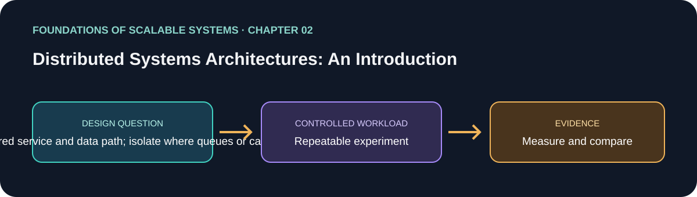

<div dir="rtl" align="right">

# فصل 02: آشنایی با معماری سیستم‌های توزیع‌شده



> راهنمای این فصل در مسیر یادگیری بر پایهٔ *Foundations of Scalable Systems*. موضوع‌ها به بیان خودمان خلاصه شده‌اند و تمرین پیشنهادی مستقل است؛ متن کتاب بازنشر نشده است.

## هدف

پرسش طراحی فصل را به آزمایشی کوچک و تکرارپذیر تبدیل کنیم. خروجی، مقایسه با فرض‌های روشن است؛ نه رتبه‌بندی همیشگی فناوری‌ها.

## محور فصل

معماری پایه؛ scale-out؛ cache؛ توزیع پایگاه‌داده؛ لایه‌های پردازش؛ پاسخ‌گویی و مقیاس سخت‌افزار.

## خلاصهٔ جامع فصل

**بخش متناظر در نسخهٔ PDF: صفحه‌های چاپی 19–34.** جمع‌بندی آموزشی با بیان تازه از ایده‌های فصل؛ برای شرح کامل به کتاب مراجعه کن.

فصل از معماری client، application service و database شروع می‌کند؛ سامانهٔ اولیه اغلب یک monolith است که در بار کم ساخت و تغییرش آسان است، اما با رشد تقاضا ممکن است سرویس واحد به سقف CPU یا حافظه برسد. Scale-up همان node را بزرگ‌تر می‌کند؛ scale-out چند replica از سرویس را پشت load balancer یا reverse proxy کم‌تأخیر می‌گذارد. برای پخش آزادانهٔ درخواست‌ها، state نشست مثل سبد خرید نباید در یک replica بماند. stateless بودن، بازیابی از خرابی یک سرویس را هم ساده‌تر می‌کند، ولی خرابی یا اشباع وابستگی مشترک را برطرف نمی‌کند.

دیتابیس معمولاً گلوگاه بعدی است. رشد عمودی و tuning پایگاه‌داده می‌تواند ظرفیتش را بیشتر کند. distributed cache خواندن‌های تکراری را وقتی داده زیاد خوانده و کم تغییر می‌کند کم می‌کند، اما باید سیاست تازگی و invalidation داشت؛ stale بودن برای بعضی داده‌ها پذیرفتنی و برای بعضی دیگر نامناسب است. اگر یک DB حجم داده یا throughput را جواب ندهد، Distributed SQL و NoSQL ذخیره‌سازی و query را بین nodeها پخش می‌کنند. replication و rebalancing ظرفیت و availability را بهتر می‌کنند، ولی مسئلهٔ consistency و ادارهٔ سیستم را می‌آورند. پایگاه‌دادهٔ مدیریت‌شدهٔ cloud بخشی از کار عملیاتی را به provider می‌سپارد، نه هزینه و تصمیم معماری را.

چند tier پردازش و سرویس‌های مستقل کمک می‌کنند هر بخش براساس تقاضای خودش scale شود؛ Backend for Frontend می‌تواند نیاز web و mobile را جدا کند. برای writeهایی که نتیجه‌شان لازم نیست پیش از پاسخ کامل در DB ثبت شود، messaging ناهمگام می‌تواند پذیرش در صف را تأیید کند و consumer بعداً دیتابیس را تغییر دهد. پاسخ‌گویی بهتر می‌شود، اما داده بعدتر قابل مشاهده است و تأخیر و شکست باید مدیریت شود. سخت‌افزار بیشتر تضمین throughput بیشتر نیست: کد سریالی، سرعت موازی را طبق Amdahl’s law محدود می‌کند و ممکن است tier دیگری گلوگاه شود. جمع‌بندی این تور معماری آن است که scale-up، scale-out، cache، توزیع داده، کار ناهمگام و سرویس‌های چندگانه باید با workload واقعی سنجیده شوند؛ الگوهایی مثل SOA، microservices و بازپردازش داده با Lambda/Kappa در فصل‌های بعد بررسی می‌شوند، نه این‌که خودکار به سامانه اضافه شوند.

### نکته‌های کلیدی

- راهکار را با گلوگاه محاسبه، خواندن، ذخیره‌سازی یا زمان پاسخ تطبیق بده.
- لایه‌ها را وقتی مستقل scale کن که قرارداد و مرزشان روشن باشد.
- توزیع، شکست شبکه و هزینهٔ عملیات تازه می‌آورد.

### پوشش موضوع‌های اصلی فصل

- لایه‌های پایه و scale-out؛ این‌که replicaها چگونه ظرفیت درخواست را بالا می‌برند.
- cache و توزیع پایگاه‌داده، از جمله rebalancing هنگام تغییر گره‌ها.
- چندلایه‌سازی پردازش، پاسخ‌گویی و اثر انتخاب سخت‌افزار و سامانه.

## درس آموزشی

### هدف‌های یادگیری و نقشهٔ مفهومی

- مسیر درخواست را از client تا سرویس و داده رسم کنیم؛ scale-up را از scale-out جدا کنیم.
- جایگاه cache، read replica، صف و پایگاه‌دادهٔ توزیع‌شده را بر اساس bottleneck انتخاب کنیم.

`Client → Load Balancer → API replicas → cache/queue → data tier`

### توضیح مفاهیم

معماری پایه معمولاً client، سرویس برنامه و دیتابیس دارد. monolith در شروع ساده است: منطق و استقرار در یک مرز قرار دارد. وقتی پردازش برنامه اشباع شد، می‌توان ماشین بزرگ‌تر گرفت (scale-up) یا چند replica پشت load balancer قرار داد (scale-out). برای اینکه هر درخواست به هر replica برود، session نباید فقط در حافظهٔ یکی از آن‌ها باشد؛ state را به store مشترک منتقل کن یا برای stateless بودن طراحی کن.

تکثیر API معمولاً از تکثیر دیتابیس ساده‌تر است. read replica می‌تواند خواندن‌هایی را که lag را تحمل می‌کنند از primary بردارد، اما writeها همچنان به primary می‌روند. cache دادهٔ پرتکرار را سریع می‌کند، اما invalidation و stale بودن بخشی از قرارداد می‌شود. cache را برای جبران query یا index ضعیف بدون اندازه‌گیری اضافه نکن.

Queue مسیر پذیرش را از انجام کار جدا می‌کند. API پس از ثبت بادوام پیام پاسخ می‌دهد و worker بعداً پردازش می‌کند؛ burst هموار می‌شود، ولی «پذیرفته شد» به معنی «تکمیل شد» نیست. صف پر، consumer کند، duplicate و poison message نیازمند سیاست روشن‌اند. سرویس‌های مستقل یا BFF وقتی ارزش دارند که نیازهای مقیاس، مالکیت یا client واقعاً جدا باشند؛ هر مرز تازه، شبکه و عملیات تازه می‌آورد.

### مثال: تغییر مقدار سبد

در نسخهٔ synchronous، API مستقیماً PostgreSQL را به‌روزرسانی می‌کند؛ قرارداد ساده و سازگاری قوی‌تر است. در نسخهٔ async، API فرمان را به Kafka می‌فرستد و worker projection را به‌روز می‌کند؛ پذیرش سریع‌تر و جذب burst بهتر است، اما خواندن فوری شاید مقدار قبلی را نشان دهد. هر دو باید همان idempotency و invariant را رعایت کنند.

```text
request → API → (synchronous DB write | durable command queue)
                       ↓                 ↓
                  response         worker → projection/database
```

### تصمیم معماری و پرسش‌ها

| الگو | مناسب است وقتی | محدودیت |
| --- | --- | --- |
| Monolith + relational DB | دامنه کوچک و تراکنش مهم است | ممکن است writer یا connection pool به سقف برسد |
| Stateless API replicas | بار درخواست قابل‌تقسیم است | دیتابیس یا وابستگی مشترک همچنان bottleneck است |
| Cache/read replica | بار read غالب و تازگی قابل‌تعریف است | برای تصمیم مالی با stale data مناسب نیست |
| Queue + worker | کار پس‌زمینه یا burst دارید | پاسخ نهایی async و مشاهدهٔ وضعیت لازم است |

- چند replica با session محلی، load balancing آزاد نمی‌دهد.
- «سرویس بیشتر» را خودکار معادل scalability ندان.
- کدام عملیات باید synchronous باشد و کدام می‌تواند eventual باشد؟ اگر صف سریع‌تر پر شود از مصرف‌کننده، backpressure کجا اعمال می‌شود؟

### خودآزمایی همراه پاسخ

1. **پرسش:** چه زمانی scale-out سرویس برنامه بی‌اثر می‌شود؟
   **پاسخ کوتاه:** وقتی state محلی مانع توزیع درخواست باشد یا وابستگی مشترکی مانند دیتابیس پیش از سرویس اشباع شود.

2. **پرسش:** صف چه چیزی را بهتر می‌کند و چه چیزی را حل نمی‌کند؟
   **پاسخ کوتاه:** جهش ورودی را جذب و کار را غیرهم‌زمان می‌کند؛ ظرفیت نامحدود ایجاد نمی‌کند و lag، duplicate و نتیجهٔ دیرتر را باید مدیریت کرد.

## برنامهٔ application پیشنهادی

- **نام application / راه‌حل:** `DistributedArchitectureTradeoffLab`.
- **الگوی namespace کد:** FoundationsOfScalableSystems.Chapter02
- **پوشهٔ مستقل راه‌حل:** solutions/02-distributed-systems-architectures/
- **وضعیت فعلی:** راهنمای یادگیری و طرح آزمایش؛ پیاده‌سازی کد هنوز اضافه نشده است.

## تمرین عملی

Compare one service with a tiered service and data path; isolate where queues or caches change the bottleneck.

۱. عملیات، شکل بار، اندازهٔ داده و invariant صحت را بنویسیم.
۲. قبل از افزودن تکنیک مقیاس‌دهی، baseline ساده بسازیم.
۳. هر بار فقط یک انتخاب اصلی را تغییر دهیم و همان workload را تکرار کنیم.
۴. نتیجهٔ خام، مشخصات محیط، نسخه‌ها و فرمان دقیق اجرا را نگه داریم.

## چه چیزهایی را اندازه بگیریم

Per-tier latency, saturation point, network and database utilization, and failure impact.

حداقل p50/p95/p99 latency، throughput، خطا، CPU، حافظه و رفتار هنگام یک شکست مرتبط را گزارش کنیم. ادعای اندازه‌گیری‌نشده را با وضعیت **اندازه‌گیری نشده** مشخص کنیم.

## پرسش‌های بازبینی طراحی

- این طراحی کدام گلوگاه یا ویژگی کیفی را هدف می‌گیرد؟
- هنگام retry، restart یا شکست جزئی کدام معناها باید حفظ شوند؟
- چه گلوگاه یا هزینهٔ عملیاتی تازه‌ای ایجاد می‌شود؟
- چه نتیجه‌ای باعث رد کردن این طراحی می‌شود؟

## منابع

### مبنای کتاب

- Ian Gorton، *Foundations of Scalable Systems*، فصل 02: “Distributed Systems Architectures: An Introduction” — [صفحهٔ فصل در O’Reilly](https://www.oreilly.com/library/view/foundations-of-scalable/9781098106058/ch02.html).

### مستندات فنی بیرونی

- مستندات فنی اولیه: [مرجع رسمی](https://kubernetes.io/docs/concepts/).

### پیوندهای این مخزن

- نقشهٔ فصل‌ها و ترتیب پیاده‌سازی مخزن: [نقشهٔ راه فارسی](../../docs/SCALABILITY-ROADMAP-FA.md).

## نام‌گذاری و استقلال

هنگام شروع پیاده‌سازی، کد، زیرساخت، workload و راهنمای اجرا را داخل همین پوشه نگه داریم. namespace بالا پیشنهاد برای namespace کد است، نه Kubernetes؛ namespace کوبرنتیز را از همان slug فصل انتخاب می‌کنیم وقتی manifestهای این راه‌حل اضافه شدند. کد application را با راه‌حل دیگر مشترک نکنیم.

</div>
