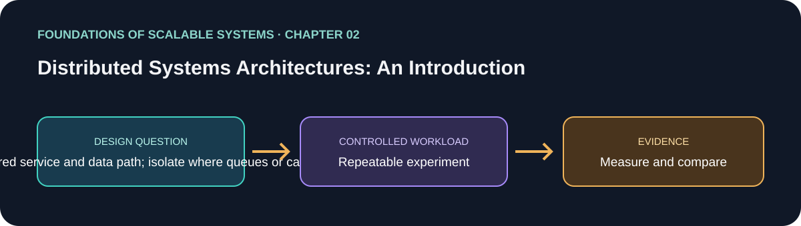

# 02. Distributed Systems Architectures: An Introduction

> Chapter guide in the *Foundations of Scalable Systems* learning track. This repository guide paraphrases topics and proposes an independent practical exercise; it does not reproduce the book.

## Goal

Turn this chapter's design question into a small, repeatable experiment. The result is a comparison with stated assumptions, not a universal technology ranking.

## Chapter focus

Basic system architecture; scale-out; caching; distributed databases; processing tiers; responsiveness; hardware scaling.

## Chapter synthesis

**Source reading: printed pages 19–34.** Original learning summary of the chapter's listed ideas; consult the book for full treatment.

The chapter surveys architectural approaches to add capacity. Scale-out distributes work across nodes; caching reduces repeated database work; database distribution spreads storage and processing; and multiple tiers separate responsibilities so parts can scale independently. Asynchrony and related techniques improve responsiveness, while hardware and deployment choices affect available capacity. These patterns complement one another but should not all be applied by default. Each adds communication, state, or operational complexity. Choose based on the measured bottleneck and the required consistency and response time.

### Key takeaways

- Match capacity techniques to compute, read, storage, or response-time bottlenecks.
- Scale tiers independently only when their contracts and boundaries are clear.
- Distribution adds network and operational failure modes.

### Coverage of chapter topics

- Basic tiers and horizontal scale-out; why independent replicas increase request capacity.
- Caching and database distribution, including data rebalancing as nodes change.
- Multiple processing tiers, responsiveness, and the influence of system/hardware choices.

## Proposed application

- **Application / solution name:** `DistributedArchitectureTradeoffLab`.
- **Namespace convention:** FoundationsOfScalableSystems.Chapter02
- **Independent solution folder:** solutions/02-distributed-systems-architectures/
- **Current state:** learning guide and experiment design; implementation is not yet present.

## Practical exercise

Compare one service with a tiered service and data path; isolate where queues or caches change the bottleneck.

1. Write down the operation, workload shape, data size, and correctness invariant.
2. Establish a simple baseline before adding the chapter's scaling technique.
3. Change one major design choice at a time and repeat the same workload.
4. Save raw results, environment details, versions, and the exact run command.

## What to measure

Per-tier latency, saturation point, network and database utilization, and failure impact.

Report at least p50/p95/p99 latency, throughput, errors, CPU, memory, and behavior during one relevant failure. Mark any unmeasured claim as **Not measured**.

## Design review questions

- What is the bottleneck or quality attribute this design addresses?
- Which semantics must remain true under retry, restart, or partial failure?
- What new bottleneck or operational cost does the approach introduce?
- What result would make us reject this design?

## References

- Ian Gorton, *Foundations of Scalable Systems*, Chapter 02: “Distributed Systems Architectures: An Introduction” — [O’Reilly chapter page](https://www.oreilly.com/library/view/foundations-of-scalable/9781098106058/ch02.html).
- Supporting primary documentation: [official reference](https://kubernetes.io/docs/concepts/).
- Repository-wide chapter map and implementation order: [Scalability roadmap](../../docs/SCALABILITY-ROADMAP-EN.md).

## Naming and independence

When implementation begins, keep this application's source, infrastructure, workload, and run instructions inside this folder. The namespace above is a proposed code namespace, not a Kubernetes namespace; choose a Kubernetes namespace from the same chapter slug only when this solution gets manifests. Do not share application code with another solution.
