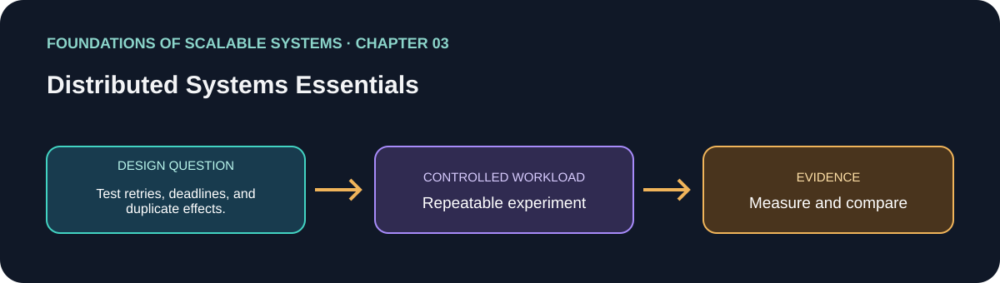

# فصل 03: مبانی سیستم‌های توزیع‌شده

> راهنمای این فصل در مسیر یادگیری بر پایهٔ *Foundations of Scalable Systems*. موضوع‌ها به بیان خودمان خلاصه شده‌اند و تمرین پیشنهادی مستقل است؛ متن کتاب بازنشر نشده است.

## هدف

پرسش طراحی فصل را به آزمایشی کوچک و تکرارپذیر تبدیل کنیم. خروجی، مقایسه با فرض‌های روشن است؛ نه رتبه‌بندی همیشگی فناوری‌ها.

## محور فصل

ارتباط و فراخوانی remote؛ شکست جزئی؛ consensus؛ ساعت و زمان؛ عدم قطعیت بین ماشین‌ها.

## خلاصهٔ جامع فصل

**بخش متناظر در نسخهٔ PDF: صفحه‌های چاپی 35–58.** جمع‌بندی آموزشی با بیان تازه از ایده‌های فصل؛ برای شرح کامل به کتاب مراجعه کن.

اجزای توزیع‌شده از شبکه‌ای ارتباط می‌گیرند که می‌تواند پیام را به تأخیر بیندازد، جابه‌جا کند یا گم کند. فراخوانی راه‌دور تابع محلی نیست: بعد از timeout ممکن است معلوم نباشد عملیات شکست خورده، موفق شده یا هنوز اجرا می‌شود. شکست جزئی طبیعی است، پس deadline، retry و idempotency باید با هم طراحی شوند. consensus دربارهٔ توافق اعضا با فرض‌های مشخص خرابی است؛ زمان هم قطعی نیست چون ساعت‌ها فرق دارند و تأخیر پیام متغیر است. دسترسی همیشگی یا ساعت جهانی دقیق فرض نکن؛ تضمین و بازیابی را روشن بنویس.

### نکته‌های کلیدی

- Timeout یعنی نتیجه نامعلوم است، نه این‌که عملیات انجام نشده.
- retry به deadline و اثر idempotent نیاز دارد تا بار و تکرار نسازد.
- ساعت و consensus محدودیت دارند؛ ترتیب و بازیابی را تعریف کن.

### پوشش موضوع‌های اصلی فصل

- مبانی ارتباط در لایه‌های سخت‌افزار و نرم‌افزار؛ فراخوانی راه‌دور اجرای محلی نیست.
- شکست جزئی، timeout و نامعلوم‌بودن نتیجهٔ درخواست.
- consensus و زمان توزیع‌شده؛ توافق و ترتیب به فرض‌های روشن نیاز دارند.

## برنامهٔ application پیشنهادی

- **نام application / راه‌حل:** `DistributedFailureSemanticsLab`.
- **الگوی namespace کد:** FoundationsOfScalableSystems.Chapter03
- **پوشهٔ مستقل راه‌حل:** solutions/03-distributed-systems-essentials/
- **وضعیت فعلی:** راهنمای یادگیری و طرح آزمایش؛ پیاده‌سازی کد هنوز اضافه نشده است.

## تمرین عملی

Inject timeouts and unavailable dependencies into a small request path; document retries, deadlines, and duplicate effects.

۱. عملیات، شکل بار، اندازهٔ داده و invariant صحت را بنویسیم.
۲. قبل از افزودن تکنیک مقیاس‌دهی، baseline ساده بسازیم.
۳. هر بار فقط یک انتخاب اصلی را تغییر دهیم و همان workload را تکرار کنیم.
۴. نتیجهٔ خام، مشخصات محیط، نسخه‌ها و فرمان دقیق اجرا را نگه داریم.

## چه چیزهایی را اندازه بگیریم

Recovery time, retry amplification, duplicate operations, timeout rate, and consistency after recovery.

حداقل p50/p95/p99 latency، throughput، خطا، CPU، حافظه و رفتار هنگام یک شکست مرتبط را گزارش کنیم. ادعای اندازه‌گیری‌نشده را با وضعیت **اندازه‌گیری نشده** مشخص کنیم.

## پرسش‌های بازبینی طراحی

- این طراحی کدام گلوگاه یا ویژگی کیفی را هدف می‌گیرد؟
- هنگام retry، restart یا شکست جزئی کدام معناها باید حفظ شوند؟
- چه گلوگاه یا هزینهٔ عملیاتی تازه‌ای ایجاد می‌شود؟
- چه نتیجه‌ای باعث رد کردن این طراحی می‌شود؟

## رفرنس‌ها

- Ian Gorton، *Foundations of Scalable Systems*، فصل 03: “Distributed Systems Essentials” — [صفحهٔ فصل در O’Reilly](https://www.oreilly.com/library/view/foundations-of-scalable/9781098106058/ch03.html).
- مستندات فنی اولیه: [مرجع رسمی](https://lamport.azurewebsites.net/pubs/time-clocks.pdf).
- نقشهٔ فصل‌ها و ترتیب پیاده‌سازی مخزن: [نقشهٔ راه فارسی](../../docs/SCALABILITY-ROADMAP-FA.md).

## نام‌گذاری و استقلال

هنگام شروع پیاده‌سازی، کد، زیرساخت، workload و راهنمای اجرا را داخل همین پوشه نگه داریم. namespace بالا پیشنهاد برای namespace کد است، نه Kubernetes؛ namespace کوبرنتیز را از همان slug فصل انتخاب می‌کنیم وقتی manifestهای این راه‌حل اضافه شدند. کد application را با راه‌حل دیگر مشترک نکنیم.

