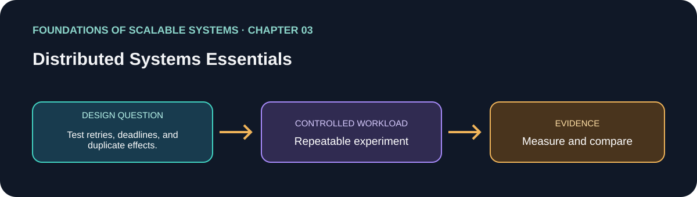

# 03. Distributed Systems Essentials

> Chapter guide in the *Foundations of Scalable Systems* learning track. This repository guide paraphrases topics and proposes an independent practical exercise; it does not reproduce the book.

## Goal

Turn this chapter's design question into a small, repeatable experiment. The result is a comparison with stated assumptions, not a universal technology ranking.

## Chapter focus

Communication and remote calls; partial failures; consensus; clocks and time; uncertainty across machines.

## Chapter synthesis

**Source reading: printed pages 35–58.** Original learning summary of the chapter's listed ideas; consult the book for full treatment.

Distributed systems consist of concurrent components on different machines exchanging messages through heterogeneous networks. Bandwidth and latency are different: nearby LANs can be fast, but WAN latency has physical distance limits and is increased by routing and congestion. The network stack hides much hardware detail, yet its behavior still matters. IP routes best-effort packets that can be lost, duplicated, or reordered; TCP adds connections, ordering, acknowledgments, retransmission, and flow control, while UDP keeps less overhead by leaving delivery and loss handling to the application. Higher-level RPC/RMI abstractions make remote calls look like local method calls, but introduce interface/versioning, serialization, and network-failure concerns; HTTP APIs are another common abstraction.

The central operational idea is partial failure: when a response is missing, the caller often cannot tell whether the request was lost, the server crashed before processing, the server completed the operation but its reply was lost, or the server is merely slow. Timeouts bound waiting, but a retry can repeat a mutation. Idempotency keys let a server recognize duplicates, and the key record and business update must be committed atomically; “exactly once” is an application-level outcome built over retries and possible duplicates, not a promise that networks never fail. Delivery semantics involve trade-offs: at-most-once may lose work, at-least-once can duplicate it, and exactly-once effects require deduplication and transactional state.

Coordination has fundamental limits too. The Two Generals’ Problem illustrates that acknowledgments cannot create certainty over an asynchronous, lossy channel; FLP shows bounded-time consensus cannot be guaranteed under arbitrary message delays and crash faults, though practical algorithms work with timing assumptions. Byzantine faults add malicious participants and are a different, stronger threat model. Finally, node clocks drift. NTP can keep wall clocks close but they can move backward or forward; monotonic clocks are better for measuring elapsed time, yet cannot establish a precise global event order. Use explicit sequence/versioning or coordination for ordering, and design timeouts, retries, idempotence, and observability around partial failure instead of assuming remote calls are reliable local calls.

### Key takeaways

- A timeout means uncertainty, not proof the remote operation did not happen.
- Retries need deadlines and idempotent effects to avoid amplification and duplicates.
- Clocks and consensus have limits; specify ordering and recovery guarantees.

### Coverage of chapter topics

- Communication fundamentals across hardware and software layers; remote invocation is not local execution.
- Partial failures, timeouts, and uncertainty in request outcomes.
- Consensus and distributed time: agreement and ordering require explicit assumptions.

## Proposed application

- **Application / solution name:** `DistributedFailureSemanticsLab`.
- **Namespace convention:** FoundationsOfScalableSystems.Chapter03
- **Independent solution folder:** solutions/03-distributed-systems-essentials/
- **Current state:** learning guide and experiment design; implementation is not yet present.

## Practical exercise

Inject timeouts and unavailable dependencies into a small request path; document retries, deadlines, and duplicate effects.

1. Write down the operation, workload shape, data size, and correctness invariant.
2. Establish a simple baseline before adding the chapter's scaling technique.
3. Change one major design choice at a time and repeat the same workload.
4. Save raw results, environment details, versions, and the exact run command.

## What to measure

Recovery time, retry amplification, duplicate operations, timeout rate, and consistency after recovery.

Report at least p50/p95/p99 latency, throughput, errors, CPU, memory, and behavior during one relevant failure. Mark any unmeasured claim as **Not measured**.

## Design review questions

- What is the bottleneck or quality attribute this design addresses?
- Which semantics must remain true under retry, restart, or partial failure?
- What new bottleneck or operational cost does the approach introduce?
- What result would make us reject this design?

## References

- Ian Gorton, *Foundations of Scalable Systems*, Chapter 03: “Distributed Systems Essentials” — [O’Reilly chapter page](https://www.oreilly.com/library/view/foundations-of-scalable/9781098106058/ch03.html).
- Supporting primary documentation: [official reference](https://lamport.azurewebsites.net/pubs/time-clocks.pdf).
- Repository-wide chapter map and implementation order: [Scalability roadmap](../../docs/SCALABILITY-ROADMAP-EN.md).

## Naming and independence

When implementation begins, keep this application's source, infrastructure, workload, and run instructions inside this folder. The namespace above is a proposed code namespace, not a Kubernetes namespace; choose a Kubernetes namespace from the same chapter slug only when this solution gets manifests. Do not share application code with another solution.
