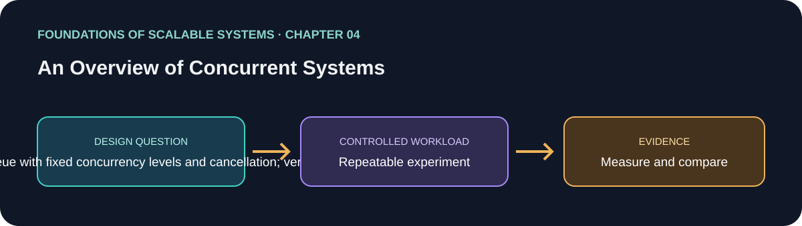

# فصل 04: مروری بر سیستم‌های هم‌روند

> راهنمای این فصل در مسیر یادگیری بر پایهٔ *Foundations of Scalable Systems*. موضوع‌ها به بیان خودمان خلاصه شده‌اند و تمرین پیشنهادی مستقل است؛ متن کتاب بازنشر نشده است.

## هدف

پرسش طراحی فصل را به آزمایشی کوچک و تکرارپذیر تبدیل کنیم. خروجی، مقایسه با فرض‌های روشن است؛ نه رتبه‌بندی همیشگی فناوری‌ها.

## محور فصل

thread و زمان‌بندی؛ race و deadlock؛ هماهنگی؛ thread pool؛ barrier؛ collection امن برای thread.

## خلاصهٔ جامع فصل

**بخش متناظر در نسخهٔ PDF: صفحه‌های چاپی 61–88.** جمع‌بندی آموزشی با بیان تازه از ایده‌های فصل؛ برای شرح کامل به کتاب مراجعه کن.

هم‌زمانی حتی روی یک CPU هم مفید است: وقتی کاری منتظر دیسک یا شبکه است، کار دیگر می‌تواند از پردازنده استفاده کند. سخت‌افزار چند‌هسته‌ای، اگر کارها مستقل باشند، اجرای واقعاً موازی را هم ممکن می‌کند. یکی از مدل‌ها thread است: هر thread stack خودش را دارد اما state سطح process را شریک می‌شود. scheduler با interleaving پیش‌دستانه و غیرقطعی کار می‌کند، پس ترتیب کد را نمی‌توان ترتیب اجرای تضمینی دانست. زبان‌ها مدل‌های دیگری هم دارند: channelهای CSP در Go، actorهای Erlang با پیام‌رسانی، و event loop در Node.js؛ هرکدام بده‌بستان متفاوتی دربارهٔ state مشترک و I/O دارند.

خطر اصلی صحت در state قابل‌تغییر مشترک race condition است: عملیاتی سطح‌بالا مثل increment ممکن است چند دستور ماشین باشد و interleaving باعث گم‌شدن update شود. invariant را در critical section کوتاه محافظت کن، اما lock کار را سری می‌کند و می‌تواند مقیاس‌پذیری را کم کند. lockها deadlock هم می‌سازند، اگر threadها منابع مشترک را با ترتیب متضاد بگیرند؛ ترتیب کلی و یکسان برای گرفتن lock چرخهٔ انتظار را می‌شکند، و timeout فقط راه‌حل جایگزین با رفتار تقریبی است. وضعیت threadها (created، runnable، blocked و terminated) را بشناس و برای هماهنگی از lifecycle signal مثل join استفاده کن، نه sleep حدسی.

کار producer-consumer به buffer محدود و هماهنگی نیاز دارد: polling CPU هدر می‌دهد، اما blocking queue اجازه می‌دهد producer برای جا و consumer برای پیام منتظر بماند. thread pool تعداد workerها را محدود و reuse می‌کند و taskهای اضافی را صف می‌کند تا thread و stack بی‌حساب ساخته نشوند؛ shutdown باید با قصد drain یا لغو کار انجام شود. barrier مثل CountDownLatch هماهنگ‌کننده را تا پایان کارهای موازی یک مرحله منتظر می‌گذارد. collection مشترک هم باید درست انتخاب شود: wrapper همگام امن است اما دسترسی را سری می‌کند؛ ساختار concurrent مثل ConcurrentHashMap به‌روزرسانی ریزدانه‌تر و تضمین snapshot/iteration ضعیف‌تری می‌دهد. قاعدهٔ عملی فصل این است که مدل هم‌روندی را آگاهانه انتخاب کنیم، state قابل‌تغییر مشترک را کم کنیم، critical section را کوتاه و pool و صف را محدود نگه داریم و هم صحت در زمان‌بندی‌های گوناگون و هم throughput و contention را بسنجیم.

### نکته‌های کلیدی

- هم‌زمانی هم‌پوشانی پیشرفت کارهاست؛ parallelism اجرای هم‌زمان است.
- invariantها را حفظ و state مشترک را کم کن.
- pool و صف را محدود کن؛ thread بیشتر ممکن است contention بسازد.

### پوشش موضوع‌های اصلی فصل

- چرایی هم‌زمانی، رفتار thread و اهمیت ترتیب اجرای غیرقطعی.
- race و deadlock؛ وضعیت thread و سازوکارهای هماهنگی.
- thread pool، barrier و collection ایمن برای کار موازی کنترل‌شده.

## برنامهٔ application پیشنهادی

- **نام application / راه‌حل:** `ConcurrentExecutionLab`.
- **الگوی namespace کد:** FoundationsOfScalableSystems.Chapter04
- **پوشهٔ مستقل راه‌حل:** solutions/04-overview-of-concurrent-systems/
- **وضعیت فعلی:** راهنمای یادگیری و طرح آزمایش؛ پیاده‌سازی کد هنوز اضافه نشده است.

## تمرین عملی

Implement the same bounded work queue with fixed concurrency levels and cancellation; verify ordering and shared-state safety.

۱. عملیات، شکل بار، اندازهٔ داده و invariant صحت را بنویسیم.
۲. قبل از افزودن تکنیک مقیاس‌دهی، baseline ساده بسازیم.
۳. هر بار فقط یک انتخاب اصلی را تغییر دهیم و همان workload را تکرار کنیم.
۴. نتیجهٔ خام، مشخصات محیط، نسخه‌ها و فرمان دقیق اجرا را نگه داریم.

## چه چیزهایی را اندازه بگیریم

Throughput, queue wait, allocation, CPU, lock contention, and tail latency as concurrency changes.

حداقل p50/p95/p99 latency، throughput، خطا، CPU، حافظه و رفتار هنگام یک شکست مرتبط را گزارش کنیم. ادعای اندازه‌گیری‌نشده را با وضعیت **اندازه‌گیری نشده** مشخص کنیم.

## پرسش‌های بازبینی طراحی

- این طراحی کدام گلوگاه یا ویژگی کیفی را هدف می‌گیرد؟
- هنگام retry، restart یا شکست جزئی کدام معناها باید حفظ شوند؟
- چه گلوگاه یا هزینهٔ عملیاتی تازه‌ای ایجاد می‌شود؟
- چه نتیجه‌ای باعث رد کردن این طراحی می‌شود؟

## رفرنس‌ها

- Ian Gorton، *Foundations of Scalable Systems*، فصل 04: “An Overview of Concurrent Systems” — [صفحهٔ فصل در O’Reilly](https://www.oreilly.com/library/view/foundations-of-scalable/9781098106058/ch04.html).
- مستندات فنی اولیه: [مرجع رسمی](https://learn.microsoft.com/en-us/dotnet/standard/parallel-programming/).
- نقشهٔ فصل‌ها و ترتیب پیاده‌سازی مخزن: [نقشهٔ راه فارسی](../../docs/SCALABILITY-ROADMAP-FA.md).

## نام‌گذاری و استقلال

هنگام شروع پیاده‌سازی، کد، زیرساخت، workload و راهنمای اجرا را داخل همین پوشه نگه داریم. namespace بالا پیشنهاد برای namespace کد است، نه Kubernetes؛ namespace کوبرنتیز را از همان slug فصل انتخاب می‌کنیم وقتی manifestهای این راه‌حل اضافه شدند. کد application را با راه‌حل دیگر مشترک نکنیم.

