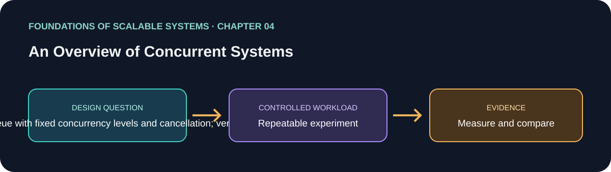

# 04. An Overview of Concurrent Systems

> Chapter guide in the *Foundations of Scalable Systems* learning track. This repository guide paraphrases topics and proposes an independent practical exercise; it does not reproduce the book.

## Goal

Turn this chapter's design question into a small, repeatable experiment. The result is a comparison with stated assumptions, not a universal technology ranking.

## Chapter focus

Threads and scheduling; races and deadlocks; coordination; thread pools; barriers; thread-safe collections.

## Chapter synthesis

**Source reading: printed pages 61–88.** Original learning summary of the chapter's listed ideas; consult the book for full treatment.

Concurrency overlaps progress on tasks and can use processor and I/O resources more effectively, but execution order becomes nondeterministic. Threads share memory; unsafe interleavings create races, while cyclic waits can deadlock. Thread states and coordination primitives explain running, blocked, and waiting work. Pools bound worker creation costs, barriers coordinate phases, and thread-safe collections protect shared access. The objective is not maximum thread count: choose a model, minimize shared mutable state, bound pools and queues, and test correctness under varied schedules.

### Key takeaways

- Concurrency overlaps progress; parallelism executes simultaneously on processors.
- Protect invariants and minimize shared mutable state.
- Bound pools and queues; more threads may increase contention.

## Proposed application

- **Application / solution name:** `ConcurrentExecutionLab`.
- **Namespace convention:** FoundationsOfScalableSystems.Chapter04
- **Independent solution folder:** solutions/04-overview-of-concurrent-systems/
- **Current state:** learning guide and experiment design; implementation is not yet present.

## Practical exercise

Implement the same bounded work queue with fixed concurrency levels and cancellation; verify ordering and shared-state safety.

1. Write down the operation, workload shape, data size, and correctness invariant.
2. Establish a simple baseline before adding the chapter's scaling technique.
3. Change one major design choice at a time and repeat the same workload.
4. Save raw results, environment details, versions, and the exact run command.

## What to measure

Throughput, queue wait, allocation, CPU, lock contention, and tail latency as concurrency changes.

Report at least p50/p95/p99 latency, throughput, errors, CPU, memory, and behavior during one relevant failure. Mark any unmeasured claim as **Not measured**.

## Design review questions

- What is the bottleneck or quality attribute this design addresses?
- Which semantics must remain true under retry, restart, or partial failure?
- What new bottleneck or operational cost does the approach introduce?
- What result would make us reject this design?

## References

- Ian Gorton, *Foundations of Scalable Systems*, Chapter 04: “An Overview of Concurrent Systems” — [O’Reilly chapter page](https://www.oreilly.com/library/view/foundations-of-scalable/9781098106058/ch04.html).
- Supporting primary documentation: [official reference](https://learn.microsoft.com/en-us/dotnet/standard/parallel-programming/).
- Repository-wide chapter map and implementation order: [Scalability roadmap](../../docs/SCALABILITY-ROADMAP-EN.md).

## Naming and independence

When implementation begins, keep this application's source, infrastructure, workload, and run instructions inside this folder. The namespace above is a proposed code namespace, not a Kubernetes namespace; choose a Kubernetes namespace from the same chapter slug only when this solution gets manifests. Do not share application code with another solution.
