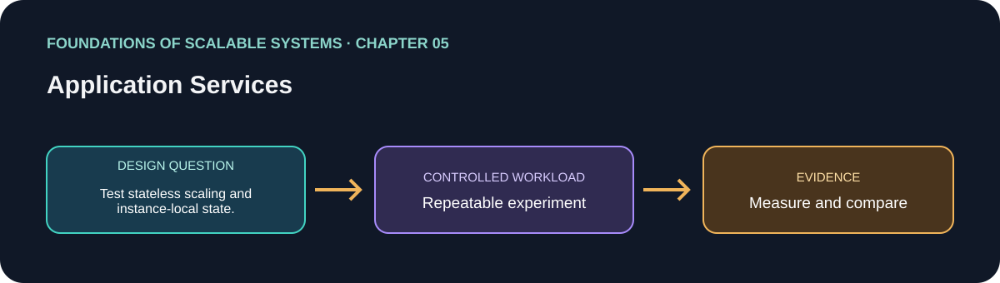

<div dir="rtl" align="right">

# فصل 05: سرویس‌های برنامه



> راهنمای این فصل در مسیر یادگیری بر پایهٔ *Foundations of Scalable Systems*. موضوع‌ها به بیان خودمان خلاصه شده‌اند و تمرین پیشنهادی مستقل است؛ متن کتاب بازنشر نشده است.

## هدف

پرسش طراحی فصل را به آزمایشی کوچک و تکرارپذیر تبدیل کنیم. خروجی، مقایسه با فرض‌های روشن است؛ نه رتبه‌بندی همیشگی فناوری‌ها.

## محور فصل

طراحی API و سرویس؛ مدیریت state؛ application server؛ scale افقی؛ load balancing؛ سلامت؛ elasticity و session affinity.

## خلاصهٔ جامع فصل

**بخش متناظر در نسخهٔ PDF: صفحه‌های چاپی 93–113.** جمع‌بندی آموزشی با بیان تازه از ایده‌های فصل؛ برای شرح کامل به کتاب مراجعه کن.

سرویس برنامه رفتار کسب‌وکار را با یک قرارداد API عرضه می‌کند: عملیات، شناسهٔ resource، ورودی، خروجی و پاسخ خطا. فصل HTTP CRUD را به‌عنوان الگوی رایج معرفی می‌کند و تأکید دارد معنی عملیات از ترکیب verb و URI می‌آید و payload معمولاً JSON است. OpenAPI می‌تواند این قرارداد را مستند کند. طراحی chatty که برای یک کار تجاری چندین رفت‌وبرگشت شبکه بخواهد مقیاس‌پذیر نیست؛ resource را کامل بخوان یا به‌شکل هدفمند به‌روزرسانی کن و برای تغییر بخشی از آن PATCH را در نظر بگیر. فشرده‌سازی payload بزرگ وقتی مناسب است که صرفه‌جویی شبکه از هزینهٔ CPU بیشتر باشد.

Application server درخواست‌ها را می‌پذیرد، handler مناسب را پیدا می‌کند، چرخهٔ عمر برنامه را مدیریت و معمولاً درخواست‌های هم‌زمان را با thread pool اجرا می‌کند. پیکربندی آن یک زنجیره از منابع محدود می‌سازد: listener و backlog، threadها و صف task، سپس connectionهای دیتابیس و صف query. درخواست ممکن است زمان قابل‌توجهی در صف بماند؛ thread زیاد حافظه و هزینهٔ context switch می‌آورد و صف بی‌حد با افزایش latency ممکن است به اتمام منابع ختم شود. poolهای thread و connection را با workload واقعی تنظیم کن، زیر اشباع کامل headroom بگذار و latency، کار فعال و اندازهٔ صف را پایش کن. abstraction راحت framework ممکن است در برابر plumbing و کارایی پایین‌تر trade-off داشته باشد.

مالکیت state سرویس هم تصمیم کلیدی است. درخواست HTTP می‌تواند self-contained باشد، اما state مکالمه‌ای کاربر گاهی ناخواسته در حافظهٔ یک server نگه داشته می‌شود. این کار حافظه‌ای متناسب با sessionهای فعال می‌خواهد، به expiry نیاز دارد و درخواست بعدی را به همان instance وابسته می‌کند. API stateless هویت و دادهٔ لازم را در هر درخواست می‌گیرد یا state را به store مشترک می‌سپارد. در نتیجه instanceها پشت load balancer افقی تکثیر می‌شوند و درخواست ناموفق را می‌توان به replica سالم دیگری فرستاد؛ replicaها یک server منفرد را هم از نقطهٔ شکست یگانه خارج می‌کنند.

Load balancer می‌تواند در Layer 4 با اتصال شبکه و NAT مسیر بدهد، یا در Layer 7 درخواست HTTP، header و path را بررسی کند؛ proxy غنی‌تر سربار بیشتری دارد. سیاست‌ها شامل round robin، کمترین اتصال، مسیریابی براساس header/operation و وزن‌دهی به instanceهای با اندازهٔ متفاوت‌اند. health check هدف خراب یا ناسالم را حذف می‌کند. elasticity تعداد replica را با schedule یا metric زنده، همراه حداقل/حداکثر و زمان warm-up تغییر می‌دهد. sticky session state داخل حافظه را ممکن می‌کند، اما sessionهای نابرابر در طول زمان بار را نامتوازن و بازیابی خرابی را سخت‌تر می‌کنند. در پایان، افزودن replica سرویس ممکن است فقط دیتابیس یا وابستگی پایین‌دستی را اشباع کند؛ کل مسیر درخواست را اندازه بگیر و tier محدودکننده را هم در نظر بگیر.

### نکته‌های کلیدی

- قرارداد API، مالکیت state و رفتار شکست را روشن کن.
- readiness، liveness، load balancing و elasticity سازوکارهای جدا هستند.
- scale کردن API به ظرفیت وابستگی‌ها هم نیاز دارد.

### پوشش موضوع‌های اصلی فصل

- قرارداد سرویس و API، مرز طراحی و مالکیت state برنامه.
- application server، تکثیر افقی، load balancer و سیاست توزیع.
- پایش سلامت، elasticity و هزینهٔ throughput/failover در session affinity.

## درس آموزشی

### هدف‌های یادگیری و نقشهٔ مفهومی

- یک قرارداد HTTP کم‌ابهام طراحی کنیم و از chatty API دوری کنیم.
- اثر thread، task queue و connection pool را روی latency و throughput بفهمیم.
- stateful/stateless، load balancer، health check و elasticity را از هم جدا کنیم.

`Client → Load Balancer → HTTP API → bounded work/connection pools → database`

### قرارداد سرویس

API مرز برنامه با مصرف‌کننده است. برای هر resource مشخص کن شناسه چیست، چه عملیات‌هایی مجازند، payload و پاسخ چه schemaای دارند، خطاهای قابل‌پیش‌بینی چه کد و معنایی دارند، و تکرار درخواست چه اثری می‌گذارد. CRUD رایج است، اما endpoint باید رفتار دامنه را منتقل کند؛ برای نمونه `POST /orders` فرمان ثبت سفارش است، نه صرفاً درج یک ردیف. OpenAPI قرارداد را برای تولیدکننده و مصرف‌کننده قابل‌بررسی می‌کند. chatty design چند round-trip برای یک عمل تجاری دارد و هزینهٔ شبکه/صف را زیاد می‌کند؛ endpointهای مناسب، batch محدود یا پاسخ شامل resource لازم را طراحی کن. فشرده‌سازی را برای payload بزرگ و شبکهٔ bottleneck با CPU cost مقایسه کن.

### Application server و ظرفیت

سرور HTTP درخواست را می‌پذیرد، route را اجرا و منابع محدود را مصرف می‌کند. صف پذیرش، thread pool/task scheduler، connection pool دیتابیس و ظرفیت DB زنجیره‌ای‌اند. اگر هر درخواست هم‌زمان سه اتصال می‌گیرد، زیادکردن API replicaها ممکن است connection بیشتری از توان DB باز کند. concurrency باید با semaphore/pool محدود شود؛ صف انتظار هم باید سقف و deadline داشته باشد. اندازهٔ pool را از سنجش saturation تعیین کن و headroom بگذار. readiness می‌گوید آیا نمونه ترافیک بگیرد؛ liveness می‌گوید آیا فرایند نیازمند restart است؛ این دو را یکی نکن.

### State و load balancing

در API stateless، هر درخواست credential و دادهٔ لازم را دارد یا state در مخزن مشترک خوانده می‌شود. session محلی نیاز به affinity دارد و خرابی/تعویض replica session را از بین می‌برد. Layer 4 اتصال را route می‌کند؛ Layer 7 می‌تواند path/header/HTTP را بفهمد و انعطاف بیشتر با سربار بیشتر می‌دهد. round-robin ساده است، اما اندازهٔ درخواست و بار نمونه‌ها را لحاظ نمی‌کند. Health check باید سنجهٔ عملیاتی درست داشته باشد و load balancer نباید نمونهٔ نیمه‌خراب را سالم بشمارد.

### مثال قرارداد و نمونه

```http
POST /v1/orders
Idempotency-Key: 75f3...
Content-Type: application/json

{"basketId":"b-42","version":18}
```

برای پردازش async، پاسخ `202 Accepted` فقط ثبت پایدار فرمان را تأیید می‌کند؛ `GET /v1/orders/{id}` وضعیت تکمیل را می‌دهد. قرارداد sync ممکن است `201` پس از commit بدهد. نمونه را براساس معنی تجاری انتخاب کن، نه فقط سرعت response.

### تصمیم و تمرین

| انتخاب | مناسب است | مراقب باش |
| --- | --- | --- |
| Stateless API | replica آزاد و failover لازم است | state را در request/token یا store مشترک نگه دار |
| In-memory session | نمونهٔ کوچک و sticky routing پذیرفته است | restart و rebalance session را از دست می‌دهد |
| Pool محدود | وابستگی ظرفیت محدود دارد | صف بزرگ فقط latency را پنهان می‌کند |
| L7 proxy | routing براساس HTTP لازم است | هزینه و نقطهٔ تنظیمات جدید دارد |

تمرین: یک API را با ۱ و ۳ replica اجرا کن؛ pool دیتابیس را عمداً کوچک بگذار، بار را بالا ببر و backlog، p99، اتصال فعال، timeout و نتیجهٔ failover را ثبت کن. بررسی کن آیا replicaهای اضافه ظرفیت موفق را زیاد کردند یا فقط صف DB را بزرگ‌تر کردند.

### Session affinity، سلامت و elasticity

Load balancer می‌تواند round-robin، least-connections یا policyهای مبتنی بر بار را به کار ببرد؛ هیچ الگوریتمی جای health signal درست را نمی‌گیرد. Readiness می‌گوید replica الان آمادهٔ دریافت ترافیک است؛ liveness برای تشخیص process گیرکرده و restart است. Health check باید سبک باشد و خرابی downstream کوتاه‌مدت را به restart storm تبدیل نکند.

Session affinity کاربر را به همان replica می‌فرستد و برای برنامهٔ stateful قدیمی راه گذار است، اما replicaهای قابل‌تعویض را سخت‌تر می‌کند و با خرابی همان نمونه session را از دسترس خارج می‌سازد. برای scale آزادتر، session را در token امن یا store مشترک نگه دار. Elasticity فقط بالا بردن تعداد replica نیست: health، ظرفیت پایین‌دست، زمان آماده‌شدن replica و رفتار scale-in هم باید در نظر گرفته شوند.

### خودآزمایی همراه پاسخ

1. **پرسش:** چه زمانی session affinity کمک می‌کند و چرا stateless بودن معمولاً بهتر scale می‌شود؟
   **پاسخ کوتاه:** Affinity می‌تواند state محلی قدیمی را برای همان client نگه دارد، اما توزیع بار و failover را محدود می‌کند؛ state مشترک یا token خودبسنده آزادی بیشتری می‌دهد.

2. **پرسش:** Load balancer چگونه خرابی endpoint را تشخیص می‌دهد؟
   **پاسخ کوتاه:** با health check/سیگنال readiness و policy مشخص؛ liveness برنامه را راه‌اندازی مجدد می‌کند و readiness تعیین می‌کند endpoint ترافیک بگیرد یا نه.

## برنامهٔ application پیشنهادی

- **نام application / راه‌حل:** `ScalableApplicationServicesLab`.
- **الگوی namespace کد:** FoundationsOfScalableSystems.Chapter05
- **پوشهٔ مستقل راه‌حل:** solutions/05-application-services/
- **وضعیت فعلی:** راهنمای یادگیری و طرح آزمایش؛ پیاده‌سازی کد هنوز اضافه نشده است.

## تمرین عملی

Serve an identical API from one and multiple stateless instances; compare balancing and instance-local state behavior.

۱. عملیات، شکل بار، اندازهٔ داده و invariant صحت را بنویسیم.
۲. قبل از افزودن تکنیک مقیاس‌دهی، baseline ساده بسازیم.
۳. هر بار فقط یک انتخاب اصلی را تغییر دهیم و همان workload را تکرار کنیم.
۴. نتیجهٔ خام، مشخصات محیط، نسخه‌ها و فرمان دقیق اجرا را نگه داریم.

## چه چیزهایی را اندازه بگیریم

Request rate, latency distribution, error rate, instance skew, and recovery after instance loss.

حداقل p50/p95/p99 latency، throughput، خطا، CPU، حافظه و رفتار هنگام یک شکست مرتبط را گزارش کنیم. ادعای اندازه‌گیری‌نشده را با وضعیت **اندازه‌گیری نشده** مشخص کنیم.

## پرسش‌های بازبینی طراحی

- این طراحی کدام گلوگاه یا ویژگی کیفی را هدف می‌گیرد؟
- هنگام retry، restart یا شکست جزئی کدام معناها باید حفظ شوند؟
- چه گلوگاه یا هزینهٔ عملیاتی تازه‌ای ایجاد می‌شود؟
- چه نتیجه‌ای باعث رد کردن این طراحی می‌شود؟

## منابع

### مبنای کتاب

- Ian Gorton، *Foundations of Scalable Systems*، فصل 05: “Application Services” — [صفحهٔ فصل در O’Reilly](https://www.oreilly.com/library/view/foundations-of-scalable/9781098106058/ch05.html).

### مستندات فنی بیرونی

- مستندات فنی اولیه: [مرجع رسمی](https://learn.microsoft.com/en-us/aspnet/core/fundamentals/servers/).

### پیوندهای این مخزن

- نقشهٔ فصل‌ها و ترتیب پیاده‌سازی مخزن: [نقشهٔ راه فارسی](../../docs/SCALABILITY-ROADMAP-FA.md).

## نام‌گذاری و استقلال

هنگام شروع پیاده‌سازی، کد، زیرساخت، workload و راهنمای اجرا را داخل همین پوشه نگه داریم. namespace بالا پیشنهاد برای namespace کد است، نه Kubernetes؛ namespace کوبرنتیز را از همان slug فصل انتخاب می‌کنیم وقتی manifestهای این راه‌حل اضافه شدند. کد application را با راه‌حل دیگر مشترک نکنیم.

</div>
