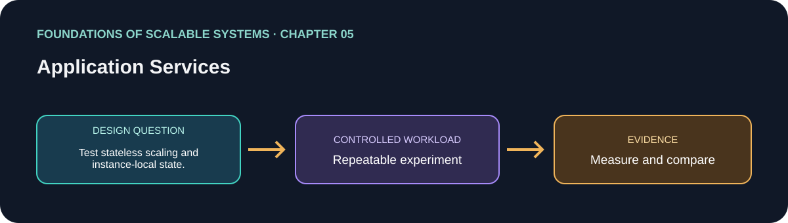

# 05. Application Services

> Chapter guide in the *Foundations of Scalable Systems* learning track. This repository guide paraphrases topics and proposes an independent practical exercise; it does not reproduce the book.

## Goal

Turn this chapter's design question into a small, repeatable experiment. The result is a comparison with stated assumptions, not a universal technology ranking.

## Chapter focus

API and service design; state management; application servers; horizontal scaling; load balancing; health; elasticity; session affinity.

## Chapter synthesis

**Source reading: printed pages 93–113.** Original learning summary of the chapter's listed ideas; consult the book for full treatment.

Application services expose business behavior through APIs and handle concurrent remote requests. Design must make contracts, state ownership, and failure behavior explicit. Stateless services are easy to replicate, but state still needs durable ownership. Horizontal scaling uses load balancing and distribution policies; health monitoring separates process liveness from readiness for traffic. Elasticity adjusts capacity with demand, while session affinity can constrain distribution and failover. Scale requests without hiding state or overwhelming dependencies.

### Key takeaways

- Make API contracts, state ownership, and failure behavior explicit.
- Readiness, liveness, load balancing, and elasticity are distinct mechanisms.
- Scaling an API requires downstream capacity too.

## Proposed application

- **Application / solution name:** `ScalableApplicationServicesLab`.
- **Namespace convention:** FoundationsOfScalableSystems.Chapter05
- **Independent solution folder:** solutions/05-application-services/
- **Current state:** learning guide and experiment design; implementation is not yet present.

## Practical exercise

Serve an identical API from one and multiple stateless instances; compare balancing and instance-local state behavior.

1. Write down the operation, workload shape, data size, and correctness invariant.
2. Establish a simple baseline before adding the chapter's scaling technique.
3. Change one major design choice at a time and repeat the same workload.
4. Save raw results, environment details, versions, and the exact run command.

## What to measure

Request rate, latency distribution, error rate, instance skew, and recovery after instance loss.

Report at least p50/p95/p99 latency, throughput, errors, CPU, memory, and behavior during one relevant failure. Mark any unmeasured claim as **Not measured**.

## Design review questions

- What is the bottleneck or quality attribute this design addresses?
- Which semantics must remain true under retry, restart, or partial failure?
- What new bottleneck or operational cost does the approach introduce?
- What result would make us reject this design?

## References

- Ian Gorton, *Foundations of Scalable Systems*, Chapter 05: “Application Services” — [O’Reilly chapter page](https://www.oreilly.com/library/view/foundations-of-scalable/9781098106058/ch05.html).
- Supporting primary documentation: [official reference](https://learn.microsoft.com/en-us/aspnet/core/fundamentals/servers/).
- Repository-wide chapter map and implementation order: [Scalability roadmap](../../docs/SCALABILITY-ROADMAP-EN.md).

## Naming and independence

When implementation begins, keep this application's source, infrastructure, workload, and run instructions inside this folder. The namespace above is a proposed code namespace, not a Kubernetes namespace; choose a Kubernetes namespace from the same chapter slug only when this solution gets manifests. Do not share application code with another solution.
