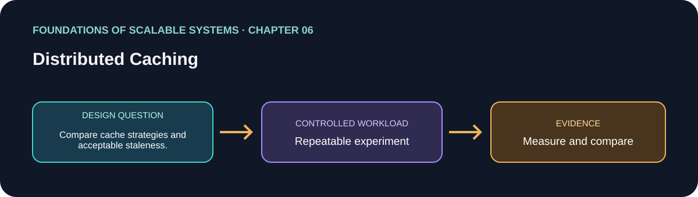

<div dir="rtl" align="right">

# فصل 06: Caching توزیع‌شده



> راهنمای این فصل در مسیر یادگیری بر پایهٔ *Foundations of Scalable Systems*. موضوع‌ها به بیان خودمان خلاصه شده‌اند و تمرین پیشنهادی مستقل است؛ متن کتاب بازنشر نشده است.

## هدف

پرسش طراحی فصل را به آزمایشی کوچک و تکرارپذیر تبدیل کنیم. خروجی، مقایسه با فرض‌های روشن است؛ نه رتبه‌بندی همیشگی فناوری‌ها.

## محور فصل

cache برنامه و وب؛ validatorهای HTTP؛ انقضا؛ cache control؛ تازگی داده و invalidation.

## خلاصهٔ جامع فصل

**بخش متناظر در نسخهٔ PDF: صفحه‌های چاپی 115–124.** جمع‌بندی آموزشی با بیان تازه از ایده‌های فصل؛ برای شرح کامل به کتاب مراجعه کن.

cache نتیجهٔ query یا محاسبهٔ پرهزینه را نگه می‌دارد تا درخواست‌های بعدی همان کار را تکرار نکنند. cache برنامه مثل Redis یا Memcached شیءهای کلیددار را در hash table حافظه‌ای توزیع‌شده می‌گذارد؛ برنامه اول hit را می‌خواند و در miss از DB یا سرویس پایین‌دستی می‌گیرد و cache را پر می‌کند. TTL کهنگی را محدود و انقضای داده را تضمین می‌کند؛ سیاستی مثل least-recently-used هم برای حافظهٔ محدود فضا باز می‌کند. cache زمانی بیشترین سود را دارد که read خیلی بیشتر از update و بازسازی مقدار پرهزینه باشد. hit، miss و eviction را پایش کن و تازگی قابل‌قبول را صریح تعریف کن.

الگوی رایج cache-aside، تشخیص miss را در کد برنامه نگه می‌دارد و هنگام خرابی cache هم می‌تواند کار کند: درخواست به منبع اصلی برمی‌گردد، با latency و بار بیشتر. در read-through cache loader داده را در miss می‌آورد؛ write-through هم cache و هم DB را به‌روز می‌کند و منتظر persistence می‌ماند؛ write-behind پاسخ نوشتن cache را پیش از ذخیره در DB می‌دهد و اگر cache پیش از flush خراب شود احتمال گم‌شدن update دارد. این الگوها بعضی مسیرهای برنامه را ساده می‌کنند، اما تضمین durability و consistency را تغییر می‌دهند. invalidation پس از update ضروری است؛ miss زیاد یا تغییر مکرر می‌تواند سود cache را از بین ببرد، پس دادهٔ مناسب و اندازهٔ working set را انتخاب کن.

web cache از HTTP و واسطه‌هایی مثل browser، proxy سازمانی یا ISP، reverse proxy و CDN edge جغرافیایی استفاده می‌کند. معمولاً resourceهای GET با URI کلید می‌شوند و cache نزدیک کاربر می‌تواند هم latency و هم ترافیک origin را کم کند. `Cache-Control` سیاست‌هایی مثل `no-store`، `no-cache` (اعتبارسنجی پیش از استفاده)، `private`، `public` و `max-age` را کنترل می‌کند؛ `Expires` زمان انقضای مطلق می‌دهد و `Last-Modified` می‌تواند برای تازگی تخمینی به کار رود. `ETag` نسخهٔ representation را مشخص می‌کند. بعد از stale شدن، درخواست شرطی `If-None-Match` باعث می‌شود origin در صورت ثابت‌بودن داده `304 Not Modified` و بدون بدنه پاسخ دهد، یا در صورت تغییر `200` همراه representation و tag جدید بفرستد. HTTP caching برای محتوای ایستا یا کم‌تغییر مناسب است؛ تازگی داده و مرزهای مجوز دسترسی بخشی از قرارداد API هستند.

### نکته‌های کلیدی

- دادهٔ cache‌شده سیاست تازگی و invalidation می‌خواهد.
- HTTP validator انتقال representation بدون تغییر را کم می‌کند.
- miss، stampede، eviction و ازدست‌رفتن cache را طراحی کن.

### پوشش موضوع‌های اصلی فصل

- تفاوت cache در application و web و محل استفادهٔ دوباره از نسخه‌ها.
- تازگی و اعتبارسنجی HTTP با Cache-Control، Expires، Last-Modified و ETag.
- نگرانی‌های صحت: دادهٔ کهنه، invalidation و رفتار cache پس از تغییر.

## درس آموزشی

### هدف‌های یادگیری و نقشهٔ مفهومی

- تعیین کنیم چه داده‌ای cacheپذیر است و freshness مجازش چقدر است.
- cache-aside، read-through، write-through و write-behind را از نظر خرابی مقایسه کنیم.
- HTTP cache و validatorها را برای کم‌کردن انتقال داده به کار ببریم.

`request → cache hit? → پاسخ؛ در miss → source of truth → cache با TTL/version`

### از cache چه انتظاری داشته باشیم؟

Cache مقدار را سریع‌تر و نزدیک‌تر نگه می‌دارد، نه اینکه خودبه‌خود source of truth شود. سودش به hit ratio و هزینهٔ محاسبه/خواندن اصلی وابسته است. برای هر کلید، اندازهٔ working set، نرخ تغییر، TTL و رفتار پس از miss را تعیین کن. eviction، restart یا failover ممکن است مقدار cache را حذف کند؛ درخواست باید بتواند به منبع اصلی برگردد. اگر load اصلی هنگام miss توان ندارد، cache failure هم می‌تواند outage بسازد.

### الگوهای نوشتن

- **Cache-aside:** برنامه miss را می‌بیند، source را می‌خواند و cache را پر می‌کند. ساده و قابل‌استفاده هنگام cache outage، اما stampede می‌تواند چندین read هم‌زمان بسازد.
- **Read-through:** cache مسئول load از منبع است؛ caller ساده‌تر می‌شود ولی coupling و semantics cache بیشتر می‌شود.
- **Write-through:** نوشتن تا به‌روزرسانی source/cache منتظر می‌ماند؛ freshness بهتر، latency و dual-write failure همچنان نیازمند طراحی است.
- **Write-behind:** cache زود پاسخ می‌دهد و بعداً source را به‌روز می‌کند؛ throughput ممکن است بهتر شود اما خرابی قبل از flush داده را از دست می‌دهد.

Invalidation را پس از تغییر داده انجام بده یا versionدار cache کن. Cache stampede را با single-flight/request coalescing، TTL پراکنده (jitter) و محدودکردن concurrency مهار کن؛ اما fallback هم باید rate limit داشته باشد.

### HTTP و CDN

Browser، proxy، reverse proxy و CDN می‌توانند GETهای قابل‌cache را نزدیک کاربر نگه دارند. `Cache-Control` مشخص می‌کند داده public/private است و چه مدتی fresh می‌ماند. `no-store` ذخیره نمی‌کند؛ `no-cache` یعنی پیش از استفاده دوباره اعتبارسنجی شود. `ETag` و `If-None-Match` امکان پاسخ `304 Not Modified` بدون ارسال body را می‌دهند. محتوای personalized یا حساس را بدون `private`/سیاست درست cache نکن؛ URL، Vary header و authorization بخشی از cache key و امنیت‌اند.

```http
Cache-Control: public, max-age=60, stale-while-revalidate=30
ETag: "basket-view-v18"
```

عددها نمونه‌اند، برای دادهٔ واقعی با تغییرات و الزام privacy تطبیق بده.

### مثال cache-aside و تصمیم

```text
GET basket:{id}:v{version}
if miss: read DB → SET key value EX ttl+jitter
on write: commit DB → invalidate old key or publish new version
```

| داده | تصمیم اولیه | دلیل/محدودیت |
| --- | --- | --- |
| تصویر و asset hashدار | CDN با cache طولانی | محتوا immutable و URL نسخه‌دار است |
| صفحهٔ عمومی فهرست کالا | cache کوتاه + ETag | تغییر با کمی تأخیر پذیرفته می‌شود |
| موجودی برای خرید | query authoritative/conditional write | cache می‌تواند oversell یا تصمیم قدیمی بسازد |
| سبد موقت | Redis با TTL + persistence/rebuild contract | عمر و دوام باید با نیاز محصول روشن باشد |

تمرین: endpoint read-heavy را بدون cache، cache-aside و invalidation versionدار اجرا کن. miss rate، DB QPS، p99، stale response و رفتار با Redis قطع‌شده را ثبت کن.

## برنامهٔ application پیشنهادی

- **نام application / راه‌حل:** `DistributedCacheBehaviorLab`.
- **الگوی namespace کد:** FoundationsOfScalableSystems.Chapter06
- **پوشهٔ مستقل راه‌حل:** solutions/06-distributed-caching/
- **وضعیت فعلی:** راهنمای یادگیری و طرح آزمایش؛ پیاده‌سازی کد هنوز اضافه نشده است.

## تمرین عملی

Compare cache disabled, cache-aside, and explicit invalidation for one read-heavy endpoint; define acceptable staleness.

۱. عملیات، شکل بار، اندازهٔ داده و invariant صحت را بنویسیم.
۲. قبل از افزودن تکنیک مقیاس‌دهی، baseline ساده بسازیم.
۳. هر بار فقط یک انتخاب اصلی را تغییر دهیم و همان workload را تکرار کنیم.
۴. نتیجهٔ خام، مشخصات محیط، نسخه‌ها و فرمان دقیق اجرا را نگه داریم.

## چه چیزهایی را اندازه بگیریم

Hit ratio, backend load, latency, stale-read window, memory use, and recovery after cache loss.

حداقل p50/p95/p99 latency، throughput، خطا، CPU، حافظه و رفتار هنگام یک شکست مرتبط را گزارش کنیم. ادعای اندازه‌گیری‌نشده را با وضعیت **اندازه‌گیری نشده** مشخص کنیم.

## پرسش‌های بازبینی طراحی

- این طراحی کدام گلوگاه یا ویژگی کیفی را هدف می‌گیرد؟
- هنگام retry، restart یا شکست جزئی کدام معناها باید حفظ شوند؟
- چه گلوگاه یا هزینهٔ عملیاتی تازه‌ای ایجاد می‌شود؟
- چه نتیجه‌ای باعث رد کردن این طراحی می‌شود؟

## رفرنس‌ها

- Ian Gorton، *Foundations of Scalable Systems*، فصل 06: “Distributed Caching” — [صفحهٔ فصل در O’Reilly](https://www.oreilly.com/library/view/foundations-of-scalable/9781098106058/ch06.html).
- مستندات فنی اولیه: [مرجع رسمی](https://redis.io/docs/latest/develop/use/patterns/).
- نقشهٔ فصل‌ها و ترتیب پیاده‌سازی مخزن: [نقشهٔ راه فارسی](../../docs/SCALABILITY-ROADMAP-FA.md).

## نام‌گذاری و استقلال

هنگام شروع پیاده‌سازی، کد، زیرساخت، workload و راهنمای اجرا را داخل همین پوشه نگه داریم. namespace بالا پیشنهاد برای namespace کد است، نه Kubernetes؛ namespace کوبرنتیز را از همان slug فصل انتخاب می‌کنیم وقتی manifestهای این راه‌حل اضافه شدند. کد application را با راه‌حل دیگر مشترک نکنیم.

</div>
