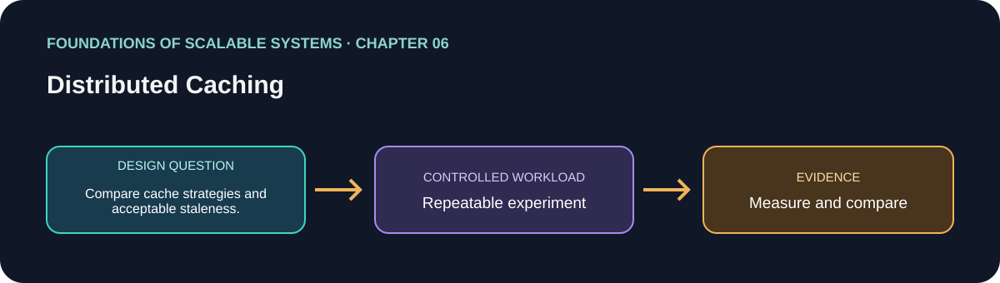

# 06. Distributed Caching

> Chapter guide in the *Foundations of Scalable Systems* learning track. This repository guide paraphrases topics and proposes an independent practical exercise; it does not reproduce the book.

## Goal

Turn this chapter's design question into a small, repeatable experiment. The result is a comparison with stated assumptions, not a universal technology ranking.

## Chapter focus

Application and web caching; HTTP validators; expiry; cache control; freshness and invalidation.

## Chapter synthesis

**Source reading: printed pages 115–124.** Original learning summary of the chapter's listed ideas; consult the book for full treatment.

Caching reuses expensive query or computation results so later requests can avoid repeating work. Application caches such as Redis or Memcached store keyed objects in distributed in-memory hash tables; the application checks for a hit, and on a miss loads from a database or downstream service and populates the cache. A TTL bounds staleness and removes entries eventually; eviction policies such as least-recently-used reclaim limited memory. Caching pays off most when reads greatly outnumber updates and values are costly to rebuild. Track hit, miss, and eviction rates, and decide explicitly how fresh data must be.

The common cache-aside pattern leaves miss handling in application code and remains usable during cache failure: the request falls back to the source, with higher latency and load. Read-through delegates misses to a cache loader; write-through updates the cache and waits for the backing database; write-behind acknowledges the cache write before persistence and risks losing updates if the cache fails before flushing. These patterns simplify some application paths but change durability and consistency guarantees. Invalidation after an update is essential; a miss or frequently changing item can erase the benefit, so cache only suitable data and size capacity for the working set.

Web caching uses HTTP and intermediary caches at browsers, organizational/ISP proxies, reverse proxies, and geographically distributed CDN edge locations. GET resources are commonly keyed by URI and can be served closer to clients, reducing both origin traffic and latency. `Cache-Control` controls policies such as `no-store`, `no-cache` (revalidate before reuse), `private`, `public`, and `max-age`; `Expires` provides an absolute freshness time, while `Last-Modified` can support heuristic freshness. An `ETag` identifies a representation version. After an entry is stale, a conditional request with `If-None-Match` lets the origin return `304 Not Modified` without sending the body, or `200` with a new representation and tag. Use HTTP caching for static or infrequently changing content, and treat freshness and authorization boundaries as part of the API contract.

### Key takeaways

- Cached data needs explicit freshness and invalidation policies.
- HTTP validators avoid transferring unchanged representations.
- Design cache misses, stampedes, eviction, and cache loss.

### Coverage of chapter topics

- Application cache versus web cache and where cached copies are reused.
- HTTP freshness and validation using Cache-Control, Expires, Last-Modified, and ETag.
- Correctness concerns: stale values, invalidation, and cache behavior on change.

## Proposed application

- **Application / solution name:** `DistributedCacheBehaviorLab`.
- **Namespace convention:** FoundationsOfScalableSystems.Chapter06
- **Independent solution folder:** solutions/06-distributed-caching/
- **Current state:** learning guide and experiment design; implementation is not yet present.

## Practical exercise

Compare cache disabled, cache-aside, and explicit invalidation for one read-heavy endpoint; define acceptable staleness.

1. Write down the operation, workload shape, data size, and correctness invariant.
2. Establish a simple baseline before adding the chapter's scaling technique.
3. Change one major design choice at a time and repeat the same workload.
4. Save raw results, environment details, versions, and the exact run command.

## What to measure

Hit ratio, backend load, latency, stale-read window, memory use, and recovery after cache loss.

Report at least p50/p95/p99 latency, throughput, errors, CPU, memory, and behavior during one relevant failure. Mark any unmeasured claim as **Not measured**.

## Design review questions

- What is the bottleneck or quality attribute this design addresses?
- Which semantics must remain true under retry, restart, or partial failure?
- What new bottleneck or operational cost does the approach introduce?
- What result would make us reject this design?

## References

- Ian Gorton, *Foundations of Scalable Systems*, Chapter 06: “Distributed Caching” — [O’Reilly chapter page](https://www.oreilly.com/library/view/foundations-of-scalable/9781098106058/ch06.html).
- Supporting primary documentation: [official reference](https://redis.io/docs/latest/develop/use/patterns/).
- Repository-wide chapter map and implementation order: [Scalability roadmap](../../docs/SCALABILITY-ROADMAP-EN.md).

## Naming and independence

When implementation begins, keep this application's source, infrastructure, workload, and run instructions inside this folder. The namespace above is a proposed code namespace, not a Kubernetes namespace; choose a Kubernetes namespace from the same chapter slug only when this solution gets manifests. Do not share application code with another solution.
