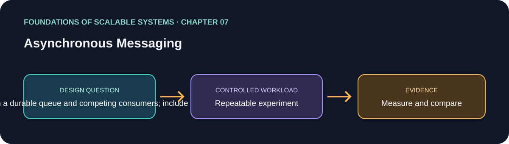

# فصل 07: پیام‌رسانی ناهمگام

> راهنمای این فصل در مسیر یادگیری بر پایهٔ *Foundations of Scalable Systems*. موضوع‌ها به بیان خودمان خلاصه شده‌اند و تمرین پیشنهادی مستقل است؛ متن کتاب بازنشر نشده است.

## هدف

پرسش طراحی فصل را به آزمایشی کوچک و تکرارپذیر تبدیل کنیم. خروجی، مقایسه با فرض‌های روشن است؛ نه رتبه‌بندی همیشگی فناوری‌ها.

## محور فصل

ماندگاری؛ pub/sub؛ queue؛ replication؛ competing consumers؛ ایمنی تحویل؛ پیام ناسالم و idempotency.

## خلاصهٔ جامع فصل

**بخش متناظر در نسخهٔ PDF: صفحه‌های چاپی 127–145.** این جمع‌بندی با بیان خودمان نوشته شده است؛ برای شرح کامل به کتاب مراجعه کن.

پیام‌رسانی ناهمگام به تولیدکننده اجازه می‌دهد درخواست را به یک واسطه بسپارد و پیش از تمام شدن کار تجاری مصرف‌کننده ادامه دهد. در مدل رایج، broker پیام‌ها را در queueهای نام‌دار می‌پذیرد. تولیدکننده می‌تواند تا تأیید broker منتظر بماند؛ مصرف‌کننده پیام را با pull/poll می‌گیرد یا برای دریافت push ثبت‌نام می‌کند. در یک queue معمولاً هر پیام به یکی از مصرف‌کننده‌های رقیب می‌رسد. در publish/subscribe، هر subscriber مستقل پیام‌های مورد علاقه‌اش را می‌گیرد. این جداسازی جهش بار را هموار می‌کند، مقیاس تولیدکننده و مصرف‌کننده را مستقل می‌سازد و اضافه شدن subscriber جدید را ممکن می‌کند؛ در عوض، کنترل backlog، ترتیب، بازیابی شکست و چرخهٔ عمر پیام به مسئله‌های اصلی طراحی تبدیل می‌شوند.

فصل برای ملموس کردن ایده‌ها از RabbitMQ استفاده می‌کند. تولیدکننده به exchange پیام می‌فرستد، نه مستقیم به queue. bindingها بر اساس کلید مستقیم، الگوی topic یا پخش fanout پیام را هدایت می‌کنند. اتصال‌ها نسبتاً پرهزینه‌اند و باید طولانی‌عمر باشند؛ channelها جریان‌های منطقی سبک‌تری هستند که روی یک اتصال multiplex می‌شوند، ولی thread-safe نیستند. channel طولانی‌عمر را به یک thread اختصاص بده یا در کاربردهای مناسب از pool محدود استفاده کن. push از polling مداوم کاراتر است. تأیید دستی به broker اجازه می‌دهد پیامی را که قبل از ack کامل نشده دوباره تحویل دهد. تعداد queueهای مستقل، concurrency مصرف‌کننده و prefetch روی نرخ پردازش اثر می‌گذارند؛ یک queue داغ یا thread واحد می‌تواند موازی‌سازی سمت broker را محدود کند. backlog بزرگ حافظه مصرف می‌کند و ممکن است broker تولیدکننده‌ها را کند کند، پس عمق صف و زمان تخلیه باید پایش و محدود شوند.

ایمنی و کارایی با هم مصالحه دارند. queue حافظه‌ای سریع است، اما با خرابی broker پیام از دست می‌دهد. queue و پیام پایدار، publisher confirm و consumer acknowledgement پنجرهٔ گم‌شدن پیام را کوچک می‌کنند، در عوض دیسک، شبکه و latency بیشتری می‌خواهند. replication می‌تواند پس از خرابی یک broker دسترس‌پذیری را بهتر کند، اما رهبر همچنان ترافیک فعال را می‌گیرد؛ بنابراین replication به‌خودی‌خود تقسیم بار برای افزایش throughput نیست. replication مبتنی بر quorum به تأیید اکثریت نیاز دارد و هزینهٔ نوشتن و منابع را بالا می‌برد. تضمین‌ها را از نیاز کسب‌وکار انتخاب کن، نه این‌که همهٔ گزینه‌های reliability را بی‌هدف روشن کنی.

retry می‌تواند پیام تکراری بسازد: broker شاید پیام را پذیرفته باشد ولی تأییدش گم شود؛ یا مصرف‌کننده اثر کار را ثبت کند اما پیش از ack از کار بیفتد. بنابراین «exactly once» باید مرز مشخص داشته باشد. شناسهٔ پایدار پیام، رکورد deduplication پایدار یا به‌روزرسانی ذاتاً idempotent به‌کار ببر و فقط پس از commit اثر موردنظر ack بده. پیام poison که همیشه شکست می‌خورد نباید بی‌نهایت دور بخورد: تعداد تحویل را محدود کن، آن را به dead-letter queue بفرست، هشدار بده، زمینهٔ کافی برای تشخیص نگه دار و روش replay امن تعریف کن. این‌ها تحویل at-least-once را عملی می‌کنند، بدون ادعای غیرواقعیِ اثر end-to-end دقیقاً یک‌باره.

### نکته‌های کلیدی

- تضمین تحویل را از تضمین اثر کسب‌وکار جدا کن.
- persistence و replication را بر اساس شکست مورد انتظار انتخاب کن.
- retry را idempotent و بازیابی پیام poison را قابل مشاهده کن.

### پوشش موضوع‌های اصلی فصل

- queue، producer، consumer، broker، دریافت push/pull و acknowledgement خودکار/دستی.
- persistence، publish/subscribe، replication رهبر/پیرو و نوع exchangeهای RabbitMQ (direct، topic، fanout).
- اتصال و channel طولانی‌عمر، thread safety، استفادهٔ مجدد یا pool کردن channel، concurrency صف در broker، فشار backlog و کند کردن producer.
- publisher confirm، queue/پیام پایدار، تأیید مصرف‌کننده و مصالحهٔ ایمنی با latency.
- competing consumers، exactly-once محدود به‌کمک idempotency، محدودکردن redelivery، dead-letter، پایش و replay.

## برنامهٔ application پیشنهادی

- **نام application / راه‌حل:** `ReliableAsyncMessagingLab`.
- **الگوی namespace کد:** FoundationsOfScalableSystems.Chapter07
- **پوشهٔ مستقل راه‌حل:** solutions/07-asynchronous-messaging/
- **وضعیت فعلی:** راهنمای یادگیری و طرح آزمایش؛ پیاده‌سازی کد هنوز اضافه نشده است.

## تمرین عملی

یک سرویس پردازش سفارش بساز: API درخواست HTTP بگیرد و workerها جداگانه مقیاس‌پذیر باشند. همان قرارداد را دو بار پیاده کن: (الف) RabbitMQ با work queue و competing consumer؛ (ب) Kafka با topic و consumer group، وقتی replay و چند subscriber مستقل لازم است. در صورت تمایل SQS به‌همراه DLQ را هم به‌عنوان گزینهٔ managed مقایسه کن. منطق کسب‌وکار و بارساز را ثابت نگه دار تا تفاوت معنا و هزینهٔ پیام‌رسانی مقایسه شود.

۱. schema رویداد، شناسهٔ پایدار، کلید ترتیب، قاعدهٔ idempotency و نقطه‌ای را تعریف کن که سفارش در آن «تمام‌شده» محسوب می‌شود.
۲. پیام را با تأیید broker منتشر کن؛ در صورت امکان اثر تجاری و شناسهٔ پیام پردازش‌شده را اتمی ذخیره کن؛ فقط بعد از commit تأیید مصرف بفرست.
۳. retry محدود با backoff، مقصد dead-letter، هشدار و دستور مستند replay اضافه کن. ثابت کن تحویل تکراری اثر کسب‌وکار را دوباره اعمال نمی‌کند.
۴. بار ثابت را یک بار با یک worker و سپس چند worker اجرا کن. خرابی worker را قبل از پردازش، بعد از ثبت اثر ولی قبل از ack، و خرابی broker را تزریق کن. حالت پایدار و حالت کم‌تأخیر را مقایسه کن.
۵. نتایج خام، مشخصات محیط، نسخه‌ها، فرمان‌ها و زمان‌بندی تزریق شکست را نگه دار.

### انتخاب‌های راه‌حل قابل پیاده‌سازی

| راه‌حل | چه زمانی انتخابش کنیم | شکل اجرایی | هزینه‌ها و محدودیت‌ها |
|---|---|---|---|
| RabbitMQ با work queue پایدار | هر task را یک worker انجام می‌دهد و routing و ack مهم است | HTTP API → exchange/queue پایدار → workerهای .NET → PostgreSQL؛ publisher confirm، ack دستی، retry محدود و DLQ | ظرفیت queue/رهبر می‌تواند گلوگاه شود؛ queue مانند log قابل replay نیست |
| Kafka به‌شکل event stream | نگه‌داری و replay رویداد یا چند consumer group مستقل لازم است | API و transactional outbox → topic با کلید aggregate → consumer groupها → projectionهای idempotent در دیتابیس | اجزای عملیاتی و برنامه‌ریزی partition بیشتر؛ offset به‌تنهایی اثر دیتابیس خارجی را exactly-once نمی‌کند |
| صف managed مانند SQS و DLQ | می‌خواهیم عملیات broker را کم کنیم و semantics ارائه‌دهنده را بپذیریم | API/outbox publisher → صف → worker fleet → DLQ پس از تعداد دریافت محدود | وابستگی به cloud و هزینهٔ مصرف؛ محدودیت visibility-timeout و ترتیب را باید بررسی کرد |

در هر سه گزینه، در قرارداد API «پذیرفته‌شدن پیام» را از «تمام‌شدن کار تجاری» جدا کن. اگر تغییر دیتابیس و انتشار پیام نباید از هم جدا شوند، از outbox استفاده کن؛ مصرف‌کننده را idempotent نگه دار، تعداد کارهای همزمان را محدود کن و عمق صف، سن قدیمی‌ترین پیام، redelivery/DLQ، latency پردازش و زمان تخلیه را گزارش بده.

## چه چیزهایی را اندازه بگیریم

نرخ publish/consume، عمق صف یا lag کافکا، سن قدیمی‌ترین پیام، شکست تحویل، redelivery، شمار DLQ، زمان تخلیه، تکمیل پایدار کار تجاری و مصرف دیسک/حافظه/شبکهٔ broker و concurrency مصرف‌کننده.

حداقل p50/p95/p99 latency، throughput، خطا، CPU، حافظه و رفتار هنگام یک شکست مرتبط را گزارش کنیم. ادعای اندازه‌گیری‌نشده را با وضعیت **اندازه‌گیری نشده** مشخص کنیم.

## پرسش‌های بازبینی طراحی

- این طراحی کدام گلوگاه یا ویژگی کیفی را هدف می‌گیرد؟
- هنگام retry، restart یا شکست جزئی کدام معناها باید حفظ شوند؟
- چه گلوگاه یا هزینهٔ عملیاتی تازه‌ای ایجاد می‌شود؟
- چه نتیجه‌ای باعث رد کردن این طراحی می‌شود؟

## رفرنس‌ها

- Ian Gorton، *Foundations of Scalable Systems*، فصل 07: “Asynchronous Messaging” — [صفحهٔ فصل در O’Reilly](https://www.oreilly.com/library/view/foundations-of-scalable/9781098106058/ch07.html).
- مستندات فنی اولیه: [مرجع رسمی](https://kafka.apache.org/documentation/).
- نقشهٔ فصل‌ها و ترتیب پیاده‌سازی مخزن: [نقشهٔ راه فارسی](../../docs/SCALABILITY-ROADMAP-FA.md).

## نام‌گذاری و استقلال

هنگام شروع پیاده‌سازی، کد، زیرساخت، workload و راهنمای اجرا را داخل همین پوشه نگه داریم. namespace بالا پیشنهاد برای namespace کد است، نه Kubernetes؛ namespace کوبرنتیز را از همان slug فصل انتخاب می‌کنیم وقتی manifestهای این راه‌حل اضافه شدند. کد application را با راه‌حل دیگر مشترک نکنیم.

