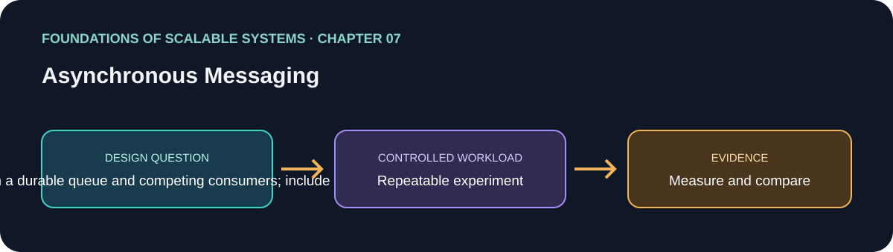

# 07. Asynchronous Messaging

> Chapter guide in the *Foundations of Scalable Systems* learning track. This repository guide paraphrases topics and proposes an independent practical exercise; it does not reproduce the book.

## Goal

Turn this chapter's design question into a small, repeatable experiment. The result is a comparison with stated assumptions, not a universal technology ranking.

## Chapter focus

Persistence; pub/sub; queues; replication; competing consumers; delivery safety; poison messages; idempotency.

## Chapter synthesis

**Source reading: printed pages 127–144.** Original learning summary of the chapter's listed ideas; consult the book for full treatment.

Asynchronous messaging separates producers from processing time and location. Persistence, publish-subscribe, replication, exchanges, and queues determine routing and retention. Competing consumers distribute work, but acknowledgements, ordering, retries, and idempotency determine correctness and performance. Replication can improve durability and availability at resource and latency cost. Exactly-once claims apply only within a defined boundary; duplicate delivery can still affect end-to-end effects. Poison messages need isolation and an explicit recovery policy.

### Key takeaways

- Separate delivery guarantees from business-effect guarantees.
- Choose persistence and replication for explicit failure goals.
- Make retry idempotent and poison-message recovery observable.

### Coverage of chapter topics

- Messaging primitives, persistence, publish/subscribe, and replication.
- RabbitMQ example: messages, exchanges, queues, distribution, and concurrency.
- Safety/performance and availability trade-offs; competing consumers, exactly-once scope, and poison messages.

## Proposed application

- **Application / solution name:** `ReliableAsyncMessagingLab`.
- **Namespace convention:** FoundationsOfScalableSystems.Chapter07
- **Independent solution folder:** solutions/07-asynchronous-messaging/
- **Current state:** learning guide and experiment design; implementation is not yet present.

## Practical exercise

Compare synchronous processing with a durable queue and competing consumers; include retry, dead-letter, and graceful stop.

1. Write down the operation, workload shape, data size, and correctness invariant.
2. Establish a simple baseline before adding the chapter's scaling technique.
3. Change one major design choice at a time and repeat the same workload.
4. Save raw results, environment details, versions, and the exact run command.

## What to measure

Publish/consume rate, lag, delivery failures, redelivery, drain time, and durable completion.

Report at least p50/p95/p99 latency, throughput, errors, CPU, memory, and behavior during one relevant failure. Mark any unmeasured claim as **Not measured**.

## Design review questions

- What is the bottleneck or quality attribute this design addresses?
- Which semantics must remain true under retry, restart, or partial failure?
- What new bottleneck or operational cost does the approach introduce?
- What result would make us reject this design?

## References

- Ian Gorton, *Foundations of Scalable Systems*, Chapter 07: “Asynchronous Messaging” — [O’Reilly chapter page](https://www.oreilly.com/library/view/foundations-of-scalable/9781098106058/ch07.html).
- Supporting primary documentation: [official reference](https://kafka.apache.org/documentation/).
- Repository-wide chapter map and implementation order: [Scalability roadmap](../../docs/SCALABILITY-ROADMAP-EN.md).

## Naming and independence

When implementation begins, keep this application's source, infrastructure, workload, and run instructions inside this folder. The namespace above is a proposed code namespace, not a Kubernetes namespace; choose a Kubernetes namespace from the same chapter slug only when this solution gets manifests. Do not share application code with another solution.
