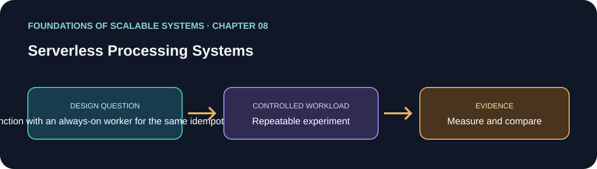

# فصل 08: سامانه‌های پردازش Serverless

> راهنمای این فصل در مسیر یادگیری بر پایهٔ *Foundations of Scalable Systems*. موضوع‌ها به بیان خودمان خلاصه شده‌اند و تمرین پیشنهادی مستقل است؛ متن کتاب بازنشر نشده است.

## هدف

پرسش طراحی فصل را به آزمایشی کوچک و تکرارپذیر تبدیل کنیم. خروجی، مقایسه با فرض‌های روشن است؛ نه رتبه‌بندی همیشگی فناوری‌ها.

## محور فصل

چرخهٔ invocation؛ autoscaling؛ cold start؛ کنترل هم‌روندی؛ پارامترهای throughput و هزینه.

## خلاصهٔ جامع فصل

**بخش متناظر در نسخهٔ PDF: صفحه‌های چاپی 147–161.** این جمع‌بندی با بیان خودمان نوشته شده است؛ برای شرح کامل به کتاب مراجعه کن. محدودیت‌ها و قیمت‌های ارائه‌دهندگان تغییر می‌کنند؛ عددهای کتاب را مثال تاریخی بدان، نه تضمین امروز سرویس.

فصل serverless را پاسخی به تقاضای متغیر می‌داند: کد هنگام نیاز اجرا می‌شود، پلتفرم تعداد محیط‌های اجرا را زیاد و کم می‌کند و هزینه به تعداد درخواست، مدت اجرا، منابع انتخابی و گاهی ظرفیت گرم وابسته است. این مدل هزینهٔ ظرفیت بیکار و بخشی از عملیات زیرساخت را کم می‌کند، اما compute را رایگان نمی‌کند و محدودیت‌های cloud را حذف نمی‌کند. معماری همچنان باید اجرای stateless، سرویس‌های دادهٔ مدیریت‌شده، قفل‌شدن به ارائه‌دهنده، سقف scale و کنترل بودجه را در نظر بگیرد.

Google App Engine Standard و AWS Lambda دو مدل متفاوت را نشان می‌دهند. App Engine درخواست HTTP را به instanceهای آماده می‌فرستد، ممکن است چند درخواست همزمان را روی یک instance اجرا کند و بر اساس هدف CPU، تعداد درخواست همزمان و زمان انتظار صف مقیاس می‌گیرد. حداقل instance تأخیر اولین درخواست را کم می‌کند، ولی هزینه دارد؛ حداکثر instance هزینه را محدود می‌کند، اما می‌تواند باعث انتظار یا overload شود. Lambda یک function را در محیط اجرا فراخوانی می‌کند: اجرای سرد اول باید کد و وابستگی‌ها را بار کند و مقداردهی اولیه انجام دهد؛ اجرای بعدی ممکن است محیط گرم را دوباره استفاده کند. provisioned concurrency شروع را قابل‌پیش‌بینی‌تر می‌کند، با هزینهٔ بیشتر. فصل همچنین نشان می‌دهد تنظیم حافظهٔ Lambda می‌تواند هم‌زمان توان پردازشی را تغییر دهد؛ تخصیص بیشتر شاید اجرا را آن‌قدر سریع کند که هزینهٔ کل کم شود، اما فقط اندازه‌گیری برای workload واقعی جواب می‌دهد. سهمیهٔ concurrency، سرعت رشد ظرفیت، ظرفیت رزروشده و throttling روی burst اثر می‌گذارند و چند function در یک حساب/منطقه ممکن است برای ظرفیت مشترک رقابت کنند.

روش اصلی مطالعهٔ موردی، «مطالعهٔ پارامتری» است نه حدس مهندسی. برای تنظیمات مهم، چند مقدار معنادار انتخاب کن؛ کد و ترکیب درخواست را ثابت نگه دار؛ هر حالت را با بار و warm-up/cooldown تکرارپذیر اجرا کن؛ سپس throughput و هزینه را با هم بسنج. بیشترین throughput الزاماً بهترین انتخاب نیست: شاید تنظیمی کمی کندتر، هدف سرویس را برآورده کند و هزینه را خیلی کم کند. serverless بیشتر به کار بار جهشی، متناوب، رویدادمحور یا کوتاه‌مدت می‌آید؛ سرویس طولانی‌مدت و پرترافیک که latency حساس دارد ممکن است روی container یا VM مناسب‌تر باشد. ترکیب این دو هم شدنی است: API حساس به latency همیشه گرم بماند و کار پس‌زمینهٔ جهشی به صف و function سپرده شود.

### نکته‌های کلیدی

- serverless را با شکل بار و زمان بیکاری تطبیق بده.
- startup، محدودیت اجرا، state بیرونی و concurrency وابستگی را حساب کن.
- تنظیم را با throughput، latency و هزینهٔ اندازه‌گیری‌شده انجام بده.

### پوشش موضوع‌های اصلی فصل

- اجرای pay-per-use، autoscaling، مزیت عملیاتی، عوامل هزینه و محدودیت‌های خاص هر ارائه‌دهنده.
- App Engine Standard: instance آماده، مسیریابی stateless، حداقل/حداکثر instance و هدف‌های CPU/concurrency/صف.
- Lambda: handler ورودی event/context، چرخهٔ cold/warm، مقداردهی وابستگی، concurrency رزروشده/آماده، رابطهٔ حافظه و توان پردازش، throttling و burst.
- مطالعهٔ پارامتری: انتخاب بازه، اجرای آزمون کنترل‌شده و ارزیابی مشترک throughput و هزینه، به‌جای فرض بهینه بودن مقدار پیش‌فرض.

## درس آموزشی

### هدف‌های یادگیری و نقشهٔ مفهومی

- serverless را به‌عنوان مدل اجرا/صورتحساب بفهمیم، نه نبودن server.
- cold/warm start، concurrency و محدودیت پایین‌دستی را در طرح ظرفیت بگنجانیم.
- تنظیمات را با مطالعهٔ پارامتری و هزینهٔ کار موفق انتخاب کنیم.

`event → managed platform → scale/concurrency → function → external state/services`

### مدل اجرا

در function-as-a-service، ارائه‌دهنده محیط اجرا را ایجاد و invocation را براساس HTTP یا event انجام می‌دهد؛ گاهی محیط گرم برای درخواست‌های بعدی باقی می‌ماند. cold start شامل فراهم‌کردن runtime، بارگذاری کد و initialization است و ممکن است tail latency را بالا ببرد. provisioned/minimum warm capacity می‌تواند startup را کم کند اما هزینهٔ idle دارد. state پایدار را در دیتابیس/object store نگه دار؛ حافظه یا دیسک موقت یک invocation را durable فرض نکن.

Autoscaling پلتفرم را با نیاز پایین‌دست محدود کن. صدها function هم‌زمان اگر هر کدام DB connection بگیرند ممکن است دیتابیس را از پا بیندازند. reserved concurrency، semaphore/bulkhead، queue و batch size ابزار کنترل‌اند. timeout function باید با visibility timeout، retry و deadline درخواست جور باشد تا دو اجرای هم‌پوشان اثر تکراری نسازند. function هم idempotent باشد.

### اقتصاد و مطالعهٔ پارامتری

هزینه فقط duration نیست؛ request count، memory/CPU allocation، provisioned capacity، network, logging, retries و datastore هم اثر دارند. حافظهٔ بیشتر ممکن است زمان را کم و هزینهٔ هر invocation را پایین آورد یا بی‌فایده هزینه را بالا ببرد. چند مقدار معنادار برای memory, concurrency, batch و warm capacity انتخاب کن؛ کد و workload را ثابت نگه دار؛ گرم/سرد و burst را چند بار اجرا کن. نقطه‌ای را انتخاب کن که SLO و هزینه را همزمان برآورده کند؛ بیشترین throughput الزاماً انتخاب بهینه نیست.

### سه شکل معماری

1. **HTTP function:** کار کوتاه و متناوب؛ gateway → function → managed store. سردشدن، timeout و connection reuse را اندازه بگیر.
2. **Queue-triggered function:** API/outbox → queue → function batch. backlog را جذب می‌کند؛ idempotency، DLQ و visibility/lease لازم است.
3. **Worker دائمی:** Kafka/queue → Deployment یا container service با KEDA/HPA → DB. برای بار پیوسته یا کنترل runtime مناسب؛ عملیات platform بر عهدهٔ تیم می‌ماند.

### تمرین و دام‌ها

یک کار idempotent مثل تولید thumbnail یا ارسال اعلان را در function HTTP، function صف‌محور و worker دائمی اجرا کن. cold/warm p95، max backlog age، error، throttle، CPU/memory و cost per completed item را بسنج. پایین‌دست را عمداً محدود کن.

- serverless نه latency ثابت می‌دهد و نه ظرفیت نامحدود.
- صف و function می‌توانند flood به دیتابیس ایجاد کنند؛ concurrency سقف‌دار لازم است.
- قیمت و سهمیهٔ provider دائماً عوض می‌شود؛ اعداد کتاب ۲۰۲۲ را امروز hard-code نکن.

## برنامهٔ application پیشنهادی

- **نام application / راه‌حل:** `ServerlessThroughputCostLab`.
- **الگوی namespace کد:** FoundationsOfScalableSystems.Chapter08
- **پوشهٔ مستقل راه‌حل:** solutions/08-serverless-processing-systems/
- **وضعیت فعلی:** راهنمای یادگیری و طرح آزمایش؛ پیاده‌سازی کد هنوز اضافه نشده است.

## تمرین عملی

یک کار idempotent مثل ساخت thumbnail تصویر یا فرستادن اعلان سفارش را در سه شکل بساز: (الف) function با ورودی HTTP، (ب) function فعال‌شونده با queue، و (ج) worker دائمی .NET روی Kubernetes. state را در object storage یا database نگه دار؛ به حافظه یا دیسک موقت یک invocation برای دوام تکیه نکن.

۱. هدف‌های سرویس را برای p95/p99 latency، نرخ خطا، بیشینهٔ سن backlog و هزینهٔ ماهانه مشخص کن؛ بار ثابت و burst ناگهانی را هم مدل کن.
۲. idempotency key و state پایدار بیرونی اضافه کن تا retry پلتفرم و رویداد تکراری اثر را دوباره اعمال نکنند.
۳. برای هر پلتفرم یک یا دو کنترل مهم (مقدار حافظه/CPU، حداقل محیط گرم، حداکثر concurrency/instance، اندازهٔ batch یا تعداد replica worker) را در یک ماتریس کوچک تغییر بده. کد، داده، ترکیب درخواست و مدت آزمون را ثابت نگه دار.
۴. اجرای سرد و گرم، burst بزرگ‌تر از ظرفیت عادی و رسیدن به سقف دیتابیس پایین‌دست را آزمایش کن. throttling و retry را اندازه بگیر، پنهانشان نکن.
۵. هزینهٔ هر کار موفق و هدف latency/خطا را مقایسه کن؛ نقطهٔ عملیاتی منتخب و شرایطی را که نیاز به تنظیم دوباره دارد ثبت کن.

### انتخاب‌های راه‌حل قابل پیاده‌سازی

| راه‌حل | چه زمانی انتخابش کنیم | شکل اجرایی | هزینه‌ها و محدودیت‌ها |
|---|---|---|---|
| API با function مدیریت‌شده | ترافیک متناوب است و هر درخواست کوتاه و stateless است | API Gateway/ورودی HTTP مدیریت‌شده → function → database/cache مدیریت‌شده | cold start، سهمیهٔ ارائه‌دهنده، هجوم اتصال به دیتابیس و بسته‌بندی اختصاصی |
| Functionهای صف‌محور | کار غیرهمزمان است و می‌خواهیم burst در صف جذب شود | HTTP API و outbox → صف مدیریت‌شده → مصرف‌کنندهٔ function به‌صورت batch → database/object store | semantics مربوط به visibility/lease timeout و retry batch؛ idempotency و DLQ لازم است |
| Worker در Kubernetes با KEDA/HPA | بار پیوسته است یا کنترل runtime، شبکه و deployment می‌خواهیم | API/outbox → Kafka یا queue → Worker Deployment با scale بر اساس CPU یا lag → database | عملیات کلاستر و broker باقی می‌ماند؛ scale باید با partition و ظرفیت اتصال DB سازگار باشد |
| ورودی همیشه‌گرم + پس‌زمینهٔ serverless | latency درخواست کاربر و جذب burst نیازهای متفاوت دارند | API همیشه‌گرم → صف پایدار → function برای پردازش‌های پس‌زمینه و fan-out | دو مدل اجرا و دو مسیر مشاهده‌پذیری؛ correlation سرتاسری باید صریح باشد |

برای محافظت دیتابیس از fan-out ناگهانی، queue یا سقف concurrency بگذار. حداقل محیط گرم را فقط وقتی نگه دار که کاهش latency هزینهٔ پایه را توجیه کند. برای هزینه، throttling، عمر صف و اشباع سرویس پایین‌دست سقف و هشدار تنظیم کن.

## چه چیزهایی را اندازه بگیریم

latency سرد و گرم در p50/p95/p99، throughput، concurrency فعال، throttling، retry، هزینهٔ هر کار موفق، سن صف/زمان تخلیهٔ backlog و اشباع سرویس پایین‌دست.

حداقل p50/p95/p99 latency، throughput، خطا، CPU، حافظه و رفتار هنگام یک شکست مرتبط را گزارش کنیم. ادعای اندازه‌گیری‌نشده را با وضعیت **اندازه‌گیری نشده** مشخص کنیم.

## پرسش‌های بازبینی طراحی

- این طراحی کدام گلوگاه یا ویژگی کیفی را هدف می‌گیرد؟
- هنگام retry، restart یا شکست جزئی کدام معناها باید حفظ شوند؟
- چه گلوگاه یا هزینهٔ عملیاتی تازه‌ای ایجاد می‌شود؟
- چه نتیجه‌ای باعث رد کردن این طراحی می‌شود؟

## رفرنس‌ها

- Ian Gorton، *Foundations of Scalable Systems*، فصل 08: “Serverless Processing Systems” — [صفحهٔ فصل در O’Reilly](https://www.oreilly.com/library/view/foundations-of-scalable/9781098106058/ch08.html).
- مستندات فنی اولیه: [مرجع رسمی](https://docs.aws.amazon.com/lambda/latest/dg/welcome.html).
- نقشهٔ فصل‌ها و ترتیب پیاده‌سازی مخزن: [نقشهٔ راه فارسی](../../docs/SCALABILITY-ROADMAP-FA.md).

## نام‌گذاری و استقلال

هنگام شروع پیاده‌سازی، کد، زیرساخت، workload و راهنمای اجرا را داخل همین پوشه نگه داریم. namespace بالا پیشنهاد برای namespace کد است، نه Kubernetes؛ namespace کوبرنتیز را از همان slug فصل انتخاب می‌کنیم وقتی manifestهای این راه‌حل اضافه شدند. کد application را با راه‌حل دیگر مشترک نکنیم.

