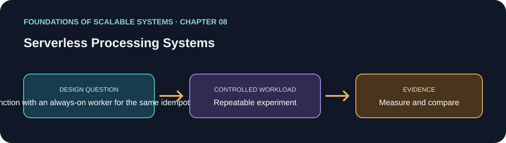

# 08. Serverless Processing Systems

> Chapter guide in the *Foundations of Scalable Systems* learning track. This repository guide paraphrases topics and proposes an independent practical exercise; it does not reproduce the book.

## Goal

Turn this chapter's design question into a small, repeatable experiment. The result is a comparison with stated assumptions, not a universal technology ranking.

## Chapter focus

Invocation lifecycle; autoscaling; cold starts; concurrency controls; throughput and cost parameters.

## Chapter synthesis

**Source reading: printed pages 147–161.** Original learning summary of the chapter's ideas; consult the book for full treatment. Provider limits and prices change over time, so treat numeric examples in the book as historical, not current service guarantees.

The chapter frames serverless as a response to variable demand: code is invoked on demand, the platform adds or removes execution instances, and billing is tied to requests, duration, selected resources, and sometimes warm capacity. That can reduce idle cost and infrastructure work, but it does not make compute free or remove cloud-specific constraints. The architecture must still account for stateless execution, managed state/services, provider lock-in, scaling limits, and budget safeguards.

Google App Engine Standard and AWS Lambda illustrate different execution models. App Engine routes HTTP requests to resident instances, may send multiple concurrent requests to an instance, and scales based on configured CPU, concurrent-request, and pending-latency targets. Minimum instances reduce first-request delay while costing more; maximum instances cap spend but can cause waiting or overload. Lambda invokes functions in runtime environments: an initial cold start includes loading code and initializing dependencies; a later invocation may reuse a warm environment. Provisioned concurrency trades cost for predictable startup. The chapter also highlights Lambda's memory setting as a coupled CPU/performance knob: a larger allocation can finish work faster enough to lower total cost, but only measurement can establish that for a workload. Concurrency quotas, ramp-up behavior, reserved capacity, and throttling shape burst handling and can couple multiple functions in one account/region.

The case study's central method is parameter study, not intuition. Select a small meaningful range for the important settings, hold the code and request mix constant, run each configuration with repeatable load and warm-up/cooldown, then compare throughput and cost together. A setting with peak throughput is not automatically the best choice; a slightly slower setting may meet the service objective at substantially lower spend. Serverless is strongest for bursty, intermittent, event-triggered, or short-lived work; long-running, highly utilized, latency-sensitive services may fit containers or VMs better. A hybrid design can keep a latency-critical API warm while sending bursty background work to functions or queues.

### Key takeaways

- Match serverless to workload shape and idle periods.
- Include startup, execution limits, external state, and downstream concurrency.
- Tune against measured throughput, latency, and cost.

### Coverage of chapter topics

- Pay-per-use cloud execution, autoscaling, operational benefits, cost drivers, and provider-specific constraints.
- App Engine Standard: resident instances, stateless routing, min/max instances, CPU/concurrency/pending-latency targets.
- Lambda: event/context handler, cold/warm lifecycle, dependency initialization, provisioned/reserved concurrency, memory-to-compute relationship, throttling and burst limits.
- Parameter studies: choose ranges, run controlled tests, and jointly assess throughput and cost instead of assuming defaults are optimal.

## Proposed application

- **Application / solution name:** `ServerlessThroughputCostLab`.
- **Namespace convention:** FoundationsOfScalableSystems.Chapter08
- **Independent solution folder:** solutions/08-serverless-processing-systems/
- **Current state:** learning guide and experiment design; implementation is not yet present.

## Practical exercise

Implement the same idempotent image-thumbnail or order-notification task in three shapes: (A) HTTP serverless function, (B) queue-triggered function, and (C) always-on .NET worker on Kubernetes. Use an object store or database as external state, and avoid relying on one invocation's local disk or memory for durable state.

1. Define service objectives for p95/p99 latency, error rate, maximum backlog age, and monthly spend; model both steady traffic and a sudden burst.
2. Add an idempotency key and durable external state so platform retries and duplicate events do not repeat side effects.
3. For each platform, vary one or two important controls (memory/CPU size, warm minimum, max concurrency/instances, batch size, or worker replicas) over a small matrix. Keep code, data, request mix, and test duration the same.
4. Include cold-start and warm runs, a burst that exceeds normal capacity, and a downstream database limit. Observe throttling and retry behavior rather than hiding it.
5. Compare cost per successful task and latency/error objectives, then record a chosen operating point and the conditions that would trigger retuning.

### Implementable solution choices

| Solution | Choose it when | Concrete shape | Main costs / caveats |
|---|---|---|---|
| Serverless HTTP API | Request volume is intermittent and each request is short/stateless | API Gateway/managed HTTP endpoint → function → managed database/cache | Cold starts, provider quotas, downstream connection storms, and vendor-specific packaging |
| Queue-triggered functions | Work can be asynchronous and bursts should be buffered | HTTP API + outbox → managed queue → function batch consumer → database/object store | Visibility/lease timeout and batch retry semantics; idempotency and poison-event DLQ are required |
| Kubernetes worker plus KEDA/HPA | Work is sustained or needs control over runtime, networking, and deployment | API/outbox → Kafka or queue → .NET worker Deployment scaled by CPU or lag → database | Cluster and broker operations remain; scaling must respect partition count and DB connection capacity |
| Hybrid warm front door + serverless background | User-facing latency and burst absorption have different needs | Always-warm API → durable queue → functions for fan-out/background processing | Two execution models and observability paths; explicit end-to-end correlation is needed |

Use a queue or concurrency cap to protect a database from sudden fan-out. Keep a warm minimum only when its latency benefit justifies its baseline cost. Set a hard maximum and alarms for spend, throttling, queue age, and downstream saturation.

## What to measure

Cold-start and warm p50/p95/p99 latency, throughput, active concurrency, throttles, retries, cost per successfully completed task, queue age/backlog recovery, and downstream saturation.

Report at least p50/p95/p99 latency, throughput, errors, CPU, memory, and behavior during one relevant failure. Mark any unmeasured claim as **Not measured**.

## Design review questions

- What is the bottleneck or quality attribute this design addresses?
- Which semantics must remain true under retry, restart, or partial failure?
- What new bottleneck or operational cost does the approach introduce?
- What result would make us reject this design?

## References

- Ian Gorton, *Foundations of Scalable Systems*, Chapter 08: “Serverless Processing Systems” — [O’Reilly chapter page](https://www.oreilly.com/library/view/foundations-of-scalable/9781098106058/ch08.html).
- Supporting primary documentation: [official reference](https://docs.aws.amazon.com/lambda/latest/dg/welcome.html).
- Repository-wide chapter map and implementation order: [Scalability roadmap](../../docs/SCALABILITY-ROADMAP-EN.md).

## Naming and independence

When implementation begins, keep this application's source, infrastructure, workload, and run instructions inside this folder. The namespace above is a proposed code namespace, not a Kubernetes namespace; choose a Kubernetes namespace from the same chapter slug only when this solution gets manifests. Do not share application code with another solution.
