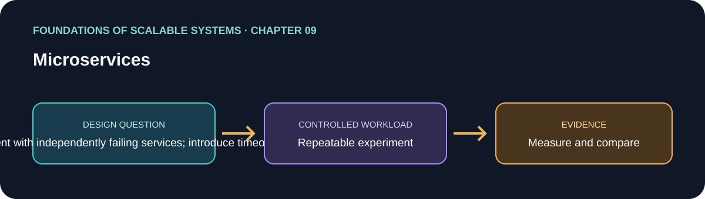

# فصل 09: Microservices

> راهنمای این فصل در مسیر یادگیری بر پایهٔ *Foundations of Scalable Systems*. موضوع‌ها به بیان خودمان خلاصه شده‌اند و تمرین پیشنهادی مستقل است؛ متن کتاب بازنشر نشده است.

## هدف

پرسش طراحی فصل را به آزمایشی کوچک و تکرارپذیر تبدیل کنیم. خروجی، مقایسه با فرض‌های روشن است؛ نه رتبه‌بندی همیشگی فناوری‌ها.

## محور فصل

تقسیم سرویس؛ مرز monolith؛ استقرار؛ تاب‌آوری؛ cascading failure و bulkhead.

## خلاصهٔ جامع فصل

**بخش متناظر در نسخهٔ PDF: صفحه‌های چاپی 163–181.** این جمع‌بندی با بیان خودمان نوشته شده است؛ برای شرح کامل به کتاب مراجعه کن.

فصل، microservice را با مرز قابلیت و مالکیت کسب‌وکار تعریف می‌کند، نه صرفاً کوچک بودن کد. در monolith، ماژول‌ها و گاهی دیتابیس مشترک در یک واحد قابل استقرارند: ساخت، تست، پایش و انتشار ساده است و می‌توان کل برنامه را بزرگ‌تر کرد یا پشت load balancer چند نسخه بالا آورد. اما با رشد کد و ترافیک، سرعت کار تیم ممکن است کم شود و حتی وقتی فقط یک قابلیت داغ است، باید کل برنامه تکثیر شود. microservice قابلیت منسجم را با API، داده، انتشار و scale مستقل نگه می‌دارد و به تیم اجازه می‌دهد ابزار داخلی مناسبش را انتخاب کند. این مزایا به قرارداد پایدار، خودکارسازی، مشاهده‌پذیری و مالکیت سازمانی نیاز دارند.

تقسیم‌بندی تصمیمی مهم است. bounded contextهای DDD نقطهٔ شروع خوبی‌اند، اما شکاف نظری تمیز ممکن است برای یک درخواست کاربر تماس‌های شبکه‌ای زیادی بسازد. هر تماس latency، شکست جزئی و هماهنگی اضافه می‌آورد؛ گاهی ادغام دو سرویس یا نگه‌داشتن نسخهٔ دادهٔ مناسب خواندن بهتر است. دادهٔ تکراری دسترسی محلی و سرعت می‌دهد، اما هزینهٔ فضا و منطق همگرا کردن تغییرات را دارد. برای workflow چندسرویسی، choreography اجازه می‌دهد سرویس‌ها مستقیم یا با پیام هماهنگ شوند؛ orchestration وضعیت و هماهنگی را به یک مؤلفهٔ مرکزی می‌سپارد. orchestration پیگیری روند را ساده می‌کند، اما می‌تواند گلوگاه یا نقطهٔ شکست باشد؛ choreography هماهنگ‌کنندهٔ مرکزی ندارد، ولی منطق جریان و عیب‌یابی را بین شرکت‌کننده‌ها پخش می‌کند.

API gateway یک نمای ثابت برای مشتری فراهم می‌کند تا سرویس‌های پشت آن بدون تغییر قرارداد بیرونی عوض شوند. می‌تواند درخواست را route/proxy کند، احراز هویت و مجوز انجام دهد، نرخ را محدود کند، cache داشته باشد و متریک استفاده/latency/خطا بدهد. خودش هم نگرانی scale و availability دارد؛ باید چندنسخه‌ای و اندازه‌گیری شود، نه این‌که فرض کنیم رایگان است. اصول سرویس در فصل شامل مرز مبتنی بر دامنه، مشاهده‌پذیری بالا، پنهان کردن جزئیات پشت قرارداد، انتشار مستقل، خودکارسازی و جداسازی خرابی است.

زیر بار، کندی یک وابستگی می‌تواند cascading failure بسازد. درخواست‌های منتظر thread و connectionهای سرویس‌های بالادست را اشغال می‌کنند؛ صف رشد می‌کند، deadline می‌گذرد و retry فوری بار را تشدید می‌کند. timeout را با tail latency اندازه‌گیری‌شده هماهنگ کن، هنگام اتمام ظرفیت fail-fast یا throttle کن و exponential backoff با jitter را فقط برای retry محدود و امن به‌کار ببر. circuit breaker وقتی وابستگی ناسالم است تماس‌ها را قطع می‌کند، در حالت half-open سلامت را آزمایش می‌کند و پس از موفقیت دوباره عبور می‌دهد. bulkhead بودجهٔ جدا برای concurrency/thread/connection می‌گذارد تا جهش یک مسیر، مسیرهای دیگر را گرسنه نکند. اگر معنای کسب‌وکار اجازه می‌دهد، پاسخ cacheشده یا پیش‌فرض می‌تواند خواندن را با کیفیت پایین‌تر زنده نگه دارد. متریک و log لازم است تا رد شدن، timeout و قطع circuit دیده شوند.

### نکته‌های کلیدی

- بر اساس مسئولیت منسجم و مالکیت تجزیه کن، نه مد روز.
- مرز شبکه timeout، مدیریت شکست و observability می‌خواهد.
- bulkhead دامنهٔ خرابی را کم می‌کند؛ هر سرویس عملیات بیشتری می‌آورد.

### پوشش موضوع‌های اصلی فصل

- مزیت‌ها و محدودیت‌های monolith؛ تجزیه بر اساس قابلیت کسب‌وکار، scale مستقل و bounded context.
- مالکیت داده، coupling سرویس، مصالحهٔ دادهٔ تکراری/read model و تفاوت orchestration با choreography.
- API gateway به‌عنوان نمای مشتری، شامل route، امنیت، rate limit، cache، telemetry و خطر گلوگاه شدن gateway.
- اصول سرویس: دامنهٔ منسجم، مشاهده‌پذیری، پنهان‌سازی جزئیات، جداسازی خرابی، استقرار مستقل و خودکارسازی.
- cascading failure، long-tail latency، timeout، fail-fast/throttling، retry امن/backoff، circuit breaker، fallback و bulkhead.

## برنامهٔ application پیشنهادی

- **نام application / راه‌حل:** `ServiceBoundaryResilienceLab`.
- **الگوی namespace کد:** FoundationsOfScalableSystems.Chapter09
- **پوشهٔ مستقل راه‌حل:** solutions/09-microservices/
- **وضعیت فعلی:** راهنمای یادگیری و طرح آزمایش؛ پیاده‌سازی کد هنوز اضافه نشده است.

## تمرین عملی

جریان checkout را در دو شکل بساز: monolith ماژولار، و سه سرویس Checkout، Inventory و Payment با دیتابیس و API تحت مالکیت خودشان و یک API gateway. ابتدا workflow را همزمان پیاده کن؛ بعد نسخهٔ ناهمزمان orchestrated با وضعیت پایدار و عملیات جبرانی بساز. صرفاً تعداد سرویس‌ها را زیاد نکن؛ مرزی را مقایسه کن که با مالکیت تیم و نقاط داغ ترافیک جور باشد.

۱. قرارداد API، مالک هر رکورد، وضعیت‌های workflow، بودجهٔ deadline/timeout و معنای نیمه‌تمام ماندن را تعریف کن.
۲. baseline monolith را ثبت کن. هر endpoint و وابستگی را جدا بسنج، بعد فقط یک قابلیت را مستقل replica کن و دوباره اندازه بگیر.
۳. کندی و شکست Inventory/Payment را تزریق کن. timeout محدود، rate limit، circuit breaker و سقف concurrency جدا اضافه کن؛ بررسی کن خواندن‌های نامرتبط پاسخ‌گو بمانند.
۴. retry را فقط برای عملیات idempotent اضافه کن. از idempotency key و جبران صریح مرحله‌های commitشده استفاده کن؛ پرداخت غیر idempotent را کورکورانه retry نکن.
۵. orchestration همزمان را با هماهنگی workflow پیام‌محور مقایسه کن و تکمیل end-to-end و پیچیدگی عملیات را کنار سرعت خام اندازه بگیر.

### انتخاب‌های راه‌حل قابل پیاده‌سازی

| راه‌حل | چه زمانی انتخابش کنیم | شکل اجرایی | هزینه‌ها و محدودیت‌ها |
|---|---|---|---|
| Modular monolith | مرز دامنه یا اندازهٔ تیم هنوز در حال تغییر است و عملیات کم می‌خواهیم | ماژول‌های ASP.NET Core با interface روشن → یک deployment → دیتابیس رابطه‌ای با schema تحت مالکیت ماژول | کل artifact با هم scale و منتشر می‌شود؛ مرز ماژول را enforce کن تا coupling جدولی ایجاد نشود |
| سرویس‌های مستقل همزمان | پاسخ فوری لازم است و مرز سرویس‌ها پایدار است | API Gateway → Checkout → APIهای Inventory/Payment؛ هر سرویس DB خود را دارد؛ deadline، timeout، breaker، bulkhead و fallback | tail latency چندمرحله‌ای؛ شکست جزئی و سازگاری داده باید صریح حل شوند |
| Workflow ناهمزمان orchestrated | مراحل checkout طولانی‌اند و دیدن/بازیابی روند مهم است | API و outbox → orchestrator/state machine → workerهای Inventory/Payment → API وضعیت پایدار؛ مرحله‌های idempotent و compensation | تکمیل نهایی با تأخیر و ذخیرهٔ وضعیت workflow؛ orchestrator باید HA و versioned باشد |
| Event choreography | سرویس‌ها باید مستقل به رویداد دامنه واکنش دهند و coupling قابل کنترل است | رویدادهای outbox → Kafka topics → consumer groupها projection محلی می‌سازند؛ correlation ID، idempotency و DLQ | منطق workflow پراکنده است؛ tracing، replay و تکامل schema نیازمند انضباط‌اند |

از ساده‌ترین شکل مطابق latency و مالکیت شروع کن. مرز سرویس را وقتی اضافه کن که مالکیت، scale یا انتشار مستقل ارزش قابل‌اندازه‌گیری دارد؛ fan-out همزمان را کم نگه دار و برای هر تماس راه‌دور بودجهٔ deadline و منابع مشخص کن.

## چه چیزهایی را اندازه بگیریم

latency سرتاسری p50/p95/p99، latency هر وابستگی، شمار تماس بین‌سرویسی، saturation، نرخ timeout/rejection، وضعیت breaker، رفتار شکست جزئی، استقلال deployment و blast radius.

حداقل p50/p95/p99 latency، throughput، خطا، CPU، حافظه و رفتار هنگام یک شکست مرتبط را گزارش کنیم. ادعای اندازه‌گیری‌نشده را با وضعیت **اندازه‌گیری نشده** مشخص کنیم.

## پرسش‌های بازبینی طراحی

- این طراحی کدام گلوگاه یا ویژگی کیفی را هدف می‌گیرد؟
- هنگام retry، restart یا شکست جزئی کدام معناها باید حفظ شوند؟
- چه گلوگاه یا هزینهٔ عملیاتی تازه‌ای ایجاد می‌شود؟
- چه نتیجه‌ای باعث رد کردن این طراحی می‌شود؟

## رفرنس‌ها

- Ian Gorton، *Foundations of Scalable Systems*، فصل 09: “Microservices” — [صفحهٔ فصل در O’Reilly](https://www.oreilly.com/library/view/foundations-of-scalable/9781098106058/ch09.html).
- مستندات فنی اولیه: [مرجع رسمی](https://learn.microsoft.com/en-us/azure/architecture/guide/architecture-styles/microservices).
- نقشهٔ فصل‌ها و ترتیب پیاده‌سازی مخزن: [نقشهٔ راه فارسی](../../docs/SCALABILITY-ROADMAP-FA.md).

## نام‌گذاری و استقلال

هنگام شروع پیاده‌سازی، کد، زیرساخت، workload و راهنمای اجرا را داخل همین پوشه نگه داریم. namespace بالا پیشنهاد برای namespace کد است، نه Kubernetes؛ namespace کوبرنتیز را از همان slug فصل انتخاب می‌کنیم وقتی manifestهای این راه‌حل اضافه شدند. کد application را با راه‌حل دیگر مشترک نکنیم.

