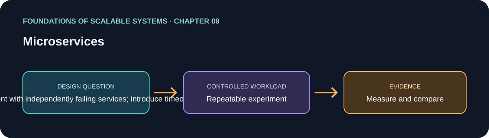

# 09. Microservices

> Chapter guide in the *Foundations of Scalable Systems* learning track. This repository guide paraphrases topics and proposes an independent practical exercise; it does not reproduce the book.

## Goal

Turn this chapter's design question into a small, repeatable experiment. The result is a comparison with stated assumptions, not a universal technology ranking.

## Chapter focus

Service decomposition; monolith boundaries; deployment; resilience; cascading failures; bulkheads.

## Chapter synthesis

**Source reading: printed pages 163–180.** Original learning summary of the chapter's listed ideas; consult the book for full treatment.

Microservices split an application into independently deployable services, but create network and operational costs. Boundaries should follow cohesive business capabilities and ownership; otherwise local complexity becomes fragile remote choreography. Independent release can help teams, while every remote call adds latency and partial failure. Resilience must prevent cascading failures; bulkheads isolate resources so one dependency cannot consume all capacity. Choose decomposition with team ownership and operational maturity in mind, not fashion.

### Key takeaways

- Decompose by cohesive ownership, not fashion.
- Network boundaries require timeout, failure handling, and observability.
- Bulkheads reduce blast radius; each service adds operational work.

### Coverage of chapter topics

- Why microservices emerged; monolithic systems and decomposition choices.
- Deployment and service design principles, including team/service boundaries.
- Resilience, cascading failures, and bulkheads to contain resource exhaustion.

## Proposed application

- **Application / solution name:** `ServiceBoundaryResilienceLab`.
- **Namespace convention:** FoundationsOfScalableSystems.Chapter09
- **Independent solution folder:** solutions/09-microservices/
- **Current state:** learning guide and experiment design; implementation is not yet present.

## Practical exercise

Compare a modular single deployment with independently failing services; introduce timeouts and bulkheads at boundaries.

1. Write down the operation, workload shape, data size, and correctness invariant.
2. Establish a simple baseline before adding the chapter's scaling technique.
3. Change one major design choice at a time and repeat the same workload.
4. Save raw results, environment details, versions, and the exact run command.

## What to measure

End-to-end latency, blast radius, deployment independence, cross-service calls, and partial-failure behavior.

Report at least p50/p95/p99 latency, throughput, errors, CPU, memory, and behavior during one relevant failure. Mark any unmeasured claim as **Not measured**.

## Design review questions

- What is the bottleneck or quality attribute this design addresses?
- Which semantics must remain true under retry, restart, or partial failure?
- What new bottleneck or operational cost does the approach introduce?
- What result would make us reject this design?

## References

- Ian Gorton, *Foundations of Scalable Systems*, Chapter 09: “Microservices” — [O’Reilly chapter page](https://www.oreilly.com/library/view/foundations-of-scalable/9781098106058/ch09.html).
- Supporting primary documentation: [official reference](https://learn.microsoft.com/en-us/azure/architecture/guide/architecture-styles/microservices).
- Repository-wide chapter map and implementation order: [Scalability roadmap](../../docs/SCALABILITY-ROADMAP-EN.md).

## Naming and independence

When implementation begins, keep this application's source, infrastructure, workload, and run instructions inside this folder. The namespace above is a proposed code namespace, not a Kubernetes namespace; choose a Kubernetes namespace from the same chapter slug only when this solution gets manifests. Do not share application code with another solution.
