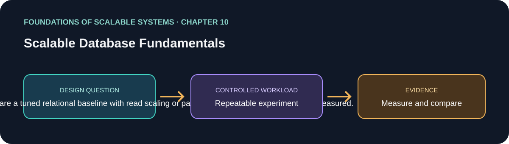

# فصل 10: مبانی پایگاه‌دادهٔ مقیاس‌پذیر

> راهنمای این فصل در مسیر یادگیری بر پایهٔ *Foundations of Scalable Systems*. موضوع‌ها به بیان خودمان خلاصه شده‌اند و تمرین پیشنهادی مستقل است؛ متن کتاب بازنشر نشده است.

## هدف

پرسش طراحی فصل را به آزمایشی کوچک و تکرارپذیر تبدیل کنیم. خروجی، مقایسه با فرض‌های روشن است؛ نه رتبه‌بندی همیشگی فناوری‌ها.

## محور فصل

scale-up/out رابطه‌ای؛ read replica؛ partitioning؛ مدل‌های NoSQL؛ توزیع و trade-offهای CAP.

## خلاصهٔ جامع فصل

**بخش متناظر در نسخهٔ PDF: صفحه‌های چاپی 185–204.** این جمع‌بندی با بیان خودمان نوشته شده است؛ برای شرح کامل به کتاب مراجعه کن.

فصل توضیح می‌دهد چرا مجموعه‌داده‌های بسیار بزرگ و متنوع موتورهای دیتابیس را به معماری توزیع‌شده سوق دادند و چرا یک شکل دیتابیس برای همهٔ workloadها نداریم. relational جایی قوی است که transaction، constraint، join و SQL منعطف لازم است. نخستین گام scale-up می‌تواند ماشین بزرگ‌تر باشد: نیاز به تغییر برنامه ندارد و از حافظه/ذخیره‌سازی مشترک بهره می‌گیرد، اما قیمت سخت‌افزار رشد می‌کند، یک node همچنان مرز خرابی است و رشد بالاخره به سقف می‌رسد. read replica راه رایج scale-out برای بار read-heavy است: write به primary می‌رود و با تأخیر به replicaها می‌رسد؛ بنابراین replica ممکن است دادهٔ کهنه بدهد. برنامه باید تعیین کند کدام read این تأخیر را می‌پذیرد و failover چگونه انجام می‌شود.

Partitioning مجموعه‌داده را بین پارتیشن‌ها یا nodeهای فیزیکی توزیع می‌کند. horizontal partitioning ردیف را بر اساس key/value/hash می‌فرستد؛ vertical partitioning ستون‌ها را جدا می‌کند، مثلاً دادهٔ کم‌تغییر را از دادهٔ پرتغییر. join رابطه‌ای بین پارتیشن‌ها می‌تواند انتقال شبکه‌ای و هماهنگی زیادی بخواهد. می‌توان جدول مرجع کوچک را روی همهٔ nodeها کپی کرد، join را روی partition key/index هم‌راستا کرد یا با فیلتر انتخابی حجم داده را کم کرد. معماری shared-everything مثل نمونهٔ Oracle RAC، موتورهای دیتابیس را روی ذخیره‌سازی و هماهنگی cache مشترک می‌نشاند، ولی به زیرساخت مشترک تخصصی وابسته است که ممکن است گران یا گلوگاه شود. shared-nothing به هر node پردازش و فضای خودش را می‌دهد و داده را توزیع می‌کند، ولی routing و پروتکل replication لازم دارد.

NoSQL در پی سخت‌افزار کالایی ارزان، نیاز availability اینترنتی، دادهٔ بدون ساختار و متغیر، و تحلیل‌های جدید رشد کرد. مصالحه‌های رایج آن مدل ساده‌تر و قابل تکامل، query وابسته به محصول، join عمومی محدودتر و توزیع افقی بومی است. مدل‌سازی از نرمال‌سازی دامنه برای joinهای منعطف به طراحی حول access patternهای شناخته‌شده می‌رود: رکورد denormalized و مناسب خواندن، read و shard را ساده می‌کند اما داده را تکرار می‌کند و update، صحت و همگرایی را پیچیده‌تر می‌سازد. فصل چهار مدل را جدا می‌کند: key-value (بازیابی با کلید)، document (query/index روی فیلدهای سند)، wide-column (ردیف کلیددار با ستون‌های منعطف) و graph (رابطه‌ها به‌عنوان دادهٔ اصلی). «schemaless» به معنی بی‌ساختار نیست؛ برنامه باید نسخه و فیلدها را بفهمد. schema-on-write و schema-on-read مسئولیت تعریف/کشف ساختار را در بخش‌های متفاوت می‌گذارند.

Sharding به کلیدی نیاز دارد که هم محل داده را پیدا کند و هم بار را پخش کند. hash معمولاً تعادل را بهتر می‌کند ولی locality بازه‌ای را دشوار؛ value یا range می‌تواند locality را حفظ کند ولی skew و hot partition بسازد. رابطه‌های graph و joinهای relational وقتی query از nodeها عبور می‌کند، partitioning را دشوار می‌کنند. replication با از دست رفتن node/partition دسترس‌پذیری را بازمی‌گرداند و گاهی read را scale می‌کند، اما انتخاب consistency را به همراه دارد. leader-follower نوشتن را به یک رهبر می‌فرستد و read را توزیع می‌کند؛ leaderless اجازهٔ دریافت درخواست به چند replica می‌دهد و برای همگرایی هماهنگ می‌کند. strong consistency ممکن است منتظر replicaها بماند؛ eventual consistency اجازه می‌دهد برخی replicaها عقب بمانند. CAP انتخاب‌های هنگام partition شبکه را می‌سنجد: سیستم می‌تواند برای حفظ نمای سازگار، بعضی عملیات را رد یا محدود کند (رفتار CP)، یا روی سمت‌های در دسترس قبول کند و بعداً همگرا شود (رفتار AP). CAP لنز یک وضعیت شکست است، نه طبقه‌بندی مطلق محصول یا گزینهٔ سومی که آزادانه به آن اضافه کنیم.

### نکته‌های کلیدی

- پیش از replica یا partition، baseline relational را بشناس.
- NoSQL را بر اساس مدل و الگوی دسترسی انتخاب کن.
- partition key توزیع و hot key را تعیین می‌کند؛ CAP دربارهٔ تضمین هنگام partition است.

### پوشش موضوع‌های اصلی فصل

- انگیزهٔ دادهٔ توزیع‌شده و scale-up، primary/read replica، partition افقی/عمودی و هزینهٔ join توزیع‌شده.
- clustering از نوع shared-everything (نمونهٔ RAC) در برابر shared-nothing.
- انگیزهٔ NoSQL، denormalization بر اساس access pattern، خانوادهٔ مدل‌ها (key-value، document، wide-column، graph) و مصالحهٔ schema/query.
- sharding از نوع hash، value و range؛ locality، skew، hot partition و دشواری توزیع graph/join.
- replication از نوع leader-follower و leaderless، strong/eventual consistency و رفتار CAP هنگام partition شبکه.

## برنامهٔ application پیشنهادی

- **نام application / راه‌حل:** `ScalableDatabaseFundamentalsLab`.
- **الگوی namespace کد:** FoundationsOfScalableSystems.Chapter10
- **پوشهٔ مستقل راه‌حل:** solutions/10-scalable-database-fundamentals/
- **وضعیت فعلی:** راهنمای یادگیری و طرح آزمایش؛ پیاده‌سازی کد هنوز اضافه نشده است.

## تمرین عملی

یک workload تراکنشی (مثلاً ساخت سفارش و خواندن تاریخچهٔ سفارش) را روی baseline PostgreSQL پیاده کن. برای بار read-heavy، read replica اضافه کن؛ بعد چیدمان relational پارتیشن‌شده و مدل document/key-value denormalized را برای همان queryهای مشخص مقایسه کن. نیاز محصول و dataset ثابت بمانند؛ دیتابیس‌ها را با schema و معنای query نامرتبط نسنج.

۱. عملیات خواندن/نوشتن، مرز transaction، indexها، رشد داده، consistency لازم پس از write و پنجرهٔ stale-read قابل‌قبول را فهرست کن.
۲. baseline تک-primary را tune و ثبت کن. فقط queryهایی را به read replica بفرست که تأخیر replication را می‌پذیرند؛ lag را اندازه بگیر و در صورت نیاز read-after-write را به primary بفرست.
۳. shard key پیشنهادی را از شرط‌های query واقعی و دسترسی tenant/aggregate انتخاب کن. قبل از تصمیم hash/range/value، skew و hot key را شبیه‌سازی کن.
۴. برای NoSQL رکوردها را حول همان use case بساز و فیلدهای تکراری، fan-out به‌روزرسانی و روش repair/rebuild را مستند کن.
۵. خرابی primary/replica و partition شبکه را آزمایش کن. ثبت کن کدام عملیات متوقف، رد یا stale می‌شوند و بررسی کن با قرارداد محصول هم‌خوان باشند.

### انتخاب‌های راه‌حل قابل پیاده‌سازی

| راه‌حل | چه زمانی انتخابش کنیم | شکل اجرایی | هزینه‌ها و محدودیت‌ها |
|---|---|---|---|
| PostgreSQL بزرگ‌تر + read replica | transaction و SQL مهم است؛ read غالب است و write هنوز در یک primary جا می‌شود | ASP.NET API → primary PostgreSQL برای write → read replica ناهمگام برای read امن؛ connection pool و routing آگاه از lag | primary سقف write است؛ replica ممکن است stale باشد؛ failover و runbook لازم است |
| relational پارتیشن‌شده | حجم داده/write از یک node بیشتر شده و partition key پایداری داریم | partition بر tenant/order key → query routing با key → index/join محلی؛ جدول مرجع کوچک تکثیر می‌شود | join/transaction بین پارتیشن پرهزینه است؛ skew و rebalancing دشوارند |
| read model از نوع document یا key-value | access pattern مشخص و محدود است و read کم‌تأخیر ارزش denormalization را دارد | PostgreSQL/outbox یا Kafka events → projection worker → MongoDB document یا رکورد Redis/Dynamo-style با کلید aggregate/user | eventual consistency، دادهٔ تکراری، rebuild و نسخه‌بندی schema؛ منبع حقیقت را روشن نگه دار |
| relational به‌همراه store تخصصی (polyglot) | گروه‌های workload نیاز ذخیره‌سازی متفاوت دارند | PostgreSQL منبع تراکنش → event stream → projectionهای search/document/cache/analytics | سامانه، pipeline، پایش، backup و reconciliation بیشتر؛ چند منبع حقیقت مستقل نساز |

read model یا partition را پس از اندازه‌گیری bottleneck اضافه کن. مسیر مهاجرت/rebuild داشته باش و پیش از انتقال readهای production صحت داده را بسنج.

## چه چیزهایی را اندازه بگیریم

latency هر query در p50/p95/p99، write throughput، replication lag، حجم/latency جابه‌جایی بین پارتیشن‌ها، skew کلید داغ، رشد storage/index، رفتار failover و هزینهٔ عملیات.

حداقل p50/p95/p99 latency، throughput، خطا، CPU، حافظه و رفتار هنگام یک شکست مرتبط را گزارش کنیم. ادعای اندازه‌گیری‌نشده را با وضعیت **اندازه‌گیری نشده** مشخص کنیم.

## پرسش‌های بازبینی طراحی

- این طراحی کدام گلوگاه یا ویژگی کیفی را هدف می‌گیرد؟
- هنگام retry، restart یا شکست جزئی کدام معناها باید حفظ شوند؟
- چه گلوگاه یا هزینهٔ عملیاتی تازه‌ای ایجاد می‌شود؟
- چه نتیجه‌ای باعث رد کردن این طراحی می‌شود؟

## رفرنس‌ها

- Ian Gorton، *Foundations of Scalable Systems*، فصل 10: “Scalable Database Fundamentals” — [صفحهٔ فصل در O’Reilly](https://www.oreilly.com/library/view/foundations-of-scalable/9781098106058/ch10.html).
- مستندات فنی اولیه: [مرجع رسمی](https://www.postgresql.org/docs/current/ddl-partitioning.html).
- نقشهٔ فصل‌ها و ترتیب پیاده‌سازی مخزن: [نقشهٔ راه فارسی](../../docs/SCALABILITY-ROADMAP-FA.md).

## نام‌گذاری و استقلال

هنگام شروع پیاده‌سازی، کد، زیرساخت، workload و راهنمای اجرا را داخل همین پوشه نگه داریم. namespace بالا پیشنهاد برای namespace کد است، نه Kubernetes؛ namespace کوبرنتیز را از همان slug فصل انتخاب می‌کنیم وقتی manifestهای این راه‌حل اضافه شدند. کد application را با راه‌حل دیگر مشترک نکنیم.

