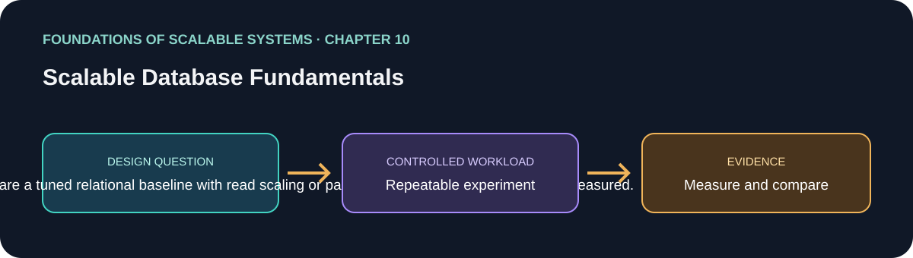

# 10. Scalable Database Fundamentals

> Chapter guide in the *Foundations of Scalable Systems* learning track. This repository guide paraphrases topics and proposes an independent practical exercise; it does not reproduce the book.

## Goal

Turn this chapter's design question into a small, repeatable experiment. The result is a comparison with stated assumptions, not a universal technology ranking.

## Chapter focus

Relational scale-up/out; read replicas; partitioning; NoSQL models; distribution; CAP trade-offs.

## Chapter synthesis

**Source reading: printed pages 185–203.** Original learning summary of the chapter's listed ideas; consult the book for full treatment.

Distributed databases add nodes for processing or storage, changing data access semantics. Relational systems can scale up, add read replicas, or partition data; each affects writes, routing, and cross-partition work. NoSQL includes distinct key-value, document, and other data models with different query and distribution choices. Data model and partition key determine workload spread and hot spots. CAP helps reason about behavior during network partitions; it is not a universal product score. Choose from access patterns, consistency needs, and failure behavior.

### Key takeaways

- Understand a relational baseline before adding replicas or partitions.
- Choose NoSQL by model and access pattern.
- Partition keys affect scale distribution and hot-key risk; CAP concerns partition-time guarantees.

## Proposed application

- **Application / solution name:** `ScalableDatabaseFundamentalsLab`.
- **Namespace convention:** FoundationsOfScalableSystems.Chapter10
- **Independent solution folder:** solutions/10-scalable-database-fundamentals/
- **Current state:** learning guide and experiment design; implementation is not yet present.

## Practical exercise

Keep one transactional workload constant; compare a tuned relational baseline with read scaling or partitioning only when a bottleneck is measured.

1. Write down the operation, workload shape, data size, and correctness invariant.
2. Establish a simple baseline before adding the chapter's scaling technique.
3. Change one major design choice at a time and repeat the same workload.
4. Save raw results, environment details, versions, and the exact run command.

## What to measure

Query latency, write throughput, replication lag, hot-key skew, storage growth, and operational cost.

Report at least p50/p95/p99 latency, throughput, errors, CPU, memory, and behavior during one relevant failure. Mark any unmeasured claim as **Not measured**.

## Design review questions

- What is the bottleneck or quality attribute this design addresses?
- Which semantics must remain true under retry, restart, or partial failure?
- What new bottleneck or operational cost does the approach introduce?
- What result would make us reject this design?

## References

- Ian Gorton, *Foundations of Scalable Systems*, Chapter 10: “Scalable Database Fundamentals” — [O’Reilly chapter page](https://www.oreilly.com/library/view/foundations-of-scalable/9781098106058/ch10.html).
- Supporting primary documentation: [official reference](https://www.postgresql.org/docs/current/ddl-partitioning.html).
- Repository-wide chapter map and implementation order: [Scalability roadmap](../../docs/SCALABILITY-ROADMAP-EN.md).

## Naming and independence

When implementation begins, keep this application's source, infrastructure, workload, and run instructions inside this folder. The namespace above is a proposed code namespace, not a Kubernetes namespace; choose a Kubernetes namespace from the same chapter slug only when this solution gets manifests. Do not share application code with another solution.
