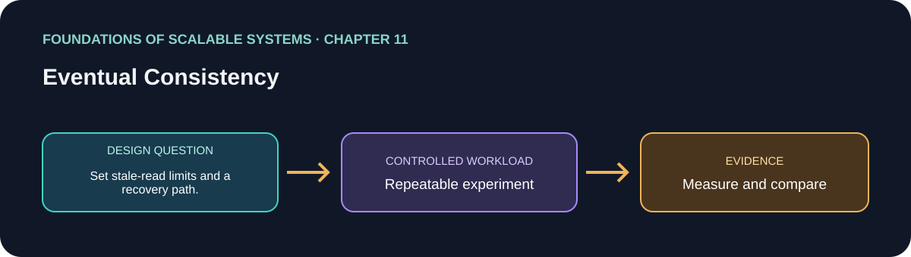

# فصل 11: سازگاری نهایی

> راهنمای این فصل در مسیر یادگیری بر پایهٔ *Foundations of Scalable Systems*. موضوع‌ها به بیان خودمان خلاصه شده‌اند و تمرین پیشنهادی مستقل است؛ متن کتاب بازنشر نشده است.

## هدف

پرسش طراحی فصل را به آزمایشی کوچک و تکرارپذیر تبدیل کنیم. خروجی، مقایسه با فرض‌های روشن است؛ نه رتبه‌بندی همیشگی فناوری‌ها.

## محور فصل

پنجرهٔ ناسازگاری؛ read-your-writes؛ consistency قابل تنظیم؛ quorum؛ ترمیم replica و حل تعارض.

## خلاصهٔ جامع فصل

**بخش متناظر در نسخهٔ PDF: صفحه‌های چاپی 205–222.** این جمع‌بندی با بیان خودمان نوشته شده است؛ برای شرح کامل به کتاب مراجعه کن.

Replication پایگاه‌داده را به یک سیستم توزیع‌شده تبدیل می‌کند: تأخیر شبکه، overload، خرابی و فاصلهٔ جغرافیایی باعث می‌شوند replicaها موقتاً متفاوت شوند. inconsistency window مدت رسیدن یک تغییر به همهٔ replicaهاست؛ هنگام شکست دلخواه حد بالای تضمین‌شده‌ای ندارد و با تعداد replica، بار و فاصله بیشتر می‌شود. این فقط جزئیات درون دیتابیس نیست؛ روی چیزی که کاربر می‌بیند اثر می‌گذارد. read-your-own-writes (RYOW) تضمین محدودتری است: پس از تغییر یک داده توسط کاربر، خواندن بعدی همان تغییر را می‌بیند، حتی اگر دیگران هنوز نسخهٔ قدیمی را ببینند. پیاده‌سازی ممکن است read را به leader بفرستد یا bookmark/version نوشتن را همراه read بعدی کند.

consistency قابل تنظیم انتخاب latency و تازگی را روشن می‌کند. برای N replica، مقدار W تعداد تأییدهای لازم برای write و R تعداد replicaهای خوانده‌شده پیش از پاسخ است. W بیشتر latency نوشتن را زیاد و هنگام قطع nodeها availability را کم می‌کند؛ R بیشتر هزینهٔ read را بالا می‌برد اما شانس یافتن نسخهٔ تازه‌تر را بیشتر می‌کند. quorum اکثریت است: (N/2)+1؛ اگر quorum خواندن و نوشتن هم‌پوشانی داشته باشند (R + W > N)، read می‌تواند به replicaای برسد که write موفق را دیده است. این تضمین به ترتیب نسخه و پیاده‌سازی quorum در خود دیتابیس وابسته است. sloppy quorum وقتی replica اصلی در دسترس نیست، write را روی node جایگزین می‌پذیرد؛ availability را بهتر می‌کند ولی تا زمان hinted handoff که داده را به replica اصلی برمی‌گرداند، read کهنه ممکن است.

miss شدن update، توقف node، خرابی دیسک/شبکه یا bug باعث drift replica می‌شود. active/read repair هنگام read نسخه‌ها را مقایسه و replica کهنه را اصلاح می‌کند؛ digest/hash read می‌تواند انتقال داده را کم کند. passive anti-entropy داده‌ها را دوره‌ای بررسی می‌کند؛ معمولاً از Merkle tree استفاده می‌شود تا شاخه‌های یکسان دوباره ارسال نشوند. repair، CPU و حافظه و شبکه و disk I/O مصرف می‌کند و باید با توجه به بار production زمان‌بندی یا محدود شود.

در نوشتن leaderless ممکن است دو کاربر همزمان یک key را تغییر دهند. last-writer-wins ساده است ولی timestamp ترتیب علّی واقعی را ثابت نمی‌کند: اختلاف ساعت می‌تواند برنده را تصادفی کند و تغییر معتبر دیگری را بی‌صدا حذف کند. کنترل version می‌تواند write کهنه را رد کند؛ version vector رابطهٔ علّی replicaها را ثبت می‌کند و «نسخه‌های هم‌زمان» را برای merge برنامه یا تصمیم کاربر آشکار می‌کند. CRDT برای نوع دادهٔ مناسب، قواعد merge دارد که با concurrency همگرا می‌شود (مثلاً counter/set) و کار دستی تعارض را کم می‌کند؛ اما فقط وقتی معناهای نوع داده با دامنه جور باشند. قرارداد عملی باید بگوید کدام فیلد ممکن است کهنه باشد، آیا کاربر RYOW لازم دارد، ویرایش همزمان چگونه ادغام می‌شود و چه داده‌ای نباید بی‌صدا overwrite شود.

### نکته‌های کلیدی

- سازگاری نهایی قرارداد قابل مشاهدهٔ برنامه است.
- quorum میان latency و تازگی هنگام خرابی trade-off دارد.
- حل تعارض باید نیت دامنه را حفظ کند، نه فقط timestamp را مقایسه کند.

### پوشش موضوع‌های اصلی فصل

- تأخیر انتشار replica و inconsistency window؛ read-your-writes با خواندن از leader/bookmark.
- consistency قابل تنظیم N/R/W، هم‌پوشانی quorum اکثریت، مصالحهٔ availability/latency، sloppy quorum و hinted handoff.
- read repair فعال و anti-entropy غیرفعال با Merkle tree.
- تعارض write همزمان، محدودیت last-writer-wins، version/version vector، sibling، merge برنامه و همگرایی CRDT.

## درس آموزشی

### هدف‌های یادگیری و نقشهٔ مفهومی

- inconsistency window و اثر آن را در UI و business workflow توضیح دهیم.
- consistency را متناسب با عملیات تنظیم و R/W/N را حساب کنیم.
- repair و conflict resolution را با هزینه و محدودیتشان طراحی کنیم.

`write → replica propagation → موقتاً چند نسخه → quorum/read policy → repair/convergence`

### اثر کاربر و RYOW

Replication به node دیگر دوام یا نزدیکی جغرافیایی می‌دهد، ولی انتقال فوری نیست. در این window، کاربر ممکن است مقدار قبلی را ببیند. Read-your-own-writes (RYOW) تضمین می‌کند همان کاربر بعد از نوشتن خودش مقدار جدید را بخواند؛ می‌توان read را موقتاً به leader فرستاد یا version token نوشتن را حفظ و replicaای را انتخاب کرد که آن version را دارد. RYOW به معنی تازگی برای همهٔ کاربران نیست.

### R/W/N و quorum

با N replica، W تعداد ack نوشتن و R تعداد پاسخ خواندن است. بزرگ‌ترکردن W معمولاً هزینه/latency write و مقاومت در برابر خرابی هم‌زمان را تغییر می‌دهد؛ R بزرگ‌تر read را پرهزینه‌تر و احتمال دیدن نسخهٔ تازه‌تر را زیاد می‌کند. شرط `R + W > N` در مدل quorum ساده overlap می‌دهد، اما به‌ترتیب نسخه، quorum membership و semantics واقعی موتور وابسته است؛ آن را تضمین عمومی برای هر دیتابیس ندان. Sloppy quorum ممکن است موقع خرابی روی node جایگزین بنویسد، سپس hinted handoff آن را برگرداند؛ این کار availability را بالا می‌برد ولی read کهنه/تعارض ممکن است.

### Convergence و تعارض

Read repair هنگام مشاهدهٔ replicaهای متفاوت ممکن است نسخهٔ کهنه را اصلاح کند. Anti-entropy دوره‌ای hash/Merkle tree را مقایسه می‌کند تا فقط بخش‌های متفاوت sync شوند. هر دو شبکه، CPU و disk مصرف می‌کنند. Last-write-wins ساده است اما clock skew می‌تواند update منطقی تازه‌تر را حذف کند. Version vector رابطهٔ causal را بهتر نشان می‌دهد ولی چند نسخهٔ concurrent را به application می‌دهد. CRDT فقط برای operation/data typeهایی مناسب است که merge آن‌ها با قواعد مشخص همیشه convergent باشد؛ هر فیلد دیتابیس را CRDT نکن.

### مثال UX

پس از تغییر سبد، API نسخهٔ `basketVersion=19` برمی‌گرداند. درخواست read بعدی همان نسخه را می‌فرستد. اگر replica فقط version 18 را دارد، سیستم می‌تواند از leader بخواند یا موقتاً انتظار دهد؛ نباید silently مقدار قدیمی را به کاربر نشان دهد اگر قرارداد RYOW دارد. برای dashboard عمومی شاید 1–2 ثانیه lag پذیرفتنی باشد.

### تصمیم و تمرین

| نوع داده/عملیات | consistency شروع | سنجه/ریسک |
| --- | --- | --- |
| گزارش عمومی | eventual | projection lag و age |
| سبد کاربر | RYOW | routing fallback و session version |
| موجودی برای commit | transaction/conditional write authoritative | oversell و contention |
| feed چندregion | tunable/quorum یا CRDT مناسب دامنه | conflict، network و repair cost |

تمرین: replica را با delay مصنوعی عقب بینداز، write انجام بده و read را از replica/leader مقایسه کن. رفتار UI را برای stale، unavailable و conflict تعریف و R/W/N را با شکست یک node بررسی کن.

## برنامهٔ application پیشنهادی

- **نام application / راه‌حل:** `EventualConsistencyRecoveryLab`.
- **الگوی namespace کد:** FoundationsOfScalableSystems.Chapter11
- **پوشهٔ مستقل راه‌حل:** solutions/11-eventual-consistency/
- **وضعیت فعلی:** راهنمای یادگیری و طرح آزمایش؛ پیاده‌سازی کد هنوز اضافه نشده است.

## تمرین عملی

یک مدل کوچک profile یا سبد خرید با primary/replica شبیه‌سازی‌شده بساز و بعد آن را با دیتابیسی که consistency قابل تنظیم دارد مقایسه کن. تأخیر انتشار و ویرایش همزمان را تزریق کن. هدف این است که قرارداد consistency قابل مشاهدهٔ کاربر را تعریف و آزمایش کنیم، نه این‌که الگوریتم replication جدیدی برای production بسازیم.

۱. یک رکورد، عملیات read/write، مدت stale قابل قبول، نیاز RYOW و رفتار تعارض هر فیلد قابل‌تغییر را تعریف کن.
۲. با N=3 ترکیب‌های W/R مثل (1,1)، (2,2)، (3,1) و (1,3) را تست کن؛ latency و نتیجه را در حالت عادی و وقتی یک replica قطع است ثبت کن.
۳. quorum معمولی را با sloppy quorum/hinted handoff مقایسه کن و زمان repair پس از بازگشت replica را بسنج.
۴. دو update همزمان را از یک نسخهٔ قدیمی بفرست. بررسی کن LWW یک ویرایش را حذف می‌کند یا نه، version vector sibling را نشان می‌دهد یا نه و merge دامنه/CRDT نتیجهٔ مورد انتظار می‌دهد یا نه.
۵. trace قطعی نگه دار تا همان interleaving و شکست دوباره اجرا شود؛ ترتیب علّی را فقط از timestamp ساعت دیواری نتیجه نگیر.

### انتخاب‌های راه‌حل قابل پیاده‌سازی

| راه‌حل | چه زمانی انتخابش کنیم | شکل اجرایی | هزینه‌ها و محدودیت‌ها |
|---|---|---|---|
| خواندن از leader برای RYOW و خواندن replica برای دادهٔ قابل‌تأخیر | کاربر باید بلافاصله تغییر خودش را ببیند ولی دیگران می‌توانند بعداً ببینند | write به leader → برگشت version/bookmark → read بعدی همان کاربر به leader می‌رود یا تا رسیدن replica صبر می‌کند؛ readهای دیگر از follower | read بیشتری روی leader می‌آید؛ session/bookmark و fallback باید طراحی شود |
| read/write از نوع quorum | بین تازگی، latency و availability داده‌های replicaشده trade-off لازم است | store با N replica و تنظیم R/W برای هر درخواست؛ هم‌پوشانی majority و شکست هنگام نبود quorum را آزمایش کن | latency بیشتر و شکست درخواست بدون quorum؛ sloppy quorum تازگی را ضعیف می‌کند |
| read model یا cache projection نهایی | UI یا analytics تأخیر را می‌پذیرد و write باید در دسترس بماند | تراکنش منبع حقیقت/outbox → event stream → projection هر view؛ updated-at/version و مسیر refresh/rebuild | هنگام خرابی طولانی زمان همگرایی تضمین نیست؛ duplicate، ترتیب و repair projection مهم‌اند |
| دادهٔ مشارکتی با تشخیص تعارض | ویرایش همزمان مستقل متداول است و باید ادغام شود | optimistic version token با پاسخ تعارض و UI ادغام، یا CRDT متناسب برای عملیات commutative | version vector/sibling یا semantics CRDT metadata و پیچیدگی می‌آورد؛ LWW برای تغییر مهم امن نیست |

برای موجودی، پرداخت یا ماندهٔ حساب، صرفاً به‌خاطر throughput سراغ معنای eventual نرو. invariantهای اصلی را در منبع تراکنشی نگه دار و viewهای کم‌حساسیت را ناهمگام projection کن.

## چه چیزهایی را اندازه بگیریم

staleness مشاهده‌شده و زمان همگرایی، موفقیت RYOW، نرخ شکست quorum، مدت/حجم repair، شمار تعارض و update ازدست‌رفته و availability هنگام partition.

حداقل p50/p95/p99 latency، throughput، خطا، CPU، حافظه و رفتار هنگام یک شکست مرتبط را گزارش کنیم. ادعای اندازه‌گیری‌نشده را با وضعیت **اندازه‌گیری نشده** مشخص کنیم.

## پرسش‌های بازبینی طراحی

- این طراحی کدام گلوگاه یا ویژگی کیفی را هدف می‌گیرد؟
- هنگام retry، restart یا شکست جزئی کدام معناها باید حفظ شوند؟
- چه گلوگاه یا هزینهٔ عملیاتی تازه‌ای ایجاد می‌شود؟
- چه نتیجه‌ای باعث رد کردن این طراحی می‌شود؟

## رفرنس‌ها

- Ian Gorton، *Foundations of Scalable Systems*، فصل 11: “Eventual Consistency” — [صفحهٔ فصل در O’Reilly](https://www.oreilly.com/library/view/foundations-of-scalable/9781098106058/ch11.html).
- مستندات فنی اولیه: [مرجع رسمی](https://cassandra.apache.org/doc/latest/cassandra/architecture/dynamo.html).
- نقشهٔ فصل‌ها و ترتیب پیاده‌سازی مخزن: [نقشهٔ راه فارسی](../../docs/SCALABILITY-ROADMAP-FA.md).

## نام‌گذاری و استقلال

هنگام شروع پیاده‌سازی، کد، زیرساخت، workload و راهنمای اجرا را داخل همین پوشه نگه داریم. namespace بالا پیشنهاد برای namespace کد است، نه Kubernetes؛ namespace کوبرنتیز را از همان slug فصل انتخاب می‌کنیم وقتی manifestهای این راه‌حل اضافه شدند. کد application را با راه‌حل دیگر مشترک نکنیم.

