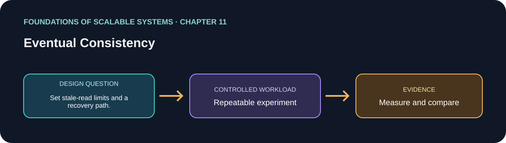

# 11. Eventual Consistency

> Chapter guide in the *Foundations of Scalable Systems* learning track. This repository guide paraphrases topics and proposes an independent practical exercise; it does not reproduce the book.

## Goal

Turn this chapter's design question into a small, repeatable experiment. The result is a comparison with stated assumptions, not a universal technology ranking.

## Chapter focus

Inconsistency windows; read-your-writes; tunable consistency; quorums; replica repair; conflict resolution.

## Chapter synthesis

**Source reading: printed pages 205–221.** Original learning summary of the chapter's listed ideas; consult the book for full treatment.

Eventual consistency permits temporary replica divergence while updates propagate. The inconsistency window shapes user-visible behavior; read-your-writes can provide a local guarantee without global immediate agreement. Tunable consistency and quorum reads/writes vary the number of participating replicas, affecting latency and freshness. Replica repair reconciles missed updates. Concurrent writes create conflicts: last-writer-wins is simple but may discard intent, while version vectors can reveal concurrency. Applications must define acceptable staleness and domain-correct conflict handling.

### Key takeaways

- Eventual consistency is an application-visible contract.
- Quorums trade latency and freshness under failure.
- Conflict handling must preserve domain intent, not just compare timestamps.

### Coverage of chapter topics

- Eventual consistency and the inconsistency window, including read-your-writes.
- Tunable consistency and quorum reads/writes; replica repair, active and passive.
- Conflict handling with last-writer-wins and version vectors, including their trade-offs.

## Proposed application

- **Application / solution name:** `EventualConsistencyRecoveryLab`.
- **Namespace convention:** FoundationsOfScalableSystems.Chapter11
- **Independent solution folder:** solutions/11-eventual-consistency/
- **Current state:** learning guide and experiment design; implementation is not yet present.

## Practical exercise

Simulate replicated reads and delayed updates; write down which stale reads the product can tolerate and how clients recover.

1. Write down the operation, workload shape, data size, and correctness invariant.
2. Establish a simple baseline before adding the chapter's scaling technique.
3. Change one major design choice at a time and repeat the same workload.
4. Save raw results, environment details, versions, and the exact run command.

## What to measure

Staleness duration, convergence time, conflict count, read-your-writes success, and availability during partition.

Report at least p50/p95/p99 latency, throughput, errors, CPU, memory, and behavior during one relevant failure. Mark any unmeasured claim as **Not measured**.

## Design review questions

- What is the bottleneck or quality attribute this design addresses?
- Which semantics must remain true under retry, restart, or partial failure?
- What new bottleneck or operational cost does the approach introduce?
- What result would make us reject this design?

## References

- Ian Gorton, *Foundations of Scalable Systems*, Chapter 11: “Eventual Consistency” — [O’Reilly chapter page](https://www.oreilly.com/library/view/foundations-of-scalable/9781098106058/ch11.html).
- Supporting primary documentation: [official reference](https://cassandra.apache.org/doc/latest/cassandra/architecture/dynamo.html).
- Repository-wide chapter map and implementation order: [Scalability roadmap](../../docs/SCALABILITY-ROADMAP-EN.md).

## Naming and independence

When implementation begins, keep this application's source, infrastructure, workload, and run instructions inside this folder. The namespace above is a proposed code namespace, not a Kubernetes namespace; choose a Kubernetes namespace from the same chapter slug only when this solution gets manifests. Do not share application code with another solution.
