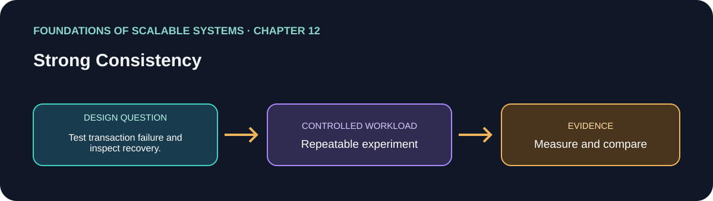

# فصل 12: سازگاری قوی

> راهنمای این فصل در مسیر یادگیری بر پایهٔ *Foundations of Scalable Systems*. موضوع‌ها به بیان خودمان خلاصه شده‌اند و تمرین پیشنهادی مستقل است؛ متن کتاب بازنشر نشده است.

## هدف

پرسش طراحی فصل را به آزمایشی کوچک و تکرارپذیر تبدیل کنیم. خروجی، مقایسه با فرض‌های روشن است؛ نه رتبه‌بندی همیشگی فناوری‌ها.

## محور فصل

مدل‌های consistency؛ تراکنش توزیع‌شده؛ 2PC؛ consensus؛ انتخاب رهبر و مصالحه‌های عملی.

## خلاصهٔ جامع فصل

**بخش متناظر در نسخهٔ PDF: صفحه‌های چاپی 223–244.** جمع‌بندی آموزشی با بیان تازه از ایده‌های فصل؛ برای شرح کامل به کتاب مراجعه کن.

سازگاری قوی عملیات را طبق مدل تعریف‌شده مرتب می‌کند و برخی استدلال‌های برنامه را ساده می‌سازد، اما هزینهٔ هماهنگی دارد. transaction توزیع‌شده مشارکت‌کننده‌ها را هماهنگ می‌کند؛ two-phase commit مرحلهٔ prepare و commit دارد اما هنگام خرابی ممکن است متوقف یا نیازمند بازیابی شود. consensus با فرض‌های روشن توافق می‌سازد؛ Raft از leader و log تکثیرشده استفاده می‌کند، پس انتخاب leader و پیشروی log روی latency و availability اثر دارند. VoltDB و Spanner نمونه‌هایی با سازوکارهای متفاوت‌اند. پیش از انتخاب، invariant، فرض شکست، دامنهٔ transaction و بودجهٔ latency را مشخص کن.

### نکته‌های کلیدی

- مدل consistency و invariant را دقیق تعریف کن.
- بازیابی two-phase commit و فرض‌های consensus را بشناس.
- هماهنگی را جایی به‌کار ببر که صحت لازم دارد و هزینهٔ آن را بسنج.

## برنامهٔ application پیشنهادی

- **نام application / راه‌حل:** `StrongConsistencyTransactionLab`.
- **الگوی namespace کد:** FoundationsOfScalableSystems.Chapter12
- **پوشهٔ مستقل راه‌حل:** solutions/12-strong-consistency/
- **وضعیت فعلی:** راهنمای یادگیری و طرح آزمایش؛ پیاده‌سازی کد هنوز اضافه نشده است.

## تمرین عملی

Compare a single-database transaction with a distributed transaction scenario; force participant failure and inspect recovery.

۱. عملیات، شکل بار، اندازهٔ داده و invariant صحت را بنویسیم.
۲. قبل از افزودن تکنیک مقیاس‌دهی، baseline ساده بسازیم.
۳. هر بار فقط یک انتخاب اصلی را تغییر دهیم و همان workload را تکرار کنیم.
۴. نتیجهٔ خام، مشخصات محیط، نسخه‌ها و فرمان دقیق اجرا را نگه داریم.

## چه چیزهایی را اندازه بگیریم

Commit latency, abort rate, lock duration, availability during failure, and invariant violations.

حداقل p50/p95/p99 latency، throughput، خطا، CPU، حافظه و رفتار هنگام یک شکست مرتبط را گزارش کنیم. ادعای اندازه‌گیری‌نشده را با وضعیت **اندازه‌گیری نشده** مشخص کنیم.

## پرسش‌های بازبینی طراحی

- این طراحی کدام گلوگاه یا ویژگی کیفی را هدف می‌گیرد؟
- هنگام retry، restart یا شکست جزئی کدام معناها باید حفظ شوند؟
- چه گلوگاه یا هزینهٔ عملیاتی تازه‌ای ایجاد می‌شود؟
- چه نتیجه‌ای باعث رد کردن این طراحی می‌شود؟

## رفرنس‌ها

- Ian Gorton، *Foundations of Scalable Systems*، فصل 12: “Strong Consistency” — [صفحهٔ فصل در O’Reilly](https://www.oreilly.com/library/view/foundations-of-scalable/9781098106058/ch12.html).
- مستندات فنی اولیه: [مرجع رسمی](https://raft.github.io/raft.pdf).
- نقشهٔ فصل‌ها و ترتیب پیاده‌سازی مخزن: [نقشهٔ راه فارسی](../../docs/SCALABILITY-ROADMAP-FA.md).

## نام‌گذاری و استقلال

هنگام شروع پیاده‌سازی، کد، زیرساخت، workload و راهنمای اجرا را داخل همین پوشه نگه داریم. namespace بالا پیشنهاد برای namespace کد است، نه Kubernetes؛ namespace کوبرنتیز را از همان slug فصل انتخاب می‌کنیم وقتی manifestهای این راه‌حل اضافه شدند. کد application را با راه‌حل دیگر مشترک نکنیم.

