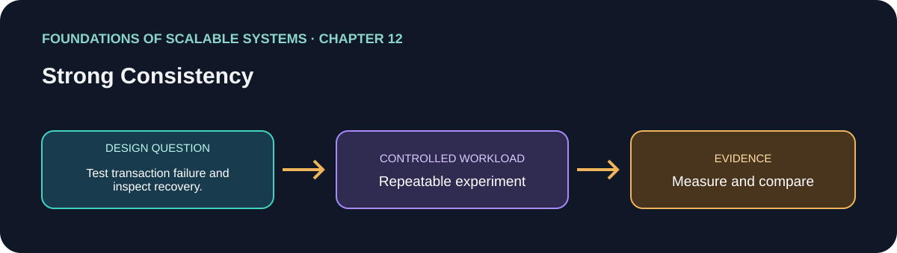

# 12. Strong Consistency

> Chapter guide in the *Foundations of Scalable Systems* learning track. This repository guide paraphrases topics and proposes an independent practical exercise; it does not reproduce the book.

## Goal

Turn this chapter's design question into a small, repeatable experiment. The result is a comparison with stated assumptions, not a universal technology ranking.

## Chapter focus

Consistency models; distributed transactions; two-phase commit; consensus; leader election; practical trade-offs.

## Chapter synthesis

**Source reading: printed pages 223–245.** Original learning summary of the chapter's ideas; consult the book for full treatment.

The chapter separates two ideas often both called “strong consistency.” Transactional consistency means a multi-object transaction preserves its business invariant atomically; replica consistency means clients see the same committed value regardless of replica. ACID transactions provide atomicity, business-defined consistency, isolation, and durability. Serializability makes concurrent transactions equivalent to some serial order; linearizability additionally respects real-time order for operations on an object. Combining serializability and linearizability gives strict serializability/external consistency, but requires coordination.

Two-phase commit (2PC) coordinates a distributed transaction: participants first prepare and promise they can commit, then the coordinator announces commit or abort. A participant failure can be recovered from logs, but a coordinator failure after participants prepare can block participants while they retain locks and wait for the decision. This hurts availability and can cascade into upstream timeouts. Replicating coordinator state and recovering it requires consensus, not just retries.

Replica consensus orders updates identically at replicas. Raft is a leader-based replicated-log algorithm: the leader orders client writes, followers persist log entries, and a majority quorum commits them. Heartbeats detect a missing leader; candidates use terms, log freshness, and majority votes to elect one leader. Quorum availability lets the system continue through some node failures, but losing the majority prevents progress. Replication and leader election add network round trips and can pause writes during recovery; Raft/Paxos solve agreement under assumptions, not arbitrary permanent partitions.

The examples show different ways to reduce or manage coordination. VoltDB maps partitions to CPU cores and serializes stored procedures per partition; single-partition transactions avoid cross-partition 2PC, while multi-partition work is more expensive. Its in-memory design requires command logs and snapshots for durability. Spanner partitions tables into replicated key-range splits, uses Paxos per replica group and 2PC across splits, and combines commit timestamps with a bounded-error time service and commit-wait to provide external consistency. Strong guarantees reduce application-level stale-read/conflict handling, but the database pays with coordination, locking, latency, and operational complexity. Keep strongly consistent transactions narrow and align partition keys with common transaction boundaries when possible.

### Key takeaways

- Specify the consistency model and invariant precisely.
- Know two-phase commit recovery behavior and consensus assumptions.
- Use coordination where correctness requires it and account for availability and latency costs.

### Coverage of chapter topics

- ACID, serializability, linearizability, and strict/external consistency.
- Distributed transactions with 2PC prepare/resolve, participant recovery, and coordinator blocking/lock consequences.
- Consensus safety/liveness, replicated state-machine logs, Raft terms/quorums/election, and Paxos context.
- VoltDB single-partition versus multi-partition transactions, and Spanner split replication, Paxos, 2PC, and commit-wait.

## Proposed application

- **Application / solution name:** `StrongConsistencyTransactionLab`.
- **Namespace convention:** FoundationsOfScalableSystems.Chapter12
- **Independent solution folder:** solutions/12-strong-consistency/
- **Current state:** learning guide and experiment design; implementation is not yet present.

## Practical exercise

Build an inventory reservation plus order-placement operation. Compare a single PostgreSQL ACID transaction, a distributed SQL transaction spanning two partitions, and an explicit asynchronous saga/outbox alternative. Preserve the same invariant: accepted orders never reserve more units than available and an order must not be reported paid unless the payment step succeeded.

1. Define transaction scope, isolation level, partition key, and the precise invariant before choosing a database.
2. Run concurrent reservations against one key and across partition keys; verify no oversell and compare single-partition/multipartition latency.
3. Inject participant/node failure before prepare, after prepare, and during commit. Observe lock retention, retry behavior, resolution, and client-visible outcome.
4. Compare successful latency and throughput with time-to-recover and availability during a lost quorum. Retry requests with idempotency keys.
5. For the saga option, persist each step and compensation, make every step idempotent, and expose pending/failed state rather than pretending the entire flow is one ACID transaction.

### Implementable solution choices

| Solution | Choose it when | Concrete shape | Main costs / caveats |
|---|---|---|---|
| Single relational transaction | Invariants fit one database and request volume fits one primary | .NET API → PostgreSQL transaction that reserves inventory and inserts order/payment intent atomically | Simplest correctness; scale/write ceiling and primary availability remain |
| Distributed SQL transaction | One atomic invariant spans partitions or regions and stale/partial results are unacceptable | CockroachDB/YugabyteDB/Cloud Spanner style SQL transaction; partition by order/tenant where possible; keep cross-partition work limited | Consensus and 2PC add latency; quorum loss blocks writes; vendor and cloud costs |
| Asynchronous saga with outbox | Workflow crosses independent services/providers and eventual completion is acceptable | Order DB + outbox → orchestrator → inventory reservation → payment authorization → confirm; compensations release/void on failure | Not one ACID transaction; pending states, timeout recovery, idempotency, and reconciliation are required |

Use a distributed transaction only when the invariant truly spans its participants and the latency/availability budget allows it. Otherwise, a local transaction plus explicit asynchronous workflow is easier to operate.

## What to measure

Commit latency by partition count, abort/retry rate, lock duration, time blocked during coordinator/leader failure, quorum availability, recovery time, and invariant violations.

Report at least p50/p95/p99 latency, throughput, errors, CPU, memory, and behavior during one relevant failure. Mark any unmeasured claim as **Not measured**.

## Design review questions

- What is the bottleneck or quality attribute this design addresses?
- Which semantics must remain true under retry, restart, or partial failure?
- What new bottleneck or operational cost does the approach introduce?
- What result would make us reject this design?

## References

- Ian Gorton, *Foundations of Scalable Systems*, Chapter 12: “Strong Consistency” — [O’Reilly chapter page](https://www.oreilly.com/library/view/foundations-of-scalable/9781098106058/ch12.html).
- Supporting primary documentation: [official reference](https://raft.github.io/raft.pdf).
- Repository-wide chapter map and implementation order: [Scalability roadmap](../../docs/SCALABILITY-ROADMAP-EN.md).

## Naming and independence

When implementation begins, keep this application's source, infrastructure, workload, and run instructions inside this folder. The namespace above is a proposed code namespace, not a Kubernetes namespace; choose a Kubernetes namespace from the same chapter slug only when this solution gets manifests. Do not share application code with another solution.
