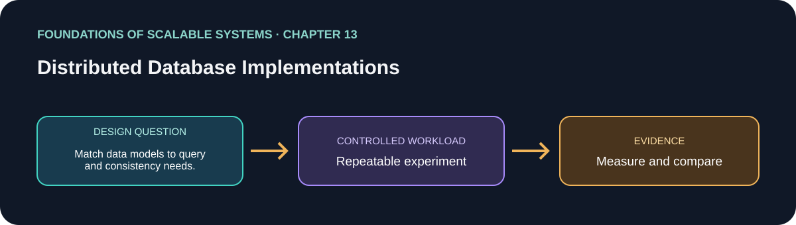

# فصل 13: پیاده‌سازی‌های پایگاه‌دادهٔ توزیع‌شده

> راهنمای این فصل در مسیر یادگیری بر پایهٔ *Foundations of Scalable Systems*. موضوع‌ها به بیان خودمان خلاصه شده‌اند و تمرین پیشنهادی مستقل است؛ متن کتاب بازنشر نشده است.

## هدف

پرسش طراحی فصل را به آزمایشی کوچک و تکرارپذیر تبدیل کنیم. خروجی، مقایسه با فرض‌های روشن است؛ نه رتبه‌بندی همیشگی فناوری‌ها.

## محور فصل

مدل داده و API؛ توزیع و replication؛ نقاط قوت و محدودیت Redis، MongoDB و DynamoDB.

## خلاصهٔ جامع فصل

**بخش متناظر در نسخهٔ PDF: صفحه‌های چاپی 247–267.** جمع‌بندی آموزشی با بیان تازه از ایده‌های فصل؛ برای شرح کامل به کتاب مراجعه کن.

فصل Redis، MongoDB و DynamoDB را از نظر مدل داده و API، توزیع و replication و قوت و ضعف ناشی از آن‌ها مقایسه می‌کند. این‌ها جایگزین مستقیم نیستند: هرکدام الگوی دسترسی متفاوتی را مناسب می‌کنند و دربارهٔ persistence، partitioning، consistency و عملیات تصمیم‌های متفاوت دارند. قابلیت محصول فقط در نسبت با نیاز برنامه معنا دارد. مقایسهٔ درست رفتار را ثابت نگه می‌دارد، دوام و consistency را مشخص می‌کند، key و index مناسب می‌چیند و شکست و بازیابی را هم می‌سنجد، نه فقط عدد throughput را.

### نکته‌های کلیدی

- پیش از مقایسه، عملیات را به مدل بومی هر دیتابیس نگاشت کن.
- persistence، replication، recovery و پیچیدگی عملیات را بسنج.
- workload و semantics معادل پیش‌شرط benchmark مفید است.

## برنامهٔ application پیشنهادی

- **نام application / راه‌حل:** `DistributedDatabaseModelComparisonLab`.
- **الگوی namespace کد:** FoundationsOfScalableSystems.Chapter13
- **پوشهٔ مستقل راه‌حل:** solutions/13-distributed-database-implementations/
- **وضعیت فعلی:** راهنمای یادگیری و طرح آزمایش؛ پیاده‌سازی کد هنوز اضافه نشده است.

## تمرین عملی

Implement the same use case only where each data model fits; state index, partition key, durability, query, and consistency requirements.

۱. عملیات، شکل بار، اندازهٔ داده و invariant صحت را بنویسیم.
۲. قبل از افزودن تکنیک مقیاس‌دهی، baseline ساده بسازیم.
۳. هر بار فقط یک انتخاب اصلی را تغییر دهیم و همان workload را تکرار کنیم.
۴. نتیجهٔ خام، مشخصات محیط، نسخه‌ها و فرمان دقیق اجرا را نگه داریم.

## چه چیزهایی را اندازه بگیریم

Operation latency, throughput, index/write amplification, hot partitions, failover, and cost.

حداقل p50/p95/p99 latency، throughput، خطا، CPU، حافظه و رفتار هنگام یک شکست مرتبط را گزارش کنیم. ادعای اندازه‌گیری‌نشده را با وضعیت **اندازه‌گیری نشده** مشخص کنیم.

## پرسش‌های بازبینی طراحی

- این طراحی کدام گلوگاه یا ویژگی کیفی را هدف می‌گیرد؟
- هنگام retry، restart یا شکست جزئی کدام معناها باید حفظ شوند؟
- چه گلوگاه یا هزینهٔ عملیاتی تازه‌ای ایجاد می‌شود؟
- چه نتیجه‌ای باعث رد کردن این طراحی می‌شود؟

## رفرنس‌ها

- Ian Gorton، *Foundations of Scalable Systems*، فصل 13: “Distributed Database Implementations” — [صفحهٔ فصل در O’Reilly](https://www.oreilly.com/library/view/foundations-of-scalable/9781098106058/ch13.html).
- مستندات فنی اولیه: [مرجع رسمی](https://www.mongodb.com/docs/manual/sharding/).
- نقشهٔ فصل‌ها و ترتیب پیاده‌سازی مخزن: [نقشهٔ راه فارسی](../../docs/SCALABILITY-ROADMAP-FA.md).

## نام‌گذاری و استقلال

هنگام شروع پیاده‌سازی، کد، زیرساخت، workload و راهنمای اجرا را داخل همین پوشه نگه داریم. namespace بالا پیشنهاد برای namespace کد است، نه Kubernetes؛ namespace کوبرنتیز را از همان slug فصل انتخاب می‌کنیم وقتی manifestهای این راه‌حل اضافه شدند. کد application را با راه‌حل دیگر مشترک نکنیم.

