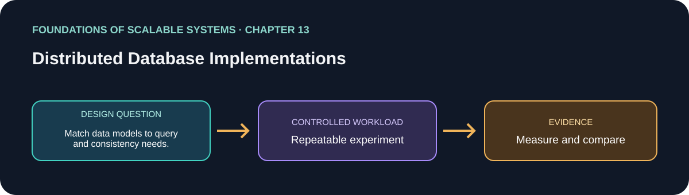

# 13. Distributed Database Implementations

> Chapter guide in the *Foundations of Scalable Systems* learning track. This repository guide paraphrases topics and proposes an independent practical exercise; it does not reproduce the book.

## Goal

Turn this chapter's design question into a small, repeatable experiment. The result is a comparison with stated assumptions, not a universal technology ranking.

## Chapter focus

Data models and APIs; distribution and replication; strengths and limits of Redis, MongoDB, and DynamoDB.

## Chapter synthesis

**Source reading: printed pages 247–268.** Original learning summary of the chapter's ideas; consult the book for full treatment. Product versions and managed-service limits change; check current vendor documentation before implementation.

The chapter compares Redis, MongoDB, and DynamoDB by implementation rather than product labels. Similar-sounding features can behave differently, so evaluate the exact data model, durability, partitioning, replication, consistency, failure recovery, and cost that your application relies on.

Redis is an in-memory key-value/data-structure store with string, list, set/sorted-set, and hash primitives. Single-key operations are atomic; MULTI/EXEC serializes a command group, but it has no rollback and is not a full ACID transaction. Snapshots and append-only files (AOF) improve recovery at write/latency cost. Redis Cluster distributes keys through hash slots; multi-key operations need keys co-located in one slot (hash tags can achieve that). Replication is asynchronous; WAIT can wait for replica acknowledgements but does not guarantee replica disk durability. Failover can promote a replica that has not received every write, so data loss is possible. Redis is excellent for low-latency cache, counters, ephemeral/session data, and carefully chosen fast state, but the chapter cautions against treating it as the sole durable source for irreplaceable data without evaluating its persistence and failover guarantees.

MongoDB stores BSON documents in collections, supports nested data and indexes, and makes one-document writes atomic. Denormalizing related fields into one document can avoid multi-document coordination, while transactions support operations spanning documents with additional cost and isolation details. Sharding by a hash or range shard key routes work through mongos; poor keys create skew and hotspots, and cross-shard queries cost more. Replica sets use a primary/oplog and secondaries; elections restore a primary after failure. Write concern controls acknowledgement durability, and read preference trades freshness for locality/scale. It is a flexible fit for evolving document-shaped business data, provided schema evolution, shard key design, and consistency behavior are deliberate.

DynamoDB is a managed key-value/document service organized around partition and optional sort keys, secondary indexes, and bounded items. The access pattern should drive the key/index design; batches reduce round trips, while transactions span items with capacity and coordination cost. The service hides shard placement and replication; default reads can be eventually consistent, while strongly consistent reads cost more and are regional. Global tables replicate asynchronously across regions and can resolve concurrent writes with last-writer-wins, so cross-region conflicts and transactions need special care. Adaptive capacity helps balanced traffic, but hot keys can still cap throughput or cause throttling. AWS integration and managed operations are strengths, while provider coupling, capacity/cost modeling, and key design are major considerations.

The useful outcome is a proof-of-technology comparison, not a universal ranking. Match each candidate to the same operations and correctness contract; measure normal and failure behavior. Keep a relational or other durable source of truth where the business requires it, and use Redis or document/key-value projections where their lower-latency access pattern justifies the additional synchronization/rebuild path.

### Key takeaways

- Map operations to each database’s native model before comparing.
- Include persistence, replication, recovery, and operational complexity.
- Equivalent workload and semantics are prerequisites for a useful benchmark.

### Coverage of chapter topics

- Redis data structures, snapshot/AOF persistence, hash slots, same-slot multi-key constraint, asynchronous replication and WAIT/failover trade-offs.
- MongoDB BSON documents, atomic document updates, multi-document transactions, shard keys/mongos/chunk migration, replica sets, write concern and read preference.
- DynamoDB partition/sort keys, secondary indexes, batches/transactions, managed replication, strong/eventual reads, global tables and hot-key/capacity behavior.
- Comparative due diligence: test the exact guarantee, workload, recovery and cost rather than assuming similar feature names are equivalent.

## Proposed application

- **Application / solution name:** `DistributedDatabaseModelComparisonLab`.
- **Namespace convention:** FoundationsOfScalableSystems.Chapter13
- **Independent solution folder:** solutions/13-distributed-database-implementations/
- **Current state:** learning guide and experiment design; implementation is not yet present.

## Practical exercise

Implement a product-catalog and user-cart workload across PostgreSQL (system of record), Redis (hot cart/session/cache), MongoDB (document catalog), and DynamoDB (keyed access-pattern model). Do not force one query into every database if it violates that database's natural model; document where a solution is a projection rather than the canonical record.

1. Define canonical records, read/write operations, freshness requirements, failure semantics, and which data loss is unacceptable.
2. Design each native key/index/shard key from the query set; include hot-key and skewed-tenant cases.
3. Implement the same API behavior and deterministic dataset; mark cache/document/table copies as projections and define rebuild/reconciliation.
4. Test restart, primary failover, stale replica reads, a hot key, and concurrent updates. Confirm which operations can return stale values or lose acknowledged writes under the chosen settings.
5. Compare latency, throughput, infrastructure cost, backup/recovery effort, and engineering complexity; make no claim from a single happy-path run.

### Implementable solution choices

| Solution | Choose it when | Concrete shape | Main costs / caveats |
|---|---|---|---|
| PostgreSQL + Redis cache | Strong transactional truth is needed with very hot repeated reads | PostgreSQL source → cache-aside Redis keyed by entity; version/invalidation event; TTL and cache-miss fallback | Cache invalidation, stampede protection, warmup; Redis must not silently become the only durable copy |
| MongoDB document service | Reads naturally fetch a cohesive, nested aggregate that changes as a unit | .NET API → BSON document per catalog item/aggregate; indexes for required filters; replica set then shard on measured access key | Document growth and multi-document transactions; shard-key skew and cross-shard query cost |
| DynamoDB access-pattern table | AWS-managed key lookup/scale is preferred and query patterns are known | Partition key + sort key model per use case; GSIs for alternate queries; on-demand or provisioned capacity; conditional/idempotent writes | Hot partitions, capacity throttling/cost, AWS lock-in; global-table conflict and regional transaction scope |
| Polyglot projections | One source of truth serves transactions while specialized reads need low latency/search | PostgreSQL + outbox/Kafka → Redis hot views, MongoDB documents or search index; versioned projection and replay | Multiple stores and consistency lag; projection rebuild, schema migration, observability and reconciliation are mandatory |

Start with the simplest authoritative database that meets the invariant. Add a cache or projection only for a measured query class, and retain an idempotent rebuild path from the source of truth.

## What to measure

Operation p50/p95/p99, throughput, index/write amplification, hot-key skew/throttling, acknowledged-write loss window, failover and recovery duration, backup restore time, and total service/engineering cost.

Report at least p50/p95/p99 latency, throughput, errors, CPU, memory, and behavior during one relevant failure. Mark any unmeasured claim as **Not measured**.

## Design review questions

- What is the bottleneck or quality attribute this design addresses?
- Which semantics must remain true under retry, restart, or partial failure?
- What new bottleneck or operational cost does the approach introduce?
- What result would make us reject this design?

## References

- Ian Gorton, *Foundations of Scalable Systems*, Chapter 13: “Distributed Database Implementations” — [O’Reilly chapter page](https://www.oreilly.com/library/view/foundations-of-scalable/9781098106058/ch13.html).
- Supporting primary documentation: [official reference](https://www.mongodb.com/docs/manual/sharding/).
- Repository-wide chapter map and implementation order: [Scalability roadmap](../../docs/SCALABILITY-ROADMAP-EN.md).

## Naming and independence

When implementation begins, keep this application's source, infrastructure, workload, and run instructions inside this folder. The namespace above is a proposed code namespace, not a Kubernetes namespace; choose a Kubernetes namespace from the same chapter slug only when this solution gets manifests. Do not share application code with another solution.
