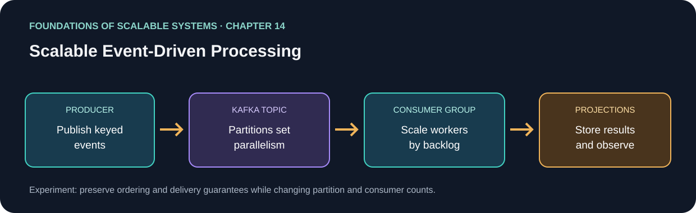

<div dir="rtl" align="right">

# فصل ۱۴: Scalable Event-Driven Processing | پردازش رویدادمحور مقیاس‌پذیر



**مبنای فصل:** Ian Gorton، *Foundations of Scalable Systems*، فصل ۱۴، [صفحهٔ رسمی فصل در O’Reilly](https://www.oreilly.com/library/view/foundations-of-scalable/9781098106058/ch14.html). متن زیر خلاصه و آموزش مستقل با بیان تازه است؛ جایگزین متن کامل کتاب نیست.

## هدف‌های یادگیری

- معماری رویدادمحور را از فراخوانی synchronous و queueهای حذف‌شونده متمایز کنیم.
- topic، partition، key، producer، consumer group، replication و offset را در یک جریان end-to-end توضیح دهیم.
- برای ترتیب، دوام، replay، duplicate، lag و خرابی broker تصمیم بگیریم.

## ایدهٔ مرکزی فصل

رویدادها واقعیت‌های ثبت‌شده‌اند که producerها را از consumerهای مستقل جدا می‌کنند؛ Kafka آن‌ها را در partitionشده log بادوام نگه می‌دارد تا چند گروه بتوانند با offset خود بخوانند، بازپخش کنند و viewهای مشتق بسازند. این جداسازی مقیاس و جذب burst را آسان‌تر می‌کند، اما قرارداد ترتیب، دوام، تکرار و دسترس‌پذیری باید صریح طراحی شود.

## نقشهٔ مفهومی

`رویداد کسب‌وکار → topic → partition با key → replica و ISR → consumer group و offset → اثر idempotent / projection`

## خلاصهٔ جامع فصل

**بخش متناظر در نسخهٔ PDF: صفحه‌های چاپی 271–284.** جمع‌بندی آموزشی با بیان تازه از ایده‌های فصل؛ برای شرح کامل به کتاب مراجعه کن.

معماری event-driven با انتشار واقعیت‌های تغییرناپذیرِ رخ‌داده، منبع رویداد را از مصرف‌کننده‌های علاقه‌مند جدا می‌کند. برخلاف queue حذف‌شونده، Kafka رکوردها را برای مدت retention یا به‌شکل compact بر اساس key در log افزایشی نگه می‌دارد و consumer از روی offset غیرمخرب می‌خواند. بنابراین می‌توان consumer جدیدی افزود که تاریخچه را replay کند، projection را بعد از خرابی بازسازی کند و تغییر وضعیت را بین سرویس‌ها پخش کند. تولیدکننده لازم نیست از consumerها خبر داشته باشد. قانون retention/deletion همچنان مهم است؛ از جمله نیازهای privacy. tombstone در topic فشرده‌شده مقدار قبلی را برای حذف بعدی علامت می‌زند.

Kafka یک log پایدار توزیع‌شده است؛ brokerها نسبتاً ساده‌اند و clientها offset مصرف را مدیریت می‌کنند. producer رکوردها را buffer و batch می‌کند تا در برابر کمی latency کمتر، round-trip شبکه و نوشتن کوچک کمتر شود. تنظیم تأیید، retry و تولید idempotent روی گم‌شدن یا تکراری‌شدن اثر دارد. consumer دسته‌ای poll و offset را commit می‌کند: commit پیش از پردازش ممکن است بعد از crash کار را رد کند؛ commit پس از پردازش رفتار at-least-once می‌دهد و اگر اثر موفق بوده ولی commit نشده، پیام دوباره می‌رسد. پس consumer باید idempotent باشد یا در صورت پشتیبانی offset و وضعیت تجاری را اتمی هماهنگ کند. API مصرف‌کننده thread-safe نیست؛ پردازش موازی به هماهنگی صریح ترتیب و commit نیاز دارد.

topic به partitionهایی تقسیم و بین brokerها پخش می‌شود. producer با hash کردن key، رویداد را به partition می‌فرستد؛ ترتیب برای همان key داخل partition حفظ می‌شود، اما ترتیب کلی بین partitionها وجود ندارد. partition بیشتر موازی‌سازی نوشتن/خواندن و consumer group را بالا می‌برد، ولی منبع broker و برنامه‌ریزی ظرفیت می‌خواهد. تعداد partition را معمولاً نمی‌توان کم کرد؛ زیادکردنش می‌تواند رویدادهای آیندهٔ یک key را به partition دیگری بفرستد و فرض ترتیب آن key را از آن نقطه به بعد عوض کند. در هر consumer group هر partition به حداکثر یک consumer فعال اختصاص می‌یابد؛ consumer کمتر چند partition را شریک می‌شود و consumer اضافه بیکار می‌ماند. تغییر اعضا rebalance می‌آورد که ممکن است مالکیت partition را جابه‌جا یا موقتاً پردازش را مکث دهد.

replication factor برابر N برای هر partition کپی leader/follower می‌سازد. producer و consumer به leader وصل می‌شوند؛ in-sync replica (ISR) followerهایی را مشخص می‌کند که به‌اندازهٔ کافی همگام‌اند تا پس از شکست نامزد رهبر شوند. `acks=all` و `min.insync.replicas` دوام و latency را با availability نوشتن مبادله می‌کنند. اگر ISR لازم نتواند تأیید بدهد، نوشتن شکست می‌خورد تا تضمین تنظیم‌شده بی‌صدا ضعیف نشود. Kafka برای capture پرحجم رویداد، replay، integration و buffer کردن جهش بار مناسب است؛ اما اثر روی دیتابیس خارجی را exactly-once نمی‌کند و منطق کسب‌وکار را اجرا نمی‌کند. lag و سلامت broker را کنار idempotency اثر، تکامل schema، retention و ظرفیت پایین‌دست پایش کن.

### نکته‌های کلیدی

- log از روی offset نگه‌داری و دوباره خوانده می‌شود؛ queue حذف‌شونده نیست.
- key محل partition و مرز ترتیب را تعیین می‌کند؛ تعداد partition سقف consumer مفید هر گروه است.
- commit پس از پردازش رفتار at-least-once دارد؛ اثرهای تجاری را در برابر پیام تکراری امن کن.
- retention، compaction/tombstone، replication/ISR و rebalance بخشی از قرارداد برنامه‌اند.
- lag و ظرفیت پایین‌دست را کنار سلامت broker پایش کن؛ Kafka رویداد ذخیره می‌کند و برنامه منطق تجاری را اجرا می‌کند.


## درس آموزشی: مدل داده و جریان Kafka

### جداسازی command، event و projection

Command درخواست انجام تغییر است؛ event واقعیتی است که پس از پذیرش/commit رخ داده؛ projection مدلی برای query سریع است. این نمونه commandهای سبد را در Kafka می‌پذیرد و Redis را projection خواندن سبد نگه می‌دارد؛ PostgreSQL در مسیر رزرو موجودی منبع تراکنشی است. پاسخ API با `202` یعنی فرمان ثبت شده، نه اینکه checkout و رزرو تمام شده است. وضعیت نهایی را باید از API وضعیت سفارش دنبال کرد.

### Partition key و consumer scaling

در این workload `basketId` کلید مناسبی برای نگه‌داشتن ترتیب تغییرهای یک سبد است؛ سبدهای جدا می‌توانند موازی شوند. Kafka تعداد partition ثابت دارد و consumer group آن‌ها را بین Podها تقسیم می‌کند. اگر Podها از partitionها بیشتر شوند، بخشی فعال نمی‌شوند؛ اگر lag زیاد باشد KEDA می‌تواند replicaهای processor را تغییر دهد، اما partition تازه یا broker نمی‌سازد. سقف scale باید با partition count و ظرفیت Redis/PostgreSQL هماهنگ باشد.

### اثر پایدار و graceful shutdown

Worker باید هنگام signal توقف، فراخوانی poll جدید را متوقف کند، پیام جاری را تا نتیجهٔ روشن پیش ببرد یا لغو قابل‌بازیابی کند، اثرهای موفق و pending را طبق قرارداد ثبت و offset را بعد از durability commit کند، سپس consumer را ببندد. Kubernetes نمی‌فهمد منطق business تمام شده؛ grace period فقط مهلت خروج می‌دهد. اگر زمان تمام شود پیام ممکن است redeliver شود، پس dedupe در دیتابیس و recovery ضروری است. زمان پیام با زمان خاموشی worker هماهنگ نمی‌شود.

نمونهٔ ترتیب برای یک اثر دیتابیسی:

```text
record = consumer.poll()
begin database transaction
  if event_id is not already processed:
    apply business change
    record event_id as processed
commit database transaction
commit Kafka offset
```

اینجا تغییر و شناسهٔ پردازش در یک تراکنش DB هستند؛ offset جدا commit می‌شود. اگر process بین این دو گام crash کند، پیام دوباره می‌آید و شناسهٔ یکتا effect دوم را مهار می‌کند. اگر اثر بیرونی مثل پرداخت است، DB transaction آن را اتمی نمی‌کند؛ provider idempotency یا workflow قابل‌بازیابی لازم می‌شود.

### تمرین راهنمای مخزن

با `compose.yaml` از اجرای محلی شروع کن؛ سپس مسیرهای API → Kafka → basket processor → Redis و order → inventory processor → PostgreSQL را دنبال کن. با crash بین DB commit و Kafka offset commit پیام تکراری بساز و بررسی کن `processed_events` رزرو را دوباره اعمال نکند. بعد تعداد partition و consumer را تغییر بده؛ lag، rebalance، p99، DB pool و recovery را ثبت کن. پروفایل lab محلی اثبات ظرفیت production نیست.

## خودآزمایی فصل همراه پاسخ

1. **پرسش:** اگر topic دوازده partition داشته باشد و گروه سی consumer داشته باشد، چه می‌شود؟
   **پاسخ کوتاه:** حداکثر دوازده consumer فعال partition می‌گیرند و باقی بیکار می‌مانند؛ افزایش replica برنامه partition تازه نمی‌سازد.

2. **پرسش:** commit کردن offset پیش از ثبت اثر چه خطری دارد؟
   **پاسخ کوتاه:** crash می‌تواند باعث ازدست‌رفتن اثر شود. معمولاً اثر پایدار را ثبت و سپس offset را commit می‌کنیم و تکرار احتمالی را با idempotency مهار می‌کنیم.

3. **پرسش:** آیا replication factor برابر سه یعنی همیشه هر سه replica پاسخ‌گوی write هستند؟
   **پاسخ کوتاه:** خیر؛ leader می‌پذیرد و ISR/`acks`/حداقل replicaهای همگام تعیین می‌کنند چه زمانی write تأیید یا رد شود.

## منابع

### مبنای کتاب

- Ian Gorton، *Foundations of Scalable Systems*، فصل ۱۴، «Scalable Event-Driven Processing» — [صفحهٔ فصل در O’Reilly](https://www.oreilly.com/library/view/foundations-of-scalable/9781098106058/ch14.html).

### مستندات فنی بیرونی

- [مفاهیم Kafka: topic، partition و replication در مستندات Apache Kafka](https://kafka.apache.org/documentation/).
- [تنظیمات consumer و commit offset در مستندات رسمی Kafka](https://kafka.apache.org/41/configuration/consumer-configs/).

### پیوندهای این مخزن

- [نقشهٔ راه فصل‌ها](../../docs/SCALABILITY-ROADMAP-FA.md).

## پیوند به راه‌حل اجرایی

برای مشاهدهٔ compose، manifestهای Kubernetes، تنظیمات برنامه، تست بار و وضعیت اندازه‌گیری، [README راه‌حل Kafka](README.fa.md) را ببین. درس این فایل بر مبنای فصل کتاب است؛ جزئیات repo نمونهٔ کاربردی‌اند.

</div>
