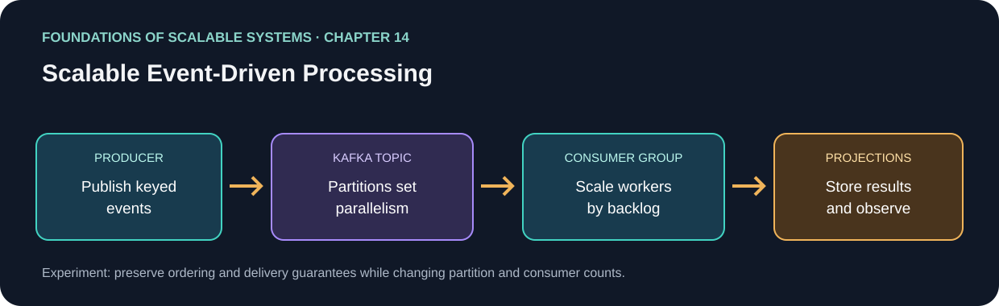
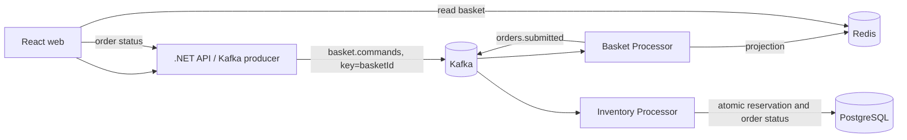
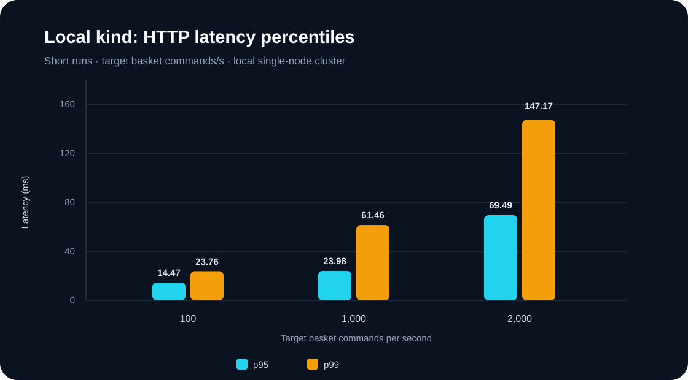
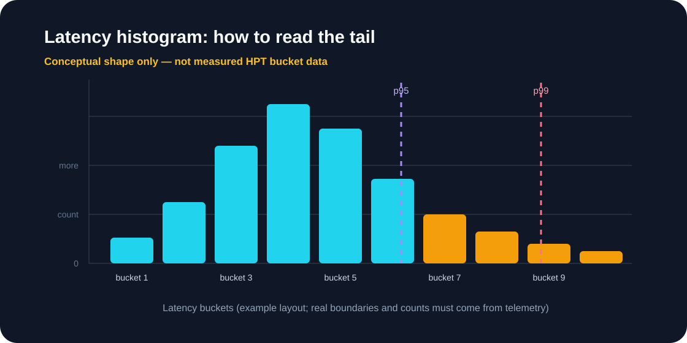

> This standalone solution is listed in the [repository guide](../../README.md).

<div dir="ltr" align="left">

<p align="center"><a href="README.md"><strong>English</strong></a> | <a href="README.fa.md">فارسی</a></p>

# 14. Scalable Event-Driven Processing

**A learning project for high-throughput basket commands and reliable order/inventory processing.**


<p align="center"><em>Basket updates are accepted asynchronously; checkout and inventory reservation follow a separate transactional path.</em></p>

This repository demonstrates an asynchronous transaction path built with **.NET 10, Apache Kafka, Redis, PostgreSQL, React, Kubernetes, and Prometheus**. It focuses on separating fast basket writes from checkout and inventory reservation while making ordering, retries, observability, and capacity limits explicit.

> **Performance target, not a benchmark claim:** 100,000 **basket commands per second** is the capacity-planning target. It has not been proven in production. It does not mean 100,000 checkouts or inventory reservations per second. The checked-in Kubernetes lab is for learning and local experiments, not production capacity.

## Documentation / مستندات

| Topic | English | فارسی |
|---|---|---|
| Project overview and quick start | This README | [README.fa.md](README.fa.md) |
| System design, technology options, and trade-offs | [System Design](../../docs/SYSTEM-DESIGN-MASTER-EN.md) | [طراحی سیستم](../../docs/SYSTEM-DESIGN-MASTER-FA.md) |
| Kubernetes deployment, scaling, metrics, and labs | [Kubernetes Guide](docs/KUBERNETES-GUIDE-EN.md) | [راهنمای Kubernetes](docs/KUBERNETES-GUIDE-FA.md) |
| 100k basket-command/s capacity runbook | [Performance Runbook](docs/PERFORMANCE-100K-EN.md) | [Runbook پرفورمنس](docs/PERFORMANCE-100K-FA.md) |

The English documents are the primary entry point. Persian counterparts retain English names for technologies, APIs, and Kubernetes concepts.

## Place in the book-aligned learning path

This implementation is a hands-on example of application services and asynchronous messaging, distributed database fundamentals, and scalable event-driven processing, especially the themes of Chapters 5, 7, and 10–14. It is an implementation to measure, not a reproduction of the book. See the [English roadmap](../../docs/SCALABILITY-ROADMAP-EN.md) or [نقشهٔ راه فارسی](../../docs/SCALABILITY-ROADMAP-FA.md) for the chapter map and candidate solutions.

**Book reference:** Ian Gorton, *Foundations of Scalable Systems*, Chapter 14, “Scalable Event-Driven Processing” ([O’Reilly](https://www.oreilly.com/library/view/foundations-of-scalable/9781098106058/ch14.html)).



**Application and project identity:** `ScalableEventDrivenProcessing`; .NET projects use the `ScalableEventDrivenProcessing.*` namespace and the Kubernetes namespace is `scalable-event-driven-processing`.

## Chapter synthesis

**Source reading: printed pages 271–284.** Original learning summary of the chapter's listed ideas; consult the book for full treatment.

Event-driven architecture decouples producers and consumers through events. Kafka supplies a persistent partitioned log: topics organize records, producers publish them, and consumer groups coordinate processing with offsets. Partition keys affect ordering and parallelism; within one group, each partition is assigned to at most one consumer at a time, so extra consumers can be idle. Replication and acknowledgements affect durability and availability; retention and replay support recovery. Scaling must consider partitions, lag, downstream capacity, and duplicate-safe effects. Kafka stores and transports events; business behavior remains in application code.

### Key takeaways

- Partition count bounds group parallelism; keys govern per-entity order.
- Design commits, retries, replay, and downstream writes together for correctness.
- Lag matters alongside broker health; Kafka does not implement business processing.


## At a glance

| Area | Implementation |
|---|---|
| API and producer | ASP.NET Core REST API publishes basket commands to Kafka |
| Basket processing | Kafka consumer updates a Redis read projection and emits checkout events |
| Inventory and orders | Separate worker reserves all order items in a PostgreSQL transaction |
| Web application | React storefront with a Persian RTL interface |
| Local development | Docker Compose |
| Kubernetes | Kind / Docker Desktop learning manifests; separate performance profile |
| Observability | .NET metrics, Prometheus, Kafka/Redis/PostgreSQL exporters, and k6 workloads |

### Request flow



- The API publishes an absolute `item-set` quantity. Reprocessing the same event does not increment the quantity again.
- Kafka uses the basket ID as the key, so messages for one basket share a partition and remain ordered.
- Basket Processor polls up to 128 records and processes independent baskets concurrently in Redis; it keeps each basket ordered and commits offsets after successful processing. Configure the batch using `Basket__MaxPollBatchSize`.
- The API returns `202 Accepted` after Kafka accepts the command. The Redis basket is an eventually consistent read model.
- Basket projections expire after 24 hours by default. Choose TTL/storage based on active basket count and durability requirements.
- Checkout uses an idempotency key. Basket Processor sends a basket snapshot to `orders.submitted`.
- Inventory Processor reserves every item in an order within a PostgreSQL transaction. If one item is unavailable, that order's updates roll back and the order is rejected.
- The order event is acknowledged in Kafka after the database commit. `processed_events` prevents a repeat reservation if the consumer fails between those steps.

## Solution layout

- `src/ScalableEventDrivenProcessing.Api`: storefront API and Kafka producer
- `src/ScalableEventDrivenProcessing.BasketProcessor`: basket command consumer and order-event publisher
- `src/ScalableEventDrivenProcessing.InventoryProcessor`: order consumer and atomic inventory reservation
- `src/ScalableEventDrivenProcessing.Contracts`: shared event contracts
- `web`: Persian RTL storefront for products, basket, and order status
- `infra/postgres/init.sql`: sample tables and products
- `infra/kubernetes/lab`: learning deployment
- `infra/kubernetes/performance`: Kafka and autoscaling profile for capacity experiments
- `infra/performance`: k6 workloads
- `docs`: English and Persian implementation/design guides

## Quick start with Docker Compose

Start Docker Desktop, then run from this solution folder:

```powershell
docker compose up --build
```

Open [http://localhost:8081](http://localhost:8081). The API is also available at `http://localhost:5080`. Local Kafka uses one broker, each topic has four partitions, and replication factor is one so the stack can run on a laptop. This configuration is for learning the flow only.

Follow logs:

```powershell
docker compose logs -f api basket-processor inventory-processor
```

Local products are seeded from `infra/postgres/init.sql`. Remove local volumes only when you no longer need their data:

```powershell
docker compose down -v
```

## Kubernetes learning deployment

The `lab` and performance profile use internal plaintext listeners; lab manifests also include sample credentials. Use TLS, Kafka authentication, and real Redis/PostgreSQL credentials for any real environment.

For a repeatable local lab deployment, install Docker Desktop or kind, .NET 10 SDK, Node.js 24, and npm. The script publishes the .NET apps for Linux x64, builds the web app and runtime images, loads them into kind when selected, and applies the Kubernetes resources:

```powershell
.\infra\kubernetes\lab\deploy.ps1 -ExpectedContext kind-k8s-course -KindClusterName k8s-course
```

For Docker Desktop, use `-ExpectedContext docker-desktop` and omit `-KindClusterName`. The script checks the current context before applying resources. It installs namespace/dependencies, Kafka through Strimzi, application images, workloads, and Prometheus. This is a sample lab with sample credentials; it is not a production deployment.

For a manual walkthrough, resource explanations, observability setup, cleanup, and practical exercises, read the [English Kubernetes Guide](docs/KUBERNETES-GUIDE-EN.md) or [نسخهٔ فارسی](docs/KUBERNETES-GUIDE-FA.md).

## Performance testing

### End-to-end k6 test

Start the cluster and forward the API, then set the target rate and duration. `RATE` is iteration/command rate, not checkout rate:

```powershell
kubectl port-forward -n scalable-event-driven-processing svc/api 15080:8080
$env:BASE_URL = "http://127.0.0.1:15080"
$env:RATE = "100"
$env:DURATION = "60s"
$env:PRE_ALLOCATED_VUS = "100"
$env:MAX_VUS = "1000"
k6 run infra/performance/k6-basket.js
```

Start at a low rate and increase `RATE` in stages. Current script thresholds are error rate below 1%, p95 below 250ms, and p99 below 1s; these are experiment thresholds and should be replaced by product SLOs. Running k6 on the same laptop as kind is a development baseline. A 100,000-command/s test needs independent distributed generators, production-like infrastructure/data/key skew, sustained duration, failure tests, and resource/lag measurements. Do not treat submitted requests as successful work.

### Batch-ingest test

`POST /api/baskets/commands/batch` accepts up to 500 `item-set` commands per request. Each is still keyed by `basketId`, preserving per-basket publish order. In the batch script, each iteration is one HTTP request, so `command rate = RATE × BATCH_SIZE`:

```powershell
$env:RATE = "30"          # HTTP batch requests per second
$env:DURATION = "20s"
$env:BATCH_SIZE = "50"    # about 1,500 commands per second
k6 run infra/performance/k6-basket-batch.js
```

`eventId` can be supplied by the caller for stable retries; the API generates one if omitted. Producer callbacks collect per-record delivery results without creating a separate `Task` per message. This allocation optimization is not yet benchmarked. If the per-Pod concurrency limiter is full, the API returns `429 Retry-After: 1` before publishing, so that request can be retried safely. After enqueue, disconnecting the client does not cancel producer work; the handler waits for delivery callbacks and holds the limiter permit until they arrive. However, the client may not receive the response and may not know the outcome. A Kafka failure can leave some batch records acknowledged and others failed; `503` includes `acknowledgedByKafka` and `failedDeliveries`, but acknowledged records may already be present. Keep `eventId` stable, but note the current consumer does not deduplicate it. The endpoint does not create a multi-message atomic Kafka transaction.

### Local recorded latency



The chart summarizes selected percentiles from short local runs. It is not a production benchmark. The histogram below is conceptual: its bar frequencies are not measured samples.



Recorded `kind-k8s-course` observations on 2026-11-12:

| Scenario | Result | Interpretation |
|---|---|---|
| 100 commands/s for 10s | 1,001 successful requests, 0% HTTP errors, p95 14.47ms, p99 23.76ms | Single-node local baseline; no loaded checkout or failure test. |
| 1,000 commands/s for 10s | 10,001 successful requests, 0% errors, p95 23.98ms, p99 61.46ms | HPA briefly scaled API 2→6 and basket workers 2→3; not production capacity. |
| 2,000 commands/s for 10s | 19,993 successful, 0 HTTP errors, p95 69.49ms, p99 147.17ms; 7 dropped iterations | Latency/error thresholds passed, but generator missed the requested rate. |
| 2,500 commands/s for 10s | 24,410 successful (~2,427/s), 0 errors, p95 110.3ms, p99 407.84ms; 592 dropped | Single-node run missed target and tail latency grew. |
| Batch: 50 commands/request, 30 requests/s for 20s | ~30,050 commands accepted (~1,501/s), 0 HTTP errors, p95 17.22ms | Reduces HTTP round trips; does not prove sustained consumer capacity. |
| Batch: 500 commands/request, 10 requests/s for 15s | 75,500 accepted (~5,015/s), 0 errors, p95 37.21ms | Four partitions drained to zero lag; short local run only. |
| Batch: 500 commands/request, 20 requests/s for 10s | 100,500 accepted (~10,000/s), 0 errors, p95 69.23ms | Lag returned to zero; four workers at lab ceiling. |
| Batch: 500 commands/request, 50 requests/s for 10s | ~24,966 commands/s, 0 HTTP errors, p95 205.72ms | About 91k lag immediately after load; drained within 10s. This is not 100k proof. |

These runs show short-term local behavior. They do not establish a sustained SLO, production capacity, checkout throughput, or 100,000 TPS. The [performance runbook](docs/PERFORMANCE-100K-EN.md) explains measurement boundaries, the larger profile, load stages, resource envelope, and histogram methodology; read the [Persian version](docs/PERFORMANCE-100K-FA.md) as well.

## Performance profile notes

`infra/kubernetes/performance` is a starting point for a separate multi-node cluster:

- 3 Kafka controllers and 12 brokers
- Basket topic with 512 partitions, replication factor 4, and example one-hour retention
- Order/result topics with 128 partitions and replication factor 4
- `min.insync.replicas=3` with producer `acks=all`
- HPA for API and KEDA for consumer scaling by Kafka lag
- Basket consumer parallelism is capped by partition count

For one million basket commands/s, 512 partitions imply an average of about 1,953 commands/s/partition before key skew and four-replica overhead. This is only a measurement starting point. Kafka ordering is per partition; do not change basket topic partition counts casually after data exists because keys may map to new partitions. Use a versioned topic and controlled migration for large changes.

The example profile requests 2 CPU, 4Gi RAM, and a 500Gi PVC per broker, plus controllers, sharded Redis, and a suitable database. One million messages averaging 200 bytes means about 200MB/s logical data; four replicas multiply broker writes to roughly four times that before protocol/filesystem overhead. Calculate retention and disk from actual event size and recovery requirements. These settings are not a throughput promise. Measure sustained rate, latency, message size, read/write mix, hot-basket skew, replica count, and checkout rate on target hardware.

For performance, point `Redis__ConnectionString` to a Redis Cluster/managed service with multiple seed nodes. Install KEDA 2.21 to enable `infra/kubernetes/performance/keda-scalers.yaml`. Lab Kubernetes intentionally uses single-instance Redis/PostgreSQL and is not sized for high capacity. PostgreSQL currently handles checkout/inventory only; 100,000 basket commands/s is not 100,000 successful checkouts/s. A rough extrapolation from the 25k/s local run suggests ~26 basket workers for 100k command/s, but this is a short-run estimate without production headroom. See the [capacity runbook](docs/PERFORMANCE-100K-EN.md) before sizing.

## API

- `GET /api/products`
- `POST /api/baskets` — create a basket ID
- `GET /api/baskets/{basketId}` — read the Redis basket projection
- `PUT /api/baskets/{basketId}/items/{productId}` with `{ "quantity": 3 }` — publish a command to Kafka
- `POST /api/baskets/commands/batch` with `{ "items": [{ "basketId": "...", "productId": "...", "quantity": 3, "eventId": "..." }] }` — up to 500 commands; `eventId` is optional but should be stable across retries
- `POST /api/baskets/{basketId}/checkout` with `{ "idempotencyKey": "<uuid>" }` — submit checkout
- `GET /api/orders/{orderId}` — read order status and items

`quantity: 0` removes an item. A basket is locked after checkout. Adding an item does not guarantee available inventory; final reservation occurs during checkout.

## Important configuration

Use .NET environment variables, for example:

```text
Kafka__BootstrapServers=broker-1:9092,broker-2:9092
Redis__ConnectionString=redis-1:6379,redis-2:6379,redis-3:6379
ConnectionStrings__Inventory=Host=postgres;Database=hpt;Username=...;Password=...
```

See `infra/postgres/init.sql` for the sample schema and values. It is a learning schema; use controlled migrations for later changes.

## Observability

The lab Prometheus setup scrapes API, worker, Kafka, PostgreSQL, and Redis metrics. It is a single replica with temporary storage. It does not include every Kubernetes/node metric by default. Useful signals include:

- Accepted basket commands versus processed basket events
- Committed offsets and Kafka consumer-group lag
- Batch size, publish duration, processing duration, and batch rejections
- API request duration and errors
- Kafka broker/partition health, PostgreSQL transaction health, Redis latency and memory

Do not label metrics with basket/order IDs. See the [Kubernetes Guide](docs/KUBERNETES-GUIDE-EN.md) for exact metric names, PromQL, and Prometheus setup, or the [فارسی guide](docs/KUBERNETES-GUIDE-FA.md).

</div>
