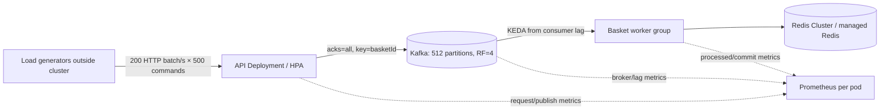
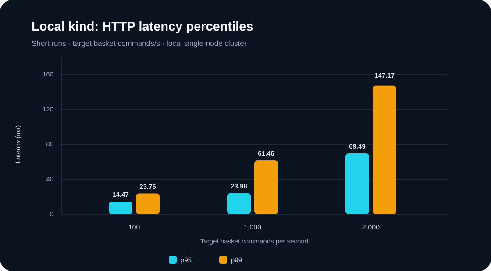
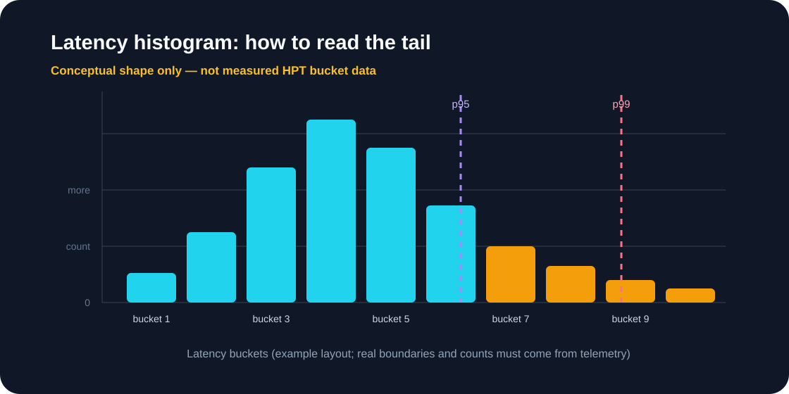

<div dir="rtl" align="right">

<p dir="ltr" align="center"><a href="PERFORMANCE-100K-EN.md">English</a> | <strong>فارسی</strong></p>

# Runbook آزمون پرفورمنس ۱۰۰٬۰۰۰ فرمان سبد در ثانیه

> فرمان‌های این راهنما را از ریشهٔ راه‌حل (`solutions/14-scalable-event-driven-processing/`) اجرا کنید.


<p align="center"><em>تصویر مفهومی است؛ برای نسبت ظرفیت و SLO به نمودارهای داده‌محور همین راهنما مراجعه کنید.</em></p>

این سند یک مسیر اجرایی برای استقرار پروفایل پرفورمنس و سنجش مرحله‌ای آن است. `100,000` در این runbook یعنی **فرمان تغییر سبد پذیرفته‌شده در ثانیه** (`item-set`)؛ معنی آن ۱۰۰٬۰۰۰ سفارش پرداخت‌شده یا رزرو موجودی موفق در ثانیه نیست. پروفایل چندگرهی هنوز روی سخت‌افزار production این پروژه اجرا نشده و هیچ‌یک از manifestها به‌تنهایی ظرفیت را ثابت نمی‌کنند.

## ۱. معماری و مرز اندازه‌گیری



سنجش را به چهار عدد جدا تقسیم کن: درخواست HTTP موفق، فرمانی که broker تأیید کرده، فرمانی که projection آن در Redis اعمال شده، و checkout نهایی. benchmark موجود برای basket فقط تا پذیرش Kafka و تخلیهٔ basket consumer را سنجیده؛ checkout/PostgreSQL باید workload جداگانه داشته باشد.

این runbook هدف ۱۰۰k فرمان `item-set` در ثانیه را پیکربندی می‌کند. اگر منظورت ۱۰۰k سفارش **تکمیل‌شده همراه با رزرو موجودی** در ثانیه است، همان عدد را برای checkout تعریف کن: مسیر فعلی از `orders.submitted` به Inventory Processor و PostgreSQL transactional می‌رود و محدودیت‌های row-lock، DB write capacity و consistency خودش را دارد. آن throughput را از basket command rate نتیجه نگیر؛ طرح‌های PostgreSQL، shard مالک SKU، escrow/bucket موجودی و reservation saga با نمودار در [راهنمای System Design](../../../docs/SYSTEM-DESIGN-MASTER-FA.md) توضیح داده شده‌اند. ظرفیت DB و SLO سفارش باید جدا سنجیده و تعریف شوند.

## ۲. منابع لازم و جداسازی محیط

پروفایل `infra/kubernetes/performance` را روی **کلاستر جداگانه** اجرا کن. داخل آن Kafka resource با نام `scalable-event-driven-processing-kafka` وجود دارد و با lab هم‌نام است؛ فایل‌های Kafka و NodePool آن را روی کلاستر lab فعلی apply نکن.

منابع درخواست‌شده در manifestها، حداقل خام‌اند و باید برای storage class و ظرفیت واقعی کلاستر بازبینی شوند. تخمین worker در جدول یک برون‌یابی خطی از مرحلهٔ کوتاه ۲۵k/s روی kind است:

| جزء | تنظیم نمونه | جمع حداقل request پیش از headroom |
|---|---:|---:|
| Kafka controller | ۳ × ۰٫۵ CPU و ۱Gi | ۱٫۵ CPU، ۳Gi |
| Kafka broker | ۱۲ × ۲ CPU و ۴Gi، PVC هرکدام ۵۰۰Gi | ۲۴ CPU، ۴۸Gi و حدود ۵٫۹TiB PVC |
| Basket worker | حدود ۲۶ نمونه برای ۱۰۰k در نرخ مشاهده‌شده × ۰٫۵ CPU و ۵۱۲Mi | حدود ۱۳ CPU و ۱۳Gi پیش از headroom |
| API | HPA از ۱۲ نمونه × ۰٫۲۵ CPU و ۲۵۶Mi | حدود ۳ CPU و ۳Gi |

این جمع هنوز Redis، PostgreSQL، Prometheus، OS، page cache، rolling update، failover و headroom را ندارد. روی کلاستری که این منابع را واقعاً رزرو نمی‌کند شروع نکن. عدد ۲۶ فقط حاصل `100,000 / 4,000` است و نرخ یک run کوتاه را خطی تعمیم می‌دهد؛ آن را sizing production فرض نکن.

به سقف autoscaler هم جداگانه دقت کن. deployment profile از همان requestهای `infra/kubernetes/lab/apps.yaml` استفاده می‌کند، ولی سقف replica را HPA/KEDA تعیین می‌کنند:

| گروه | سقف replica | request هر Pod | جمع در سقف |
|---|---:|---:|---:|
| API | ۲۵۶ | ۰٫۲۵ CPU / ۲۵۶Mi | ۶۴ CPU / ۶۴Gi |
| Basket worker | ۵۱۲ | ۰٫۵ CPU / ۵۱۲Mi | ۲۵۶ CPU / ۲۵۶Gi |
| Inventory worker، در صورت رشد checkout lag | ۱۲۸ | ۰٫۵ CPU / ۵۱۲Mi | ۶۴ CPU / ۶۴Gi |

فقط Kafka controller+broker به‌علاوهٔ API و basket در سقف، حدود **۳۴۵٫۵ CPU و ۳۷۱Gi RAM request** می‌خواهد؛ اگر Inventory هم تا سقف برسد، این عدد حدود **۴۰۹٫۵ CPU و ۴۳۵Gi** می‌شود. این‌ها هنوز exporterها، Redis/PostgreSQL، Prometheus، DaemonSetها، system reserve، فضای page cache، rollout surge و ظرفیت failover را ندارند. PVC خام profile نیز ۱۲×۵۰۰Gi برای broker و ۳×۲۰Gi برای controller است؛ یعنی حدود ۵٫۹TiB پیش از storage overhead و فضای لازم برای recovery.

این سقف، الزام نیست که از روز اول این تعداد node بخری؛ ولی اگر HPA/KEDA را با این max فعال نگه داری و backlog بالا برود، scheduler می‌تواند صدها Pod را `Pending` نگه دارد. `maxReplicaCount` را به quota و ظرفیت واقعی cluster محدود کن یا node autoscaler و بودجهٔ scale-out متناظر فراهم کن. مقدار ۲۶ basket worker تخمین نقطهٔ هدف بر اساس run کوتاه است؛ سقف ۵۱۲ فقط upper bound کنترل‌کننده است، نه پیش‌بینی مصرف عادی.

نیازهای پیش از اجرا:

- Kubernetes چندگرهی با StorageClass پایدار و فضای کافی برای PVCهای broker؛ ظرفیت نهایی را از bytes/message، retention و replication حساب کن.
- نسخه‌ها را با Kubernetes مقصد تطبیق بده. installer آزمایشگاهی `latest` است و نسخهٔ نصب آن با گذر زمان تغییر می‌کند؛ هنگام نگارش این راهنما image آن Strimzi 1.3.1 بود که با Kafka 4.3.2 کار می‌کند. پیش از اجرا، نسخه و ماتریس Kubernetes را در [Strimzi Downloads](https://strimzi.io/downloads/) بررسی کن؛ برای production نسخهٔ release را از آرشیو رسمی pin کن. KEDA 2.21 با Kubernetes 1.34–1.36 آزموده شده؛ [راهنمای نصب KEDA](https://keda.sh/docs/2.21/deploy/) را هم ببین.
- imageهای immutable در registry قابل‌دسترسی همهٔ nodeها؛ `scalable-event-driven-processing-api:dev` و سایر tagهای محلی Docker Desktop در کلاستر remote موجود نیستند.
- Redis Cluster یا سرویس Redis مدیریت‌شده با ظرفیت و failover سنجیده‌شده. Redis تک‌نمونهٔ lab مناسب این پروفایل نیست.
- PostgreSQL مدیریت‌شده/HA برای checkout. نرخ سفارش را جدا تعریف و benchmark کن.
- TLS، Kafka authentication، secret manager، network policy، backup/restore، quota، monitoring و load generator خارج از nodeهای سرویس.

فایل Kafka در این profile برای محیط آزمایش listener داخلی بدون TLS دارد. برای ظرفیت‌سنجی روی شبکهٔ خصوصی جداگانه می‌توانی از آن استفاده کنی؛ پیش از اتصال به workload واقعی، TLS/auth را در Kafka، تنظیمات producer/consumer برنامه، Kafka exporter و KEDA TriggerAuthentication هماهنگ کن. صرفاً فعال‌کردن TLS listener در Kafka باعث اتصال خودکار برنامه یا autoscaler نمی‌شود.

## ۳. آماده‌سازی registry و کلاستر

در سیستم CI یا ماشین build، imageها را با tag تغییرناپذیر بساز و push کن. نمونهٔ PowerShell؛ آدرس را با registry خودت جایگزین کن:

```powershell
$Registry = "registry.example.com/pouya/scalable-event-driven-processing"
$Version = "<git-sha>"

docker build -t "$Registry/api:$Version" -f src/ScalableEventDrivenProcessing.Api/Dockerfile .
docker build -t "$Registry/basket-processor:$Version" -f src/ScalableEventDrivenProcessing.BasketProcessor/Dockerfile .
docker build -t "$Registry/inventory-processor:$Version" -f src/ScalableEventDrivenProcessing.InventoryProcessor/Dockerfile .
docker build -t "$Registry/web:$Version" -f web/Dockerfile --build-arg VITE_API_BASE_URL=/ .
docker push "$Registry/api:$Version"
docker push "$Registry/basket-processor:$Version"
docker push "$Registry/inventory-processor:$Version"
docker push "$Registry/web:$Version"
```

Namespace و Strimzi operator را در کلاستر پرفورمنس نصب کن. نسخهٔ operator را با نسخه‌های Kubernetes و Kafka خودت pin کن؛ URL زیر فقط نمونهٔ نصب نسخهٔ استفاده‌شده در lab این پروژه است:

```powershell
kubectl apply -f infra/kubernetes/namespace.yaml
kubectl apply -f "https://strimzi.io/install/latest?namespace=scalable-event-driven-processing" -n scalable-event-driven-processing
kubectl wait deployment/strimzi-cluster-operator -n scalable-event-driven-processing --for=condition=Available --timeout=10m
```

پس از Ready شدن operator، Kafka node pool و brokerها را بساز:

```powershell
kubectl apply -f infra/kubernetes/performance/kafka.yaml
kubectl wait kafka/scalable-event-driven-processing-kafka -n scalable-event-driven-processing --for=condition=Ready --timeout=30m
kubectl get kafkanodepool -n scalable-event-driven-processing
kubectl get pods,pvc -n scalable-event-driven-processing -o wide
```

انتظار می‌رود سه controller، دوازده broker و PVCهای مربوطه آماده باشند. اگر Kafka Ready نشد، ابتدا scheduler، StorageClass، PVCها، quota و operator eventها را بررسی کن؛ topicها را پیش از آماده‌شدن broker نصب نکن.

بعد topicها را با اندازهٔ پارتیشن و replication پروفایل بساز:

```powershell
kubectl apply -f infra/kubernetes/performance/topics.yaml
kubectl get kafkatopics -n scalable-event-driven-processing
```

`basket.commands` با ۵۱۲ پارتیشن و RF=4 ساخته می‌شود. partitionها سقف consumerهای فعال در یک group هستند. کلید `basketId` ترتیب هر سبد را حفظ می‌کند؛ یک سبد داغ همچنان به یک partition/consumer محدود می‌ماند.

## ۴. تنظیم dependencyها، secretها و برنامه

فایل `infra/kubernetes/lab/dependencies.yaml` شامل Redis/Postgres سادهٔ lab است؛ آن را در کلاستر پرفورمنس برای بار ۱۰۰k نصب نکن. endpointهای Redis Cluster و PostgreSQL واقعی/آزمایشی را از secret manager در secretهای namespace قرار بده. مقدار credential را در Git یا command history ثبت نکن.

ConfigMap برنامه باید حداقل این تنظیمات را داشته باشد. پیش از apply، `Redis__ConnectionString` را به seed endpointهای Redis Cluster تغییر بده؛ مقدار lab به Redis تک‌نمونه اشاره می‌کند:

```text
Kafka__BootstrapServers=scalable-event-driven-processing-kafka-kafka-bootstrap:9092
Kafka__BasketTopic=basket.commands
Kafka__OrdersTopic=orders.submitted
Kafka__InventoryResultsTopic=orders.inventory-results
Kafka__BasketConsumerGroup=basket-projector-v1
Kafka__InventoryConsumerGroup=inventory-reservation-v1
Redis__ConnectionString=<Redis Cluster seed endpoints>
ConnectionStrings__Inventory=<PostgreSQL endpoint from Secret>
Ingestion__MaxConcurrentBatchesPerPod=8
Basket__MaxPollBatchSize=128
```

API برای هر Pod حداکثر ۸ درخواست batch هم‌زمان می‌پذیرد و درخواست اضافه را با `429 Retry-After: 1`، پیش از publish، رد می‌کند؛ این retry را می‌توان امن تکرار کرد چون handler آن batch را اجرا نکرده است. سقف صف Kafka producer هر API Pod نیز ۵٬۰۰۰ پیام یا ۶۴MiB است (هرکدام زودتر پر شود). Basket Processor هر بار تا ۱۲۸ رکورد poll می‌کند و عملیات basketهای مستقل را هم‌زمان به Redis می‌فرستد؛ ترتیب همان basket را حفظ می‌کند و برای partition offset را فقط پس از موفقیت commit می‌کند. این‌ها guardrail شروع‌اند، نه اعداد capacity ثابت؛ با اندازهٔ پیام، latency broker، memory limit، replica count و SLO تنظیمشان کن. limiter داخل حافظهٔ هر replica است؛ سقف کلی درخواست هم‌زمان با تعداد API replica تغییر می‌کند. HPA فعلی با CPU scale می‌کند و rejection metric را مستقیم مصرف نمی‌کند؛ افزایش پایدار 429 را ببین و بر اساس resource headroom، replica یا limit را تنظیم کن. اگر quota کلی مشتری لازم است، آن را در gateway مشترک enforce کن.

پیش از شروع checkout، schema دیتابیس را با migration مورد تأیید خودت ایجاد کن. `infra/postgres/init.sql` جدول‌های این نمونه را می‌سازد و چهار کالای آزمایشی seed می‌کند؛ seed آزمایشی را به دادهٔ production منتقل نکن.

پیش از apply، در `infra/kubernetes/lab/apps.yaml` imageهای چهار deployment را با tagهای متناسب جایگزین کن:

| Container | Image ساخته‌شده در مرحلهٔ قبلی |
|---|---|
| API | `registry.example.com/pouya/scalable-event-driven-processing/api:<version>` |
| Basket processor | `registry.example.com/pouya/scalable-event-driven-processing/basket-processor:<version>` |
| Inventory processor | `registry.example.com/pouya/scalable-event-driven-processing/inventory-processor:<version>` |
| Web | `registry.example.com/pouya/scalable-event-driven-processing/web:<version>` |

برای worker و API، resources و replica اولیه را با اندازهٔ محیط تنظیم کن. نسخهٔ broker topic و `Kafka__BasketTopic` باید هر دو `basket.commands` باشند.

```powershell
kubectl apply -f infra/kubernetes/lab/config.yaml
# Secretها را با secret manager خودت ایجاد کن؛ secret.yaml نمونهٔ lab را کپی نکن.

> فرمان‌های این راهنما را از ریشهٔ راه‌حل (`solutions/14-scalable-event-driven-processing/`) اجرا کنید.
kubectl apply -f infra/kubernetes/lab/apps.yaml
kubectl rollout status deployment/scalable-event-driven-processing-api -n scalable-event-driven-processing --timeout=10m
kubectl rollout status deployment/scalable-event-driven-processing-basket-processor -n scalable-event-driven-processing --timeout=10m
kubectl rollout status deployment/scalable-event-driven-processing-inventory-processor -n scalable-event-driven-processing --timeout=10m
kubectl get pods -n scalable-event-driven-processing -o wide
```

اگر registry خصوصی است، `imagePullSecrets` را به Pod templateها اضافه کن. readiness API باید Redis و PostgreSQL را ببیند. readiness هر worker تا زمانی که مصرف‌کنندهٔ Kafka حداقل یک partition گرفته باشد 503 می‌دهد و پس از assignment موفق آماده می‌شود؛ علاوه بر آن، basket worker اتصال Redis و inventory worker اتصال Redis و PostgreSQL را بررسی می‌کند. خطای مصرف Kafka نیز worker را موقتاً از سرویس آماده خارج می‌کند. liveness فقط زنده‌بودن process وب metrics را بررسی می‌کند تا اختلال موقت broker باعث restart loop نشود. پس از rollout همچنان consumer group، lag و سلامت dependencyها را در داشبورد و `kubectl describe pod` ببین.

## ۵. autoscaling و پایش

ابتدا KEDA را نصب کن. این manifest نسخهٔ 2.21.0 را نصب می‌کند؛ نسخهٔ Kubernetes مقصد باید با ماتریس سازگاری همان release هم‌خوان باشد:

```powershell
kubectl apply --server-side -f https://github.com/kedacore/keda/releases/download/v2.21.0/keda-2.21.0.yaml
kubectl get pods -n keda -w
kubectl get crd scaledobjects.keda.sh
```

پس از Ready شدن operator و CRD، HPA CPU در lab را حذف کن تا دو controller برای replica count رقابت نکنند؛ سپس HPA API و KEDA ScaledObjectهای profile را فعال کن:

```powershell
kubectl delete hpa scalable-event-driven-processing-basket-processor -n scalable-event-driven-processing --ignore-not-found
kubectl apply -f infra/kubernetes/performance/apps-hpa.yaml
kubectl apply -f infra/kubernetes/performance/keda-scalers.yaml
kubectl get hpa,scaledobject -n scalable-event-driven-processing -w
```

KEDA basket را از ۱۶ تا حداکثر ۵۱۲ replica بر اساس lag scale می‌کند؛ تعداد نهایی را با quota، منابع nodeها و partitionها محدود کن. طبق [تعریف Kafka scaler در KEDA](https://keda.sh/docs/2.21/scalers/apache-kafka/)، `lagThreshold` هدف lag برای تصمیم scale است. مقدار `4000` فعلی حدود یک ثانیه backlog به‌ازای worker با نرخ مشاهده‌شدهٔ kind است؛ threshold را با نرخ پایدار واقعی worker و زمان drain مجاز محاسبه و تنظیم کن. مصرف‌کنندهٔ بیش از ۵۱۲ در همین group، موازی‌سازی جدیدی نمی‌سازد. HPA API نیز ۱۲ تا ۲۵۶ replica می‌خواهد و باید با بودجهٔ منابع و load balancer سازگار باشد.

Prometheus lab از endpoint discovery و RBAC namespace-scoped برای scrape هر pod استفاده می‌کند؛ روی profile remote ابتدا image، storage persistence، retention، alert routing و RBAC production را تنظیم کن. معیارهای شروع:

```powershell
kubectl get hpa -n scalable-event-driven-processing
kubectl get pods -n scalable-event-driven-processing -l app=scalable-event-driven-processing-basket-processor
kubectl exec -n scalable-event-driven-processing scalable-event-driven-processing-kafka-kafka-0 -- /opt/kafka/bin/kafka-consumer-groups.sh --bootstrap-server scalable-event-driven-processing-kafka-kafka-bootstrap.scalable-event-driven-processing.svc:9092 --describe --group basket-projector-v1
```

در Prometheus این metricها را برای هر pod و به صورت aggregate دنبال کن:

- `hpt_basket_commands_total`: فرمان پذیرفته‌شده در API.
- `hpt_basket_events_processed_total`: فرمان اعمال‌شده در projection.
- `hpt_basket_offsets_committed_total`: offsetهای commitشده.
- `hpt_basket_poll_batch_size`: اندازهٔ micro-batch هر poll در basket worker؛ p50/p95 آن را کنار processing duration ببین تا concurrency محدود و latency متعادل بماند.
- `hpt_kafka_publish_failures_total`: تعداد delivery failureهای مسیر batch API؛ هر record ناموفق یک واحد شمرده می‌شود.
- `hpt_basket_batch_rejections_total`: درخواست‌های batch که limiter هر Pod پیش از publish با 429 رد کرده است.
- `kafka_consumergroup_lag`: صف منتظر در هر partition.
- `http_server_request_duration_seconds`: نرخ/latency API؛ p95 را با route/status کم‌کاردینالیتی بسنج.
- Kafka disk/network و Redis ops/latency از exporterهای lab.

**مرز جمع‌آوری معیارهای Kubernetes در lab:** Prometheus فعلی metricهای API، workerها و exporterهای Kafka/PostgreSQL/Redis را scrape می‌کند؛ manifest فعلی آن kubelet/cAdvisor، `kube-state-metrics` یا `node-exporter` را نصب/scrape نمی‌کند. بنابراین metricهایی مثل `container_cpu_usage_seconds_total`، throttling، working set، وضعیت PVC، restart و scheduling را در این Prometheus موجود فرض نکن. فعلاً منابع لحظه‌ای را از Metrics API بخوان:

```powershell
kubectl top nodes
kubectl top pods -n scalable-event-driven-processing
kubectl get hpa -n scalable-event-driven-processing
kubectl describe pod <pod> -n scalable-event-driven-processing
kubectl get events -n scalable-event-driven-processing --sort-by=.lastTimestamp
kubectl get pvc -n scalable-event-driven-processing
```

`metrics-server` منبع Metrics API برای `kubectl top` و HPA است؛ خودش این metricها را به Prometheus ارائه نمی‌کند. برای نمودار تاریخی و alertهای منابع Kubernetes، یک stack مانیتورینگ سازگار با کلاستر نصب کن یا scrape امن kubelet/cAdvisor و `kube-state-metrics`/`node-exporter` را جداگانه پیکربندی کن. جزئیات دسترسی kubelet، TLS، RBAC، retention و alert routing وابسته به کلاستر مقصد است و جزو manifest سادهٔ lab نیست. پس PromQLهای پایین فقط برای metricهایی معتبرند که واقعاً در Prometheus هدف وجود دارند.

پذیرش API را با processing throughput اشتباه نگیر. بعد از هر run، consumer group را بخوان و مطمئن شو lag به صفر یا SLO تعریف‌شده برگشته است. جمع کردن counterهای pod پس از restart نیازمند `rate()` است؛ raw counterها را مستقیماً با هم مقایسه نکن.

نمونهٔ queryهای PromQL برای داشبورد lab/profile:

```promql
# فرمان‌هایی که API broker-ack گرفته است؛ فرمان/ثانیه

> فرمان‌های این راهنما را از ریشهٔ راه‌حل (`solutions/14-scalable-event-driven-processing/`) اجرا کنید.
sum(rate(hpt_basket_commands_total[5m]))

# فرمان‌هایی که basket projection پردازش کرده است؛ event/ثانیه

> فرمان‌های این راهنما را از ریشهٔ راه‌حل (`solutions/14-scalable-event-driven-processing/`) اجرا کنید.
sum(rate(hpt_basket_events_processed_total[5m]))

# lag فعلی consumerها

> فرمان‌های این راهنما را از ریشهٔ راه‌حل (`solutions/14-scalable-event-driven-processing/`) اجرا کنید.
hpt:kafka_consumer_lag:sum

# p95 تعداد رکوردهای جمع‌شده در هر poll توسط Basket Processor

> فرمان‌های این راهنما را از ریشهٔ راه‌حل (`solutions/14-scalable-event-driven-processing/`) اجرا کنید.
histogram_quantile(0.95,
  sum by (le) (rate(hpt_basket_poll_batch_size_bucket[5m])))

# p95 زمان انتظار batch تا delivery report از Kafka

> فرمان‌های این راهنما را از ریشهٔ راه‌حل (`solutions/14-scalable-event-driven-processing/`) اجرا کنید.
histogram_quantile(0.95,
  sum by (le) (rate(hpt_kafka_publish_duration_milliseconds_bucket{mode="batch"}[5m])))

# درخواست‌های batch ردشده با 429 در ثانیه؛ پس از rollout نسخهٔ دارای limiter

> فرمان‌های این راهنما را از ریشهٔ راه‌حل (`solutions/14-scalable-event-driven-processing/`) اجرا کنید.
sum(rate(hpt_basket_batch_rejections_total[5m]))
```

metric latency بالا زمان کل batch است، نه latency هر پیام. metricهای جدید publish-failure و rejection بعد از build و rollout image جدید قابل مشاهده می‌شوند؛ source و manifest به‌تنهایی باعث ظاهرشدن سری جدید در podهای فعلی نمی‌شوند.

## ۶. برنامهٔ بار مرحله‌ای

load generator را بیرون کلاستر اجرا کن. `RATE` در اسکریپت batch تعداد HTTP batch در ثانیه است؛ `command rate = RATE × BATCH_SIZE`. batch اندازهٔ ۵۰۰، هدف ۱۰۰k فرمان/s را به حدود ۲۰۰ درخواست/s تبدیل می‌کند.

مرحله‌ها را یکی‌یکی اجرا کن و تا drain شدن lag به مرحلهٔ بعد نرو:

| مرحله | `BATCH_SIZE` | نرخ کل batch | نرخ هدف فرمان | زمان اولیه |
|---|---:|---:|---:|---:|
| warm-up | 50 | 20/s | 1k/s | 2 دقیقه |
| baseline profile | 500 | 10/s | 5k/s | 5 دقیقه |
| intermediate | 500 | 50/s | 25k/s | 5 دقیقه |
| target ramp | 500 | 100/s | 50k/s | 5 دقیقه |
| target | 500 | 200/s | 100k/s | 30 دقیقه سپس soak |

نمونهٔ یک اجرا از هر generator:

```powershell
$env:BASE_URL = "https://scalable-event-driven-processing.example.com"
$env:RATE = "50"
$env:DURATION = "5m"
$env:BATCH_SIZE = "500"
$env:PRE_ALLOCATED_VUS = "100"
$env:MAX_VUS = "1000"
k6 run infra/performance/k6-basket-batch.js
```

برای target ۱۰۰k، چهار generator مستقل را با نرخ ۵۰ batch/s هرکدام اجرا کن یا generatorهای بیشتری با تقسیم مساوی نرخ بساز. خروجی `basket_commands_submitted` را بین generatorها جمع کن؛ مجموع command rate هدف ۱۰۰k/s است. generator CPU/network را هم پایش کن تا خودش به bottleneck تبدیل نشود.

برای هر مرحله ثبت کن: commit SHA، image digest، تعداد generatorها، workload/payload و skew کلید، نرخ batch و فرمان موفق، p50/p95/p99، HTTP/produce errors، Kafka group lag قبل/حین/بعد، HPA replicas، CPU throttling، Redis ops/latency، broker disk/network، و زمان drain. هدف فقط وقتی پاس است که نرخ پایدار، SLO latency/error، lag قابل‌قبول و headroom هم‌زمان برقرار باشند؛ سپس یک node و یک broker را جداگانه از دسترس خارج کن و recovery را بسنج.

## ۷. نتایج فعلی و تفسیر

آزمایش‌های `kind-k8s-course` یک node، چهار Kafka partition و حداکثر چهار basket worker داشتند:

| نرخ درخواستی | نرخ پذیرفته‌شده | p95 HTTP | نتیجهٔ مصرف |
|---:|---:|---:|---|
| 5k command/s، batch=500 | حدود 5,015/s | 37ms | lag پس از بار صفر |
| 10k command/s، batch=500 | حدود 9,998/s | 69ms | lag پس از بار صفر |
| 25k command/s، batch=500 | حدود 24,966/s | 206ms | حدود 91k lag بلافاصله؛ صفر حداکثر 10s بعد؛ worker CPU تا 900m |

در مرحلهٔ 25k/s، offset commitشده طی ۱۰ ثانیهٔ ورودی حدود ۱۵۹k جلو رفت؛ یعنی نزدیک ۴k پیام/s برای هر یک از چهار worker همان run. این مشاهده مبنای موقت threshold برابر ۴۰۰۰ است. runها ۱۰ تا ۱۵ ثانیه‌ای روی یک node بودند؛ هدف ۱۰۰k تا زمان اجرای target ramp و soak روی پروفایل چندگرهی، با SLO و failure test، **اثبات‌نشده** می‌ماند.

### نمودار latency ثبت‌شده و شکل histogram

نمودار زیر سه اجرای کوتاه با درخواست تکی را از گزارش‌های ثبت‌شدهٔ همین پروژه نشان می‌دهد. این اعداد مربوط به `kind` تک‌نودی و target rate هستند و ظرفیت production را نشان نمی‌دهند. سناریوهای batch جدا هستند؛ latency درخواست batch را نباید مستقیم با latency درخواست تکی مقایسه کرد.



برای histogram واقعی باید bucketهای latency یا نمونه‌های خام همان run ذخیره شوند. داده‌های مستند فعلی فقط percentileهای منتخب را نگه داشته‌اند؛ بنابراین تصویر زیر شکل مفهومی توزیع و دنباله است و **فراوانی‌های آن دادهٔ اندازه‌گیری‌شده نیستند**.



وقتی Prometheus در دسترس باشد، histogram واقعی را از `*_bucket` بساز؛ مرز bucketها باید برای SLOهای موردنظر (مثلاً اطراف 100ms، 250ms، 500ms و 1s) به‌اندازهٔ کافی دقیق باشند. `histogram_quantile()` برآورد percentile را از bucketها می‌دهد؛ histogram خام را با labelهای پرکاردینالیتی مثل شناسهٔ مشتری یا سفارش نریز.

## ۸. پاک‌سازی پروفایل جداگانه

برای محیط آزمایشی اختصاصی، ابتدا workload را متوقف و ScaledObjectها را حذف کن. Kafka PVCهای manifest `deleteClaim: false` دارد؛ قبل از حذف namespace، تصمیم retention داده/PVC را بگیر. namespace shared را حذف نکن.

```powershell
kubectl delete -f infra/kubernetes/performance/keda-scalers.yaml
kubectl delete -f infra/kubernetes/performance/topics.yaml
kubectl delete -f infra/kubernetes/performance/kafka.yaml
```

حذف CRها لزوماً PVCهای retained را پاک نمی‌کند. PVC را فقط بعد از تأیید نام، namespace و نیاز به داده حذف کن.

</div>
