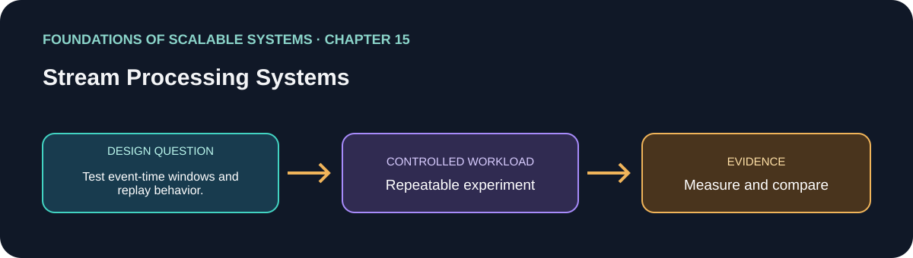

<div dir="rtl" align="right">

# فصل 15: سامانه‌های پردازش Stream



> راهنمای این فصل در مسیر یادگیری بر پایهٔ *Foundations of Scalable Systems*. موضوع‌ها به بیان خودمان خلاصه شده‌اند و تمرین پیشنهادی مستقل است؛ متن کتاب بازنشر نشده است.

## هدف

پرسش طراحی فصل را به آزمایشی کوچک و تکرارپذیر تبدیل کنیم. خروجی، مقایسه با فرض‌های روشن است؛ نه رتبه‌بندی همیشگی فناوری‌ها.

## محور فصل

پلتفرم stream؛ event time؛ window و join دارای state؛ مقیاس؛ checkpoint و ایمنی داده.

## خلاصهٔ جامع فصل

**بخش متناظر در نسخهٔ PDF: صفحه‌های چاپی 287–301.** این جمع‌بندی با بیان خودمان نوشته شده است؛ برای شرح کامل به کتاب مراجعه کن.

پردازش stream روی دادهٔ در حرکت محاسبهٔ پیوسته می‌کند و تأخیر pipeline دسته‌ای ETL را برای نتیجه‌ای که باید تازه باشد کم می‌کند. batch همچنان برای بازپردازش تاریخی حجیم و بارهایی که چند دقیقه یا ساعت تأخیر می‌پذیرند مفید است. معماری Lambda لایهٔ batch دوره‌ای و لایهٔ speed کم‌تأخیر را ترکیب و نتیجه‌ها را ارائه می‌کند؛ فصل اشاره می‌کند که برای بسیاری از بارها، log رویداد بادوام و stream قابل replay می‌تواند به طراحی Kappa ساده‌تر منجر شود. این‌ها انتخاب معماری‌اند، نه الزام یک فناوری مشخص.

برنامهٔ streaming یک dataflow جهت‌دار بدون چرخه از source، transformation و sink است. operator بدون state روی هر رویداد مستقل کار می‌کند؛ operator stateful دادهٔ کلیددار را بین رویدادها نگه می‌دارد، مثلاً شمارنده، ویژگی مدل یا آخرین محل اتوبوس‌ها. window یک جریان نامحدود را به محاسبات محدود تبدیل می‌کند: tumbling بازه‌های جدا دارد و sliding بازه‌های هم‌پوشان. نمونهٔ Flink فصل رویدادها را بر اساس lift ID گروه و مجموع ده‌دقیقه‌ای را هر پنج دقیقه محاسبه می‌کند. طراحی عملی باید مبنای زمان و سیاست رویدادهای خارج از ترتیب/دیررس را هم تعیین کند؛ مثال اصلی کتاب روی processing-time window و aggregation کلیددار متمرکز است.

Flink dataflow منطقی را به DAG فیزیکی تبدیل می‌کند. parallelism را برای هر operator یا به‌صورت پیش‌فرض تعیین می‌کنیم و keyed partitioning رویدادهای یک key را به مالک state می‌فرستد. task managerها زیرکارهای operator را در task slot اجرا می‌کنند؛ operator chaining می‌تواند هزینهٔ ارتباط را کم کند. parallelism بیشتر فقط وقتی throughput را بالا می‌برد که source partition، شبکه، CPU و sink ظرفیت داشته باشند. operator سراسری یا تک‌نسخه‌ای ممکن است گلوگاه شود.

پردازش stateful به بازیابی سازگار نیاز دارد. Flink state هر operator را پایدار می‌کند و به‌صورت دوره‌ای از کل dataflow checkpoint می‌گیرد. barrier همراه رکوردهای source حرکت می‌کند؛ هر operator state را در همان موقعیت ورودی ثبت می‌کند و checkpoint کامل، state را به offsetهای source وصل می‌کند. پس از شکست، job state را restore و پس از موقعیت checkpoint ادامه می‌دهد. این کار از پرش دلخواه در محاسبه جلوگیری می‌کند، اما ذخیره و فاصلهٔ checkpoint I/O مصرف می‌کند و برای state بزرگ throughput را پایین می‌آورد. اثر end-to-end به sink هم وابسته است: replay بعد از recovery ممکن است write خارجی را تکراری کند، مگر sink تراکنشی یا idempotent باشد. زمان checkpoint، recovery، lag، اندازهٔ state و صحت sink را با هم بسنج.

### نکته‌های کلیدی

- event-time و سیاست رویداد دیررس را مشخص کن.
- checkpoint، offset و اثر sink را برای recovery هماهنگ کن.
- stream stateful تحلیل زمانی را می‌دهد اما پیچیدگی عملیاتی می‌افزاید.

### پوشش موضوع‌های اصلی فصل

- محدودیت تازگی batch ETL، کاربرد streaming و معماری Lambda در برابر Kappa مبتنی بر log/replay.
- DAG جریان داده، operatorهای stateless/stateful، state کلیددار، tumbling/sliding window و نتیجهٔ زمان‌حساس.
- مدل source/transform/sink در Flink DataStream، keyed partitioning، parallelism، task slot، task manager و operator chaining.
- persistence state، checkpoint با stream barrier هماهنگ با offset منبع، restore/replay و جلوگیری از تکرار سمت sink.

## درس آموزشی

### هدف‌های یادگیری و نقشهٔ مفهومی

- batch و stream و Lambda/Kappa را با نیاز تازگی و replay مقایسه کنیم.
- operatorهای stateful، keying و window را طراحی کنیم.
- checkpoint و sink behavior را در بازیابی لحاظ کنیم.

`source → parse/filter/map → key/partition → state/window/join → checkpoint → sink`

### Batch، Lambda و Kappa

Batch دادهٔ محدود و تاریخی را در یک job می‌پردازد و برای بازپردازش حجیم مفید است. Stream روی رویدادهای پیوسته کار می‌کند و نتیجهٔ تازه می‌دهد، اما state و recovery را مدیریت می‌کند. Lambda دو مسیر batch دقیق و speed کم‌تأخیر دارد؛ دو مسیر باید نتیجه را هماهنگ کنند. Kappa با log قابل replay می‌تواند یک مسیر stream را برای تاریخچه/بازسازی هم به کار گیرد؛ replay بزرگ یا تغییر منطق ممکن است پرهزینه باشد. اگر freshness دقیقه‌ای کافی است، batch ساده‌تر را هم مقایسه کن.

### Dataflow، state و window

Pipeline معمولاً DAG از source/operator/sink است. Stateless filter/map هر رکورد را مستقل می‌پردازد؛ stateful operator شمارنده یا aggregation کلیددار را نگه می‌دارد. Keying رویدادهای مرتبط را به مالک یکسان state می‌رساند. Window جریان را برای محاسبه محدود می‌کند: tumbling بازه‌های مجزا و sliding بازه‌های هم‌پوشان دارد. زمان را مشخص کن: processing time یا event time؟ رویداد دیررس چه می‌شود؟ watermark/lateness policy زمان نهایی‌شدن window را تعیین می‌کند.

### Parallelism و recovery

Framework pipeline منطقی را به task موازی نگاشت می‌کند. parallelism بیشتر فقط وقتی سود دارد که source partition، شبکه، CPU و sink ظرفیت داشته باشند؛ skew کلید bottleneck می‌سازد. Checkpoint باید state و موقعیت source را هماهنگ نگه دارد؛ پس از شکست، job state را بازیابی و ورودی را replay می‌کند. Exactly-once end-to-end به sink transaction یا idempotency نیاز دارد؛ checkpoint تنها اثر خارجی را exactly-once نمی‌کند.

### مثال و تمرین

```text
orders source → validate → keyBy(region)
→ 5-minute event-time window, 1-minute slide
→ count and sum → analytics store
```

این analytics است، نه کنترل موجودی تراکنشی. late event و duplicate را در تعریف نتیجه لحاظ کن. parallelism را 1، 2 و 4 کن و یک worker را متوقف کن؛ throughput، freshness p99، checkpoint duration، recovery time و duplicate sink effect را مقایسه کن.

## برنامهٔ application پیشنهادی

- **نام application / راه‌حل:** `StatefulStreamProcessingLab`.
- **الگوی namespace کد:** FoundationsOfScalableSystems.Chapter15
- **پوشهٔ مستقل راه‌حل:** solutions/15-stream-processing-systems/
- **وضعیت فعلی:** راهنمای یادگیری و طرح آزمایش؛ پیاده‌سازی کد هنوز اضافه نشده است.

## تمرین عملی

یک Flink job بساز که رویداد خرید را از Kafka بگیرد، بر اساس `productId` کلیدگذاری کند و مجموع فروش پنج‌دقیقه‌ای را هر یک دقیقه به دیتابیس یا خروجی Kafka بدهد. جریان رویداد دیررس/خارج از ترتیب و checkpoint پایدار اضافه کن. این کار را با consumer سادهٔ Kafka که فقط رکورد مستقل را validate و route می‌کند مقایسه کن تا ببینی runtime جریان ارزش پیچیدگی را دارد یا نه.

۱. معنای نتیجه را تعریف کن: processing-time یا event-time، اندازه/فاصلهٔ window، میزان late قابل‌قبول و این‌که رویداد دیررس خروجی قبل را اصلاح می‌کند یا نه.
۲. جریان را با موجودیتی key کن که عملیاتش باید مرتب باشد. parallelism را از partition مفید منبع بالاتر نبر، مگر repartitioning عمدی باشد.
۳. محل و فاصلهٔ checkpoint بادوام را تنظیم کن. پس از تغییر state، task manager را خراب کن و بررسی کن restart از موقعیت درست ادامه می‌یابد و شمارش گم نمی‌شود.
۴. sink را با window/key/version قطعی یا sink تراکنشی idempotent کن؛ بین ثبت خروجی و تکمیل checkpoint crash تزریق کن و تکراری‌شدن نادرست aggregate را بررسی کن.
۵. parallelism و فاصلهٔ checkpoint را جداگانه تغییر بده و throughput، lag، تأخیر p99، زمان/شکست checkpoint، حجم state، زمان recovery و writeهای sink را گزارش کن.

### انتخاب‌های راه‌حل قابل پیاده‌سازی

| راه‌حل | چه زمانی انتخابش کنیم | شکل اجرایی | هزینه‌ها و محدودیت‌ها |
|---|---|---|---|
| Kafka Streams یا consumer ساده | تبدیل محدود است و می‌خواهیم اجرا به Kafka نزدیک بماند | Kafka topic → consumer کلیددار .NET/Java یا topology Kafka Streams → topic فشرده‌شده/نتیجه یا دیتابیس | مدیریت state/window توزیع‌شده از موتور تخصصی ساده‌تر است؛ جزئیات state/rebalance/recovery بیشتر برعهدهٔ برنامه است |
| Flink stateful stream | state حجیم، event-time window، join یا recovery با checkpoint نیاز اصلی است | Kafka source → operatorهای keyed/windowed → کلاستر Flink با checkpoint → sink تراکنشی/idempotent | عملیات job manager/task manager، فضای checkpoint، sizing و tuning state؛ semantics sink باید اثبات شود |
| batch به‌علاوهٔ speed (Lambda) | حقیقت تاریخی batch و نتیجهٔ تازهٔ فوری هر دو لازم‌اند | آرشیو رویداد بادوام → بازپردازش batch دوره‌ای + نمای سریع streaming → serving layer | دو پیاده‌سازی ممکن است اختلاف پیدا کنند؛ تکرار منطق و reconciliation هزینه دارد |
| log replay (سبک Kappa) | یک log رویداد بادوام برای بازسازی تمام state مشتق‌شده کافی است | Kafka retention/archive → job جریان versioned → projectionها؛ redeploy/replay برای محاسبهٔ مجدد | زمان/ظرفیت replay و تکامل schema باید برنامه‌ریزی شود؛ اثر جانبی خارجی باید محافظت شود |

موتور stream را برای state کلیددار، window زمانی، join یا checkpoint هماهنگ انتخاب کن. برای پیام‌های مستقل، consumer معمولی کافی است و runtime دوم را بدون شواهد اضافه نکن.

## چه چیزهایی را اندازه بگیریم

lag سرتاسری، رویداد دیررس/خارج از ترتیب، throughput، skew operator، اندازهٔ state، مدت/شکست checkpoint، زمان recovery، idempotency sink و صحت replay.

حداقل p50/p95/p99 latency، throughput، خطا، CPU، حافظه و رفتار هنگام یک شکست مرتبط را گزارش کنیم. ادعای اندازه‌گیری‌نشده را با وضعیت **اندازه‌گیری نشده** مشخص کنیم.

## پرسش‌های بازبینی طراحی

- این طراحی کدام گلوگاه یا ویژگی کیفی را هدف می‌گیرد؟
- هنگام retry، restart یا شکست جزئی کدام معناها باید حفظ شوند؟
- چه گلوگاه یا هزینهٔ عملیاتی تازه‌ای ایجاد می‌شود؟
- چه نتیجه‌ای باعث رد کردن این طراحی می‌شود؟

## رفرنس‌ها

- Ian Gorton، *Foundations of Scalable Systems*، فصل 15: “Stream Processing Systems” — [صفحهٔ فصل در O’Reilly](https://www.oreilly.com/library/view/foundations-of-scalable/9781098106058/ch15.html).
- مستندات فنی اولیه: [مرجع رسمی](https://nightlies.apache.org/flink/flink-docs-stable/docs/).
- نقشهٔ فصل‌ها و ترتیب پیاده‌سازی مخزن: [نقشهٔ راه فارسی](../../docs/SCALABILITY-ROADMAP-FA.md).

## نام‌گذاری و استقلال

هنگام شروع پیاده‌سازی، کد، زیرساخت، workload و راهنمای اجرا را داخل همین پوشه نگه داریم. namespace بالا پیشنهاد برای namespace کد است، نه Kubernetes؛ namespace کوبرنتیز را از همان slug فصل انتخاب می‌کنیم وقتی manifestهای این راه‌حل اضافه شدند. کد application را با راه‌حل دیگر مشترک نکنیم.

</div>
