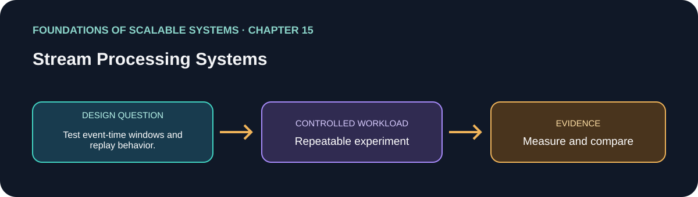

# 15. Stream Processing Systems

> Chapter guide in the *Foundations of Scalable Systems* learning track. This repository guide paraphrases topics and proposes an independent practical exercise; it does not reproduce the book.

## Goal

Turn this chapter's design question into a small, repeatable experiment. The result is a comparison with stated assumptions, not a universal technology ranking.

## Chapter focus

Stream platforms; event time; stateful windows and joins; scalability; checkpointing and data safety.

## Chapter synthesis

**Source reading: printed pages 287–300.** Original learning summary of the chapter's listed ideas; consult the book for full treatment.

Stream processing continuously computes over event flows. Platforms such as Flink provide transformations, windows, and stateful operators through models such as DataStream. Parallelism depends on partitioning and topology; event-time progress and late arrivals affect window results. Recovery uses checkpoints and replay, so data safety depends on aligning state snapshots, source positions, and sink behavior. Throughput, latency, state size, checkpoint overhead, and recovery time interact. Use stream processing for continuous aggregation, joins, or temporal analysis; a simple consumer may suffice for independent messages.

### Key takeaways

- Set event-time and late-event policies explicitly.
- Align checkpoints, source offsets, and sink effects for recovery.
- Stateful streams support temporal computation but add operational complexity.

### Coverage of chapter topics

- Streaming as continuous computation on data in motion.
- Platforms and Flink DataStream: operators, state, and execution topology.
- Scalability and data safety through partitioning, checkpoints, and recovery.

## Proposed application

- **Application / solution name:** `StatefulStreamProcessingLab`.
- **Namespace convention:** FoundationsOfScalableSystems.Chapter15
- **Independent solution folder:** solutions/15-stream-processing-systems/
- **Current state:** learning guide and experiment design; implementation is not yet present.

## Practical exercise

Build one windowed aggregation or join with replayable input; compare event time and processing time and recover from a restart.

1. Write down the operation, workload shape, data size, and correctness invariant.
2. Establish a simple baseline before adding the chapter's scaling technique.
3. Change one major design choice at a time and repeat the same workload.
4. Save raw results, environment details, versions, and the exact run command.

## What to measure

End-to-end lag, event-time lateness, throughput, state size, checkpoint duration, and replay correctness.

Report at least p50/p95/p99 latency, throughput, errors, CPU, memory, and behavior during one relevant failure. Mark any unmeasured claim as **Not measured**.

## Design review questions

- What is the bottleneck or quality attribute this design addresses?
- Which semantics must remain true under retry, restart, or partial failure?
- What new bottleneck or operational cost does the approach introduce?
- What result would make us reject this design?

## References

- Ian Gorton, *Foundations of Scalable Systems*, Chapter 15: “Stream Processing Systems” — [O’Reilly chapter page](https://www.oreilly.com/library/view/foundations-of-scalable/9781098106058/ch15.html).
- Supporting primary documentation: [official reference](https://nightlies.apache.org/flink/flink-docs-stable/docs/).
- Repository-wide chapter map and implementation order: [Scalability roadmap](../../docs/SCALABILITY-ROADMAP-EN.md).

## Naming and independence

When implementation begins, keep this application's source, infrastructure, workload, and run instructions inside this folder. The namespace above is a proposed code namespace, not a Kubernetes namespace; choose a Kubernetes namespace from the same chapter slug only when this solution gets manifests. Do not share application code with another solution.
