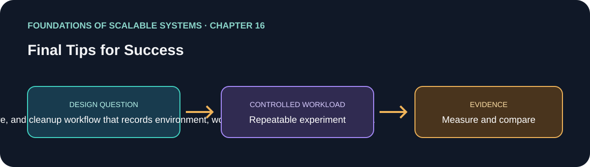

# فصل 16: توصیه‌های پایانی برای موفقیت

> راهنمای این فصل در مسیر یادگیری بر پایهٔ *Foundations of Scalable Systems*. موضوع‌ها به بیان خودمان خلاصه شده‌اند و تمرین پیشنهادی مستقل است؛ متن کتاب بازنشر نشده است.

## هدف

پرسش طراحی فصل را به آزمایشی کوچک و تکرارپذیر تبدیل کنیم. خروجی، مقایسه با فرض‌های روشن است؛ نه رتبه‌بندی همیشگی فناوری‌ها.

## محور فصل

automation؛ observability؛ پلتفرم استقرار؛ data lake؛ یادگیری تکرارپذیر و نظم عملیاتی.

## خلاصهٔ جامع فصل

**بخش متناظر در نسخهٔ PDF: صفحه‌های چاپی 303–308 (صفحه‌های PDF 321–326).** این خلاصهٔ آموزشی با بیان مستقل نوشته شده و جایگزین متن کتاب نیست.

فصل پایانی یادآوری می‌کند که ساخت سامانهٔ توزیع‌شدهٔ مقیاس‌پذیر دشوار است؛ چون اجزای زیادی با هم کار می‌کنند، هر کدام می‌توانند جداگانه از کار بیفتند و هم‌زمان بار و حجم داده تغییر می‌کند. دانستن اصول طراحی کافی نیست: تیم به روش و پلتفرمی نیاز دارد که تغییر را امن کند، رفتار سامانه را نشان دهد، ظرفیت محاسباتی قابل‌توسعه فراهم کند و دادهٔ تاریخی را نگه دارد. فناوری همواره تغییر می‌کند؛ بنابراین معماری موفق حاصل یادگیری و بازنگری مداوم است.

### ۱. خودکارسازی و DevOps

در مقیاس بالا، مهندسان باید بتوانند تغییرها، رفع اشکال‌ها و قابلیت‌های تازه را مرتب و بدون عملیات دستیِ پرخطر منتشر کنند. خودکارسازی مدیریت پیکربندی، ساخت، آزمون، استقرار و پایش فاصلهٔ بین تغییر کد و انتشار امن آن را کم می‌کند. فصل، Continuous Delivery را هستهٔ این روش می‌داند و DevOps را به مسئولیت عملیاتی تیم پیوند می‌دهد: تیمی که سرویس را می‌سازد باید ابزار و مسئولیت اجرای آن و پاسخ‌گویی به رخدادهای تولید را هم داشته باشد. خودکارسازی کار تکراری و هماهنگی اضافی را کم می‌کند و انتشار مستقل و پرتکرار را شدنی‌تر می‌سازد؛ اما جای آزمون مناسب، مسئولیت عملیاتی یا کنترل انتشار امن را نمی‌گیرد.

### ۲. مشاهده‌پذیری

با اجزای فراوان و بار متغیر، حدس و یک بررسی سادهٔ زنده‌بودن برای فهم وضعیت کافی نیست. باید از کد برنامه، سیستم‌عامل و زیرساخت‌هایی مانند پایگاه داده و سامانهٔ پیام‌رسانی دادهٔ تله‌متری تولید شود. متریک‌ها مصرف منابع، تأخیر، زمان پاسخ و توان عملیاتی را نشان می‌دهند؛ لاگ‌ها جزئیات رویدادها را برای بررسی نگه می‌دارند. جمع‌آوری داده کافی نیست: باید آن را تجمیع و در گذر زمان بررسی کرد، وضعیت کنونی را پایید و هنگام عبور از آستانه یا نزدیک‌شدن به خرابی هشدار عملیاتی فرستاد. نکتهٔ اصلی این است که اندازه‌گیری باید به آگاهی قابل‌استفاده تبدیل شود. فصل OpenTelemetry را نمونه‌ای برای ابزارگذاری و Prometheus، Grafana و Graphite را نمونه‌هایی از ابزارهای مشاهده‌پذیری معرفی می‌کند.

### ۳. پلتفرم استقرار

سرویس مقیاس‌پذیر به پلتفرم محاسباتی و داده‌ای نیاز دارد که قابل‌توسعه و قابل‌اعتماد باشد. Infrastructure as Code ساخت و پیکربندی محیط را تکرارپذیر و خودکار می‌کند. فصل ماشین مجازی را با کانتینر مقایسه می‌کند: کانتینر کد و وابستگی‌ها را در یک image قابل‌استقرار بسته‌بندی می‌کند و با اشتراک هستهٔ سیستم‌عامل میزبان، در بسیاری از workloadها از ماشین مجازی کامل کم‌هزینه‌تر است. ابزار ارکستریشن مثل Kubernetes API می‌دهد تا محل و زمان اجرای کانتینرها کنترل شود، استقرار چند نودی هماهنگ شود و تعداد اجراها با بار تغییر کند. این پلتفرم‌ها مقیاس‌دهی و عملیات خودکار را آسان می‌کنند، اما به‌تنهایی معماری مقیاس‌پذیر نمی‌سازند؛ طراحی برنامه، سقف منابع و مدیریت شکست همچنان لازم است.

### ۴. دریاچهٔ داده و دادهٔ تاریخی

سامانه‌ها در طول زمان دادهٔ زیادی تولید می‌کنند که به‌ندرت خوانده می‌شود، اما ممکن است به‌خاطر نیاز محصول، مقررات، قرارداد یا تحلیل باید در دسترس بماند. Data Lake دادهٔ تاریخی با قالب‌های گوناگون—مثل فایل خام، JSON و خروجی رابطه‌ای—را معمولاً روی object storage کم‌هزینه نگه می‌دارد و با catalog و ابزارهای query و تبدیل قابل‌کشف و تحلیل می‌کند. tierهای ذخیره‌سازی می‌توانند با کندترکردن بازیابی، هزینه را کم کنند. این نیاز با خواندن و نوشتن تراکنشی کم‌تأخیر فرق دارد: نگه‌داشتن همهٔ تاریخچه در پایگاه عملیاتی ممکن است گران یا دشوار شود، اما انتقال داده هم نیازمند تعیین lineage، retention، دسترسی و زمان مورد انتظار برای بازیابی است.

### ۵. رویکرد پایانی به طراحی

یک کتاب نمی‌تواند همهٔ جنبه‌های ساخت و ادارهٔ سامانهٔ تولیدی در مقیاس بزرگ را پوشش دهد. با تغییر نیازها، سخت‌افزار، نرم‌افزار و مدل‌های پلتفرم باید به یادگیری ادامه داد. به‌جای جست‌وجوی جواب جهان‌شمول، از شواهد و تحلیل trade-off استفاده کن؛ نویسنده برای مطالعهٔ گسترده‌تر به Site Reliability Engineering و Software Architecture: The Hard Parts ارجاع می‌دهد.

### نکته‌های کلیدی

- مسیر تغییر از commit تا ساخت، اعتبارسنجی، انتشار و بازخورد عملیاتی را خودکار کن.
- برنامه و وابستگی‌ها را ابزارگذاری کن و تله‌متری را به بررسی و هشدار قابل‌اقدام وصل کن.
- پلتفرم استقرار را بر اساس نیاز workload و عملیات انتخاب کن؛ ارکستریشن جای طراحی درست را نمی‌گیرد.
- اگر تاریخچه به‌ندرت خوانده می‌شود، آن را در بستر تحلیلی/آرشیویِ دارای حاکمیت مناسب نگه دار، نه لزوماً در پایگاه تراکنشی.
- معماری را یک فرضیه بدان: اندازه‌گیری کن، از بار و شکست یاد بگیر و با تغییر شرایط بازنگری کن.

## طرح‌های اجرایی قابل‌پیاده‌سازی

این گزینه‌ها جایگزین یا مکمل یکدیگرند. با ساده‌ترین گزینه‌ای شروع کن که workload و محدودیت‌های عملیات را برآورده می‌کند.

### الف) آزمایشگاه تک‌ماشینه

یک API و worker کانتینری، PostgreSQL، Redis و Kafka را با Compose یا kind اجرا کن. اسکریپت build/deploy/cleanup، مولد بار تکرارپذیر و داشبورد Prometheus/Grafana اضافه کن. پیکربندی هر اجرا و نتیجهٔ خام را ذخیره کن. این مسیر کم‌هزینه کمک می‌کند ابزارگذاری، گلوگاه و رفتار مقیاس‌دهی پایه را پیش از افزودن زیرساخت توزیع‌شده بسنجی.

### ب) بستر سرویس‌های Kubernetes

هر سرویس مستقل را به‌صورت image بسته‌بندی کن؛ سرویس‌های بدون state را با Deployment و Service اجرا کن، resource request/limit و probe تعریف کن و در صورت تناسب از HPA یا KEDA مبتنی بر lag صف استفاده کن. زیرساخت را به‌شکل کد نگه دار و CI را برای اعتبارسنجی، انتشار مرحله‌ای، بررسی سلامت و rollback تنظیم کن. تله‌متری برنامه و کلاستر را مرکزی جمع کن. این گزینه برای تیمی مناسب است که عملیات چند سرویس و کشش‌پذیری لازم دارد و دانش و ظرفیت ادارهٔ Kubernetes را نیز دارد.

### پ) پلتفرم ابری مدیریت‌شده

API بدون state را روی بستر کانتینری مدیریت‌شده یا serverless اجرا کن و در صورت تناسب تضمین‌ها از پایگاه رابطه‌ای، cache و messaging مدیریت‌شده استفاده کن. ساخت زیرساخت و انتشار را خودکار کن، تله‌متری برنامه را از لایهٔ ابزارگذاری مستقل از ارائه‌دهنده عبور بده و هشدارهای عملیاتی تنظیم کن. داده‌های قدیمی یا خروجی رویدادها را با سیاست نگهداری، catalog، کنترل دسترسی و ابزار query به object storage منتقل کن. نگهداری پلتفرم کمتر می‌شود، اما محدودیت ارائه‌دهنده و هزینهٔ سرویس‌ها باید سنجیده شود.

### ت) معماری ترکیبی تراکنشی و دادهٔ تاریخی

وضعیت جاری تراکنش را در پایگاه داده‌ای نگه دار که با نیاز consistency و query سازگار است. رویدادهای دامنه را از طریق outbox یا تحویل مطمئن مشابه به object storage، با قالب نسخه‌دار و partition‌بندی‌شده، انتقال بده و در catalog ثبت کن. query تحلیلی را به‌جای پایگاه اصلی از مخزن تاریخی پاسخ بده. پیش از تولید، retention، حذف داده، حریم خصوصی، replay، تغییر schema و reconciliation را تعریف کن. این معماری برای تحلیل بلندمدت و نگهداری کم‌هزینه مناسب است، اما نگهداری pipeline و تأخیر تازه‌شدن داده را اضافه می‌کند.

## ترتیب پیشنهادی پیاده‌سازی

۱. workload، SLO، invariantهای صحت، الزام نگهداری داده و سقف هزینه را بنویس.
۲. baseline بگیر و پیش از انتخاب پلتفرم گلوگاه را با داده پیدا کن.
۳. تله‌متری و سناریوی ثابت بار/شکست بساز تا اجراها قابل‌مقایسه شوند.
۴. build، اعتبارسنجی، استقرار، rollback و پاک‌سازی را خودکار کن؛ بعد در هر مرحله فقط یک تغییر مقیاس‌دهی یا ذخیره‌سازی اعمال کن.
۵. بازیابی، کار تکراری یا replayشده، مفیدبودن هشدار، نگهداری/حذف داده و هزینه را زیر بار نماینده بررسی کن.
۶. نتیجهٔ اندازه‌گیری‌شده و موارد تأییدنشده را ثبت و با تغییر شرایط، طراحی را بازبینی کن.

## برنامهٔ application پیشنهادی

- **نام application / راه‌حل:** `ScalabilityEvidenceKit`.
- **الگوی namespace کد:** FoundationsOfScalableSystems.Chapter16
- **پوشهٔ مستقل راه‌حل:** solutions/16-final-tips-for-success/
- **وضعیت فعلی:** راهنمای یادگیری و طرح آزمایش؛ پیاده‌سازی کد هنوز اضافه نشده است.

## تمرین عملی

یک «جعبهٔ شواهد» کوچک بساز که یک سرویس را deploy کند، بار ثابتی اجرا کند، متریک و log بگیرد و محیط را پاک‌سازی کند. اجرای دوم، دادهٔ مصنوعی قدیمی را به object storage صادر و جدا از پایگاه تراکنشی query کند. تکرارپذیری، کار عملیاتی، latency، فرض‌های هزینهٔ ذخیره‌سازی و رفتار بازیابی را مقایسه کن. workload و بررسی صحت را بین دو اجرا ثابت نگه دار.

## چه چیزهایی را اندازه بگیریم

Reproducibility, telemetry coverage, time to detect/recover, cleanup completeness, and evidence quality.

حداقل p50/p95/p99 latency، throughput، خطا، CPU، حافظه و رفتار هنگام یک شکست مرتبط را گزارش کنیم. ادعای اندازه‌گیری‌نشده را با وضعیت **اندازه‌گیری نشده** مشخص کنیم.

## پرسش‌های بازبینی طراحی

- این طراحی کدام گلوگاه یا ویژگی کیفی را هدف می‌گیرد؟
- هنگام retry، restart یا شکست جزئی کدام معناها باید حفظ شوند؟
- چه گلوگاه یا هزینهٔ عملیاتی تازه‌ای ایجاد می‌شود؟
- چه نتیجه‌ای باعث رد کردن این طراحی می‌شود؟

## رفرنس‌ها

- Ian Gorton، *Foundations of Scalable Systems*، فصل 16: “Final Tips for Success” — [صفحهٔ فصل در O’Reilly](https://www.oreilly.com/library/view/foundations-of-scalable/9781098106058/ch16.html).
- مستندات فنی اولیه: [مرجع رسمی](https://prometheus.io/docs/introduction/overview/).
- نقشهٔ فصل‌ها و ترتیب پیاده‌سازی مخزن: [نقشهٔ راه فارسی](../../docs/SCALABILITY-ROADMAP-FA.md).

## نام‌گذاری و استقلال

هنگام شروع پیاده‌سازی، کد، زیرساخت، workload و راهنمای اجرا را داخل همین پوشه نگه داریم. namespace بالا پیشنهاد برای namespace کد است، نه Kubernetes؛ namespace کوبرنتیز را از همان slug فصل انتخاب می‌کنیم وقتی manifestهای این راه‌حل اضافه شدند. کد application را با راه‌حل دیگر مشترک نکنیم.

