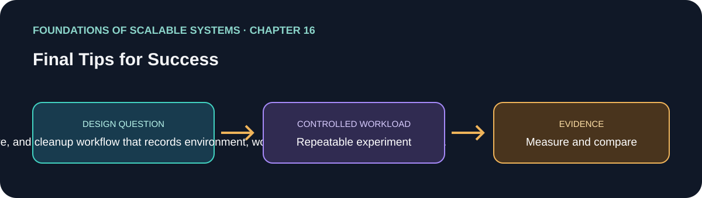

# 16. Final Tips for Success

> Chapter guide in the *Foundations of Scalable Systems* learning track. This repository guide paraphrases topics and proposes an independent practical exercise; it does not reproduce the book.

## Goal

Turn this chapter's design question into a small, repeatable experiment. The result is a comparison with stated assumptions, not a universal technology ranking.

## Chapter focus

Automation; observability; deployment platforms; data lakes; repeatable learning and operational discipline.

## Chapter synthesis

**Source reading: printed pages 303–308 (PDF pages 321–326).** This is an original, topic-complete learning summary of the chapter, not a replacement for the book.

The chapter closes by stressing that scalable distributed systems are difficult because many independently failing components must cooperate under changing load and growing data. Design knowledge alone is insufficient: teams also need practices and platforms that make change safe, expose system behavior, provide elastic compute, and retain useful history. The surrounding technology keeps changing, so successful architecture is an ongoing process of learning and revisiting decisions.

### 1. Automation and DevOps

At scale, engineers need to deliver frequent fixes and features across complex systems without making every change a manual, risky operation. Automating configuration management, build, tests, deployment, and monitoring shortens the path from a code change to a safely released change. Continuous delivery is the core delivery practice described here. The chapter also links DevOps to operational responsibility: teams that own services need the means and responsibility to deploy and operate them, including responding to production incidents. Automation reduces repetitive coordination and makes independent, frequent releases practical; it does not remove the need for good tests, operational ownership, or safe release controls.

### 2. Observability

Many moving parts and variable loads make intuition and isolated health checks inadequate. Instrumentation should emit telemetry from application code, operating systems, and foundational services such as databases and messaging. Metrics can describe resource use, latency, response time, and throughput; logs preserve event details useful for diagnosis. Collection alone is not enough: data must be aggregated and explored over time, current conditions monitored, and actionable alerts raised for actual or emerging failures. The chapter's key operational point is to turn measurements into situational awareness. OpenTelemetry is one instrumentation option, and Prometheus, Grafana, and Graphite are examples of observability tools mentioned in the book.

### 3. Deployment platforms

Scalable services need compute and data platforms that can be provisioned elastically and reliably. Infrastructure as code makes provisioning repeatable and automatable. The chapter contrasts virtual machines with containers: containers package an application and dependencies into a deployable image and, by sharing the host operating system, can use resources more efficiently than full virtual machines for many workloads. Orchestrators such as Kubernetes provide APIs to control where and when containers run, coordinate multi-node deployments, and automate responses to varying demand. These platforms enable scaling and operational automation, but they do not make a workload scalable by themselves; application design, resource limits, and failure handling still matter.

### 4. Data lakes and historical data

Systems accumulate data that is rarely accessed but may need to remain available for product, legal, contractual, or analytical reasons. A data lake organizes historical data in heterogeneous formats—such as objects, JSON, and relational extracts—typically on comparatively low-cost object storage, with catalogs and query/transform tools that make it discoverable and useful. Storage tiers can trade retrieval speed for cost. This is a different concern from serving low-latency transactional reads and writes: keeping all history in the primary transactional database can be expensive and operationally awkward, while exporting it requires attention to lineage, retention, access, and retrieval expectations.

### 5. Closing design posture

The chapter is a reminder that one book cannot cover every ingredient of production-scale operation. Continue learning as requirements, hardware, software, and platform models change. Use evidence and trade-off analysis rather than searching for universally correct choices; the author points readers to Site Reliability Engineering and Software Architecture: The Hard Parts for broader operational and design practice.

### Key takeaways

- Automate the path from change through build, verification, release, and operational feedback.
- Instrument the application and its dependencies; connect telemetry to exploration and actionable alerts.
- Choose a deployment platform for workload and operational needs; orchestration is an enabler, not a substitute for sound design.
- Move infrequently accessed history to an appropriately governed analytical/archive platform when transactional storage is not the right fit.
- Treat architecture as a hypothesis: measure it, learn from failures and load, and update it as conditions change.

## Implementable solution designs

These are alternatives and can be combined. Begin with the smallest one that meets the workload and operational constraints.

### A. Single-node learning lab

Use a containerized API and worker, PostgreSQL, Redis, and Kafka in a local Compose or kind environment. Add a scripted build/deploy/cleanup workflow, a repeatable load generator, and Prometheus/Grafana dashboards. Store each run's configuration and raw results. This is the cheapest way to validate instrumentation, bottlenecks, and basic scaling behavior before adding distributed infrastructure.

### B. Kubernetes service platform

Package each independently deployable service as an image; deploy stateless services with Kubernetes Deployments and Services, configure resource requests/limits and probes, and use HPA or queue-lag-based KEDA scaling where the signal matches the workload. Manage infrastructure as code and use a CI pipeline with validation, staged rollout, health checks, and rollback. Collect service and cluster telemetry centrally. This suits teams that need elastic multi-service operation and already have Kubernetes skills and capacity to operate it.

### C. Managed cloud platform

Run stateless APIs on a managed container or serverless platform; use managed relational/cache/messaging services where their guarantees fit. Automate infrastructure and releases, emit application telemetry to the provider-neutral instrumentation layer, and set actionable service-level alerts. Archive aged records or event exports to object storage with cataloging, retention, access controls, and a query engine. This reduces platform maintenance, at the cost of provider constraints and ongoing service charges.

### D. Hybrid transactional and historical-data architecture

Keep current transactional state in a database selected for its consistency and query needs. Publish durable domain events through an outbox or equivalent reliable handoff; consume them into object storage in partitioned, versioned formats and register them in a catalog. Run analytical queries against the historical store rather than overloading the primary database. Define retention, deletion, privacy, replay, schema evolution, and reconciliation procedures before production use. This works when long-term analysis and low-cost retention matter, but introduces data-pipeline operations and freshness lag.

## Suggested implementation sequence

1. Define workload, SLOs, correctness invariants, retention obligations, and cost limits.
2. Capture a baseline and identify the measured bottleneck before selecting a platform.
3. Add telemetry and a repeatable load/failure scenario; make results comparable between runs.
4. Automate build, validation, deployment, rollback, and cleanup; then introduce one scaling or storage change at a time.
5. Verify recovery, duplicate/replayed work, alert usefulness, data retention/deletion, and cost under representative load.
6. Record what was measured and what remains unverified; revisit the design when workload or constraints change.

## Proposed application

- **Application / solution name:** `ScalabilityEvidenceKit`.
- **Namespace convention:** FoundationsOfScalableSystems.Chapter16
- **Independent solution folder:** solutions/16-final-tips-for-success/
- **Current state:** learning guide and experiment design; implementation is not yet present.

## Practical exercise

Build a small “evidence kit” that deploys one service, generates a fixed workload, captures metrics and logs, and cleans up. Add a second run that exports aged synthetic records into object storage and queries them separately from the transactional database. Compare reproducibility, operational effort, latency, storage cost assumptions, and retrieval behavior. Keep the workload and correctness checks constant between runs.

## What to measure

Reproducibility, telemetry coverage, time to detect/recover, cleanup completeness, and evidence quality.

Report at least p50/p95/p99 latency, throughput, errors, CPU, memory, and behavior during one relevant failure. Mark any unmeasured claim as **Not measured**.

## Design review questions

- What is the bottleneck or quality attribute this design addresses?
- Which semantics must remain true under retry, restart, or partial failure?
- What new bottleneck or operational cost does the approach introduce?
- What result would make us reject this design?

## References

- Ian Gorton, *Foundations of Scalable Systems*, Chapter 16: “Final Tips for Success” — [O’Reilly chapter page](https://www.oreilly.com/library/view/foundations-of-scalable/9781098106058/ch16.html).
- Supporting primary documentation: [official reference](https://prometheus.io/docs/introduction/overview/).
- Repository-wide chapter map and implementation order: [Scalability roadmap](../../docs/SCALABILITY-ROADMAP-EN.md).

## Naming and independence

When implementation begins, keep this application's source, infrastructure, workload, and run instructions inside this folder. The namespace above is a proposed code namespace, not a Kubernetes namespace; choose a Kubernetes namespace from the same chapter slug only when this solution gets manifests. Do not share application code with another solution.
